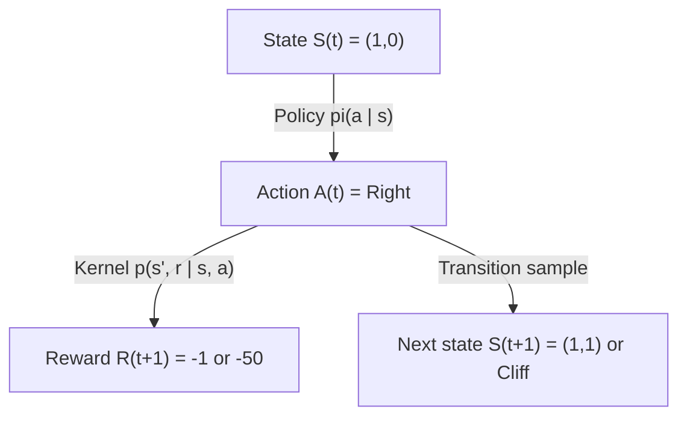

---
{
  "id": "introduction-to-reinforcement-learning-fundamentals",
  "title": "Reinforcement Learning Basics",
  "slug": "introduction-to-reinforcement-learning-fundamentals",
  "section": "ML Algorithms & Evaluation",
  "category": "Model Architecture",
  "difficulty": "Medium",
  "order": 4,
  "coverImage": "illustrations/_generated/chapter_flow_dark.png",
  "companies": [
    "OpenAI",
    "Anthropic",
    "Google",
    "DeepMind"
  ],
  "shortDescription": "Formulate a 3x4 cliff gridworld as a Markov decision process, solve Bellman equations with NumPy dynamic programming, compare Q-learning against SARSA, and derive REINFORCE policy gradients.",
  "keyConceptsTested": [
    "Markov decision process",
    "Bellman optimality and expectation equations",
    "value iteration and policy iteration",
    "Q-learning vs SARSA",
    "termination vs truncation",
    "exploration and action coverage",
    "reward hacking and discount factor",
    "policy gradients and REINFORCE",
    "importance sampling and offline evaluation"
  ]
}
---

A rover needs to reach a beacon across a canyon. The short route runs beside a cliff; a longer route climbs onto a ridge first. On firm ground, the shortcut looks attractive. Add a gust of wind, and taking the long way can become the better decision.

Put that problem on a three-row, four-column grid. The rover starts at `(1,0)`, and the beacon is at `(2,3)`. The other three cells in the bottom row are cliff cells. Moving into the beacon earns `+20` and ends the trip; entering a cliff cell earns `-50` and ends it. Every other move costs `1` point, including a move into an outer wall that leaves the rover in place. We will keep this same map while discovering how to plan a route, learn one from experience, and improve the probabilities of its individual moves.

The tree classifiers in the previous lesson learned from examples with known target labels. Here we can let the rover try an action and observe its consequences. A move changes where the rover goes next, what it can learn there, and which rewards it will eventually receive. <span data-glossary="reinforcement-learning">Reinforcement learning</span> turns that experience into a **policy**, a rule for choosing actions in each state.[^sutton2018]

<figure>
  
  <figcaption>Both routes reach the same beacon. The four-move shortcut passes beside the cliff; the six-move ridge route buys distance from it.</figcaption>
</figure>

## Sequential episodes and discounted return

One trip from start to either the beacon or a cliff is an **episode**. With no wind, the shortcut is `Right, Right, Right, Down`, producing rewards `[-1, -1, -1, +20]`. Their sum is `17`. The ridge route takes two extra steps, so its sum is `15`. Looking only at the first reward cannot distinguish them: both begin by paying `-1` to move.

The **return** combines the rewards along the rest of a trip. We will discount future rewards by multiplying by `0.90` for each additional step away. A reward on the next move counts in full, the following reward counts at 90%, and the next at 81%. This is like tracing the value of the beacon backward through the route: each intervening move reduces that value and adds its own cost. Written for a general time step $t$, the return is:[^sutton2018]

$$
G_t = R_{t+1} + \gamma R_{t+2} + \gamma^2 R_{t+3} + \dots + \gamma^{T-t-1} R_T = \sum_{k=0}^{T-t-1} \gamma^k R_{t+1+k}, \qquad \gamma \in [0, 1).
$$

Here $R_{t+1}$ is the reward after the current action, $T$ is the episode's final step, and $\gamma$ is the **discount factor**. With $\gamma=0$, the rover compares immediate rewards only; from the start, several moves tie at `-1`, and the distant beacon provides no preference between them. Larger values of $\gamma$ give later rewards more weight. Finite episodes can also use $\gamma=1$, giving the ordinary reward sum.

For our choice $\gamma=0.90$, the shortcut gives $G_0 = -1 - 0.9 - 0.81 + 0.729(20) = 11.87$. The ridge route gives $7.7147$. This NumPy calculation pairs every reward with its own power of the discount:

<!-- leetllm: test, deps=numpy, output=show -->
```python title="compare-trajectory-returns.py"
import numpy as np

gamma = 0.90
cliff_edge_rewards = np.array([-1.0, -1.0, -1.0, 20.0])
safe_ridge_rewards = np.array([-1.0, -1.0, -1.0, -1.0, -1.0, 20.0])

def discounted_return(rewards: np.ndarray, discount: float) -> float:
    powers = discount ** np.arange(len(rewards))
    return float(np.dot(rewards, powers))

print(f"cliff-edge 4-step return: {discounted_return(cliff_edge_rewards, gamma):.4f}")
print(f"safe-ridge 6-step return: {discounted_return(safe_ridge_rewards, gamma):.4f}")
```

<!-- leetllm: output:start -->
```text title="Output" output compact
cliff-edge 4-step return: 11.8700
safe-ridge 6-step return: 7.7147
```
<!-- leetllm: output:end -->

The shortcut leads by about `4.16` points on firm ground. That calculation describes a particular sequence of moves. To choose well when a move can land in several places, the rover also needs to account for how likely each outcome is.

## Markov decision processes and environment dynamics

Imagine the rover at `(1,1)` choosing `Right`. On firm ground it reaches `(1,2)` and receives `-1`. In wind, let the intended move happen 80% of the time, with a 10% chance of moving in either perpendicular direction. The same action can now lead right to `(1,2)`, up to `(0,1)`, or down into the cliff at `(2,1)`. The rover chooses an action; the environment determines the resulting state and reward.

A <span data-glossary="markov-decision-process">Markov decision process (MDP)</span> collects these ingredients: states $\mathcal{S}$, actions $\mathcal{A}$, transition probabilities $P$, rewards $R$, and discount $\gamma$. Our twelve cells are the states, and `Up`, `Right`, `Down`, and `Left` are the actions. A policy $\pi(a\mid s)$ assigns probabilities to those actions in state $s$. A deterministic policy puts all its probability on one move. The joint transition probability $p(s',r\mid s,a)$ describes the chance of arriving at state $s'$ with reward $r$ after choosing $a$.[^sutton2018]



The **Markov property** says the current state contains the information needed to predict the next step. In our map, coordinates suffice because the wind probabilities are the same on every visit. A rover at `(1,1)` faces the same next-step possibilities whether it arrived from the left or above. Formally:

$$
P(S_{t+1}=s', R_{t+1}=r \mid S_t, A_t, S_{t-1}, A_{t-1}, \dots, S_0, A_0) = P(S_{t+1}=s', R_{t+1}=r \mid S_t, A_t).
$$

If momentum also affected slipping, we would add velocity to the state. That makes state design practical: include what changes the consequences of an action. The cliff and beacon are terminal states. Their entry rewards have already been paid, so their remaining value is zero.

```checkpoint
Suppose the rover's tire temperature affects whether it slips at cell `(1,1)`, yet temperature is omitted from the state vector `S_t`. Which MDP assumption fails?
---
The Markov property fails because the true transition probabilities depend on past heating history not captured in `S_t`. Augmenting `S_t` with tire temperature restores Markovian dynamics so optimal decisions depend only on the current state.
```

The following code builds `probs[s, a, next_s]`, the probability of each landing cell, and `exp_r[s, a]`, the immediate reward averaged across those landings. We flatten `(row, col)` to `row * 4 + col` so NumPy can store the map in arrays. Probabilities for branches that hit the same cell add together, including moves that bump into a wall.

<!-- leetllm: test, deps=numpy, output=show -->
```python title="gridworld-mdp.py"
import numpy as np

ROWS, COLS = 3, 4
N_STATES, N_ACTIONS = ROWS * COLS, 4
ACTIONS = ("Up", "Right", "Down", "Left")
DELTAS = ((-1, 0), (0, 1), (1, 0), (0, -1))
START, GOAL = (1, 0), (2, 3)
CLIFFS = {(2, 0), (2, 1), (2, 2)}
TERMINALS = CLIFFS | {GOAL}
GAMMA = 0.90

def sid(r: int, c: int) -> int:
    return r * COLS + c

def build_mdp(slip: float = 0.0):
    probs = np.zeros((N_STATES, N_ACTIONS, N_STATES))
    exp_r = np.zeros((N_STATES, N_ACTIONS))
    for r in range(ROWS):
        for c in range(COLS):
            s = sid(r, c)
            if (r, c) in TERMINALS:
                probs[s, :, s] = 1.0
                continue
            for a in range(N_ACTIONS):
                branches = [(1.0 - slip, a), (slip / 2, (a - 1) % 4), (slip / 2, (a + 1) % 4)]
                for p, move in branches:
                    if p == 0.0:
                        continue
                    dr, dc = DELTAS[move]
                    nr, nc = min(max(r + dr, 0), ROWS - 1), min(max(c + dc, 0), COLS - 1)
                    ns = sid(nr, nc)
                    reward = -50.0 if (nr, nc) in CLIFFS else (20.0 if (nr, nc) == GOAL else -1.0)
                    probs[s, a, ns] += p
                    exp_r[s, a] += p * reward
    return probs, exp_r

probs_det, exp_r_det = build_mdp(slip=0.0)
probs_slip, exp_r_slip = build_mdp(slip=0.20)
s11 = sid(1, 1)
print("Deterministic R((1,1), a):", np.round(exp_r_det[s11], 2).tolist())
print("Slip=0.20     R((1,1), a):", np.round(exp_r_slip[s11], 2).tolist())
```

<!-- leetllm: output:start -->
```text title="Output" output compact
Deterministic R((1,1), a): [-1.0, -1.0, -50.0, -1.0]
Slip=0.20     R((1,1), a): [-1.0, -5.9, -40.2, -5.9]
```
<!-- leetllm: output:end -->

Examine the expected immediate reward for choosing `Right` at `(1,1)` under `slip=0.20`: `0.80(-1) + 0.10(-1) + 0.10(-50) = -5.90`. Just a 10% perpendicular slip into the cliff pulls the single-step reward of `Right` nearly five points below `Up`. Adding discounted future continuation values turns that immediate risk into a complete policy reversal.

## Bellman expectation and optimality equations

Start one move from the beacon, at `(1,3)`. Moving `Down` earns `20` immediately, so that action is worth `20`. At `(1,2)`, moving `Right` costs `1` and takes us to that valuable cell. Its return is therefore `-1 + 0.9(20) = 17`. One cell farther left, it is `-1 + 0.9(17) = 14.3`. The entire future can be summarized by the value of the next state.

This backward chain is a **Bellman backup**. Think of each cell as a signpost carrying the return available from there. A neighboring cell reads that signpost, discounts its number, and adds the cost of getting there. The number can travel backward across the map even though the rover travels forward.

For a fixed policy $\pi$, the **state value** $V^\pi(s)$ is its expected return starting in $s$. The **action value** $Q^\pi(s,a)$ fixes the first action to $a$ and then follows $\pi$. The identity $G_t=R_{t+1}+\gamma G_{t+1}$ gives the <span data-glossary="bellman-equation">Bellman expectation equation</span>:[^sutton2018]

$$
V^\pi(s) = \sum_a \pi(a\mid s)\left[R(s,a)+\gamma\sum_{s'}P(s'\mid s,a)V^\pi(s')\right].
$$

The inner sum averages over possible landing cells. The outer sum averages over the actions our policy chooses. Here $R(s,a)$ means expected immediate reward, exactly the `exp_r` array above. To find the best policy, compare actions instead of averaging them. A star marks the optimal value:

$$
Q^*(s,a)=R(s,a)+\gamma\sum_{s'}P(s'\mid s,a)V^*(s'),
\qquad V^*(s)=\max_a Q^*(s,a).
$$

Consider cliff-edge state `(1,1)` under both transition regimes. When `slip=0.0`, the optimal value immediately east is $V^*(1,2) = 17.0$ (one step cost `-1` plus `0.90 * 20.0`), so moving `Right` yields $Q^*((1,1), \text{Right}) = -1 + 0.90(17.0) = 14.30$, outscoring `Up` and `Left` (`9.68`) and avoiding `Down` (`-50.0`). When `slip=0.20`, however, optimal continuation values adjust across the entire upper half of the grid (`V*(1,2) = 9.34`, `V*(0,1) = 8.455`, and terminal cliff cells `0.0`), splitting `Right` across three branches:

$$
Q^*((1,1), \text{Right}) = 0.80\bigl(-1 + 0.90 \cdot 9.340\bigr) + 0.10\bigl(-1 + 0.90 \cdot 8.455\bigr) + 0.10(-50) \approx 1.59.
$$

Meanwhile, stepping `Up` into `(0,1)` keeps both perpendicular slips horizontal without risking `(2,1)`, earning $Q^*((1,1), \text{Up}) \approx 6.31$. One risky action value plunges by `12.71` points, flipping greedy control from the cliff shortcut to the upper ridge.

## Solving known MDPs with dynamic programming

We computed a backup using neighboring values, but where do those values come from? **Value iteration** begins with zeros everywhere and repeatedly updates the whole map. On the first sweep, only immediate rewards are visible: `(1,3)` discovers the beacon's `20`, while most other cells see `-1`. On the second sweep, `(1,2)` reads the previous sweep's `20` and becomes `17`. The third brings `14.3` to `(1,1)`, and the fourth brings `11.87` to the start. Each sweep extends the planning horizon by one move.

<figure>
  
  <figcaption>The beacon's reward reaches the start after four synchronous sweeps. Each predecessor computes its own step cost plus the discounted value available one move ahead.</figcaption>
</figure>

**Policy iteration** asks the same question in a different order. First choose a complete rule, such as moving toward the ridge. Evaluate that rule until its values are settled, then replace each move with the action that looks best according to those values. Repeating evaluation and improvement gives an optimal policy. For a fixed policy, the Bellman equations form a linear system, $(I-\gamma P^\pi)V^\pi=R^\pi$, which NumPy can solve directly.

Both methods below use the known transition model. `probs @ v` computes the expected next-state value for every state-action pair. Adding immediate rewards gives `q`, and taking its largest entry along the action axis gives the next value estimate. We solve both the firm-ground map and the windy map, then print their preferred moves.

<!-- leetllm: test, deps=numpy, output=show -->
```python title="dp-value-and-policy-iteration.py"
import numpy as np

ROWS, COLS = 3, 4
N_STATES, N_ACTIONS = 12, 4
ARROWS = ("^", ">", "v", "<")
DELTAS = ((-1, 0), (0, 1), (1, 0), (0, -1))
GOAL, CLIFFS = (2, 3), {(2, 0), (2, 1), (2, 2)}
TERMINALS = CLIFFS | {GOAL}
GAMMA = 0.90

def build_mdp(slip: float):
    probs = np.zeros((N_STATES, N_ACTIONS, N_STATES))
    exp_r = np.zeros((N_STATES, N_ACTIONS))
    for r in range(ROWS):
        for c in range(COLS):
            s = r * COLS + c
            if (r, c) in TERMINALS:
                probs[s, :, s] = 1.0
                continue
            for a in range(N_ACTIONS):
                for p, mv in ((1 - slip, a), (slip / 2, (a - 1) % 4), (slip / 2, (a + 1) % 4)):
                    dr, dc = DELTAS[mv]
                    nr, nc = min(max(r + dr, 0), 2), min(max(c + dc, 0), 3)
                    ns = nr * COLS + nc
                    rew = -50.0 if (nr, nc) in CLIFFS else (20.0 if (nr, nc) == GOAL else -1.0)
                    probs[s, a, ns] += p
                    exp_r[s, a] += p * rew
    return probs, exp_r

def value_iteration(probs, exp_r, tol=1e-9):
    v = np.zeros(N_STATES)
    for _ in range(500):
        q = exp_r + GAMMA * (probs @ v)
        new_v = q.max(axis=1)
        for tr, tc in TERMINALS:
            new_v[tr * COLS + tc] = 0.0
        if np.max(np.abs(new_v - v)) < tol:
            v = new_v
            break
        v = new_v
    q = exp_r + GAMMA * (probs @ v)
    return v, q

def policy_iteration(probs, exp_r):
    pi = np.zeros(N_STATES, dtype=int)
    for step in range(1, 50):
        idx = np.arange(N_STATES)
        p_pi, r_pi = probs[idx, pi], exp_r[idx, pi].copy()
        for tr, tc in TERMINALS:
            ts = tr * COLS + tc
            p_pi[ts] = 0.0
            r_pi[ts] = 0.0
        v = np.linalg.solve(np.eye(N_STATES) - GAMMA * p_pi, r_pi)
        q = exp_r + GAMMA * (probs @ v)
        new_pi = q.argmax(axis=1)
        for tr, tc in TERMINALS:
            new_pi[tr * COLS + tc] = 0
        if np.array_equal(new_pi, pi):
            return step, v
        pi = new_pi
    raise RuntimeError("Policy iteration did not converge")

for slip in (0.0, 0.20):
    probs, exp_r = build_mdp(slip)
    v, q = value_iteration(probs, exp_r)
    icons = [ARROWS[q[s].argmax()] for s in range(N_STATES)]
    for tr, tc in CLIFFS:
        icons[tr * COLS + tc] = "X"
    icons[GOAL[0] * COLS + GOAL[1]] = "G"
    print(f"slip={slip:.2f} V*(1,0)={v[4]:.3f}, Q*((1,1), a)={np.round(q[5], 3).tolist()}")
    print("  policy row0:", icons[0:4], "row1:", icons[4:8])

pi_steps, pi_v = policy_iteration(*build_mdp(0.20))
print(f"policy iteration converged in {pi_steps} steps, V*(1,0)={pi_v[4]:.3f}")
```

<!-- leetllm: output:start -->
```text title="Output" output compact
slip=0.00 V*(1,0)=11.870, Q*((1,1), a)=[9.683, 14.3, -50.0, 9.683]
  policy row0: ['>', '>', '>', 'v'] row1: ['>', '>', '>', 'v']
slip=0.20 V*(1,0)=4.284, Q*((1,1), a)=[6.314, 1.586, -38.974, -2.054]
  policy row0: ['>', '>', '>', 'v'] row1: ['^', '^', '^', 'v']
policy iteration converged in 4 steps, V*(1,0)=4.284
```
<!-- leetllm: output:end -->

The three cells immediately above the cliff switch from `Right` to `Up` in wind. Once on the ridge, the rover moves right and descends at the far end. Policy iteration finds the same optimal start value, `4.284`, in four improvement rounds.

There is a useful reason value iteration settles down: a discrepancy in a neighbor's value is multiplied by `0.9` before reaching the current cell. Averaging outcomes and taking the best action cannot amplify the largest discrepancy. Repeated backups therefore shrink the maximum error by at least this factor, which is the contraction argument for convergence in a finite discounted MDP.[^sutton2018]

We can also evaluate a policy by letting it walk. The next experiment runs 5,000 episodes for each route in the windy environment, accumulating discounted rewards and counting falls. The ridge policy moves `Up` whenever the rover drifts back beside the cliff, so it includes recovery decisions as well as its intended path.

<!-- leetllm: test, deps=numpy, output=show -->
```python title="monte-carlo-policy-eval.py"
import numpy as np

DELTAS = ((-1, 0), (0, 1), (1, 0), (0, -1))
CLIFFS = {(2, 0), (2, 1), (2, 2)}
GOAL = (2, 3)

def simulate(policy_grid, slip=0.20, episodes=5000, seed=42):
    rng = np.random.default_rng(seed)
    returns = np.empty(episodes)
    cliffs = 0
    for ep in range(episodes):
        r, c = 1, 0
        disc, total = 1.0, 0.0
        for _ in range(100):
            a = policy_grid[r, c]
            u = rng.random()
            move = a if u < 1 - slip else ((a - 1) % 4 if u < 1 - slip / 2 else (a + 1) % 4)
            dr, dc = DELTAS[move]
            r, c = min(max(r + dr, 0), 2), min(max(c + dc, 0), 3)
            rew = -50.0 if (r, c) in CLIFFS else (20.0 if (r, c) == GOAL else -1.0)
            total += disc * rew
            disc *= 0.90
            if (r, c) in CLIFFS:
                cliffs += 1
                break
            if (r, c) == GOAL:
                break
        returns[ep] = total
    return float(returns.mean()), cliffs / episodes

cliff_path = np.array([[1, 1, 1, 2], [1, 1, 1, 2], [0, 0, 0, 0]])
safe_path = np.array([[1, 1, 1, 2], [0, 0, 0, 2], [0, 0, 0, 0]])
for label, pol in (("cliff-edge", cliff_path), ("safe-ridge", safe_path)):
    mean_ret, fall_rate = simulate(pol)
    print(f"{label}: mean return={mean_ret:6.3f}, cliff rate={fall_rate:.3f}")
```

<!-- leetllm: output:start -->
```text title="Output" output compact
cliff-edge: mean return=-4.988, cliff rate=0.262
safe-ridge: mean return= 4.313, cliff rate=0.000
```
<!-- leetllm: output:end -->

In this run, the cliff-edge policy falls on `26.2%` of trips and averages `-4.988`. The ridge policy averages `4.313`, close to its calculated expectation of `4.284`, and never falls. In fact, its chosen actions cannot enter a cliff under this particular perpendicular-slip model: beside the cliff it selects `Up`, whose slips go left or right. This explains the zero fall count rather than treating it as luck. Averaging complete sampled returns is **Monte Carlo policy evaluation**. With more episodes, its estimate becomes more precise.

## Model-free control: Q-learning versus SARSA

Now hide the map's transition probabilities. Let the rover see only what happens when it moves: a state, an action, a reward, and a next state. It can still improve a table of action values. Suppose moving `Right` from `(1,1)` costs `1`, and the best current estimate at the next cell is `17`. That experience suggests a target of `-1 + 0.9(17) = 14.3`. If the current table entry is `10`, moving halfway toward the target gives `10 + 0.5(14.3 - 10) = 12.15`.

This is **temporal-difference (TD)** learning: the difference between the old estimate and a new one-step target supplies the correction. The step size $\alpha$ controls how far the correction moves the estimate. Using an estimated future value inside the target is called *bootstrapping*. It lets the rover learn before a whole trip finishes.[^sutton2018][^watkins1992qlearning]

The rover also needs to try moves it has not learned about yet. An **<span data-glossary="epsilon-greedy">$\epsilon$-greedy</span>** policy chooses a uniform random action with probability $\epsilon$ and its best current action otherwise. At $\epsilon=0.20$, four out of five choices exploit the table, while one out of five explores. With four actions, the best action also wins one quarter of the exploratory draws, so its total probability is `0.80 + 0.20/4 = 0.85`.

Two learning rules differ in which future they put into the target:

- **<span data-glossary="q-learning">Q-learning</span> (<span data-glossary="off-policy">off-policy</span>):** updates $Q(S_t, A_t)$ toward the greedy maximum continuation $\max_{a'} Q(S_{t+1}, a')$, learning optimal greedy values independently of exploratory moves:[^watkins1992qlearning]
  $$
  Q(S_t, A_t) \leftarrow Q(S_t, A_t) + \alpha \Bigl[ R_{t+1} + \gamma \max_{a'} Q(S_{t+1}, a') - Q(S_t, A_t) \Bigr].
  $$
- **<span data-glossary="on-policy">SARSA</span> (on-policy):** updates $Q(S_t, A_t)$ toward $Q(S_{t+1}, A_{t+1})$ using the action actually drawn by $\epsilon$-greedy behavior, causing nearby exploratory cliff falls to depress adjacent action values:
  $$
  Q(S_t, A_t) \leftarrow Q(S_t, A_t) + \alpha \Bigl[ R_{t+1} + \gamma Q(S_{t+1}, A_{t+1}) - Q(S_t, A_t) \Bigr].
  $$

To see the difference, suppose the next cell's action estimates are `17` for `Right` and `9` for `Up`, but exploration chooses `Up`. Q-learning uses `17`, giving a target of `14.3`. SARSA uses the selected action's `9`, giving `7.1`. Q-learning asks how good the move would be with greedy choices afterward. SARSA asks how good it is under the choices the rover is actually making, exploration included.

Train both methods on firm ground while holding $\epsilon=0.20$. There is no wind here: the random motion comes from the rover's own exploration. At a cliff-edge cell, random exploration picks `Down` with probability `0.20/4 = 0.05`. That danger enters SARSA's learned values. The code keeps the next action selected by SARSA and actually executes it on the next loop iteration.

<!-- leetllm: test, deps=numpy, output=show -->
```python title="q-learning-vs-sarsa-cliff.py"
import numpy as np

ARROWS = ("^", ">", "v", "<")
DELTAS = ((-1, 0), (0, 1), (1, 0), (0, -1))
CLIFFS = {(2, 0), (2, 1), (2, 2)}
GOAL = (2, 3)

def step_env(r, c, a):
    dr, dc = DELTAS[a]
    nr, nc = min(max(r + dr, 0), 2), min(max(c + dc, 0), 3)
    done = (nr, nc) in CLIFFS or (nr, nc) == GOAL
    rew = -50.0 if (nr, nc) in CLIFFS else (20.0 if (nr, nc) == GOAL else -1.0)
    return nr * 4 + nc, rew, done

def eps_greedy(rng, q_row, eps):
    return int(rng.integers(4)) if rng.random() < eps else int(q_row.argmax())

def train(method: str, episodes=10000, eps=0.20, alpha=0.1, gamma=0.90, seed=7):
    rng = np.random.default_rng(seed)
    q = np.zeros((12, 4))
    for _ in range(episodes):
        s = 4  # Start (1, 0)
        a = eps_greedy(rng, q[s], eps)
        for _ in range(100):
            ns, rew, done = step_env(s // 4, s % 4, a)
            na = eps_greedy(rng, q[ns], eps)
            target = rew if done else rew + gamma * (q[ns].max() if method == "q" else q[ns, na])
            q[s, a] += alpha * (target - q[s, a])
            if done:
                break
            s, a = ns, na
    return q

for name, key in (("Q-learning", "q"), ("SARSA     ", "sarsa")):
    q = train(key)
    row1 = [ARROWS[q[s].argmax()] for s in range(4, 8)]
    print(f"{name} row1 policy: {row1}, Q(1,0)={np.round(q[4], 2).tolist()}")
```

<!-- leetllm: output:start -->
```text title="Output" output compact
Q-learning row1 policy: ['>', '>', '>', 'v'], Q(1,0)=[7.71, 11.87, -50.0, 9.68]
SARSA      row1 policy: ['^', '^', '>', 'v'], Q(1,0)=[5.24, 3.97, -50.0, 1.32]
```
<!-- leetllm: output:end -->

Q-learning recovers the shortcut's `11.87` start value. In this seeded run, SARSA prefers `Up` at the start, estimating `5.24` for it versus `3.97` for `Right`. Its learned row is not uniformly `Up`: finite training with a constant step size keeps reacting to recent experiences. The main distinction is visible at the start, where accounting for exploratory moves makes extra distance from the cliff attractive.

Training and evaluation answer different questions. Turning exploration off evaluates the learned greedy route. Keeping it on evaluates the behavior used during training. To compare crash rates or mean returns, run episodes in the mode you intend to use and measure them directly. Reducing $\epsilon$ gradually makes SARSA's sampled next action increasingly greedy; convergence to optimal tabular values also requires continued state-action coverage and suitable decreasing step sizes.[^sutton2018][^watkins1992qlearning]

```checkpoint
If you anneal exploration $\epsilon \to 0$ gradually over training in a deterministic cliff gridworld, do Q-learning and SARSA remain apart forever?
---
As exploration vanishes, SARSA increasingly uses the greedy next action, bringing its target into agreement with Q-learning's. With sufficient visits and suitable decreasing step sizes, both learn optimal tabular values. Dropping exploration immediately can instead leave useful routes undiscovered.
```

### Handling episode termination versus time-limit truncation

How an episode ends determines whether the Bellman update keeps or zeros its next-state bootstrap value. At a genuine terminal state such as the cliff or goal, future reward is zero by definition (`V(S_T) = 0`), whereas a **truncation** triggered by a maximum step counter cuts off an unfinished trajectory that still held real future value.[^gymnasiumTimeLimits2026] Standard environments like Gymnasium distinguish `terminated` from `truncated` flags specifically so training code masks bootstrapping only on `terminated`, preventing an artificial zero-value wall from appearing near step horizons.

<!-- leetllm: test, deps=numpy, output=show -->
```python title="termination-vs-truncation-target.py"
import numpy as np

gamma = 0.90
reward = -1.0
v_next = np.array([17.0, 17.0])
terminated = np.array([True, False])  # first ended at terminal, second hit step limit

targets = reward + gamma * v_next * (~terminated)
print("terminal backup target (no bootstrap):  ", round(float(targets[0]), 2))
print("truncated backup target (keep bootstrap):", round(float(targets[1]), 2))
```

<!-- leetllm: output:start -->
```text title="Output" output compact
terminal backup target (no bootstrap):   -1.0
truncated backup target (keep bootstrap): 14.3
```
<!-- leetllm: output:end -->

Masking strictly on `terminated` leaves the truncated bootstrap target at `14.3` instead of collapsing it to `-1.0`. Confusing timeouts with true terminal states introduces a `15.3`-point value error near time horizons and teaches policies to act myopically right before a step limit expires.

## Exploration, reward design, and positive loops

The rover learns only about moves it tries. Starting every Q entry at zero makes untried moves attractive compared with moves that have so far produced only `-1` costs. This is a local optimistic effect: zero is still below the true value of a successful route to the beacon. Random exploration gives the rover a way to discover those routes instead of trusting its first estimates forever.

Sparse rewards tempt us to add intermediate bonuses. Suppose we award `+8` every time the rover enters `(0,3)`, a cell near the beacon. Starting at `(0,2)`, the rover can collect `+7` after the ordinary step cost, move back for `-1`, and repeat. Or it can collect the same first bonus and then descend to the goal. Both choices start in the same cell and use the same reward rule, so their returns can be compared directly.

<!-- leetllm: test, deps=numpy, output=show -->
```python title="reward-hacking-loop.py"
import numpy as np

gamma = 0.90
goal_rewards = np.array([7.0, -1.0, 20.0])
goal_return = float(np.dot(goal_rewards, gamma ** np.arange(3)))

# Start at (0,2): Right collects the bonus; Left makes it collectible again.
t = np.arange(120)
cycle_rewards = np.where(t % 2 == 0, 7.0, -1.0)
hack_return = float(np.dot(cycle_rewards, gamma ** t))

print(f"reach Goal in 3 steps:    {goal_return:.3f}")
print(f"infinite shaping shuttle: {hack_return:.3f}")
```

<!-- leetllm: output:start -->
```text title="Output" output compact
reach Goal in 3 steps:    22.300
infinite shaping shuttle: 32.105
```
<!-- leetllm: output:end -->

The shuttle approaches $(7-0.9)/(1-0.81)=32.105$, exceeding the goal route's `22.3`. The rover has found exactly what the reward asks for: repeated bonus collection. This is **reward hacking**, where improving the score moves behavior away from the intended task.

**Potential-based shaping** gives progress bonuses without changing which policy is optimal. Choose a potential $\Phi(s)$, such as negative distance to the beacon, and add $F(s,s')=\gamma\Phi(s')-\Phi(s)$ to each reward. Across a trip, the discounted shaping terms telescope:

$$
\sum_{t=0}^{T-1}\gamma^t F(S_t,S_{t+1})=-\Phi(S_0)+\gamma^T\Phi(S_T).
$$

Set terminal potentials to zero. Every completed trip from the same start then receives the same total adjustment, $-\Phi(S_0)$, so policy rankings stay unchanged. For a continuing discounted task with bounded potentials, the final term tends to zero. A single discounted cycle need not have zero shaping sum; the preservation argument comes from this complete-return identity.[^ng1999]

## Policy gradients, REINFORCE, and baselines

An action-value table stores four estimates per grid cell. A camera-controlled rover may instead observe millions of different images, and a language model may choose among thousands of next tokens. We can replace the table with a function approximator, or learn the action probabilities themselves. **<span data-glossary="policy-gradient">Policy gradient</span>** methods take the second route: parameters $\theta$ determine a stochastic policy $\pi_\theta(a\mid s)$, and gradient ascent adjusts them to increase expected return.[^williams1992reinforce]

At one grid cell, let four logits pass through softmax to produce probabilities for `Up`, `Right`, `Down`, and `Left`. Sample an action, finish the trip, and use its return to adjust those logits. The gradient of the sampled action's log probability is particularly simple: $\nabla_{\theta_s}\log\pi_\theta(a\mid s)=e_a-\pi_\theta(\cdot\mid s)$, where $e_a$ is a vector with one at the chosen action and zeros elsewhere. A positive multiplier raises the chosen action's logit and lowers the others. A negative multiplier reverses the change.

Why does weighting that direction by return work? An episode $\tau$ has a probability $P_\theta(\tau)$ determined partly by the policy's choices. Write the expected start return as $J(\theta)=\sum_\tau P_\theta(\tau)G_0(\tau)$. The identity $\nabla P=P\nabla\log P$ turns its derivative into an expectation we can estimate by sampling:

$$
\nabla J(\theta)=\mathbb{E}_{\tau\sim\pi_\theta}\left[G_0\sum_t\nabla\log\pi_\theta(A_t\mid S_t)\right].
$$

The environment's transition probabilities stay fixed while the policy changes. Rewards received before an action cannot be affected by that action, so their expected contribution to its gradient is zero. Keeping only subsequent rewards yields **REINFORCE** with reward-to-go. Subtracting a state-dependent baseline $b(S_t)$ gives:[^williams1992reinforce][^openaiSpinningUpPolicyGradient2026]

$$
\nabla_\theta J(\theta) = \mathbb{E}_{\tau \sim \pi_\theta}\!\left[ \sum_{t=0}^{T-1} \gamma^t \bigl(G_t - b(S_t)\bigr)\, \nabla_\theta \log \pi_\theta(A_t \mid S_t) \right].
$$

The factor $\gamma^t$ translates the return measured at step $t$ back to the start of the episode. The baseline answers a useful comparison question: was this trip better or worse than expected from here? With $b(s)=V^\pi(s)$, the expected difference is the **<span data-glossary="advantage">advantage</span>**, $A^\pi(s,a)=Q^\pi(s,a)-V^\pi(s)$.

A good baseline reduces variation in the sampled gradient. It leaves the expected gradient unchanged because it is the same for every action in that state:

$$
\sum_a\pi(a\mid s)b(s)\nabla\log\pi(a\mid s)
=b(s)\nabla\sum_a\pi(a\mid s)=b(s)\nabla 1=0.
$$

First check a four-action softmax gradient against finite differences. Then train the rover in wind using episode returns. During each episode the policy stays fixed. We save its action probabilities, accumulate all gradient contributions, and apply one update afterward. The baseline comes from previous episodes and is updated only after it has been used, so the current sampled return does not determine its own comparison value.

<!-- leetllm: test, deps=numpy, output=show -->
```python title="reinforce-exact-and-baseline.py"
import numpy as np

# Four estimated action returns at a grid cell.
q_start = np.array([6.0, 2.0, -40.0, -2.0])
logits = np.zeros(4)

def softmax(z):
    e = np.exp(z - z.max())
    return e / e.sum()

def objective(z):
    return float(np.dot(softmax(z), q_start))

probs = softmax(logits)
analytic_grad = probs * (q_start - np.dot(probs, q_start))
eps = 1e-6
fd_grad = np.array([
    (objective(logits + eps * np.eye(4)[i]) - objective(logits - eps * np.eye(4)[i])) / (2 * eps)
    for i in range(4)
])
print("analytic vs FD match:", np.allclose(analytic_grad, fd_grad, atol=1e-6))
print("softmax grad(Up,Right,Down,Left):", np.round(analytic_grad, 4).tolist())

# Full multi-step REINFORCE with running-mean baseline on slip=0.20 gridworld
DELTAS = ((-1, 0), (0, 1), (1, 0), (0, -1))
CLIFFS, GOAL = {(2, 0), (2, 1), (2, 2)}, (2, 3)

rng = np.random.default_rng(11)
theta = np.zeros((12, 4))
baseline, lr, gamma = 0.0, 0.01, 0.90
recent = []

for ep in range(3000):
    r, c = 1, 0
    traj = []
    # Complete an episode before making the Monte Carlo update.
    while (r, c) not in CLIFFS and (r, c) != GOAL:
        s = r * 4 + c
        p = softmax(theta[s])
        a = int(rng.choice(4, p=p))
        u = rng.random()
        mv = a if u < 0.80 else ((a - 1) % 4 if u < 0.90 else (a + 1) % 4)
        nr, nc = min(max(r + DELTAS[mv][0], 0), 2), min(max(c + DELTAS[mv][1], 0), 3)
        rew = -50.0 if (nr, nc) in CLIFFS else (20.0 if (nr, nc) == GOAL else -1.0)
        traj.append((s, a, rew, p.copy()))
        r, c = nr, nc
        if (r, c) in CLIFFS or (r, c) == GOAL:
            break
    G = 0.0
    returns = []
    for _, _, rew, _ in reversed(traj):
        G = rew + gamma * G
        returns.append(G)
    returns.reverse()
    gradient = np.zeros_like(theta)
    for t, ((s, a, _, p), g_t) in enumerate(zip(traj, returns)):
        grad_logp = -p.copy()
        grad_logp[a] += 1.0
        gradient[s] += (gamma ** t) * (g_t - baseline) * grad_logp
    theta += lr * gradient
    baseline = 0.99 * baseline + 0.01 * returns[0]
    recent.append(returns[0])

print(f"last-300 mean return: {np.mean(recent[-300:]):.3f}")
print("learned P(a | (1,0)): ", np.round(softmax(theta[4]), 3).tolist())
```

<!-- leetllm: output:start -->
```text title="Output" output compact
analytic vs FD match: True
softmax grad(Up,Right,Down,Left): [3.625, 2.625, -7.875, 1.625]
last-300 mean return: 2.872
learned P(a | (1,0)):  [0.997, 0.001, 0.0, 0.002]
```
<!-- leetllm: output:end -->

The gradient check agrees: raising the `Up` logit helps most, while raising `Down` hurts expected return. The training loop then learns from complete trips without reading transition probabilities. Its final start-state probabilities concentrate on `Up`, the move that first takes the rover away from the cliff. The reported recent mean measures sampled training episodes, while value iteration computes an expectation from the full model.

### From rover moves to language-model tokens

For text generation, a state is the prompt plus the tokens already generated, an action is the next token, and appending it creates the next state. A reward model or answer verifier can score the completed response. The same credit-assignment question returns: which earlier choices should become more likely after a successful completion?

In the InstructGPT RLHF setup, a policy generates responses, a learned reward model scores them, and a value model estimates future return. **<span data-glossary="ppo">PPO</span>** uses those estimates to form advantages and limits incentives for large changes in token probabilities. A separate KL penalty keeps responses close to a reference policy.[^ouyang2022][^schulman2017] For example, if a positively advantaged token's probability changes from `0.20` to `0.28`, its new-to-old ratio is `1.4`. With a clip threshold of `1.2`, the clipped objective receives credit for `1.2`, rather than continuing to reward that increase.

**GRPO** replaces the separate learned value model with a comparison among completions sampled for the same prompt. For scores `[0, 1, 2]`, subtracting the group mean gives `[-1, 0, 1]`; dividing by the group's standard deviation gives approximately `[-1.225, 0, 1.225]`. These weights encourage the better completions and discourage the worse ones. The original outcome-supervised formulation applies the completion's weight to its token terms, alongside a clipped ratio and reference-policy penalty.[^shao2024] The later training chapters develop these methods in detail; the common foundation is a policy updated using the returns of its own sampled actions.

## Offline policy evaluation and support coverage

Online trial and error is often too costly in safety-critical systems, prompting teams to evaluate a target policy $\pi_e$ offline from trajectories previously gathered by a behavior policy $\pi_b$. **Importance sampling (IS)** corrects distribution mismatch by reweighting each logged trajectory's return $G_0$ by its cumulative action-probability ratio $\rho_{0:T-1}$:[^sutton2018]

$$
\rho_{0:T-1} = \prod_{t=0}^{T-1} \frac{\pi_e(A_t \mid S_t)}{\pi_b(A_t \mid S_t)}, \qquad \hat{V}_{\text{IS}}^{\pi_e}(S_0) = \frac{1}{N} \sum_{i=1}^{N} \rho^{(i)} G_0^{(i)}.
$$

Each ratio says how much more or less likely the target policy would be to take a recorded action. Multiplying them gives the relative likelihood of the whole path. This comparison assumes the two policies face the same environment and starting-state distribution. The behavior policy must also give positive probability to actions the target might take: $\pi_e(a\mid s)>0\implies\pi_b(a\mid s)>0$.

For example, a six-move ridge path is much less likely under uniform random actions than under a policy that gives each recorded move probability `0.85`. The code computes its trajectory weight. It also checks whether every target-supported action is present in a logging policy's distribution.

<!-- leetllm: test, deps=numpy, output=show -->
```python title="importance-sampling-ratio-and-support.py"
import numpy as np

# Safe-ridge 6-step path actions: Up, Right, Right, Right, Down, Down
pi_b = np.array([0.25, 0.25, 0.25, 0.25, 0.25, 0.25])  # uniform logging behavior
pi_e = np.array([0.85, 0.85, 0.85, 0.85, 0.85, 0.85])  # target confident policy
rho = float(np.prod(pi_e / pi_b))
print(f"6-step IS ratio (uniform behavior -> 0.85 target): {rho:.2f}")

# Action order: Up, Right, Down, Left.
behavior = np.array([0.0, 0.8, 0.1, 0.1])
target = np.array([0.9, 0.1, 0.0, 0.0])
missing = (target > 0) & (behavior == 0)
print("unsupported target actions:", np.array(["Up", "Right", "Down", "Left"])[missing].tolist())
```

<!-- leetllm: output:start -->
```text title="Output" output compact
6-step IS ratio (uniform behavior -> 0.85 target): 1544.80
unsupported target actions: ['Up']
```
<!-- leetllm: output:end -->

The ratio is `3.4` per move, giving $3.4^6\approx1544.80$ for the complete path. One rare recorded trip can therefore contribute a large amount to the estimate. Long products can make estimates very noisy even when the estimator is unbiased. Weighted importance sampling reduces some of that instability by normalizing weights, at the cost of finite-sample bias.

Zero probability is a different problem. If the behavior policy never chooses `Up`, collecting more trips from that policy still provides no samples of choosing `Up`. Reweighting changes how much observed experience counts; it cannot create missing experience. When `Up` has a small positive probability, coverage exists in principle, but a finite dataset may still contain too few examples to estimate its consequences well.

```checkpoint
A logged dataset comes from a deterministic policy that always moved `Right` from start `(1,0)`. Can importance sampling estimate the expected return of a new policy that picks `Up` 90% of the time?
---
No. Because $\pi_b(\text{Up} \mid (1,0)) = 0$ while $\pi_e(\text{Up} \mid (1,0)) = 0.90$, absolute continuity (coverage) fails. No logged trajectories took `Up`, so offline ratio reweighting has no valid samples to evaluate that branch.
```

## Put the pieces together on the map

The rover now gives us three ways to improve decisions. With a known model, Bellman backups propagate the beacon's value backward until every cell can choose a route. With sampled transitions, Q-learning and SARSA move action estimates toward one-step targets. With a parameterized policy, REINFORCE changes action probabilities using completed returns. All three connect a local choice to consequences beyond the next move.

Try changing the cliff penalty from `-50` to `-5` in the dynamic-programming example while keeping wind at `0.20`. Recompute the action values at `(1,1)` and explain the resulting route in terms of the three possible landings. In a separate experiment, restore the `-50` cliff and change only the discount from `0.90` to `0.50`. A cheaper failure and less weight on distant rewards change different parts of the calculation; they need not change the preferred action in the same direction.

With the cheaper cliff, `Right` rises to `8.869` and beats `Up` at `7.328`: the shortcut is worth its risk. With the original cliff and lower discount, `Up` still wins, at `-1.229` versus `-5.584` for `Right`. The distant beacon matters less, while the immediate cliff penalty retains its full weight. Recomputing the entire value table is essential because each change affects the continuation values as well as the first move.

```mastery-quiz
[
  {
    "question": "A route produces rewards [-2, -2, +12]. With discount 0.80, what is its return from the start?",
    "options": [
      "8.00",
      "4.08",
      "6.00",
      "7.60"
    ],
    "answer": "4.08",
    "explanation": "Apply successive powers of 0.80: -2 - 0.8(2) + 0.64(12) = 4.08. Adding the rewards without discounts gives 8.00. The first reward counts in full, and the final reward receives two discounts."
  },
  {
    "question": "An action lands right with probability 0.70, up with probability 0.20, and in a terminal pit with probability 0.10. Their continuation values are 12, 9, and 0. The first two landings cost 2; the pit costs 30. With discount 0.80, what is the action value?",
    "options": [
      "3.36",
      "-4.80",
      "8.16",
      "7.60"
    ],
    "answer": "3.36",
    "explanation": "Average complete branches: 0.70(-2 + 0.80 × 12) + 0.20(-2 + 0.80 × 9) + 0.10(-30) = 3.36. The -4.80 answer includes only immediate rewards; 8.16 includes only discounted continuation; 7.60 assumes the intended landing happens every time."
  },
  {
    "question": "A transition earns -2. At the next state, the best action is Right with Q=15, while Up has Q=5. Exploration selects Up. With discount 0.80, which targets do Q-learning and SARSA use?",
    "options": [
      "Q-learning 10; SARSA 2",
      "Q-learning 2; SARSA 10",
      "Both use 10",
      "Both use 2"
    ],
    "answer": "Q-learning 10; SARSA 2",
    "explanation": "Q-learning uses the best next action: -2 + 0.8(15) = 10. SARSA uses the action actually selected: -2 + 0.8(5) = 2. Giving both methods the same target loses the distinction between greedy continuation and the exploratory behavior."
  },
  {
    "question": "A collector stops a continuing task after 200 steps. The last reward is -1, the final observed state has estimated value 15, and discount is 0.90. What is the TD target?",
    "options": [
      "-1.0",
      "12.5",
      "15.0",
      "14.0"
    ],
    "answer": "12.5",
    "explanation": "The collection limit truncates an unfinished task, so keep the next-state estimate: -1 + 0.90(15) = 12.5. A genuine terminal state would have no remaining continuation value."
  },
  {
    "question": "Tire heat affects slipping, but the rover observes only its grid coordinates. Which change directly improves the state representation?",
    "options": [
      "Include tire temperature with the coordinates",
      "Increase the discount toward one",
      "Choose the largest Q entry more often",
      "Average more returns at each coordinate"
    ],
    "answer": "Include tire temperature with the coordinates",
    "explanation": "Two visits to the same coordinates can have different transition probabilities because of heat. Including temperature lets the state distinguish those situations. More samples can average over the hidden difference but do not expose it to the policy."
  },
  {
    "question": "Two otherwise identical REINFORCE updates use different baselines. Which baseline preserves the expected policy gradient when held fixed during the actor update?",
    "options": [
      "The mean return from previous episodes",
      "The current sampled episode return itself",
      "The reward of the selected action only",
      "The current return multiplied by the selected action probability"
    ],
    "answer": "The mean return from previous episodes",
    "explanation": "A baseline chosen independently of the current sampled action has zero expected contribution because the action probabilities sum to one. Subtracting the very sampled return being weighted can erase the learning signal."
  },
  {
    "question": "A trip uses shaping F(s,s′)=gamma × Phi(s′)-Phi(s), starts with Phi=3, and ends in a terminal state with Phi=0. What is its total discounted shaping return?",
    "options": [
      "-3, regardless of which completed route it takes",
      "0, because every individual cycle has zero bonus",
      "3, because the initial potential is added",
      "Its number of moves multiplied by 3"
    ],
    "answer": "-3, regardless of which completed route it takes",
    "explanation": "The discounted sum telescopes to -Phi(start) + gamma^T Phi(terminal) = -3. Giving every completed route from that start the same adjustment preserves their ranking."
  },
  {
    "question": "The logging policy never chooses Up at the start, while a target policy chooses Up with probability 0.80. What would provide the missing information needed to evaluate that branch?",
    "options": [
      "Collect experience from a policy that sometimes chooses Up",
      "Collect more episodes from the unchanged logging policy",
      "Clip each importance ratio to a smaller maximum",
      "Normalize all observed Right weights to sum to one"
    ],
    "answer": "Collect experience from a policy that sometimes chooses Up",
    "explanation": "Reweighting operates on observed actions and outcomes. More data from a policy that assigns Up probability zero still contains no Up outcomes. A model could supply an estimate, but that would add modeling assumptions rather than repair the missing sample coverage."
  },
  {
    "question": "A GRPO group has completion rewards [2,3,7]. What centered rewards are used before division by the group standard deviation?",
    "options": [
      "[-2,-1,3]",
      "[-1,0,4]",
      "[2,3,7]",
      "[-1,0,1]"
    ],
    "answer": "[-2,-1,3]",
    "explanation": "The group mean is 4, so subtracting it gives [-2,-1,3]. Subtracting the median gives [-1,0,4], while [-1,0,1] encodes ranks and loses the size of the score differences."
  },
  {
    "question": "A deterministic corridor starts five moves from its only terminal reward. Value iteration begins with zero values and reads only the previous sweep. On which sweep can the terminal reward first influence the start value?",
    "options": [
      "The fifth sweep",
      "The first sweep",
      "The second sweep",
      "The fourth sweep"
    ],
    "answer": "The fifth sweep",
    "explanation": "The terminal reward reaches its nearest predecessor on sweep 1, then travels one transition farther per sweep. Five transitions require five synchronous sweeps. Updating a table in place could propagate information farther within one sweep, but this question reads only the previous table."
  }
]
```

> **Next:** Continue to [Validation and Leakage](/learn/cross-validation-leakage-generalization). Now that you can formulate sequential control as an MDP, compute Bellman backups, and distinguish on-policy from off-policy learning, turn to how proper train-validation splits protect supervised and sequential models alike from subtle evaluation leakage.
