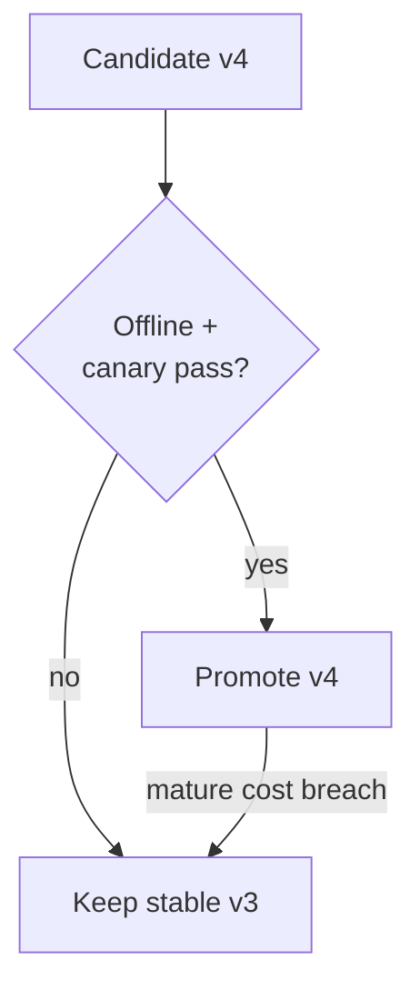

---
{
  "id": "monitoring-predictive-models",
  "title": "Monitoring Predictive Models",
  "slug": "monitoring-predictive-models",
  "section": "Production ML Systems",
  "category": "MLOps & Deployment",
  "difficulty": "Medium",
  "order": 4,
  "coverImage": "illustrations/_generated/chapter_flow_dark.png",
  "companies": [
    "Google",
    "Amazon",
    "Uber",
    "DoorDash"
  ],
  "shortDescription": "Catch stale or broken inputs in real time, distinguish data drift from concept drift, join delayed labels cleanly, and protect model rollouts with canary checks and rollback.",
  "keyConceptsTested": [
    "input health",
    "data drift",
    "concept drift",
    "training-serving skew",
    "delayed labels",
    "continuous training",
    "rollback"
  ]
}
---

At noon, your job-risk prediction service responds in 40 milliseconds with zero HTTP 500s. Every infrastructure dashboard is bright green. Yet one request just scored a three-hour-old queue snapshot, another arrived with a null backlog field, and yesterday's predictions will not even have ground-truth labels until tomorrow.

Traditional service monitoring checks whether a process is alive. ML monitoring runs on **two separate clocks**:

1. **The Fast Request Clock:** Synchronous, pre-scoring checks that catch missing fields, schema errors, and stale feature snapshots *before* a bad prediction reaches downstream systems.
2. **The Slow Outcome Clock:** Asynchronous evaluation loops that wait for the <span data-glossary="label-delay">label delay</span> to mature before measuring precision, recall, calibration, and error cost.

<figure>
  
  <figcaption>Two decoupled monitoring clocks at noon. On the fast clock, four of six live requests pass freshness and completeness checks while <code>s-103</code> (missing backlog) and <code>s-104</code> (180-minute stale snapshot) are blocked. On the slow clock, five archived predictions have matured while <code>p-006</code> is due at 13:00; delaying <code>p-005</code>'s label arrival drops mature label coverage from 5/5 to 4/5.</figcaption>
</figure>

## Start with a served release and feature traces

Before asking whether a prediction was accurate, log *what the model actually saw*. Our deployed model (`job-risk-v3`) scores batch jobs for <span data-glossary="sla">deadline-miss (SLA)</span> risk using two live features: `queue_backlog` and `hours_since_last_heartbeat`.

Keep two ages strictly separate: a 30-hour-old heartbeat in a freshly computed snapshot is a genuine risk signal, whereas a snapshot that has not refreshed for 3 hours is a broken feature pipeline. Store an immutable **feature <span data-glossary="tracing">trace</span>** on every request recording feature values, `feature_as_of` timestamps, model version, and feature spec version:

<!-- leetllm: test, deps=numpy, output=show, id=monitoring-lab -->
```python title="build-live-feature-traces.py"
from datetime import datetime, timedelta, timezone
from hashlib import sha256
from json import dumps
import numpy as np

now = datetime(2025, 2, 4, 12, 0, tzinfo=timezone.utc)
deployed = {"model": "job-risk-v3", "feature_spec": "features-v3", "threshold": 0.50}

feature_traces = [
    {"job_id": "s-100", "queue_backlog": 18,   "hours_since_last_heartbeat": 2,  "feature_as_of": now - timedelta(minutes=10),  "risk_score": 0.18},
    {"job_id": "s-101", "queue_backlog": 27,   "hours_since_last_heartbeat": 8,  "feature_as_of": now - timedelta(minutes=20),  "risk_score": 0.44},
    {"job_id": "s-102", "queue_backlog": 35,   "hours_since_last_heartbeat": 20, "feature_as_of": now - timedelta(minutes=25),  "risk_score": 0.76},
    {"job_id": "s-103", "queue_backlog": None, "hours_since_last_heartbeat": 26, "feature_as_of": now - timedelta(minutes=15),  "risk_score": None},
    {"job_id": "s-104", "queue_backlog": 22,   "hours_since_last_heartbeat": 6,  "feature_as_of": now - timedelta(minutes=180), "risk_score": 0.52},
    {"job_id": "s-105", "queue_backlog": 40,   "hours_since_last_heartbeat": 30, "feature_as_of": now - timedelta(minutes=5),   "risk_score": 0.91},
]

ages_min = np.array([(now - r["feature_as_of"]).total_seconds() / 60 for r in feature_traces])
print(f"deployed={deployed['model']} ({deployed['feature_spec']}) | traces={len(feature_traces)} | median snapshot age={np.median(ages_min):.0f}m")
```

<!-- leetllm: output:start -->
```text title="Output" output compact
deployed=job-risk-v3 (features-v3) | traces=6 | median snapshot age=18m
```
<!-- leetllm: output:end -->

## Block invalid inputs before waiting for labels

Even before a single label exists, three fast-clock checks catch silent pipeline failures:

1. **Completeness:** Required features are non-null (upstream extractor crashes often turn missing readings into nulls or silent zeros).
2. **Domain integrity:** Numeric fields are finite, nonnegative, and match expected types (integer counts for `queue_backlog`).
3. **<span data-glossary="feature-freshness">Feature freshness</span>:** Snapshot age (`now - feature_as_of`) stays within the declared freshness budget (`0` to `60` minutes inclusive).

Sculley et al. emphasize that unstable upstream data dependencies silently corrupt healthy model binaries; watching input invariants catches broken feeds in seconds instead of days.[^sculley2015] Route blocked requests to an explicit fallback rather than silently scoring them as low risk:

<!-- leetllm: test, deps=numpy, output=show, continue=monitoring-lab, id=request-health -->
```python title="check-request-time-input-health.py"
MAX_AGE_MIN = 60

def validate_request(row):
    issues = []
    for col in ("queue_backlog", "hours_since_last_heartbeat"):
        val = row.get(col)
        if val is None or not np.isfinite(val) or val < 0:
            issues.append(f"invalid:{col}")
    age_min = (now - row["feature_as_of"]).total_seconds() / 60
    if age_min < 0 or age_min > MAX_AGE_MIN:
        issues.append(f"stale:{age_min:g}m")
    return issues

scored = []
for row in feature_traces:
    issues = validate_request(row)
    if issues:
        print(f"{row['job_id']} -> BLOCK ({', '.join(issues)})")
    else:
        scored.append(row)
        print(f"{row['job_id']} -> SCORE")
print(f"summary: scored={len(scored)}, blocked={len(feature_traces) - len(scored)}")
```

<!-- leetllm: output:start -->
```text title="Output" output compact
s-100 -> SCORE
s-101 -> SCORE
s-102 -> SCORE
s-103 -> BLOCK (invalid:queue_backlog)
s-104 -> BLOCK (stale:180m)
s-105 -> SCORE
summary: scored=4, blocked=2
```
<!-- leetllm: output:end -->

```checkpoint
Why block `s-104` at noon instead of waiting for its delayed outcome label?
---
Its feature snapshot is 180 minutes old, violating the 60-minute freshness limit. Waiting for tomorrow's label lets stale inputs drive bad decisions today.
```

## Measure drift without calling it failure

Passing input checks means individual requests are well-formed; it does not mean today's traffic looks like training traffic. **<span data-glossary="data-drift">Data drift</span>** detects shifts in feature distributions before labels arrive, signaling *where* to investigate rather than proving accuracy dropped.[^klaise2020]

<figure>
  
  <figcaption>Comparing two 100-request windows across fixed heartbeat-age buckets. The <code>24h+</code> bucket jumps from 5% to 20%, contributing <code>0.208</code> (56%) of the total <code>0.370</code> PSI and crossing the <code>0.20</code> inspection threshold.</figcaption>
</figure>

### Population Stability Index (PSI)

For fixed buckets with reference shares $e_i$ and current shares $a_i$, the **<span data-glossary="population-stability-index">Population Stability Index (PSI)</span>** sums both KL divergence directions (Jeffreys divergence):

$$
\text{PSI} = D_{\text{KL}}(A \parallel E) + D_{\text{KL}}(E \parallel A) = \sum_i (a_i - e_i) \ln\left(\frac{a_i}{e_i}\right)
$$

Every term is nonnegative because $(a_i - e_i)$ and $\ln(a_i / e_i)$ always share the same sign. Keep bucket boundaries fixed across windows, and apply a consistent smoothing rule when a bucket hits zero. Remember that classic `0.10 / 0.25` PSI cutoffs are empirical rules of thumb that depend on bin count and sample size; treat them as investigation triggers rather than automatic retraining commands.[^potgieter2026psi]

### Continuous drift metrics: KS-test and Wasserstein-1

For unbinned continuous features, two complementary diagnostics avoid arbitrary bin boundaries:

- **Two-sample Kolmogorov-Smirnov (KS):** Measures the largest vertical gap between empirical CDFs, $D = \sup_x |F_{\text{ref}}(x) - F_{\text{curr}}(x)| \in [0, 1]$.[^scipyKs2Sample2026] On massive traffic, tiny meaningless shifts trigger tiny p-values, so always inspect effect size $D$ alongside p-values.
- **1D Wasserstein-1 (Earth Mover's Distance):** Measures the area between CDFs in the **original feature units**, $W_1(u, v) = \int_{-\infty}^{\infty} |U(x) - V(x)|\, dx$.[^scipyWasserstein2026]

| Metric | Binning? | Scale | Strength | Watch out for |
| --- | --- | --- | --- | --- |
| **PSI** | Fixed bins | $[0, \infty)$ | Per-bin attribution of shift | Zero-count bins; not a metric (violates triangle inequality) |
| **KS ($D$)** | None | $[0, 1]$ | Distribution-free max CDF gap | Sensitive near median; p-values over-trigger on huge $N$ |
| **Wasserstein-1** | None | Feature units | Directly readable shift magnitude | Sensitive to extreme tails and feature scale |

Verify PSI against SciPy's KL sum and inspect how KS and Wasserstein catch spread changes even when two distributions share the exact same mean (`2.0`):

<!-- leetllm: test, deps=numpy,scipy, output=show, continue=request-health, id=drift-diagnostic -->
```python title="calculate-drift-metrics.py"
from scipy.stats import entropy, ks_2samp, wasserstein_distance

ref = np.array([50, 30, 15, 5], dtype=float)
cur = np.array([30, 25, 25, 20], dtype=float)
e, a = ref / ref.sum(), cur / cur.sum()

psi = float(np.sum((a - e) * np.log(a / e)))
kl_sum = float(entropy(a, e) + entropy(e, a))
investigate_at = 0.20

print(f"PSI={psi:.3f} (SciPy KL sum={kl_sum:.3f}) | 24h+ contribution={(a[3]-e[3])*np.log(a[3]/e[3]):.3f} | inspect={psi >= investigate_at}")

# Identical means (2.0), very different distributions:
before_h, after_h = np.array([0.0, 4.0]), np.array([2.0, 2.0])
print(f"equal means ({before_h.mean():.1f} vs {after_h.mean():.1f}) -> KS D={ks_2samp(before_h, after_h).statistic:.2f}, W1={wasserstein_distance(before_h, after_h):.1f}h")
```

<!-- leetllm: output:start -->
```text title="Output" output compact
PSI=0.370 (SciPy KL sum=0.370) | 24h+ contribution=0.208 | inspect=True
equal means (2.0 vs 2.0) -> KS D=0.50, W1=2.0h
```
<!-- leetllm: output:end -->

### Covariate shift, concept drift, and label shift

Factoring $P(X, Y) = P(X) P(Y \mid X) = P(Y) P(X \mid Y)$ separates three fundamentally different shifts:

| Shift type | What moved | Example | First response |
| --- | --- | --- | --- |
| **Covariate shift** | $P(X)$ changes, $P(Y \mid X)$ stays fixed | Weekend surge brings older heartbeats, but miss risk per heartbeat age is unchanged | Inspect traffic mix; check performance on shifted slices |
| **Concept drift** | $P(Y \mid X)$ changes | Faster GPUs clear backlogs of 35 in minutes instead of hours | Retrain on recent mature snapshots |
| **Label shift** | $P(Y)$ changes, $P(X \mid Y)$ stays fixed[^lipton2018labelshift] | Overall outage prevalence rises while feature patterns per class hold steady | Audit base-rate shift and recalibrate thresholds |

Notice a subtle mix-shift trap: if Pool A has a constant 10% miss rate and Pool B has a constant 40% miss rate, shifting traffic from 50/50 to 80/20 moves the overall miss rate from 25% to 16% even though *neither* pool changed its behavior. Always inspect matched slices before declaring concept drift.

```checkpoint
Why shouldn't a PSI of 0.37 trigger immediate automated retraining?
---
PSI only shows that input distributions moved. If the shift came from a broken upstream feed or a harmless traffic mix change, retraining blindly can bake corrupted data into a new model. Inspect data health and delayed outcomes first.
```

## Reproduce training-serving skew

<span data-glossary="training-serving-skew">Training-serving skew</span> happens when live serving computes a feature differently from training. Suppose training normalizes `queue_backlog` by each runner pool's staffed capacity, while a serving bug divides by a hardcoded `100`. That bug stays invisible on pools with capacity `100` and corrupts every pool of size `50` or `75`:

<!-- leetllm: test, deps=numpy, output=show, continue=drift-diagnostic, id=parity-probe -->
```python title="reproduce-training-serving-skew.py"
capacities = np.array([50.0, 75.0, 100.0])
backlog = 20.0

train_ratio = backlog / capacities
serve_ratio = np.full_like(capacities, backlog / 100.0)

for cap, tr, sr in zip(capacities, train_ratio, serve_ratio):
    print(f"capacity={int(cap):3d}: train={tr:.3f} vs serve={sr:.3f} | parity={np.isclose(tr, sr)}")
```

<!-- leetllm: output:start -->
```text title="Output" output compact
capacity= 50: train=0.400 vs serve=0.200 | parity=False
capacity= 75: train=0.267 vs serve=0.200 | parity=False
capacity=100: train=0.200 vs serve=0.200 | parity=True
```
<!-- leetllm: output:end -->

Retraining will never fix a wrong serving denominator. Share one versioned transformation library across batch and online paths, and run automated <span data-glossary="unit-test">unit tests</span> and parity probes across multiple input slices.[^google2026mlops]

## Join delayed labels back to stored predictions

Ground-truth evaluation runs on the slow clock and requires tracking three timestamps per prediction:

- **Prediction time ($t_{\text{pred}}$):** When the model scored the job.
- **Maturity time (`label_due_at`):** When the outcome window closes.
- **Ingestion time ($t_{\text{ingest}}$):** When the verified label lands in the warehouse.

For a prediction cohort ending at $T_2$ with horizon $\Delta t_{\text{maturity}}$, all outcome windows close once:

$$
t_{\text{now}} \ge T_2 + \Delta t_{\text{maturity}}
$$

Never score immature predictions as negatives (early failures often arrive faster than long-running successes, biasing naive dashboards). Separate **immature** predictions (`label_due_at > now`) from **mature-but-missing** predictions (`label_due_at <= now` with no ingested label yet), and always report **mature label coverage**:

<!-- leetllm: test, deps=numpy, output=show, continue=parity-probe, id=delayed-labels -->
```python title="join-delayed-job-labels.py"
predictions = [
    {"id": "p-001", "score": 0.15, "priority": False, "due": now - timedelta(hours=5), "threshold": 0.50},
    {"id": "p-002", "score": 0.32, "priority": False, "due": now - timedelta(hours=4), "threshold": 0.50},
    {"id": "p-003", "score": 0.68, "priority": True,  "due": now - timedelta(hours=3), "threshold": 0.50},
    {"id": "p-004", "score": 0.78, "priority": False, "due": now - timedelta(hours=2), "threshold": 0.50},
    {"id": "p-005", "score": 0.91, "priority": True,  "due": now - timedelta(hours=1), "threshold": 0.50},
    {"id": "p-006", "score": 0.84, "priority": True,  "due": now + timedelta(hours=1), "threshold": 0.50},
]
labels = {"p-001": 0, "p-002": 0, "p-003": 1, "p-004": 0, "p-005": 1}

def join_mature(preds, label_map, as_of):
    mature = [r for r in preds if r["due"] <= as_of]
    immature = [r["id"] for r in preds if r["due"] > as_of]
    joined = [{**r, "y": label_map[r["id"]]} for r in mature if r["id"] in label_map]
    missing = [r["id"] for r in mature if r["id"] not in label_map]
    cov = len(joined) / len(mature) if mature else 0.0
    return mature, immature, joined, missing, cov

matured, immature, joined, missing, cov = join_mature(predictions, labels, now)
print(f"at noon -> mature={len(matured)}, joined={len(joined)}, coverage={cov:.2f}, immature={immature}")

# Delay p-005 ingestion until 13:00: still mature at noon, now missing!
delayed_labels = {k: v for k, v in labels.items() if k != "p-005"}
_, _, _, late_missing, late_cov = join_mature(predictions, delayed_labels, now)
print(f"p-005 delayed -> coverage={late_cov:.2f}, missing_mature={late_missing}")
```

<!-- leetllm: output:start -->
```text title="Output" output compact
at noon -> mature=5, joined=5, coverage=1.00, immature=['p-006']
p-005 delayed -> coverage=0.80, missing_mature=['p-005']
```
<!-- leetllm: output:end -->

While waiting for slow labels, track leading operational proxies (queue wait times, worker drop rates) and raw score distributions separately from threshold-crossing review rates.

```checkpoint
Why must `p-006` stay out of the noon quality cohort instead of counting as an on-schedule job?
---
Its outcome window closes at 13:00, so its outcome is unknown at noon. Treating pending jobs as negatives silently fabricates false positives or hides real misses.
```

## Evaluate decisions and calibration

Once a mature cohort reaches full label coverage, reconstruct historical decisions using each row's **stored serving threshold** (never today's updated threshold) and measure <span data-glossary="precision-recall">precision, recall</span>, weighted error cost (cost `2` per false positive, `10` per false negative), and probability <span data-glossary="calibration">calibration</span> (via Brier score and score buckets):[^guo2017]

<!-- leetllm: test, deps=numpy,scikit-learn, output=show, continue=delayed-labels, id=quality-window -->
```python title="measure-quality-and-calibration.py"
from sklearn.metrics import brier_score_loss, precision_score, recall_score

scores = np.array([r["score"] for r in joined])
y_true = np.array([r["y"] for r in joined])
y_pred = (scores >= np.array([r["threshold"] for r in joined])).astype(int)
pri = np.array([r["priority"] for r in joined])

fp = int(np.sum((y_pred == 1) & (y_true == 0)))
fn = int(np.sum((y_pred == 0) & (y_true == 1)))
print(f"precision={precision_score(y_true, y_pred):.3f} | recall={recall_score(y_true, y_pred):.3f} | priority_misses={int(np.sum(pri & (y_true == 1) & (y_pred == 0)))} | error_cost={2*fp + 10*fn}")
print(f"Brier score={brier_score_loss(y_true, scores):.3f} | low-bin avg={scores[scores<0.5].mean():.3f} (obs={y_true[scores<0.5].mean():.3f}) | high-bin avg={scores[scores>=0.5].mean():.3f} (obs={y_true[scores>=0.5].mean():.3f})")
```

<!-- leetllm: output:start -->
```text title="Output" output compact
precision=0.667 | recall=1.000 | priority_misses=0 | error_cost=2
Brier score=0.169 | low-bin avg=0.235 (obs=0.000) | high-bin avg=0.790 (obs=0.667)
```
<!-- leetllm: output:end -->

> **Common mistake:** Evaluating untreated calibration after interventions act on high-risk scores. If on-call engineers rescue every job flagged at `0.80` so its observed miss rate drops to `0.20`, the model did not suddenly become miscalibrated; you are observing the *intervened* outcome rather than untreated risk.

## Triage repair, inspection, and retraining separately

Monitoring signals point to different remedies, and infrastructure fixes always come before retraining:

| Signal | First action |
| --- | --- |
| Missing or stale live features | Repair upstream data path |
| Training-serving parity mismatch | Fix shared transform logic |
| PSI / KS / Wasserstein spike | Inspect upstream feeds and traffic mix |
| Mature error cost regresses (with clean data & full coverage) | Train a new frozen-snapshot candidate |

<!-- leetllm: test, deps=numpy, output=show, continue=quality-window, id=monitoring-triage -->
```python title="triage-monitoring-signals.py"
def triage(schema_errs, stale_cnt, parity_ok, psi_val, cost_worse, labels_ready):
    actions = []
    if schema_errs > 0 or stale_cnt > 0:
        actions.append("repair online data path")
    if not parity_ok:
        actions.append("fix training-serving parity")
    if psi_val >= investigate_at:
        actions.append("inspect distribution shift")
    if not labels_ready:
        actions.append("wait for mature labels")
    if schema_errs == 0 and stale_cnt == 0 and parity_ok and labels_ready and cost_worse:
        actions.append("train candidate on frozen snapshot")
    return actions

print("dirty feed:       ", triage(1, 1, False, psi, True, True))
print("clean drift+cost: ", triage(0, 0, True,  psi, True, True))
print("incomplete labels:", triage(0, 0, True,  psi, True, False))
```

<!-- leetllm: output:start -->
```text title="Output" output compact
dirty feed:        ['repair online data path', 'fix training-serving parity', 'inspect distribution shift']
clean drift+cost:  ['inspect distribution shift', 'train candidate on frozen snapshot']
incomplete labels: ['inspect distribution shift', 'wait for mature labels']
```
<!-- leetllm: output:end -->

Continuous training produces *candidates*, not automatic production overwrites.[^google2026mlops] Separate training a model from promoting its serving alias:



## Freeze an immutable candidate bundle

When clean evidence justifies retraining, freeze everything needed to reproduce or revert the release into one immutable **candidate bundle**: data snapshot digest, training code revision, model weights digest, feature spec, threshold, and a pointer to `previous_model`.[^google2026mlops] Promotion flips a serving alias (`prod -> bundle_id`) rather than overwriting files in place (never reference mutable tags like `latest`):

<!-- leetllm: test, deps=numpy, output=show, continue=monitoring-triage, id=candidate-bundle -->
```python title="assemble-candidate-manifest.py"
candidate_config = {
    "model": "job-risk-v4",
    "snapshot": "labels-snapshot-v4",
    "feature_spec": deployed["feature_spec"],
    "threshold": 0.50,
    "previous_model": deployed["model"],
}
digest = sha256(dumps(candidate_config, sort_keys=True).encode()).hexdigest()
bundle_id = f"job-risk-v4-{digest[:10]}"
print(f"bundle={bundle_id} | full_sha256_bytes={len(bytes.fromhex(digest))} | rollback_to={candidate_config['previous_model']}")
```

<!-- leetllm: output:start -->
```text title="Output" output compact
bundle=job-risk-v4-eafa1ed722 | full_sha256_bytes=32 | rollback_to=job-risk-v3
```
<!-- leetllm: output:end -->

## Deployment strategies and canary health gates

Three progressive rollout patterns control blast radius while gathering live evidence:

1. **Shadow traffic:** Mirror live requests to the candidate without letting its outputs trigger real actions. Great for checking latency, memory, and score distributions, though shared compute still needs resource isolation.
2. **Canary routing:** Route a deterministic percentage of jobs (say 5%, then 25%) to the candidate via a cryptographic hash (never Python's built-in `hash()`, which changes random salt across processes).[^python2026hash]
3. **Blue-green switching:** Stand up the full replacement fleet alongside the active fleet, verify health checks, then flip traffic while keeping the old fleet warm for fast <span data-glossary="rollback">rollback</span> (as supported by tools like Argo <span data-glossary="rollout">Rollouts</span>).[^automated_rollback_ml]

Verify sticky SHA-256 canary bucketing alongside offline cohort checks and fast canary budgets (error rate, <span data-glossary="p95-latency">p95 latency</span>, and review-queue load):

<!-- leetllm: test, deps=numpy, output=show, continue=candidate-bundle, id=canary-gates -->
```python title="check-canary-and-offline-gates.py"
def canary_bucket(job_id):
    return int.from_bytes(sha256(f"job-risk-canary-v1:{job_id}".encode()).digest()[:8], "big") % 100

buckets = np.array([canary_bucket(f"job-{i:04d}") for i in range(1000)])
print(f"sticky canary jobs: 5%={int(np.sum(buckets < 5))}/1000, 25%={int(np.sum(buckets < 25))}/1000, 5%-subset-of-25%={bool(np.all((buckets < 5) <= (buckets < 25)))}")

# Offline comparison on 1,000 matched mature predictions (cost = 2*FP + 10*FN)
v3_cost = 2 * 20 + 10 * 2  # tp=8, fp=20, fn=2 -> recall=0.80, cost=60/1k
v4_cost = 2 * 15 + 10 * 1  # tp=9, fp=15, fn=1 -> recall=0.90, cost=40/1k
offline_ok = (0.90 >= 0.80) and (v4_cost <= v3_cost) and (42 <= 50)

# Fast canary checks over 500 live requests
canary_vals = np.array([0.002, 44.0, 0.72])
canary_caps = np.array([0.005, 50.0, 0.80])  # error_rate, p95_ms, queue_load
canary_ok = bool(np.all(canary_vals <= canary_caps))

print(f"offline: v3_cost={v3_cost}/1k -> v4_cost={v4_cost}/1k (pass={offline_ok})")
print(f"canary:  max_budget_util={float((canary_vals/canary_caps).max()):.2f} (pass={canary_ok})")
```

<!-- leetllm: output:start -->
```text title="Output" output compact
sticky canary jobs: 5%=48/1000, 25%=257/1000, 5%-subset-of-25%=True
offline: v3_cost=60/1k -> v4_cost=40/1k (pass=True)
canary:  max_budget_util=0.90 (pass=True)
```
<!-- leetllm: output:end -->

Notice that bucketing by `job_id` keeps every request for one job on the same model and ensures the 5% group stays cleanly inside the 25% group when ramping traffic.

## Simulate promotion and rehearse rollback

Passing fast canary checks authorizes promotion, not permanent immunity. Keep a post-promotion delayed-label <span data-glossary="guardrail">guardrail</span> watching mature cohorts. Suppose 500 mature post-promotion rows arrive with 10 false positives and 2 false negatives: that costs `40` units per 500 rows, or `80` per 1,000, breaching the `50/1,000` rollback ceiling and triggering a rollback to `job-risk-v3`:

<figure>
  
  <figcaption>End-to-end promotion and delayed-label rollback. Candidate <code>v4</code> clears offline checks and fast canary budgets, promotes, and then rolls back to <code>job-risk-v3</code> once 500 mature outcomes show normalized error cost of <code>80/1,000</code> against the <code>50/1,000</code> limit.</figcaption>
</figure>

<!-- leetllm: test, deps=numpy, output=show, continue=canary-gates -->
```python title="promote-and-rollback-model-alias.py"
def evaluate_rollout(offline_pass, canary_pass, mature_n, joined_n, cost_per_1k, limit=50.0):
    if not (offline_pass and canary_pass):
        return "not_promoted", deployed["model"]
    if mature_n < 500 or joined_n < mature_n:
        return "insufficient_evidence", bundle_id
    if cost_per_1k > limit:
        return "rolled_back", deployed["model"]
    return "keep_candidate", bundle_id

delayed_cost_1k = 1000.0 * (2 * 10 + 10 * 2) / 500.0
for label, args in [
    ("mature breach (80/1k)", (offline_ok, canary_ok, 500, 500, delayed_cost_1k)),
    ("canary failed",         (offline_ok, False,     500, 500, delayed_cost_1k)),
    ("incomplete labels",     (offline_ok, canary_ok, 500, 499, delayed_cost_1k)),
    ("at exact limit (50)",   (offline_ok, canary_ok, 500, 500, 50.0)),
]:
    action, alias = evaluate_rollout(*args)
    print(f"{label:22s} -> {action:21s} (active={alias})")
```

<!-- leetllm: output:start -->
```text title="Output" output compact
mature breach (80/1k)  -> rolled_back           (active=job-risk-v3)
canary failed          -> not_promoted          (active=job-risk-v3)
incomplete labels      -> insufficient_evidence (active=job-risk-v4-eafa1ed722)
at exact limit (50)    -> keep_candidate        (active=job-risk-v4-eafa1ed722)
```
<!-- leetllm: output:end -->

Rehearse rollbacks regularly: confirm the previous artifact still loads cleanly, matches current feature schemas, and actually recovers live metrics once traffic shifts back.

## When monitoring breaks

| Symptom | Root cause | Fix |
| --- | --- | --- |
| Bad inputs corrupt predictions for days | Only slow label metrics are monitored | Add fast-clock schema, null, and freshness checks |
| Drift alerts trigger useless retraining | Covariate shift mistaken for model decay | Inspect data feeds and slice outcomes before retraining |
| PSI is quiet yet error cost spikes | Concept drift or intervention feedback | Audit matched slices, labels, and intervention logging |
| Retrained model repeats live errors | Training-serving feature skew | Share transforms and run multi-slice parity probes |
| Dashboard looks great while labels trickle in | Early-arriving label selection bias | Restrict quality metrics to mature cohorts and show coverage |
| Rollback fails under pressure | Mutable `latest` tags or incompatible schemas | Pin immutable bundle digests and rehearse alias rollbacks |

```checkpoint
A model predicts 0.80 untreated risk of a missed deadline. Because engineers intervene on every flagged job, only 0.20 of flagged jobs actually miss their deadline. Is the model miscalibrated?
---
Not necessarily. The prediction estimated untreated risk, while observed outcomes reflect the intervened regime. You need untreated holdouts or counterfactual tracking to judge untreated calibration.
```

```mastery-quiz
[
  {
    "question": "At 14:20, a request arrives with a feature snapshot stamped 13:20 reporting 17 queued jobs and 9 hours since the last heartbeat. The freshness rule allows snapshot ages from 0 through 60 minutes inclusive. What snapshot age and action result?",
    "options": [
      "60 minutes; block.",
      "540 minutes; block.",
      "60 minutes; score.",
      "0 minutes; score."
    ],
    "answer": "60 minutes; score.",
    "explanation": "Elapsed snapshot age is 14:20 - 13:20 = 60 minutes, which meets the inclusive 60-minute freshness limit. The 9-hour (540-minute) heartbeat age is a feature value, not snapshot staleness."
  },
  {
    "question": "Reference bin shares are [0.4, 0.6] and current shares are [0.6, 0.4]. Using natural logs and an inspection cutoff of 0.15, what PSI and first action follow?",
    "options": [
      "PSI ≈ 0.081; no inspection needed.",
      "PSI ≈ 0.162; trigger automatic retraining immediately.",
      "PSI ≈ 0.400; rebin until shares match.",
      "PSI ≈ 0.162; inspect source health, traffic mix, and delayed outcomes."
    ],
    "answer": "PSI ≈ 0.162; inspect source health, traffic mix, and delayed outcomes.",
    "explanation": "Each bin contributes 0.2 * ln(1.5) ≈ 0.0811, summing to PSI ≈ 0.162 > 0.15. PSI flags a distribution shift for inspection rather than proving concept drift or justifying blind retraining."
  },
  {
    "question": "Two equal-weight samples are [0, 0, 4, 4] hours and [1, 1, 3, 3] hours. What are their two-sample KS statistic D and 1D Wasserstein distance W1?",
    "options": [
      "D = 0.5; W1 = 1 hour.",
      "D = 1.0; W1 = 0 hours.",
      "D = 0.5; W1 = 2 hours.",
      "D = 0.0; W1 = 1 hour."
    ],
    "answer": "D = 0.5; W1 = 1 hour.",
    "explanation": "The largest vertical ECDF gap is 0.5 (e.g., at x = 0). Optimal transport shifts each quarter-mass by 1 hour (0->1 and 4->3), giving W1 = 1 hour even though both means equal 2."
  },
  {
    "question": "Pools A and B keep constant miss rates of 10% and 30%, while traffic mix shifts from 50/50 to 25/75. What happens to the overall miss rate, and is this concept drift?",
    "options": [
      "Stays 20%; no concept drift.",
      "Rises to 25%; concept drift occurred.",
      "Rises to 25%; traffic-mix (covariate) shift with unchanged within-pool rates.",
      "Rises to 30%; traffic-mix shift."
    ],
    "answer": "Rises to 25%; traffic-mix (covariate) shift with unchanged within-pool rates.",
    "explanation": "Aggregate miss rate moves from 20% to 0.25*10% + 0.75*30% = 25% purely from changing traffic composition, while P(Y|X) inside each pool stayed constant."
  },
  {
    "question": "An evaluation snapshot has 8 stored predictions: 6 are mature (5 with ingested labels, 1 missing) and 2 are still immature. What are mature label coverage and missing count?",
    "options": [
      "Coverage 5/8; 3 missing.",
      "Coverage 6/8; 1 missing.",
      "Coverage 5/5; 0 missing.",
      "Coverage 5/6; 1 missing."
    ],
    "answer": "Coverage 5/6; 1 missing.",
    "explanation": "Coverage divides labeled mature predictions (5) by all mature predictions (6), giving 5/6 with 1 mature-but-missing row. The 2 immature predictions stay excluded until their windows close."
  },
  {
    "question": "With threshold 0.60, scores [0.2, 0.4, 0.65, 0.7, 0.8, 0.9] have outcomes [0, 1, 1, 0, 1, 0]. At FP cost 2 and FN cost 10, what precision, recall, and total error cost follow?",
    "options": [
      "Precision 1/2; recall 2/3; cost 14.",
      "Precision 2/3; recall 1/2; cost 14.",
      "Precision 1/2; recall 1; cost 4.",
      "Precision 2/3; recall 2/3; cost 12."
    ],
    "answer": "Precision 1/2; recall 2/3; cost 14.",
    "explanation": "Four predictions >= 0.60 contain 2 TP and 2 FP (precision = 2/4 = 1/2). One positive at 0.40 is missed (recall = 2/3). Error cost = 2*2 + 10*1 = 14."
  },
  {
    "question": "After promotion, 720 mature predictions arrive fully labeled with 8 false positives (cost 2) and 2 false negatives (cost 10). Rollback triggers when cost strictly exceeds 50 per 1,000 predictions. What normalized cost and decision result?",
    "options": [
      "50 per 1,000; keep candidate.",
      "36 per 1,000; keep candidate.",
      "50 per 1,000; roll back.",
      "72 per 1,000; roll back."
    ],
    "answer": "50 per 1,000; keep candidate.",
    "explanation": "Raw error cost is 8*2 + 2*10 = 36 across 720 predictions, which scales to 36 * 1000 / 720 = 50 per 1,000. Because rollback triggers strictly above 50, the candidate stays active."
  }
]
```

> **Next:** Continue to [Prompt Engineering Fundamentals](/learn/prompt-engineering-fundamentals).
