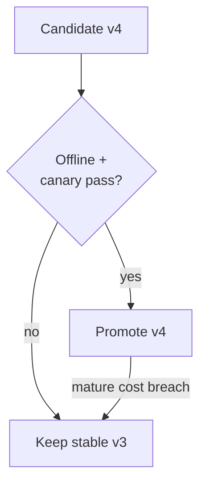

---
{
  "id": "monitoring-predictive-models",
  "title": "Monitoring Predictive Models",
  "slug": "monitoring-predictive-models",
  "section": "Production ML Systems",
  "category": "MLOps & Deployment",
  "difficulty": "Medium",
  "order": 6,
  "coverImage": "illustrations/_generated/chapter_flow_dark.png",
  "companies": ["Google", "Amazon", "Uber", "DoorDash"],
  "shortDescription": "At noon the job-risk service is fast and green, but one feature snapshot is three hours old. Freshness, delayed labels, and promotion gates catch what uptime misses.",
  "keyConceptsTested": ["input health", "data drift", "concept drift", "training-serving skew", "delayed labels", "continuous training", "rollback"]
}
---

At noon, a job-risk service is responding in 40 milliseconds and returning scores. Its uptime and latency dashboards are bright green. One request, however, contains a three-hour-old queue snapshot. Another job's outcome won't be known until tomorrow. Endpoint uptime answers neither whether today's inputs are usable nor whether yesterday's predictions helped.

Two useful monitoring clocks are:
1. **The Fast Request Clock**: Synchronous, pre-scoring input health checks that can reject or quarantine an inference payload immediately.
2. **The Slow Outcome Clock**: Asynchronous, post-maturity evaluation loops that must wait for the <span data-glossary="label-delay">label delay</span> before calculating precision, recall, or business error cost.

Both clocks run on a model that flags batch jobs likely to miss deadlines. The Python cells share one session and only propose promotion or rollback from authored gate results. Scores, cohort counts, and latency values are sample datasets. No model is deployed, no request is routed, no notification is sent, and no production deployment changes.

<figure>
  
  <figcaption>Two decoupled monitoring clocks at noon. The upper rows check snapshot age against the inclusive 60-minute freshness rule and check backlog completeness separately. Snapshot <code>s-104</code> is stale at 180 minutes; <code>s-103</code> is fresh at 15 minutes but lacks <code>queue_backlog</code>. Four live requests can be scored. The separate archived cohort has five mature predictions and five joined labels; <code>p-006</code> is due at 13:00 and stays out of the quality cohort. The lower variant delays only <code>p-005</code>'s label arrival until 13:00: it is already mature at noon, leaving four of five mature labels joined.</figcaption>
</figure>

## Start with a served release and feature traces

Before asking whether a prediction is right, capture what it saw. We'll score each live job for <span data-glossary="sla">service-level agreement (SLA)</span>-miss risk. High scores enter operational review. Each request carries two model inputs:

| Feature | Meaning | Why it can fail |
| --- | --- | --- |
| `queue_backlog` | jobs waiting in the runner pool | upstream feed drops or changes measurement units |
| `hours_since_last_heartbeat` | elapsed time since the latest scheduler heartbeat | stale worker snapshot or timestamp parsing error |

A 30-hour-old heartbeat can be a valid risk signal in a freshly computed feature. That's different from a feature snapshot that hasn't been refreshed for three hours. Monitor the age of the measurement separately from the value it measures.

Store a **feature <span data-glossary="tracing">trace</span>** with each prediction: values, timestamps, and **feature specification** versions. Replay also needs preserved model bytes, transforms, and input revisions; mutable version names alone aren't enough. Restrict sensitive traces and their retention to the investigation's needs.

Build six incoming requests against deployed release `job-risk-v3`. Two rows contain failures that should be caught before delayed SLA labels exist. Sample risk scores stand in for model outputs and are omitted whenever a request is blocked.

<!-- leetllm: test, deps=numpy, output=show, id=monitoring-lab -->
```python title="build-live-feature-traces.py"
from datetime import datetime, timedelta, timezone
from hashlib import sha256
from json import dumps
from math import isclose, isfinite, log
import numpy as np


now = datetime(2026, 2, 4, 12, 0, tzinfo=timezone.utc)
deployed = {
    "model": "job-risk-v3",
    "feature_spec": "features-v3",
    "threshold": 0.50,
}
requests = [
    {"job_id": "s-100", "runner_pool": "fc-a", "queue_backlog": 18, "hours_since_last_heartbeat": 2, "feature_as_of": now - timedelta(minutes=10), "risk_score": 0.18},
    {"job_id": "s-101", "runner_pool": "fc-a", "queue_backlog": 27, "hours_since_last_heartbeat": 8, "feature_as_of": now - timedelta(minutes=20), "risk_score": 0.44},
    {"job_id": "s-102", "runner_pool": "fc-b", "queue_backlog": 35, "hours_since_last_heartbeat": 20, "feature_as_of": now - timedelta(minutes=25), "risk_score": 0.76},
    {"job_id": "s-103", "runner_pool": "fc-b", "queue_backlog": None, "hours_since_last_heartbeat": 26, "feature_as_of": now - timedelta(minutes=15), "risk_score": None},
    {"job_id": "s-104", "runner_pool": "fc-a", "queue_backlog": 22, "hours_since_last_heartbeat": 6, "feature_as_of": now - timedelta(minutes=180), "risk_score": 0.52},
    {"job_id": "s-105", "runner_pool": "fc-b", "queue_backlog": 40, "hours_since_last_heartbeat": 30, "feature_as_of": now - timedelta(minutes=5), "risk_score": 0.91},
]
feature_traces = [
    {
        **request,
        "model": deployed["model"],
        "feature_spec": deployed["feature_spec"],
    }
    for request in requests
]
snapshot_ages_min = np.array([(now - r["feature_as_of"]).total_seconds() / 60 for r in feature_traces])

print("deployed:", deployed["model"])
print("feature spec:", deployed["feature_spec"])
print("feature traces:", len(feature_traces), f"(median age {np.median(snapshot_ages_min):.0f}m)")
print("label status: pending")
```

<!-- leetllm: output:start -->
```text title="Output" output compact
deployed: job-risk-v3
feature spec: features-v3
feature traces: 6 (median age 18m)
label status: pending
```
<!-- leetllm: output:end -->

At request time, you don't know which jobs will miss their SLA. Check whether the required inputs exist and whether their timestamps are fresh enough to trust.

Each trace links the request to pinned model and feature specification names. The next function validates incoming inputs with NumPy before labels arrive. It does not verify the deployed transform, per-feature lineage, or upstream progress: a newly stamped snapshot can still contain stale source data.

## Block invalid inputs before waiting for labels

Which rows satisfy the serving requirements? `s-103` has a recent snapshot but no backlog value. `s-104` has a value but a snapshot from three hours ago. Both should stop before the label clock can tell us what happened.

Before a label exists, a request can still fail one of three checks:
1. **Feature Completeness**: Detect sudden spikes in null or missing values. When upstream data extractors fail, missing fields often manifest as silent zeroes or `None` values.
2. **Schema Integrity**: Validate data types and domain constraints. Required features must be finite, nonnegative numbers; backlog must be an integer.
3. **Freshness Lag**: Measure the elapsed time between the feature snapshot timestamp (`feature_as_of`) and the current scoring timestamp. Our <span data-glossary="feature-freshness">feature freshness</span> rule requires snapshots between zero and 60 minutes old, inclusive. Future timestamps are invalid; a system tolerating clock skew must declare that tolerance explicitly.

An **invariant** is a declared condition the system must preserve. Check completeness, domain validity, and freshness. Enforcing these rules blocks bad rows early, though passing them does not guarantee an input is accurate or safe for every use. Define a fallback for blocked requests rather than silently treating them as low risk.

<!-- leetllm: test, deps=numpy, output=show, continue=monitoring-lab, id=request-health -->
```python title="check-request-time-input-health.py"
import numpy as np

required_features = ["queue_backlog", "hours_since_last_heartbeat"]
max_feature_age_minutes = 60


def request_health(row):
    reasons = []
    for name in required_features:
        value = row.get(name)
        if value is None:
            reasons.append("missing=" + name)
            continue
        numeric = np.asarray(value)
        if value is True or value is False or not np.issubdtype(numeric.dtype, np.number):
            reasons.append("invalid=" + name)
        else:
            val = float(numeric)
            if not np.isfinite(val) or val < 0:
                reasons.append("invalid=" + name)
            elif name == "queue_backlog" and not val.is_integer():
                reasons.append("noninteger=" + name)
    snapshot = row.get("feature_as_of")
    if not isinstance(snapshot, datetime) or snapshot.utcoffset() is None:
        reasons.append("invalid=feature_as_of")
    else:
        feature_age = (now - snapshot).total_seconds() / 60
        if feature_age < 0:
            reasons.append("future=feature_as_of")
        elif feature_age > max_feature_age_minutes:
            reasons.append(f"stale={feature_age:g}m")
    return reasons


healthy_requests = []
for row in feature_traces:
    reasons = request_health(row)
    if reasons:
        print(row["job_id"], "-> block", ";".join(reasons))
    else:
        healthy_requests.append(row)
        print(row["job_id"], "-> score")

print("scored:", len(healthy_requests))
print("blocked:", len(feature_traces) - len(healthy_requests))
```

<!-- leetllm: output:start -->
```text title="Output" output compact
s-100 -> score
s-101 -> score
s-102 -> score
s-103 -> block missing=queue_backlog
s-104 -> block stale=180m
s-105 -> score
scored: 4
blocked: 2
```
<!-- leetllm: output:end -->

`s-103` fails completeness: its snapshot is only 15 minutes old, but `queue_backlog` is absent. `s-104` fails freshness: its value exists, but its snapshot is 180 minutes old. Neither failure requires an outcome label to detect. This function checks individual requests; production monitoring also needs aggregate failure rates and source-progress checks.

Sculley et al. describe unstable data dependencies, input-data tests, live monitoring, prediction-bias checks, and alerts from upstream feature producers as production concerns.[^sculley2015] A reliable serving pipeline therefore watches the data systems feeding its weights, not only the endpoint process.

```checkpoint
Why block `s-104` before its SLA label arrives?
---
The three-hour-old feature snapshot violates this request-time freshness check. A future label may measure outcome quality, but doesn't waive the freshness requirement. Freshness alone also would not guarantee input accuracy.
```

## Measure drift without calling it failure

Passing input checks doesn't mean traffic resembles training. For the next comparison, expand from the six-request trace to two separate 100-request windows, using only requests that passed the same validation checks.

**<span data-glossary="data-drift">Data drift</span>** means an input distribution changed over time. Distribution checks give a signal before labels arrive, as Klaise et al. discuss.[^klaise2020] A shift tells you where to look; it doesn't prove accuracy fell.

Compare the historical and current distributions for `hours_since_last_heartbeat`:

<figure>
  
  <figcaption>Each square represents one accepted request in one of two independent, authored 100-request windows. Colors use the same fixed heartbeat-age buckets. In the PSI formula, <code>a</code> is the current share and <code>e</code> the reference share. The stacked contributions total <code>0.370</code>, crossing the lab's <code>0.20</code> inspection cutoff. The <code>24h+</code> count grows from 5 to 20 and contributes <code>0.208</code>, about 56% of the total. Model-quality assessment requires mature outcomes.</figcaption>
</figure>

The live window has more old heartbeats. A scheduler outage is one hypothesis. A holiday or a different runner-pool mix could create the same shape, so the histogram narrows the investigation without naming its cause.

### Deriving the Population Stability Index

Compress the bucket pairs into the <span data-glossary="population-stability-index">population stability index (PSI)</span>. With these normalized positive bin shares and natural logarithms, its formula equals Jeffreys divergence, the sum of both KL directions. This is an algebraic identity for the stated formula; it says nothing about PSI's historical origin.

The KL divergence from current distribution $A$ to reference $E$ is:

$$
D_{\text{KL}}(A \parallel E) = \sum_i a_i \ln\left(\frac{a_i}{e_i}\right)
$$

Because KL divergence is asymmetric, comparing $E$ to $A$ yields a different quantity:

$$
D_{\text{KL}}(E \parallel A) = \sum_i e_i \ln\left(\frac{e_i}{a_i}\right) = -\sum_i e_i \ln\left(\frac{a_i}{e_i}\right)
$$

Summing both directions gives the symmetric **divergence**:

$$
\text{PSI} = D_{\text{KL}}(A \parallel E) + D_{\text{KL}}(E \parallel A) = \sum_i (a_i - e_i) \ln\left(\frac{a_i}{e_i}\right)
$$

Here $e_i$ is the historical baseline share for bucket $i$, and $a_i$ is its current live share. Notice that $(a_i - e_i)$ and $\ln(a_i / e_i)$ always share the same sign: when $a_i > e_i$, both terms are positive; when $a_i < e_i$, both terms are negative. Their product is nonnegative, and is zero when the shares match.

The often-repeated 0.10/0.25 bands are historical rules of thumb, not universal standards or statistical significance levels. Sampling variation, sample size, bin count, dependence, and business relevance matter. A recent primary study discusses these limitations.[^potgieter2026psi] Our `0.20` threshold is an authored inspection policy, not a p-value, proof of failure, or automatic retraining trigger.

Use fixed bucket intervals: `0-4h` means $[0,4)$, `4-12h` means $[4,12)$, and so on. Changing bin cutoffs between windows would compare different events. PSI also loses changes within a bucket and relationships between features; two unchanged marginal histograms can hide a changed joint distribution.

Empty buckets need a declared policy. Below, an empty bucket in both windows contributes zero, but positive mass opposite zero gives infinite PSI. Optional additive smoothing adds the same pseudocount to every bucket before normalizing. It makes the result finite but changes the diagnostic, especially for small windows. Don't silently clip shares without renormalizing.

Work each term by hand across our four buckets:
- `0-4h`: $(0.30 - 0.50) \ln(0.30 / 0.50) = (-0.20) \ln(0.60) \approx (-0.20)(-0.5108) = 0.102$
- `4-12h`: $(0.25 - 0.30) \ln(0.25 / 0.30) = (-0.05) \ln(0.8333) \approx (-0.05)(-0.1823) = 0.009$
- `12-24h`: $(0.25 - 0.15) \ln(0.25 / 0.15) = (+0.10) \ln(1.6667) \approx (+0.10)(+0.5108) = 0.051$
- `24h+`: $(0.20 - 0.05) \ln(0.20 / 0.05) = (+0.15) \ln(4.0000) \approx (+0.15)(+1.3863) = 0.208$

Summing all four terms gives $\text{PSI} = 0.102 + 0.009 + 0.051 + 0.208 = 0.370$. The `24h+` bucket quadrupled from $0.05$ to $0.20$ and single-handedly drove over 56% of the total divergence. Using `scipy.stats.entropy`, we can verify that summing both KL directions produces the exact same `0.370` divergence.

<!-- leetllm: test, deps=numpy,scipy, output=show, continue=request-health, id=drift-diagnostic -->
```python title="calculate-input-drift-diagnostic.py"
import numpy as np
from scipy.stats import entropy

bucket_names = ["0-4h", "4-12h", "12-24h", "24h+"]
reference_counts = np.array([50, 30, 15, 5], dtype=float)
current_counts = np.array([30, 25, 25, 20], dtype=float)


def normalize(counts, pseudocount=0.0):
    arr = np.asarray(counts, dtype=float)
    if arr.size == 0 or np.any(~np.isfinite(arr)) or np.any(arr < 0):
        raise ValueError("counts must be nonempty, finite, and nonnegative")
    if not np.isfinite(pseudocount) or pseudocount < 0 or arr.sum() == 0:
        raise ValueError("need observed data and a finite nonnegative pseudocount")
    adjusted = arr + pseudocount
    return adjusted / adjusted.sum()


def population_stability_index(reference, current):
    e = np.asarray(reference, dtype=float)
    a = np.asarray(current, dtype=float)
    if e.shape != a.shape or e.size == 0:
        raise ValueError("bucket vectors must have the same nonzero length")
    if np.any(~np.isfinite(e)) or np.any(~np.isfinite(a)) or not np.isclose(e.sum(), 1.0) or not np.isclose(a.sum(), 1.0):
        raise ValueError("shares must be finite, nonnegative, and sum to one")
    nonzero_both = (e > 0) & (a > 0)
    if np.any((e == 0) ^ (a == 0)):
        return float("inf")
    return float(np.sum((a[nonzero_both] - e[nonzero_both]) * np.log(a[nonzero_both] / e[nonzero_both])))


reference = normalize(reference_counts)
current = normalize(current_counts)
psi = population_stability_index(reference, current)
jeffreys_scipy = float(entropy(current, reference) + entropy(reference, current))
investigate_at = 0.20

for name, before, after in zip(bucket_names, reference, current):
    print(f"{name}: reference={before:.2f} current={after:.2f} delta={after - before:+.2f}")
print("PSI:", round(psi, 3), "(SciPy KL sum:", round(jeffreys_scipy, 3), ")")
print("local action:", "inspect shift" if psi >= investigate_at else "continue")
```

<!-- leetllm: output:start -->
```text title="Output" output compact
0-4h: reference=0.50 current=0.30 delta=-0.20
4-12h: reference=0.30 current=0.25 delta=-0.05
12-24h: reference=0.15 current=0.25 delta=+0.10
24h+: reference=0.05 current=0.20 delta=+0.15
PSI: 0.37 (SciPy KL sum: 0.37 )
local action: inspect shift
```
<!-- leetllm: output:end -->

The code confirms `0.37`, above the local `0.20` cutoff. Inspect source and traffic context; retraining isn't automatically the first fix. Repeating checks across many features and windows also needs a declared alert-volume and false-alarm policy.

```checkpoint
Why shouldn't the `0.37` PSI result automatically start retraining?
---
PSI only reports a distribution change. Inspect source-data health, business context, and delayed outcomes first. Retraining on corrupted inputs can produce a newer broken model.
```

### Continuous Drift Metrics: KS-Test and Wasserstein Distance

Unbinned one-dimensional distributions offer other diagnostics:

1. **Kolmogorov-Smirnov (KS) Test**:
   The two-sample KS-test computes the maximum vertical discrepancy between two empirical cumulative distribution functions (ECDFs):

   $$
   D = \sup_x |F_{\text{ref}}(x) - F_{\text{curr}}(x)|
   $$

   $D\in[0,1]$ measures shape discrepancy without bins. A standard p-value assumes independent samples from continuous distributions.[^scipyKs2Sample2026] Counts, ties, repeated jobs, and serial dependence can undermine that calibration. Large independent samples can detect practically tiny differences; no universal sample-size or p-value threshold determines usefulness. Pair an appropriate test with effect size and operational impact.

2. **Wasserstein Distance (Earth Mover's Distance)**:
   The 1D first Wasserstein distance measures the minimum cost (mass times distance) needed to reshape one probability distribution into another:

   $$
   W_1(u, v) = \int_{-\infty}^{\infty} |U(x) - V(x)| \, dx
   $$

   $U,V$ are CDFs, including those of discrete empirical distributions. $W_1$ has the feature's units when first moments are finite.[^scipyWasserstein2026] It describes the average transport distance under an optimal coupling, not a mean shift or movement of the same requests. Tail behavior, sampling error, dependence, and feature scaling still matter.

| Metric | Data Type | Binning Required? | Output Scale | Key Strength | Main Limitation |
| --- | --- | --- | --- | --- | --- |
| **PSI** | Categories or binned values | Fixed categories/bins | Dimensionless $[0, \infty]$ | Clear per-bin contributions | Binning, zero mass, sampling, and heuristic cutoffs |
| **KS** | 1D samples | No | $D\in[0,1]$; optional p-value | Largest CDF discrepancy | Test assumptions; significance does not imply impact |
| **Wasserstein-1** | 1D distributions with finite first moments | No | Original feature units | Optimal transport interpretation | Tail sensitivity, scale, and local thresholds |

Two counterexamples help interpret the formulas. First, symmetric PSI doesn't satisfy the triangle inequality required of a metric. Second, using `scipy.stats.wasserstein_distance` and `scipy.stats.ks_2samp` shows how two distributions can share an identical mean of `2.0` while still exhibiting large Wasserstein and KS distances:

<!-- leetllm: test, deps=numpy,scipy, output=show, continue=drift-diagnostic, id=drift-counterexamples -->
```python title="challenge-two-drift-interpretations.py"
import numpy as np
from scipy.stats import ks_2samp, wasserstein_distance

a, b, c = ([0.1, 0.9], [0.2, 0.8], [0.3, 0.7])
direct_psi = population_stability_index(a, c)
via_b_psi = population_stability_index(a, b) + population_stability_index(b, c)
print("direct PSI:", round(direct_psi, 3))
print("PSI via middle distribution:", round(via_b_psi, 3))
print("triangle inequality violated:", direct_psi > via_b_psi)

before_hours = np.array([0.0, 4.0])
after_hours = np.array([2.0, 2.0])
w1_hours = float(wasserstein_distance(before_hours, after_hours))
ks_stat = float(ks_2samp(before_hours, after_hours).statistic)
print("means:", float(before_hours.mean()), float(after_hours.mean()))
print("KS D statistic:", ks_stat)
print("Wasserstein-1 hours:", w1_hours)
```

<!-- leetllm: output:start -->
```text title="Output" output compact
direct PSI: 0.27
PSI via middle distribution: 0.135
triangle inequality violated: True
means: 2.0 2.0
KS D statistic: 0.5
Wasserstein-1 hours: 2.0
```
<!-- leetllm: output:end -->

### The Drift Taxonomy: Covariate Shift, Concept Drift, and Label Drift

To isolate what actually moved, factor the joint data-generation distribution $P(X, Y)$ using Bayes' rule:

$$
P(X, Y) = P(X) P(Y \mid X) = P(Y) P(X \mid Y)
$$

These terms describe distinct conditions, not mutually exclusive or exhaustive buckets:

1. **Covariate Shift ($P(X)$)**: The feature distribution $P(X)$ changes while the underlying relationship $P(Y \mid X)$ remains invariant. For example, during a weekend batch surge, traffic shifts toward older scheduler heartbeats, but an 18-hour heartbeat carries the exact same probability of missing an SLA as it did during weekday training.
2. **Concept Drift ($P(Y \mid X)$)**: The conditional relationship between inputs and targets changes. The real world changed: identical feature values now map to different outcome distributions. For example, infrastructure engineers deploy faster CPUs, so runners handle a queue backlog of 35 in minutes rather than hours. High backlog no longer implies an SLA miss.
3. **Label shift / prior probability shift**: $P(Y)$ changes while $P(X\mid Y)$ remains fixed.[^lipton2018labelshift] That invariance is a strong assumption, not something an increased miss rate proves. A cooling failure can also change features and their conditional relationships, so it isn't automatically pure label shift.

| Change | What moved | Early evidence | First response |
| --- | --- | --- | --- |
| **Input distribution change** | $P(X)$; unchanged $P(Y\mid X)$ is not yet verified | feature PSI, KS, Wasserstein | inspect upstream data and traffic mix; evaluate later outcomes |
| **Concept drift** | $P(Y \mid X)$ (relationship) | persistent prediction errors within matched slices after checking labels | audit feature relevance and retrain on recent frozen snapshots |
| **Outcome-rate change** | $P(Y)$; pure label shift additionally requires fixed $P(X\mid Y)$ | mature outcome rates | inspect mix, labels, interventions, and conditional relationships |

For example, suppose two runner pools have unchanged miss rates of 10% and 40%. Moving their traffic mix from 50/50 to 80/20 lowers the overall miss rate from 25% to 16%, without changing either within-pool relationship. Base rates and aggregate quality can move just because the population changed. Conversely, $P(Y)$ can't change if both $P(X)$ and $P(Y \mid X)$ remain fixed.

Score distributions give you another early signal before labels arrive. If raw risk scores shift while monitored feature histograms look stable, inspect the model version, serving configuration, transforms, and unmonitored feature relationships. A changed decision threshold changes review decisions, not the model's raw scores.

## Reproduce training-serving skew

The same raw row should produce the same feature in both paths. <span data-glossary="training-serving-skew">Training-serving skew</span> appears when production computes an input differently from training. Here, training divides backlog by staffed runner-pool capacity, while a serving change divides by a fixed `100`.

Probe the same raw row and a NumPy grid of runner-pool capacities across both transformations. Dividing by `100` hides completely when staffed capacity happens to be `100`, yet fails immediately at `50` or `75`.

<!-- leetllm: test, deps=numpy, output=show, continue=drift-counterexamples, id=parity-probe -->
```python title="reproduce-training-serving-skew.py"
import numpy as np

probe = {"queue_backlog": 20, "staffed_capacity": 50}


def training_transform(backlog, capacity):
    return np.asarray(backlog, dtype=float) / np.asarray(capacity, dtype=float)


def buggy_serving_transform(backlog, capacity):
    return np.asarray(backlog, dtype=float) / 100.0


training_value = float(training_transform(probe["queue_backlog"], probe["staffed_capacity"]))
serving_value = float(buggy_serving_transform(probe["queue_backlog"], probe["staffed_capacity"]))
capacities = np.array([50.0, 75.0, 100.0])
all_close = bool(np.allclose(training_transform(20.0, capacities), buggy_serving_transform(20.0, capacities)))

print("training backlog ratio:", training_value)
print("serving backlog ratio:", serving_value)
print("parity on probe:", np.isclose(training_value, serving_value))
print("parity across pools:", all_close)
```

<!-- leetllm: output:start -->
```text title="Output" output compact
training backlog ratio: 0.4
serving backlog ratio: 0.2
parity on probe: False
parity across pools: False
```
<!-- leetllm: output:end -->

The same runner pool becomes `0.4` in training and `0.2` online, so the parity probe fails. Retraining won't repair that denominator. Share the transform, validate positive capacity upstream, and test several capacities rather than only `100`, where the bug would hide. Compare unrounded values; if different numerical implementations require tolerance, set it from the feature's numerical precision requirement.

Google Cloud's MLOps guidance pairs <span data-glossary="unit-test">unit tests</span> for feature-engineering logic with prediction-service tests, data validation, and a predictive-performance check before deployment.[^google2026mlops] Those gates test the path that turns raw data into a served score, not only the final model artifact.

## Join delayed labels back to stored predictions

Request-time checks run before outcomes arrive. Quality moves on a slower clock: an SLA-miss label may arrive only after the promised job window closes. Passing the input validation permits scoring; delayed labels measure whether the score was useful.

### The Anatomy of the Delayed Label Problem

Tracking ground truth requires distinguishing three timestamps for every inference event:
- **Prediction Timestamp ($t_{\text{pred}}$)**: When the model computed the score.
- **Event Timestamp ($t_{\text{event}}$)**: When the job actually completed or missed its SLA.
- **Label Ingestion Timestamp ($t_{\text{ingest}}$)**: When the verified outcome landed in the data warehouse.

Let $T_2$ be the end of the cohort's prediction-time window. For a declared outcome definition with common horizon $\Delta t_{\text{maturity}}$, all of its outcome windows have closed once:

$$
t_{\text{now}} \ge T_2 + \Delta t_{\text{maturity}}
$$

Different jobs may have different due times, so our code checks each row's `label_due_at`. Window closure doesn't ensure label arrival, correctness, or finality. A fixed-horizon miss label also differs from an eventual completion label.

**Early-label selection** can bias quality: jobs that fail quickly may be labeled before longer successful jobs, or the reverse under another collection path. Define cohorts before inspecting outcomes and report coverage. If you deliberately evaluate early outcomes, use a suitable censoring/time-to-event method and name that different estimand.

### Proxy Metrics While Waiting for Labels

When true labels take weeks to mature, monitor near-instant proxy metrics:
1. **Leading Operational Indicators**: Early warning signals that correlate with downstream failure. If predicting job SLA misses, track intermediate queue wait times, worker dropout rates, or partial step execution latency.
2. **Score and decision telemetry**: Track raw score distributions separately from the fraction crossing a decision threshold. A review-rate jump can result from a threshold change without any score change. Stable monitored input marginals don't rule out changed joint inputs, transforms, or model versions. Investigate the jump; neither “hallucinating risk” nor model failure follows before outcomes are checked.

What should happen to `p-006`, whose outcome is due in one hour? Store model ID, score, job ID, decision context, and the time when each outcome becomes mature. Later, join outcomes by immutable prediction ID and compute quality only on cohorts whose outcome windows have closed.

Report label coverage inside each mature cohort. A missing label in a mature cohort is a coverage gap, not an on-schedule outcome. The following archived predictions concern different jobs from the live feature trace. The label map is a snapshot of valid Boolean outcomes available at noon; a historical replay must filter labels by their arrival timestamp, not use tomorrow's warehouse state.

<!-- leetllm: test, deps=numpy, output=show, continue=parity-probe, id=delayed-labels -->
```python title="join-delayed-job-SLA-labels.py"
import numpy as np

predictions = [
    {"prediction_id": "p-001", "job_id": "s-200", "risk_score": 0.15, "priority_job": False, "label_due_at": now - timedelta(hours=5)},
    {"prediction_id": "p-002", "job_id": "s-201", "risk_score": 0.32, "priority_job": False, "label_due_at": now - timedelta(hours=4)},
    {"prediction_id": "p-003", "job_id": "s-202", "risk_score": 0.68, "priority_job": True, "label_due_at": now - timedelta(hours=3)},
    {"prediction_id": "p-004", "job_id": "s-203", "risk_score": 0.78, "priority_job": False, "label_due_at": now - timedelta(hours=2)},
    {"prediction_id": "p-005", "job_id": "s-204", "risk_score": 0.91, "priority_job": True, "label_due_at": now - timedelta(hours=1)},
    {"prediction_id": "p-006", "job_id": "s-205", "risk_score": 0.84, "priority_job": True, "label_due_at": now + timedelta(hours=1)},
]
decision_policy = "missed-sla-threshold-050-v1"
predictions = [
    {
        **prediction,
        "model": deployed["model"],
        "feature_spec": deployed["feature_spec"],
        "decision_policy": decision_policy,
        "decision_threshold": deployed["threshold"],
    }
    for prediction in predictions
]
labels = {
    "p-001": False,
    "p-002": False,
    "p-003": True,
    "p-004": False,
    "p-005": True,
}

def join_mature_cohort(predictions, labels, as_of):
    ids = [row["prediction_id"] for row in predictions]
    if len(ids) != len(set(ids)):
        raise ValueError("prediction IDs must be unique")
    if any(value not in (True, False) or int(value) not in (0, 1) for value in labels.values()):
        raise ValueError("labels must be Boolean outcomes, not unknown placeholders")
    due_times = np.array([np.datetime64(row["label_due_at"].replace(tzinfo=None)) for row in predictions])
    cutoff = np.datetime64(as_of.replace(tzinfo=None))
    mature_mask = due_times <= cutoff
    mature = [row for row, is_mature in zip(predictions, mature_mask) if is_mature]
    immature = [row for row, is_mature in zip(predictions, mature_mask) if not is_mature]
    joined = [{**row, "missed_sla": labels[row["prediction_id"]]}
              for row in mature if row["prediction_id"] in labels]
    missing = [row["prediction_id"] for row in mature if row["prediction_id"] not in labels]
    coverage = float(len(joined) / len(mature)) if mature else None
    return mature, immature, joined, missing, coverage


matured, immature, matured_labeled, missing_matured_labels, label_coverage = (
    join_mature_cohort(predictions, labels, now)
)

print("stored predictions:", len(predictions))
print("matured predictions:", len(matured))
print("joined matured labels:", len(matured_labeled))
print(f"matured label coverage: {label_coverage:.3f}")
print("missing matured labels:", missing_matured_labels)
print("immature predictions:", [row["prediction_id"] for row in immature])
```

<!-- leetllm: output:start -->
```text title="Output" output compact
stored predictions: 6
matured predictions: 5
joined matured labels: 5
matured label coverage: 1.000
missing matured labels: []
immature predictions: ['p-006']
```
<!-- leetllm: output:end -->

Prediction `p-006` stays out because its SLA outcome window hasn't closed. That's the right-hand clock in the opening figure: five bars sit before noon, while `+1h` remains immature. Label arrival doesn't define cohort maturity.

The five-row mature cohort has `100%` label coverage. If one mature row were still unlabeled, expose the gap instead of assuming that the observed subset is representative. The simple quality policy below requires full coverage.

Keep the same five outcome windows but delay p-005's ingestion until 13:00. At noon, it is mature and missing, not immature:

<!-- leetllm: test, deps=numpy, output=show, continue=delayed-labels, id=arrival-clock -->
```python title="separate-maturity-from-label-arrival.py"
import numpy as np

label_events = [
    {"prediction_id": pid, "outcome": outcome,
     "ingested_at": now + timedelta(hours=1) if pid == "p-005" else now - timedelta(hours=1)}
    for pid, outcome in labels.items()
]
ingested_mask = np.array([event["ingested_at"] <= now for event in label_events])
labels_known_at_noon = {
    event["prediction_id"]: event["outcome"]
    for event, known in zip(label_events, ingested_mask) if known
}
late_mature, _, _, late_missing, late_coverage = join_mature_cohort(
    predictions, labels_known_at_noon, now
)
print("mature rows:", len(late_mature))
print("known-label coverage:", late_coverage)
print("missing mature labels:", late_missing)
```

<!-- leetllm: output:start -->
```text title="Output" output compact
mature rows: 5
known-label coverage: 0.8
missing mature labels: ['p-005']
```
<!-- leetllm: output:end -->

This event list assumes one correct record per prediction. Real corrections need immutable revisions and a declared as-of selection policy; filtering timestamps alone doesn't resolve conflicts or duplicates.

```checkpoint
Why exclude `p-006` from this quality cohort instead of counting it as an on-schedule job?
---
Its outcome window hasn't closed, so the prediction isn't mature. Replacing that unknown outcome with a negative label biases the report. Separately, missing labels for predictions that are already mature must reduce reported coverage and can block quality decisions.
```

## Evaluate decisions and calibration

The mature cohort lets us reconstruct decisions. Scores at or above each prediction's stored threshold enter job-SLA review. Use that historical threshold, not today's configuration, or an audit could silently change yesterday's decisions. Require a nonempty, fully labeled cohort, then compute <span data-glossary="precision-recall">precision and recall</span>, priority-job misses, and weighted error cost.

<!-- leetllm: test, deps=numpy,scikit-learn, output=show, continue=arrival-clock, id=quality-window -->
```python title="measure-delayed-quality-window.py"
import numpy as np
from sklearn.metrics import precision_score, recall_score

if not matured or missing_matured_labels:
    raise RuntimeError("quality metrics unavailable: empty or incompletely labeled cohort")

y_true = np.array([int(row["missed_sla"]) for row in matured_labeled])
y_pred = np.array([int(row["risk_score"] >= row["decision_threshold"]) for row in matured_labeled])
priority = np.array([bool(row["priority_job"]) for row in matured_labeled])

precision = round(float(precision_score(y_true, y_pred, zero_division=0)), 3) if y_pred.any() else None
recall = round(float(recall_score(y_true, y_pred, zero_division=0)), 3) if y_true.any() else None
false_positives = int(np.sum((y_pred == 1) & (y_true == 0)))
false_negatives = int(np.sum((y_pred == 0) & (y_true == 1)))
missed_priority_job = int(np.sum(priority & (y_true == 1) & (y_pred == 0)))
error_cost = false_positives * 2 + false_negatives * 10

print("precision:", precision)
print("recall:", recall)
print("missed priority jobs:", missed_priority_job)
print("error cost:", error_cost)
```

<!-- leetllm: output:start -->
```text title="Output" output compact
precision: 0.667
recall: 1.0
missed priority jobs: 0
error cost: 2
```
<!-- leetllm: output:end -->

This error-cost proxy assigns `2` units to an unnecessary review and `10` to a missed SLA that wasn't flagged. It omits the cost of reviewing true positives, so it captures only part of operating cost. These are local decision weights; set values with the service's business owners. If a rate's denominator is zero, report `None` and distinguish unavailable evidence from an observed failure.

Good threshold decisions do not guarantee <span data-glossary="calibration">calibration</span>. Guo et al. found that modern neural classifiers can be miscalibrated.[^guo2017] Calibration means that predictions assigned a score of `0.80` have an 80% positive-outcome frequency in the population being evaluated. Calibration across the whole population does not guarantee calibration in every runner pool or service tier. Compare average scores, observed missed-SLA rates, and the scikit-learn Brier score across two score buckets:

<!-- leetllm: test, deps=numpy,scikit-learn, output=show, continue=quality-window, id=calibration-window -->
```python title="measure-risk-score-calibration.py"
import numpy as np
from sklearn.metrics import brier_score_loss

scores = np.array([row["risk_score"] for row in matured_labeled], dtype=float)
outcomes = np.array([int(row["missed_sla"]) for row in matured_labeled], dtype=float)
brier = float(brier_score_loss(outcomes, scores))

for name, mask in (("low", scores < 0.50), ("high", scores >= 0.50)):
    count = int(mask.sum())
    if count == 0:
        print(f"{name}: n=0 average_score=None observed_missed_sla_rate=None")
        continue
    print(
        f"{name}: n={count} "
        f"average_score={scores[mask].mean():.3f} "
        f"observed_missed_sla_rate={outcomes[mask].mean():.3f}"
    )
print(f"Brier score: {brier:.3f}")
```

<!-- leetllm: output:start -->
```text title="Output" output compact
low: n=2 average_score=0.235 observed_missed_sla_rate=0.000
high: n=3 average_score=0.790 observed_missed_sla_rate=0.667
Brier score: 0.169
```
<!-- leetllm: output:end -->

Three high-score jobs yield an observed rate of two out of three; one extra positive would move it to three out of four. This sample is too small to approve or reject calibration. Use larger mature windows, uncertainty estimates, and relevant slices such as runner pool and service tier. Also record interventions: if review prevents a predicted SLA miss, the eventual label describes the *intervened* outcome. Comparing it directly with an untreated-risk prediction can mislead.

## Triage repair, inspection, and retraining separately

By now, three signals can disagree: the feature mix may have shifted, a parity probe may fail, and delayed quality may fall. They don't imply the same action:

| Evidence | First action |
| --- | --- |
| missing or stale online features | repair data path |
| parity probe fails | repair training-serving parity |
| distribution shifts | inspect source health and business context |
| delayed decision cost regresses on adequate, comparable evidence | investigate labels and interventions; consider a frozen-snapshot candidate |

Repairs take precedence over retraining. In this small policy, `quality_ready` means the declared mature cohort has sufficient coverage and sample size, and the regression has survived checks for label, population, and intervention changes. It comes from an investigation, not something PSI alone can confirm.

<!-- leetllm: test, deps=numpy, output=show, continue=calibration-window, id=monitoring-triage -->
```python title="triage-monitoring-signals.py"
import numpy as np


def triage(schema_failures, stale_features, parity_ok, psi, cost_regressed, quality_ready):
    actions = []
    if np.any([schema_failures > 0, stale_features > 0]):
        actions.append("repair online data path")
    if not parity_ok:
        actions.append("repair training-serving parity")
    if psi >= investigate_at:
        actions.append("inspect distribution shift")
    if not quality_ready:
        actions.append("withhold quality decision")
    if schema_failures == 0 and stale_features == 0 and parity_ok and quality_ready and cost_regressed:
        actions.append("train frozen-snapshot candidate")
    return actions


print("dirty window:", triage(1, 1, False, psi, True, True))
print("clean changed window:", triage(0, 0, True, psi, True, True))
print("labels incomplete:", triage(0, 0, True, psi, True, False))
```

<!-- leetllm: output:start -->
```text title="Output" output compact
dirty window: ['repair online data path', 'repair training-serving parity', 'inspect distribution shift']
clean changed window: ['inspect distribution shift', 'train frozen-snapshot candidate']
labels incomplete: ['inspect distribution shift', 'withhold quality decision']
```
<!-- leetllm: output:end -->

Continuous training produces candidates; it does not have to overwrite production after every alert. Google Cloud describes several pipeline triggers and recommends tracking the previous model.[^google2026mlops] Separate the decision to run an experiment from the decision to expose its outputs to users:



## Freeze an immutable candidate bundle

When clean evidence justifies new weights, freeze the snapshot, training pipeline, feature specification, decision policy, evaluation policy, and previous model pointer. The resulting **candidate bundle** is an immutable release proposal. Promotion moves an alias; it doesn't rewrite the bundle.

What must remain fixed if a later rollback needs to explain this candidate? Hash a manifest to identify its contents. A hash doesn't make referenced files immutable: production storage must preserve the exact data snapshot, model bytes, code, and transform specifications, with content digests or immutable revisions. This simulation hashes only the manifest and doesn't publish artifacts.

<!-- leetllm: test, deps=numpy, output=show, continue=monitoring-triage, id=candidate-bundle -->
```python title="assemble-candidate-manifest.py"
import numpy as np

candidate_config = {
    "model": "job-risk-v4",
    "snapshot": "labels-through-2026-02-03",
    "training_pipeline": "job-risk-train-v4",
    "feature_spec": "features-v3",
    "decision_policy": decision_policy,
    "threshold": 0.50,
    "evaluation_policy": "job-risk-eval-v1",
    "previous_model": deployed["model"],
}
payload = dumps(candidate_config, sort_keys=True, separators=(",", ":"))
digest_bytes = np.frombuffer(sha256(payload.encode()).digest(), dtype=np.uint8)
bundle_id = "job-risk-v4-" + sha256(payload.encode()).hexdigest()[:10]
candidate_bundle = {**candidate_config, "bundle_id": bundle_id}

print("candidate bundle:", candidate_bundle["bundle_id"])
print("digest byte count:", int(digest_bytes.size))
print("rollback pointer:", candidate_bundle["previous_model"])
```

<!-- leetllm: output:start -->
```text title="Output" output compact
candidate bundle: job-risk-v4-c56541796a
digest byte count: 32
rollback pointer: job-risk-v3
```
<!-- leetllm: output:end -->

The short bundle ID is a display label, not a collision-proof registry key. Keep the full digest in a real registry, and bind immutable artifact references rather than mutable names like `latest`. Google Cloud recommends lineage metadata and a previous-model pointer for <span data-glossary="rollback">rollback</span> or comparison.[^google2026mlops]

## Deployment strategies and canary health gates

Staged releases limit exposure while collecting evidence. Three common strategies answer different questions:

1. **Shadow traffic:** Send a sample of live requests to the candidate while continuing to return the stable model's responses. Shadow predictions help inspect behavior and resource use, but mustn't trigger real review actions. Shared compute, queues, network traffic, and logging can still affect users; shadowing needs resource limits, data controls, and side-effect isolation.
2. **Canary routing:** Assign a stable subset of jobs or users to the candidate, then increase exposure when declared checks pass. Choose an assignment unit that keeps related interactions together. A fast gate can request an abort, but telemetry delay, controller timing, and in-flight requests determine how quickly exposure stops. Shared resources can transmit effects beyond the assigned subset.
3. **Blue-green switching:** Keep an active environment and a prepared replacement, then change the routing configuration after validation. Retaining the old environment can make reversal faster, but readiness, database and feature compatibility, routing propagation, and in-flight work still matter. No strategy promises a globally instantaneous switch or a fixed rollback time. Argo Rollouts provides pre- and post-promotion analysis for blue-green releases.[^automated_rollback_ml]

Python's built-in string `hash` is salted separately for each process, so `hash(job_id) % 100` isn't a stable routing rule across processes.[^python2026hash] Use a declared hash algorithm, encoding, assignment key, and fixed experiment namespace. Here, SHA-256 assigns jobs to 100 buckets; selecting five buckets targets approximately 5% of jobs, not exactly 5% of requests:

<!-- leetllm: test, deps=numpy, output=show, continue=candidate-bundle, id=sticky-routing -->
```python title="assign-stable-canary-buckets.py"
import numpy as np


def canary_bucket(job_id):
    key = ("job-risk-canary-v1:" + job_id).encode("utf-8")
    return int.from_bytes(sha256(key).digest()[:8], "big") % 100


def assigned_to_canary(job_id, percentage):
    if percentage is True or percentage is False or not 0 <= percentage <= 100 or int(percentage) != percentage:
        raise ValueError("percentage must be an integer from 0 to 100")
    return canary_bucket(job_id) < percentage


job_ids = [f"job-{i:04d}" for i in range(1000)]
buckets = np.fromiter((canary_bucket(jid) for jid in job_ids), dtype=int)
at_five = {jid for jid in job_ids if assigned_to_canary(jid, 5)}
at_twenty_five = {jid for jid in job_ids if assigned_to_canary(jid, 25)}
print("jobs in 5 buckets:", int(np.sum(buckets < 5)))
print("jobs in 25 buckets:", int(np.sum(buckets < 25)))
print("same ID, same bucket:", canary_bucket("job-0000") == canary_bucket("job-0000"))
print("5-bucket group retained at 25:", at_five <= at_twenty_five)
```

<!-- leetllm: output:start -->
```text title="Output" output compact
jobs in 5 buckets: 48
jobs in 25 buckets: 257
same ID, same bucket: True
5-bucket group retained at 25: True
```
<!-- leetllm: output:end -->

Changing the namespace reassigns jobs. Keep it fixed when increasing exposure in the same experiment. Jobs can make different numbers of requests, and this assignment alone does not validate causal interference assumptions or prove experiment integrity. The code computes membership; it doesn't send network traffic.

Use a separate held-out cohort to compare the candidates offline. The following synthetic confusion counts each total 1,000 predictions with 10 positive outcomes. Current `v3` catches eight positives and makes 20 false alarms: its error cost is $2(20)+10(2)=60$. Candidate `v4` catches nine and makes 15 false alarms: $2(15)+10(1)=40$. Express cost per 1,000 predictions so a later 500-row window can use the same units. Given <span data-glossary="p95-latency">p95 latency</span> values complete the example; benchmark latency on the target workload before making a release decision.

<!-- leetllm: test, deps=numpy, output=show, continue=sticky-routing, id=offline-gates -->
```python title="check-offline-promotion-gates.py"
import numpy as np


def summarize_counts(tp, fp, fn, tn, priority_misses, latency_ms):
    counts = np.array([tp, fp, fn, tn, priority_misses], dtype=float)
    if np.any(counts < 0) or np.any(counts != np.floor(counts)) or priority_misses > fn:
        raise ValueError("invalid confusion counts")
    n = int(counts[:4].sum())
    if not n or not np.isfinite(latency_ms) or latency_ms < 0:
        raise ValueError("need a nonempty cohort and valid latency")
    return {
        "n": n,
        "recall": tp / (tp + fn) if tp + fn else None,
        "priority_misses": priority_misses,
        "error_cost_per_1000": float(1000.0 * np.dot([2.0, 10.0], [fp, fn]) / n),
        "p95_latency_ms": latency_ms,
    }


current_metrics = summarize_counts(8, 20, 2, 970, 1, 40)
candidate_metrics = summarize_counts(9, 15, 1, 975, 0, 42)
evaluation_cohort = {
    "maturity_cutoff": "2026-02-03T12:00:00Z",
    "matured_predictions": 1000,
    "joined_labels": 1000,
}
evaluation_cohort["label_coverage"] = (
    evaluation_cohort["joined_labels"] / evaluation_cohort["matured_predictions"]
    if evaluation_cohort["matured_predictions"] else None
)
offline_evaluation = {
    "policy": candidate_bundle["evaluation_policy"],
    "label_snapshot": candidate_bundle["snapshot"],
    "cohort": evaluation_cohort,
    "current": current_metrics,
    "candidate": candidate_metrics,
}
offline_gates = {
    "mature_label_coverage": evaluation_cohort["matured_predictions"] > 0 and evaluation_cohort["label_coverage"] == 1.0,
    "same_cohort_size": current_metrics["n"] == candidate_metrics["n"] == evaluation_cohort["joined_labels"],
    "recall": candidate_metrics["recall"] is not None and current_metrics["recall"] is not None and candidate_metrics["recall"] >= current_metrics["recall"],
    "priority_misses": candidate_metrics["priority_misses"] == 0,
    "error_cost": candidate_metrics["error_cost_per_1000"] <= current_metrics["error_cost_per_1000"],
    "latency_budget": candidate_metrics["p95_latency_ms"] <= 50,
}

for name, passed in offline_gates.items():
    print(f"{name}: {passed}")
print("offline gate:", all(offline_gates.values()))
```

<!-- leetllm: output:start -->
```text title="Output" output compact
mature_label_coverage: True
same_cohort_size: True
recall: True
priority_misses: True
error_cost: True
latency_budget: True
offline gate: True
```
<!-- leetllm: output:end -->

All local policy checks pass on this sample cohort. Matching cohort sizes alone doesn't prove matching records: a real evaluation must score both models on the same immutable prediction IDs and label snapshot. Ten positives also give weak evidence about recall; predeclare sample requirements and uncertainty checks for important slices. These checks illustrate gate logic, not statistical approval. Google Cloud recommends online validation before full deployment.[^google2026mlops]

The canary asks a different question from the offline cohort: does this candidate stay within declared operational budgets under production-shaped traffic? Gate it on fast signals such as service errors, latency, request count, and immediate review-queue pressure. Declare each measurement window and denominator. Here, queue load equals queued review work divided by the local capacity budget. These checks do not replace delayed-label quality or guarantee safety for unmeasured behavior.

<!-- leetllm: test, deps=numpy, output=show, continue=offline-gates, id=canary-gates -->
```python title="check-canary-promotion-gates.py"
import numpy as np

canary_metrics = {
    "requests": 500,
    "error_rate": 0.002,
    "p95_latency_ms": 44,
    "review_queue_load_ratio": 0.72,
}
canary_limits = np.array([0.005, 50.0, 0.80])
canary_ratios = np.array([0.002, 44.0, 0.72]) / canary_limits
canary_gates = {
    "enough_requests": canary_metrics["requests"] >= 500,
    "error_rate": canary_metrics["error_rate"] <= 0.005,
    "p95_latency_ms": canary_metrics["p95_latency_ms"] <= 50,
    "review_queue_load_ratio": canary_metrics["review_queue_load_ratio"] <= 0.80,
}
canary_evaluation = {
    "policy": "job-risk-canary-v1",
    "metrics": canary_metrics,
    "checks": canary_gates,
    "max_budget_utilization": round(float(canary_ratios.max()), 2),
}

for name, passed in canary_gates.items():
    print(f"{name}: {passed}")
print("max budget utilization:", canary_evaluation["max_budget_utilization"])
print("canary gate:", all(canary_gates.values()))
```

<!-- leetllm: output:start -->
```text title="Output" output compact
enough_requests: True
error_rate: True
p95_latency_ms: True
review_queue_load_ratio: True
max budget utilization: 0.9
canary gate: True
```
<!-- leetllm: output:end -->

Argo <span data-glossary="rollout">Rollouts</span> supports metric analysis and aborts; its blue-green post-promotion analysis can switch traffic back to the previous stable ReplicaSet.[^automated_rollback_ml] Our simulation uses that control pattern without invoking a deployment tool. A request-count minimum alone isn't statistical confidence, and shared queues mean a canary's impact can extend beyond its own requests.

## Simulate promotion and rehearse rollback

In a deployment, passing both gate sets can authorize an alias update while leaving the bundle fixed. Here, a function returns the proposed final alias without changing any router or registry. Simulate a slower delayed-label <span data-glossary="guardrail">guardrail</span> arriving after promotion. The cost threshold is evaluated only after the declared mature cohort reaches full label coverage; an incomplete cohort reports insufficient evidence instead of treating early labels as representative. Operational emergencies can require stopping exposure before labels arrive.

<figure>
  
  <figcaption>The release simulation assigns five of 100 stable hash buckets to v4; those buckets contain 48 of the 1,000 sample jobs. Both offline and fast canary checks pass before the alias proposal moves from v3 to v4. The fast bars use fractions of their separate limits. Later, a different, fully joined cohort of 500 mature rows contains 10 false positives and 2 false negatives. Their weighted costs are 20 units each, totaling 40 per 500 rows, or 80 per 1,000. The local limit is 50, so the function returns <code>job-risk-v3</code>. A live controller must verify compatibility, routing, and recovery.</figcaption>
</figure>

<!-- leetllm: test, deps=numpy, output=show, continue=canary-gates -->
```python title="promote-and-rollback-model-alias.py"
import numpy as np


def simulate_release(offline_ok, canary_ok, mature_count, joined_count, cost_per_1000):
    stable = deployed["model"]
    candidate = candidate_bundle["bundle_id"]
    # No promotion means no post-promotion rollback can have occurred.
    if not offline_ok or not canary_ok:
        return {"action": "not_promoted", "alias": stable}
    counts = np.array([mature_count, joined_count], dtype=float)
    if mature_count is True or mature_count is False or joined_count is True or joined_count is False:
        raise ValueError("invalid label counts")
    if np.any(counts < 0) or np.any(counts != np.floor(counts)) or joined_count > mature_count:
        raise ValueError("invalid label counts")
    # Local policy: at least 500 mature rows, all labeled.
    if mature_count < 500 or joined_count != mature_count:
        return {"action": "insufficient_evidence", "alias": candidate}
    if cost_per_1000 is None or not np.isfinite(cost_per_1000) or cost_per_1000 < 0:
        return {"action": "invalid_metric", "alias": candidate}
    rollback_limit = 50
    if cost_per_1000 > rollback_limit:
        return {"action": "rolled_back", "alias": stable,
                "reason": f"error cost per 1000 {cost_per_1000:g} > {rollback_limit}"}
    return {"action": "keep_candidate", "alias": candidate}


# 500 mature rows: two false negatives and ten false positives cost 40.
# In the same units as offline evaluation: 1000 * 40 / 500 = 80.
delayed_cost_per_1000 = float(1000.0 * np.dot([2, 10], [10, 2]) / 500.0)
decision_record = simulate_release(all(offline_gates.values()), all(canary_gates.values()),
                                   500, 500, delayed_cost_per_1000)
print("delayed error cost per 1000:", delayed_cost_per_1000)
print("release action:", decision_record["action"])
print("final alias:", decision_record["alias"])
print("reason:", decision_record.get("reason"))

for name, args in [
    ("canary failed", (True, False, 500, 500, 80)),
    ("labels incomplete", (True, True, 500, 499, 80)),
    ("no mature rows", (True, True, 0, 0, None)),
    ("exact cost limit", (True, True, 500, 500, 50)),
]:
    print(name + ":", simulate_release(*args)["action"])
```

<!-- leetllm: output:start -->
```text title="Output" output compact
delayed error cost per 1000: 80.0
release action: rolled_back
final alias: job-risk-v3
reason: error cost per 1000 80 > 50
canary failed: not_promoted
labels incomplete: insufficient_evidence
no mature rows: insufficient_evidence
exact cost limit: keep_candidate
```
<!-- leetllm: output:end -->

The main scenario returns a rollback decision: normalized cost `80` exceeds the local limit `50`. At exactly `50`, the strict `>` check returns `keep_candidate`. A failed canary returns `not_promoted`. Missing labels return the candidate alias with insufficient-evidence status. A production policy also needs a timeout and a decision about what to do if reliable evidence never arrives.

This function doesn't mutate deployment state. A real drill must resolve the stable artifact, check feature and schema compatibility, update routing only if the expected candidate is still active, and verify recovery. A conditional alias update can protect against conflicting controller actions; traffic propagation and in-flight work still need separate checks. Persist the cohort, thresholds, gate results, artifact identities, and reason with each decision. Restoring old weights doesn't undo reviews already triggered or repair an upstream data outage.

Does reverting to `v3` guarantee cost falls below `50`? No. Its earlier offline sample already had cost `60`, and neither offline sample measures its performance in the later production window. The absolute-limit rule proposes a precautionary rollback, not a measured recovery. Check the restored model's contemporaneous outcomes and consider stopping or changing the review workflow if both models breach the budget.

## When monitoring breaks

Block a stale snapshot before its label exists, tell a mix shift from a broken model, and keep a failed canary separate from a later cost rollback. When an alert fires, name which clock broke before choosing a remedy:

| Symptom | Possible explanation | First check or action |
| --- | --- | --- |
| Accuracy report arrives days after bad inputs hit production | only label metrics are monitored on slow loop | add schema, null-rate, and freshness alarms on fast request clock |
| Every drift alert immediately triggers automated retraining | covariate shift is confused with model failure | inspect data path, business context, and slice performance before retraining |
| Feature PSI is quiet but delayed error cost rises | concept drift, unmonitored feature shifts, or intervention feedback | compare matched slices, audit ground truth labels, and train snapshot candidates |
| Newly retrained model repeats wrong online predictions | serving transform differs from training pipeline | add automated parity probes before triggering training jobs |
| Dashboard looks pristine while labels are still arriving | metrics evaluate whichever labels arrived first | define mature cohorts, report label coverage, and block premature quality decisions |
| New model can't be rolled back cleanly | missing artifacts, incompatible state, or bundle and alias identities mixed up | preserve artifacts and policies, protect alias updates, and verify recovery |
| Canary passes cleanly but delayed error cost later spikes | only fast telemetry was checked during rollout | maintain post-promotion guardrails and rehearse automated rollbacks regularly |

```checkpoint
A model claims 0.8 risk of a missed deadline without intervention. Review is assigned to these jobs and often prevents the miss; observed miss frequency after review is 0.2. Which calibration assessment is justified?
---
Untreated calibration remains unresolved; the treated rate estimates a different outcome regime.

The probability names untreated risk while outcomes are measured after an intervention that can prevent misses. Those are different estimands. Preserve assignment, outcome definition and comparison design before declaring calibration or conditional drift.
```

```checkpoint
Offline gates pass. A fast canary has 600 requests, error rate 0.004, p95 of 49 ms and queue ratio 0.85. Local requirements are at least 500 requests and maxima 0.005, 50 ms and 0.8. What does the release simulator return at this stage?
---
not_promoted with stable alias; the queue-load failure blocks the combined fast gate.

The queue ratio 0.85 exceeds 0.8, so the combined canary gate fails even though its other checks pass. The simulator stops before promotion and returns the stable alias. It has not reached a later post-promotion rollback branch.
```

```mastery-quiz
[
  {
    "question": "At 14:20 UTC, the service receives a request with a snapshot taken at 13:20 UTC that day. The snapshot reports 17 queued jobs and 9 hours since the last heartbeat. The freshness rule accepts snapshot ages from 0 through 60 minutes. What snapshot age and scoring decision should the service record?",
    "options": [
      "60 minutes. Block the request.",
      "540 minutes. Block the request.",
      "60 minutes. Score the request.",
      "0 minutes. Score the request."
    ],
    "answer": "60 minutes. Score the request.",
    "explanation": "From 13:20 to 14:20, exactly 60 minutes elapsed. The freshness rule includes that endpoint, so the service can score the request. Blocking at 60 would exclude the last allowed minute. The 540 minutes measure how long the worker had been silent when the snapshot was taken. Recording zero would treat arrival of the request as a new measurement."
  },
  {
    "question": "Reference shares are [0.4, 0.6] and current shares [0.6, 0.4] on the same two fixed bins. Using natural logs and a local PSI inspection cutoff 0.15 inclusively, which result and first action follow?",
    "options": [
      "PSI ≈ 0.081; inspect neither source health nor delayed outcomes at this cutoff.",
      "PSI ≈ 0.162; inspect a replacement model because conditional quality drift is proven.",
      "PSI ≈ 0.400; inspect newly chosen bin intervals until the windows have matching shares.",
      "PSI ≈ 0.162; inspect source health, traffic context and delayed outcomes before repair."
    ],
    "answer": "PSI ≈ 0.162; inspect source health, traffic context and delayed outcomes before repair.",
    "explanation": "Each term equals 0.2 ln(1.5), about 0.081093. Their sum is 0.162186, above 0.15. This identifies a distribution discrepancy requiring inspection; it does not by itself demonstrate conditional quality drift or justify changing the comparison bins."
  },
  {
    "question": "Two equally weighted samples are [0, 0, 4, 4] hours and [1, 1, 3, 3] hours. What are their two-sample KS statistic D and Wasserstein-one distance? No p-value is requested.",
    "options": [
      "D=0.5; W1=1 hour.",
      "D=1.0; W1=0 hours.",
      "D=0.5; W1=2 hours.",
      "D=0.0; W1=1 hour."
    ],
    "answer": "D=0.5; W1=1 hour.",
    "explanation": "The largest ECDF gap is 0.5, for example at 0. Sorted optimal pairing moves every quarter-mass by 1 hour, giving W1=1 hour. Both means remain 2, which does not make either distribution discrepancy zero. Ties matter for a standard p-value, not this descriptive calculation."
  },
  {
    "question": "Pools A and B retain miss rates 0.10 and 0.30. Their traffic mix changes from 50/50 to 25/75. What aggregate rate follows, and what conditional-change conclusion is supported by these given facts?",
    "options": [
      "Rate 0.20; changed within-pool rates explain the aggregate outcome rate.",
      "Rate 0.25; changed within-pool rates explain the aggregate outcome rate.",
      "Rate 0.25; unchanged within-pool rates explain the traffic-mix effect.",
      "Rate 0.30; unchanged within-pool rates explain the traffic-mix effect."
    ],
    "answer": "Rate 0.25; unchanged within-pool rates explain the traffic-mix effect.",
    "explanation": "The new mixture is 0.25×0.10+0.75×0.30=0.25, up from 0.20. The reported within-pool rates are unchanged. An aggregate prevalence change alone does not prove concept drift or the separate assumptions of pure label shift."
  },
  {
    "question": "A raw parity row has backlog 30 and staffed capacity 75. Training computes backlog/capacity, but serving divides by 100. Which measured values and immediate repair match this defect?",
    "options": [
      "Training 0.30; serving 0.40; test a retrained model on the serving feature values.",
      "Training 0.40; serving 0.30; test and restore the shared feature transform.",
      "Training 0.40; serving 0.40; test a higher review threshold on the same pool.",
      "Training 0.30; serving 0.30; test a wider tolerance for this feature calculation."
    ],
    "answer": "Training 0.40; serving 0.30; test and restore the shared feature transform.",
    "explanation": "30/75=0.40 while 30/100=0.30. The row exposes a denominator mismatch. Restore the intended shared transform, verify source capacity and test multiple capacities; new model weights do not repair that feature computation."
  },
  {
    "question": "An as-of report has 8 stored predictions: 6 outcome windows are mature and 5 of those have valid labels ingested by the cutoff. The other 2 predictions are still immature. Which coverage and missing-state summary is correct?",
    "options": [
      "Coverage 5/8; 3 mature labels are missing.",
      "Coverage 6/8; 1 mature label is missing.",
      "Coverage 5/5; no mature label is missing.",
      "Coverage 5/6; 1 mature label is missing."
    ],
    "answer": "Coverage 5/6; 1 mature label is missing.",
    "explanation": "The quality denominator is the 6 mature predictions, giving 5/6 coverage and 1 mature-but-missing row. The 2 immature predictions belong to a separate status. Neither missing nor immature outcomes may be silently counted as negative labels."
  },
  {
    "question": "A frozen policy reviews scores at least 0.6. Scores [0.2, 0.4, 0.65, 0.7, 0.8, 0.9] have outcomes [false, true, true, false, true, false]. With false-positive cost 2 and false-negative cost 10, which precision, recall and total error cost follow?",
    "options": [
      "Precision 1/2; recall 2/3; error cost 14.",
      "Precision 2/3; recall 1/2; error cost 14.",
      "Precision 1/2; recall 1; error cost 4.",
      "Precision 2/3; recall 2/3; error cost 12."
    ],
    "answer": "Precision 1/2; recall 2/3; error cost 14.",
    "explanation": "Four reviews include 2 true and 2 false positives. One positive at 0.4 is missed. Precision=2/4, recall=2/3 and error cost=2×2+10×1=14. The calculation uses the stored threshold and the same eligible outcome cohort."
  },
  {
    "question": "A candidate manifest and its digest stay unchanged, but its model reference is mutable latest and now resolves to different weight bytes. Which evidence-preservation repair is required?",
    "options": [
      "Bind the stable manifest digest to the mutable name; use that name as the preserved artifact.",
      "Bind immutable model bytes or content digests to the manifest; preserve those exact artifacts.",
      "Bind a new digest of the unchanged manifest; retain latest as the authoritative weight source.",
      "Bind the alias history to the manifest; reconstruct earlier weights from those routing records."
    ],
    "answer": "Bind immutable model bytes or content digests to the manifest; preserve those exact artifacts.",
    "explanation": "A manifest digest covers its serialized contents, not mutable external files. Preserve the actual weight and transform artifacts behind immutable references or content digests. Alias changes and display names cannot recreate missing bytes."
  },
  {
    "question": "Four jobs have fixed canary buckets [2, 8, 44, 97] and request counts [1000, 1, 1, 1], respectively. Of the 100 buckets numbered 0 through 99, the policy admits those below 10. About what percentage of these requests goes to the canary?",
    "options": [
      "10%",
      "0.2%",
      "99.8%",
      "50%"
    ],
    "answer": "99.8%",
    "explanation": "Buckets 2 and 8 qualify. Their jobs send 1,000 + 1 = 1,001 of the 1,003 requests, or about 99.8%. The 10% figure counts admitted buckets. The 50% figure counts selected jobs (2 of 4). The 0.2% figure counts each selected job once but divides by the total number of requests. In this log, 0.2% is also the share sent by jobs outside the canary."
  },
  {
    "question": "After v4 passes the offline and canary gates, all 720 mature predictions in a later cohort have joined labels. Each of the 8 false positives costs 2 units. Each of the 2 false negatives costs 10 units. For a fully labeled cohort of at least 500 mature predictions, the policy proposes rollback when cost exceeds 50 units per 1,000 predictions. What cost and decision should the report record?",
    "options": [
      "50 units per 1,000. Keep v4.",
      "36 units per 1,000. Keep v4.",
      "50 units per 1,000. Propose rollback.",
      "72 units per 1,000. Propose rollback."
    ],
    "answer": "50 units per 1,000. Keep v4.",
    "explanation": "The errors cost 8 × 2 + 2 × 10 = 36 units across 720 predictions. Scaling to 1,000 gives 36 × 1,000 / 720 = 50 units. The policy keeps v4 at the limit. Proposing rollback at 50 would include equality in the trigger. Reporting 36 skips the scaling step. A rate of 72 uses the 500-prediction minimum as the denominator. If a later cohort exceeds the limit, check compatibility and the active version before switching, then verify routing and measure cost on mature outcomes."
  }
]
```

> **Next:** Continue to [The Bitter Lesson & Compute](/learn/bitter-lesson-compute-over-heuristics). These monitoring checks let you test whether a more complex model actually earns its place. Next, examine the historical case for methods that improve with more data and compute rather than more hand-written rules.
