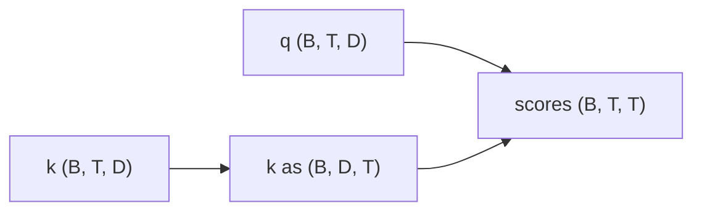

---
{
  "id": "numpy-and-tensor-shapes",
  "title": "NumPy and Tensor Shapes",
  "slug": "numpy-and-tensor-shapes",
  "section": "Computing Foundations",
  "category": "Model Architecture",
  "difficulty": "Easy",
  "order": 4,
  "coverImage": "illustrations/_generated/chapter_flow_dark.png",
  "companies": [
    "OpenAI",
    "Anthropic",
    "Google",
    "Meta"
  ],
  "shortDescription": "Two text snippets hold 24 numbers. Naming each axis tells you which values belong to which word before an index, a broadcast, or a reduction can be trusted.",
  "keyConceptsTested": [
    "ndarrays",
    "shape and dtype checks",
    "axis naming",
    "indexing",
    "broadcasting",
    "axis reductions",
    "keepdims",
    "reshape vs transpose",
    "matrix multiplication",
    "shape guards",
    "column vs row vectors"
  ],
  "prerequisites": [
    "python-for-ai-engineering"
  ],
  "relatedQuestions": [
    "data-structures-for-ai-systems",
    "algorithms-complexity-ml-engineers"
  ]
}
---

Two short text snippets contain three words each: "the red fox" and "a blue bird." Suppose we represent each word with four numbers. We have 24 numbers in total, yet the total count alone never tells us which slice of numbers belongs to which word or which snippet. The previous [Python for AI Engineering](/learn/python-for-ai-engineering) lesson scored JSONL rows one at a time: parse a line, inspect its fields, and compare a predicted class with the expected label. Here, the same kind of data arrives as one numeric array holding many rows together, so a single array operation processes the entire batch in one step.

## Two text snippets, one array

An **array** arranges values along numbered **axes**, such as rows and columns. NumPy calls its array object an <span data-glossary="numpy-array">ndarray</span>. In machine-learning code, you'll also see the word <span data-glossary="tensor">tensor</span> for an array with zero, one, or several axes.

| Batch item | Tokens (words) |
|---|---|
| 0 | `["the", "red", "fox"]` |
| 1 | `["a", "blue", "bird"]` |

A <span data-glossary="token">token</span> is a piece of text a model processes; here we choose one word per token, and a feature <span data-glossary="vector">vector</span> is the list of numbers representing one token. The numbers below count sequentially from 0 rather than encoding learned word meanings, which makes every value easy to track as we slice, broadcast, and reshape the array. Give each token four features and fill them in order so every coordinate holds a distinct value:

```text
x =
[
  [[ 0,  1,  2,  3],
   [ 4,  5,  6,  7],
   [ 8,  9, 10, 11]],

  [[12, 13, 14, 15],
   [16, 17, 18, 19],
   [20, 21, 22, 23]]
]
```

There are two snippets, three token rows per snippet, and four values per row. Because each axis captures one nested grouping level from outer batch down to individual features, the tensor shape reads naturally from left to right as `(B, T, D) = (2, 3, 4)`:

| Axis | Meaning | Size |
|---|---|---:|
| `B` | batch, how many snippets | 2 |
| `T` | token positions per snippet | 3 |
| `D` | numbers per token | 4 |

If you can say that sentence, you can usually debug the next operation. The first axis picks a snippet, the second picks a word, and the third holds that word's four numbers. `x[0, 1]` selects the row labeled `red` and returns its four-feature vector.

<figure>
  
  <figcaption>`x[0, 1]` selects snippet 0, then its highlighted `red` row. Both integer indices remove an axis: only the four features `[4, 5, 6, 7]` remain, with shape `(4,)`.</figcaption>
</figure>

## Rank, shape, and dtype

Finding one value takes three indices, and the shape says how many choices exist at each position. The number of axes is the array's **rank**, exposed as `x.ndim`, so this array has rank 3. Axis numbers start at zero: batch is axis `0`, tokens are axis `1`, and features are axis `2`, while negative axis numbers count backward, making `-1` another name for the feature axis.

| Term | Shape | What it holds |
|---|---|---|
| **scalar** | `()` | one number, no axes |
| **vector** | `(4,)` | 4 numbers along one axis, with no row or column orientation |
| **matrix** | `(3, 4)` | 3 rows, each with 4 numbers |
| **3-D tensor** | `(2, 3, 4)` | three axes, generalizing the same idea |

The comma in `(4,)` is Python's notation for a one-item tuple, because an array's `shape` is always a tuple even when it contains just one axis length. Leaving off the comma turns `(4)` into an ordinary integer in parentheses, which trips beginners writing shape tuples by hand. Shape alone only describes how coordinates map to entries, however; every NumPy array also carries one <span data-glossary="dtype">data type, or dtype</span>, that determines how each element is stored and interpreted in memory.

Our examples use `float32`, a 32-bit floating-point type standard for model inputs and activations. Calling `np.arange(24)` without a `dtype` argument defaults to integers, whereas passing `dtype=np.float32` keeps later arithmetic aligned with neural network code. At a model interface, check shape and dtype separately: an array with shape `(2, 3, 4)` and dtype `int64` passes a shape check yet still fails an operation that requires `float32`.

## Indexing: which axes stay and which disappear

Because every coordinate points directly to a token vector, indexing lets you pull out either a single word, a full snippet, or the same position across the entire batch. Look at `x[:, 1]`: the colon keeps the batch axis, the integer `1` selects token position 1 and drops the token axis, and all four features remain, giving shape `(2, 4)`. By contrast, `x[:, :, 0]` keeps both batch and token axes while collapsing the feature axis down to a single slot per word, giving shape `(2, 3)`.

| Expression | Plain-English meaning | Result shape |
|---|---|---|
| `x[0]` | snippet 0, all tokens, all features | `(3, 4)` |
| `x[0, 1]` | token 1 in snippet 0 | `(4,)` |
| `x[:, 1]` | token 1 from each snippet | `(2, 4)` |
| `x[:, :, 0]` | feature 0 from each token in each snippet | `(2, 3)` |

Read an index from left to right. A single integer such as `0` or `1` chooses one item and removes that axis, while a colon keeps the entire axis intact. A slice such as `0:1` also keeps the axis, selecting only its first item: `x[0:1]` has shape `(1, 3, 4)` rather than `(3, 4)` from `x[0]`, which matters whenever downstream code expects a leading batch axis.

### Inspect the batch

Run the script below to check both values and shapes. `np.arange(24)` creates the numbers from 0 through 23, and `reshape(B, T, D)` groups them into the nested layout above; with `uv` from the Python lesson, you can save any runnable snippet as a `.py` file and execute `uv run --with numpy filename.py`.

<!-- leetllm: test, deps=numpy, output=show -->
```python title="code-lab-inspect-one-batch.py"
import numpy as np

B, T, D = 2, 3, 4
x = np.arange(B * T * D, dtype=np.float32).reshape(B, T, D)

print("x shape", x.shape)
print("x dtype", x.dtype)
print("x[0] shape", x[0].shape)
print("x[0,1]", x[0, 1])
print("x[:,1]")
print(x[:, 1])
```

<!-- leetllm: output:start -->
```text title="Output" output compact
x shape (2, 3, 4)
x dtype float32
x[0] shape (3, 4)
x[0,1] [4. 5. 6. 7.]
x[:,1]
[[ 4.  5.  6.  7.]
 [16. 17. 18. 19.]]
```
<!-- leetllm: output:end -->

Selecting the token `red` gave us four features. Adding the same four offsets to every token should preserve those feature positions, without writing a loop over snippets and tokens.

## Broadcasting: reuse one feature bias

A **bias** is an additive offset. Suppose we want to add the same four offsets, one per feature, to every token vector in the batch without writing nested Python loops over snippets and positions. Because `bias = [100, 200, 300, 400]` has shape `(4,)`, it matches the trailing feature axis of `x` and adds cleanly to each token vector:

```text
x[0, 1]     = [  4,   5,   6,   7]
bias        = [100, 200, 300, 400]
result      = [104, 205, 306, 407]
```

NumPy applies that addition across every token in every snippet automatically through <span data-glossary="broadcasting">broadcasting</span>. Conceptually, the bias vector repeats across the batch and token axes to yield a `(2, 3, 4)` output, without materializing an expanded copy of `bias` in memory first. The addition itself still allocates the full `(2, 3, 4)` output array, so broadcasting saves memory on the smaller operand rather than making large results free.[^numpyBroadcasting2026]

The alignment rule proceeds strictly from right to left:

1. Line both shapes up at their trailing dimensions.
2. Two aligned axes are compatible if their sizes are equal or one of them is `1`.
3. Missing leading axes in the smaller array behave as size `1`.
4. If any aligned pair breaks this rule, NumPy raises a `ValueError`.

For `x.shape == (2, 3, 4)`:

| Smaller shape | What NumPy does | Meaning |
|---|---|---|
| `(4,)` | aligns with the feature axis and expands across batch and token positions | one bias per feature |
| `(3, 1)` | aligns with the token axis and expands across batch and features | one scalar per token position |
| `(3,)` | raises an error | no feature axis matches that `3` |

Each column in the diagram below represents one axis slot (`B`, `T`, `D`), with cyan cells showing size-1 dimensions including implicit leading ones. Notice why the bare `(3,)` array fails: lining shapes up from the right places `3` under `D=4` rather than under `T=3`. Placing a trailing size-1 axis on `(3, 1)` shifts `3` left into the token column so `D=1` broadcasts safely across features.

<figure>
  
  <figcaption>Broadcasting starts at the trailing edge. Equal sizes or size-1 axes align cleanly, while a bare `(3,)` collides with `D=4` unless you insert a trailing size-1 axis to place `3` on `T`.</figcaption>
</figure>

### Add the feature bias

Run the next snippet to add `bias` to `x` and confirm both the shifted `red` row `[104, 205, 306, 407]` and the preserved `(2, 3, 4)` output shape.

<!-- leetllm: test, deps=numpy, output=show -->
```python title="code-lab-broadcast-one-feature-bias.py"
import numpy as np

B, T, D = 2, 3, 4
x = np.arange(B * T * D, dtype=np.float32).reshape(B, T, D)
bias = np.array([100, 200, 300, 400], dtype=np.float32)
shifted = x + bias

print("shifted shape", shifted.shape)
print("shifted[0,1]", shifted[0, 1])
```

<!-- leetllm: output:start -->
```text title="Output" output compact
shifted shape (2, 3, 4)
shifted[0,1] [104. 205. 306. 407.]
```
<!-- leetllm: output:end -->

If you pass `np.array([10, 20, 30])` by mistake, NumPy catches the incompatible trailing axis immediately with `ValueError: operands could not be broadcast together with shapes (2,3,4) (3,)`. That error message is helpful because it reveals that the trailing feature dimension did not match the array you supplied as a bias. Rather than waiting for such mismatches in a larger pipeline, you can test the failure condition explicitly:

<!-- leetllm: test, deps=numpy, output=show -->
```python title="broadcast-shape-error.py"
import numpy as np

x = np.arange(2 * 3 * 4, dtype=np.float32).reshape(2, 3, 4)
token_bias = np.array([10, 20, 30], dtype=np.float32)

try:
    x + token_bias
except ValueError as exc:
    print(str(exc))
else:
    raise RuntimeError("Expected NumPy to reject shape (3,) against (2, 3, 4)")
```

<!-- leetllm: output:start -->
```text title="Output" output compact
operands could not be broadcast together with shapes (2,3,4) (3,)
```
<!-- leetllm: output:end -->

### When broadcasting succeeds with the wrong meaning

A 1-D array with shape `(3,)` has no row or column orientation on its own, so broadcasting always lines its single axis up with the trailing dimension of the larger array. When you need an array to align along an earlier axis instead, insert a size-1 axis explicitly using `None` inside an index: `v[:, None]` has shape `(3, 1)` to broadcast across columns, whereas `v[None, :]` has shape `(1, 3)` to broadcast down rows. Checking these two 2-D shapes before adding avoids relying on accidental shape compatibility.

<!-- leetllm: test, deps=numpy, output=show -->
```python title="the-n-vs-n-1-trap.py"
import numpy as np

v = np.array([1, 2, 3])
print("v shape", v.shape)
print("v[:, None] shape", v[:, None].shape)
print("v[None, :] shape", v[None, :].shape)
```

<!-- leetllm: output:start -->
```text title="Output" output compact
v shape (3,)
v[:, None] shape (3, 1)
v[None, :] shape (1, 3)
```
<!-- leetllm: output:end -->

The risk becomes clear when two axes happen to share the same length. Take only the first three features of snippet 0 so its shape becomes `(3, 3)`, matching token count and feature count. NumPy accepts a bare `(3,)` token bias without raising an error, yet it applies the three offsets across features instead of down tokens:

<!-- leetllm: test, deps=numpy, output=show -->
```python title="silent-broadcast-error.py"
import numpy as np

x = np.arange(24, dtype=np.float32).reshape(2, 3, 4)
square = x[0, :, :3]
token_bias = np.array([10, 20, 30], dtype=np.float32)
wrong = square + token_bias
right = square + token_bias[:, None]

print("both shapes", wrong.shape, right.shape)
print("wrong first token", wrong[0])
print("right first token", right[0])
assert np.array_equal(right[0], [10, 11, 12])
assert not np.array_equal(wrong, right)
```

<!-- leetllm: output:start -->
```text title="Output" output compact
both shapes (3, 3) (3, 3)
wrong first token [10. 21. 32.]
right first token [10. 11. 12.]
```
<!-- leetllm: output:end -->

The intended offset for token 0 is `10`, applied uniformly across all three features of that token. Instead, bare `token_bias` shifts features differently, producing `[10, 21, 32]` on token 0 while `token_bias[:, None]` yields the expected `[10, 11, 12]`. Notice that both `wrong` and `right` produce shape `(3, 3)`, proving that a passing execution and matching output shape never guarantee the axes were aligned as intended; checking values on a concrete row catches the mistake.

## Reductions: collapsing the right axis

Every reduction answers a single design question: which axis are you summarizing away, and which axes must remain? Suppose you want one summary vector per snippet rather than one vector per token. Keeping the batch and feature axes while averaging across the token axis (`x.mean(axis=1)`) gives shape `(B, D) = (2, 4)`. Using the same values from 0 through 23 for snippet 0, each feature column averages across its three token rows:

```text
token 0 = [ 0,  1,  2,  3]
token 1 = [ 4,  5,  6,  7]
token 2 = [ 8,  9, 10, 11]
mean    = [ 4,  5,  6,  7]
```

Now contrast `x.mean(axis=1)` with `x.mean(axis=-1)`, which collapses the trailing feature axis instead of the token axis. Reducing axis `-1` leaves the batch and token axes intact, turning shape `(2, 3, 4)` into `(B, T) = (2, 3)`: one scalar summary per token rather than one feature vector per snippet. Run the next comparison to verify both output shapes (`(2, 4)` for token pooling and `(2, 3)` for feature means) alongside the first-row numbers we computed by hand.

<!-- leetllm: test, deps=numpy, output=show -->
```python title="code-lab-compare-two-reductions.py"
import numpy as np

B, T, D = 2, 3, 4
x = np.arange(B * T * D, dtype=np.float32).reshape(B, T, D)
pooled_tokens = x.mean(axis=1)
feature_means = x.mean(axis=-1)

print("pooled_tokens shape", pooled_tokens.shape)
print("pooled_tokens dtype", pooled_tokens.dtype)
print("pooled_tokens[0]", pooled_tokens[0])
print("feature_means shape", feature_means.shape)
print("feature_means[0]", feature_means[0])
```

<!-- leetllm: output:start -->
```text title="Output" output compact
pooled_tokens shape (2, 4)
pooled_tokens dtype float32
pooled_tokens[0] [4. 5. 6. 7.]
feature_means shape (2, 3)
feature_means[0] [1.5 5.5 9.5]
```
<!-- leetllm: output:end -->

Before writing a reduction, state its target axes out loud: "I want one vector per snippet, so I'm reducing the token axis." That phrasing tells you immediately which axis disappears and which two must remain.

Also pay attention to accumulation precision. A `float32` input returns a `float32` mean, whereas integer inputs use `float64` accumulation and output by default, and `float16` accumulates in `float32` before returning `float16`.[^numpyMean2026] When summing many values or combining magnitudes that differ sharply, `float32` accumulation can lose small terms, so passing `dtype=np.float64` protects precision whenever downstream code can accept a `float64` result. Even three values expose the effect: for `[16777216, 1, -16777216]`, the exact sum is `1` and the exact mean is `1/3`, yet `float32` drops the `1` when adding it to `16777216` because the spacing between adjacent `float32` numbers there exceeds `1`. Compare both accumulators on the same `float32` input:

<!-- leetllm: test, deps=numpy, output=show -->
```python title="mean-accumulator-precision.py"
import numpy as np

feature = np.array([16777216, 1, -16777216], dtype=np.float32)
default_mean = feature.mean()
wide_mean = feature.mean(dtype=np.float64)

print("float32 mean", float(default_mean))
print("float64 mean", float(wide_mean))
assert default_mean == 0
assert np.isclose(wide_mean, 1 / 3)
```

<!-- leetllm: output:start -->
```text title="Output" output compact
float32 mean 0.0
float64 mean 0.3333333333333333
```
<!-- leetllm: output:end -->

All three inputs are exactly representable in `float32`; the unit is lost solely during accumulation, so a wider accumulator recovers it without altering the input array (whereas our running batch values `0` through `23` sit well inside exact integer range).[^numpyMean2026]

### Subtract a mean without losing its position

By default, a reduction deletes the collapsed axis, which breaks subsequent broadcasting back against the original array. Collapsing `axis=1` on `(2, 3, 4)` produces `(2, 4)`, so right-aligned broadcasting tries to pair batch length `2` with token length `3` and either raises a `ValueError` or, worse, mixes axes silently when lengths happen to match. Keeping the reduced axis as size `1` with `keepdims=True` produces `(2, 1, 4)` so every mean subtracts cleanly across all tokens in its own snippet:

<!-- leetllm: test, deps=numpy, output=show -->
```python title="why-keepdims-true-is-a-safety-switch.py"
import numpy as np

B, T, D = 2, 3, 4
x = np.arange(B * T * D, dtype=np.float32).reshape(B, T, D)

# Without keepdims: shape becomes (2, 4), which no longer broadcasts with (2, 3, 4)
mean_flat = x.mean(axis=1)
print("mean_flat shape", mean_flat.shape)

# With keepdims: shape stays (2, 1, 4), which still broadcasts with (2, 3, 4)
mean_kept = x.mean(axis=1, keepdims=True)
print("mean_kept shape", mean_kept.shape)
centered = x - mean_kept
print("centered snippet 0")
print(centered[0])
assert np.allclose(centered.mean(axis=1), 0)
```

<!-- leetllm: output:start -->
```text title="Output" output compact
mean_flat shape (2, 4)
mean_kept shape (2, 1, 4)
centered snippet 0
[[-4. -4. -4. -4.]
 [ 0.  0.  0.  0.]
 [ 4.  4.  4.  4.]]
```
<!-- leetllm: output:end -->

Passing `keepdims=True` retains the collapsed axis as a placeholder of size `1`, preserving all axis positions so the mean broadcasts cleanly across every token in `x`. After centering, the first feature column across tokens becomes `[-4, 0, 4]`, whose mean is zero within floating-point tolerance (`np.allclose`). Just like the square-array bias trap, if batch size happened to match token count (`B == T`), omitting `keepdims=True` would run without error and subtract the wrong snippet's mean!

The diagram below shows both the arithmetic on snippet 0 and the shape alignment side by side. Without `keepdims`, `(2, 4)` right-aligns so the batch dimension `2` collides with `T=3`; with `keepdims`, a cyan size-1 slot holds `T`'s place and broadcasts across all three tokens.

<figure>
  
  <figcaption>`keepdims=True` leaves a size-1 placeholder where the token reduction happened, keeping `B` and `D` in their original slots so the mean subtracts cleanly back into `x`.</figcaption>
</figure>

## Reshape vs. transpose: regrouping or reordering

Suppose `x` still has axes `(batch, tokens, features) = (2, 3, 4)`, and a downstream operation asks for shape `(2, 4, 3)`. Does it want the same 24 numbers re-chunked into four groups of three, or does it want the token and feature axes swapped? Run both operations on `x` to see how identical values land in completely different slots:

<!-- leetllm: test, deps=numpy, output=show -->
```python title="reshape-vs-transpose.py"
import numpy as np

x = np.arange(24, dtype=np.float32).reshape(2, 3, 4)
reshaped = x.reshape(2, 4, 3)
transposed = np.transpose(x, (0, 2, 1))

print("x[0]")
print(x[0])
print("reshaped[0]")
print(reshaped[0])
print("transposed[0]")
print(transposed[0])
```

<!-- leetllm: output:start -->
```text title="Output" output compact
x[0]
[[ 0.  1.  2.  3.]
 [ 4.  5.  6.  7.]
 [ 8.  9. 10. 11.]]
reshaped[0]
[[ 0.  1.  2.]
 [ 3.  4.  5.]
 [ 6.  7.  8.]
 [ 9. 10. 11.]]
transposed[0]
[[ 0.  4.  8.]
 [ 1.  5.  9.]
 [ 2.  6. 10.]
 [ 3.  7. 11.]]
```
<!-- leetllm: output:end -->

Both results have shape `(2, 4, 3)`, yet they answer entirely different questions. Trace where the highlighted `3` lands while staying attached to token `the`, feature `d3`: `reshape` walks the flat stream in C-order and parks `3` beside `4` (the first feature of token `red`), whereas `transpose` permutes the axes so `3` stays at feature `d3` of `the` in a feature-by-token grid. Even identical dimensions can hide an axis scramble unless you inspect where individual token values move.

The figure below also reveals how those values sit in memory. Each `float32` occupies four bytes, so in `x[0]` moving one feature advances 4 bytes and moving one token advances `4 × 4 = 16` bytes, giving <span data-glossary="array-stride">strides</span> of `(16, 4)`. Our original array is **C-contiguous** because its final axis steps across adjacent memory addresses; reshaping to `(4, 3)` shortens each row to three values with strides `(12, 4)`, whereas transposing swaps the existing strides to `(4, 16)` so stepping across a row jumps 16 bytes in the unchanged buffer.[^numpyStrides2026]

<figure>
  
  <figcaption>Same twelve numbers, two layouts. `reshape` walks the flat stream, so `3` and `4` become neighbors. `transpose` swaps axes, so `3` stays feature `d3` of token `the`.</figcaption>
</figure>

| Operation | What it does | When to use it |
|---|---|---|
| `reshape` | reads values in the requested index order (C-order by default) and groups them into a new shape | when the flat order is correct and you want new grouping |
| `transpose` | permutes the axes | when the same values are attached to the wrong axis order |

Whenever your goal is turning `(B, T, D)` into `(B, D, T)`, you are reordering axes rather than re-chunking a stream, so `transpose` is the right tool. Reshaping is reserved for regrouping elements while preserving their count (`2 * 3 * 4 == 2 * 4 * 3 == 24`), where one dimension may be `-1` so NumPy infers it automatically (for instance, `x.reshape(-1, 4)` merges batch and token axes into `(6, 4)` while keeping each four-feature token vector intact).[^numpyReshape2026] Watch for one quiet edge case with 1-D vectors: because a 1-D array has only one axis, `.T` leaves its shape unchanged, so explicit row or column vectors still require `v[None, :]` or `v[:, None]`:

<!-- leetllm: test, deps=numpy, output=show -->
```python title="vector-transpose-stays-1d.py"
import numpy as np

v = np.array([1, 2, 3])
print(v.shape)
print(v.T.shape)
```

<!-- leetllm: output:start -->
```text title="Output" output compact
(3,)
(3,)
```
<!-- leetllm: output:end -->

### Views and copies: who shares memory

An ndarray pairs a contiguous or strided memory buffer with metadata describing shape, dtype, and strides. A **view** reuses the underlying buffer with new metadata, so writing through a view mutates the original array, whereas a **copy** allocates an independent buffer. Basic slicing (`x[:, 1, :]`) and `np.transpose` return views whenever strides can represent the new indexing, while **advanced indexing** using integer lists or boolean masks always returns a copy, and `reshape` copies only if the array is non-contiguous.[^numpyCopiesViews2026] Test that distinction directly in the next snippet: editing the slice mutates `x`, while editing the advanced-index selection leaves `x` unchanged.

<!-- leetllm: test, deps=numpy, output=show -->
```python title="views-vs-copies.py"
import numpy as np

x = np.arange(24, dtype=np.float32).reshape(2, 3, 4)

token = x[:, 1, :]   # basic slice -> view shares memory with x
token[0, 0] = 99
print("after editing a slice, x[0, 1, 0] =", x[0, 1, 0])

picked = x[[0, 1]]   # advanced indexing -> independent copy
picked[0, 0, 0] = -1
print("after editing an advanced-index copy, x[0, 0, 0] =", x[0, 0, 0])
```

<!-- leetllm: output:start -->
```text title="Output" output compact
after editing a slice, x[0, 1, 0] = 99.0
after editing an advanced-index copy, x[0, 0, 0] = 0.0
```
<!-- leetllm: output:end -->

If you need to mutate a slice without touching the source, call `.copy()` first (`x[:, 1, :].copy()`), and check `np.shares_memory(a, b)` whenever buffer ownership is unclear. Note also that retrieving an advanced-index expression (`picked = x[[0, 1]]`) allocates a copy, whereas assigning into one (`x[[0, 1]] = 0`) still writes directly into `x`.[^numpyCopiesViews2026]

### A transpose can make the next reshape copy

Because a transpose reorders strides without moving memory, its result is usually non-contiguous, forcing a subsequent `reshape` to allocate a new buffer in logical index order rather than original physical order. The next snippet checks strides, memory sharing, and contiguity across both operations:

<!-- leetllm: test, deps=numpy, output=show -->
```python title="transpose-then-reshape-copy.py"
import numpy as np

x = np.arange(24, dtype=np.float32).reshape(2, 3, 4)
t = x.transpose(0, 2, 1)
print("source shape and strides", x.shape, x.strides)
print("transpose shape and strides", t.shape, t.strides)
print("transpose shares memory?", np.shares_memory(t, x))
print("transpose contiguous?", t.flags["C_CONTIGUOUS"])
reshaped = t.reshape(2, 12)
print("reshape shares memory with transpose?", np.shares_memory(reshaped, t))
print("reshaped shape", reshaped.shape)
print("reshaped snippet 0", reshaped[0])
assert np.array_equal(reshaped[0], [0, 4, 8, 1, 5, 9, 2, 6, 10, 3, 7, 11])
```

<!-- leetllm: output:start -->
```text title="Output" output compact
source shape and strides (2, 3, 4) (48, 16, 4)
transpose shape and strides (2, 4, 3) (48, 4, 16)
transpose shares memory? True
transpose contiguous? False
reshape shares memory with transpose? False
reshaped shape (2, 12)
reshaped snippet 0 [ 0.  4.  8.  1.  5.  9.  2.  6. 10.  3.  7. 11.]
```
<!-- leetllm: output:end -->

Prefer `reshape` only when the flat index order is already what you want, and call `np.ascontiguousarray(t)` explicitly when downstream code requires a contiguous C-order buffer. Notice that `reshaped[0]` begins `[0, 4, 8]` rather than `[0, 1, 2]` because `reshape` follows logical C-index order of `t`, forcing a copy that preserves the transposed axis semantics rather than reverting to the original buffer layout.[^numpyReshape2026] Keep in mind too that axis positions are conventions rather than self-describing names: vision libraries variously expect `(batch, channels, height, width)` or `(batch, height, width, channels)`, so always write the axis order explicitly.

## Matrix multiplication: compare every pair of tokens

Addition pairs features at matching positions and `mean` collapses an axis, while **matrix multiplication** (`@`) compares every token vector against every other token vector via row-by-column dot products. Token `the` (`[0, 1, 2, 3]`) and token `red` (`[4, 5, 6, 7]`) have <span data-glossary="dot-product">dot product</span> $0\times4 + 1\times5 + 2\times6 + 3\times7 = 38$, and `@` computes all nine token-pair scores at once by contracting the shared feature axis `D`: multiplying `(3, 4) @ (4, 3)` produces `(3, 3)`.[^numpyMatmul2026]

This pairwise comparison forms the core of **attention** in a <span data-glossary="transformer">Transformer</span>, where each token projects into a **query** vector (asking for context) and a **key** vector (advertising what it contains).[^vaswani2017] Using learned weight <span data-glossary="matrix">matrices</span> of shape `(D, D)` (set to identity matrices here so values stay identical to `x`), both `q` and `k` have shape `(B, T, D)`. For arrays with more than two axes, `@` treats the final two dimensions as matrices and broadcasts leading axes as a batch stack, so swapping the last two axes of `k` to `(B, D, T)` lets `(B, T, D) @ (B, D, T)` produce `(B, T, T)` unscaled attention scores.[^numpyMatmul2026]



Swapping the last two axes of `k` lines up the inner dimension `D` across `q` and `k`, contracting `D` away so each entry `scores[b, i, j]` compares query token `i` with key token `j` in snippet `b`. Run the verification cell below to watch `q @ k` fail on mismatched inner axes `(4 != 3)` and then verify `unscaled_scores[0, 0, 0] == 14.0` ($0^2 + 1^2 + 2^2 + 3^2$) and `unscaled_scores[0, 0, 1] == 38.0`.

<!-- leetllm: test, deps=numpy, output=show -->
```python title="code-lab-check-attention-scores.py"
import numpy as np

B, T, D = 2, 3, 4
x = np.arange(B * T * D, dtype=np.float32).reshape(B, T, D)
wq = np.eye(D, dtype=np.float32)
wk = np.eye(D, dtype=np.float32)

q = x @ wq
k = x @ wk

try:
    q @ k
except ValueError:
    print("q @ k fails: inner axes are D=4 and T=3")
else:
    raise RuntimeError("Expected q @ k to fail for shapes (2, 3, 4) and (2, 3, 4)")

unscaled_scores = q @ np.swapaxes(k, -1, -2)

print("q", q.shape)
print("k", k.shape)
print("unscaled_scores", unscaled_scores.shape)
print("first query against first key", unscaled_scores[0, 0, 0])
print("token 'the' against token 'red'", unscaled_scores[0, 0, 1])
assert unscaled_scores[0, 0, 1] == 38
```

<!-- leetllm: output:start -->
```text title="Output" output compact
q @ k fails: inner axes are D=4 and T=3
q (2, 3, 4)
k (2, 3, 4)
unscaled_scores (2, 3, 3)
first query against first key 14.0
token 'the' against token 'red' 38.0
```
<!-- leetllm: output:end -->

These are raw comparison scores rather than normalized weights or final attention outputs; later lessons scale them, pass them through softmax, and combine value vectors. For now, the shape invariant is what matters: `unscaled_scores[b, i, j]` scores token `i` against token `j` in snippet `b` across all four features.

### Split each token's features, then move the new axis

Transformers run several attention comparisons in parallel across separate **heads** by splitting each `D`-dimensional vector into `H` chunks of size `head_dim = D // H`.[^vaswani2017] Exposing those heads requires two distinct operations: first `reshape` `(B, T, D)` into `(B, T, H, D // H)` so each token's feature vector splits cleanly into head-sized slices, and then `transpose(0, 2, 1, 3)` to move the head axis next to the batch axis as `(B, H, T, D // H)`. Calling `reshape(B, H, T, head_dim)` directly yields the exact same shape while silently mixing features across tokens and heads:

<!-- leetllm: test, deps=numpy, output=show -->
```python title="split-attention-heads.py"
import numpy as np

B, T, D, H = 2, 3, 4, 2
assert D % H == 0
head_dim = D // H
x = np.arange(B * T * D, dtype=np.float32).reshape(B, T, D)

# Right: expose the head axis, then move it next to the batch axis.
heads = x.reshape(B, T, H, head_dim).transpose(0, 2, 1, 3)

# Wrong: same target shape, but the values land in the wrong heads.
jumbled = x.reshape(B, H, T, head_dim)

print("heads shape", heads.shape)
print("same positions?", np.array_equal(heads, jumbled))
print("head 0, token 'red'", heads[0, 0, 1])
print("direct reshape, same index", jumbled[0, 0, 1])
assert np.array_equal(heads[0, 0, 1], x[0, 1, :head_dim])
```

<!-- leetllm: output:start -->
```text title="Output" output compact
heads shape (2, 2, 3, 2)
same positions? False
head 0, token 'red' [4. 5.]
direct reshape, same index [2. 3.]
```
<!-- leetllm: output:end -->

Both arrays have shape `(2, 2, 3, 2)`, so a shape check alone would pass. But head 0 for token `red` must contain `[4, 5]`, not the last two features of token `the`. The value assertion catches what the shape assertion can't.

## Transfer: the same rule on images

The trailing-axis rule works identically on image tensors. In a computer-vision pipeline holding 32 RGB satellite tiles of height 224 and width 224, the batch shape is `(32, 224, 224, 3)` with color channels on the final axis. Scaling pixel intensities to `[0, 1]` and subtracting a three-channel dataset mean `[0.52, 0.48, 0.44]` broadcasts right-aligned across every pixel location and image in the batch without a Python loop:

<!-- leetllm: test, deps=numpy, output=show -->
```python title="normalize-satellite-tiles.py"
import numpy as np

images = np.ones((32, 224, 224, 3), dtype=np.float32)
mean_color = np.array([0.52, 0.48, 0.44], dtype=np.float32)

normalized = images - mean_color
print("normalized shape", normalized.shape)
print("one centered pixel", normalized[0, 0, 0].round(2))
```

<!-- leetllm: output:start -->
```text title="Output" output compact
normalized shape (32, 224, 224, 3)
one centered pixel [0.48 0.52 0.56]
```
<!-- leetllm: output:end -->

Because the trailing channel count `3` matches on both operands, NumPy automatically expands the missing leading dimensions `(1, 1, 1, 3)` over all 32 tiles and `224 × 224` pixels. Notice the exact parallel to token features: `(B, H, W, C)` plays the same structural role here as `(B, T, D)` played for language snippets. Whenever you subtract a vector along the trailing feature or channel axis, right-aligned broadcasting shares one dataset statistic across every example and spatial or sequence position.

## Common shape bugs: symptoms and fixes

Shape bugs become straightforward to diagnose once you pair the error symptom with the axis alignment that caused it.

| Symptom | Likely cause | Fix |
|---|---|---|
| `ValueError: operands could not be broadcast together with shapes (2,3,4) (3,)` | you tried to match a token-sized vector with the feature axis | decide whether the smaller array should be `(D,)`, `(T, 1)`, or something else |
| output has shape `(2, 3)` after `mean`, but you expected `(2, 4)` | you reduced the feature axis instead of the token axis | say the axis name before calling `mean`, then verify the kept axes |
| code works with `x[0]` but breaks on real batches | you dropped the batch axis during indexing | keep tiny batch examples in scripts and assertions |
| `v.T` still has shape `(4,)` | a 1-D vector has a single axis | make the row or column explicit with `v[None, :]` or `v[:, None]` |
| `reshape` gave a legal array, but token meaning changed | axis order was wrong, but you regrouped values instead of permuting axes | use `transpose` when the axis names must move |
| `q @ k` raises a matrix-multiply mismatch | the last axis of `q` doesn't line up with the second-to-last axis of `k` | swap the last two axes of `k` before the multiply |
| subtracting a mean gives `(32, 224, 224, 3)` but colors look wrong | `(224, 224, 3)` subtracts a different mean at each pixel location | require `(3,)` when the goal is one mean per channel, shared across all locations |
| editing a slice silently changes the original array | basic slices are views that share memory, not copies | call `.copy()` when you need an independent array |
| split heads have the right shape but attention output is garbage | you reshaped straight to `(B, H, T, D // H)` instead of reshaping then transposing | reshape to `(B, T, H, D // H)` first, then `transpose(0, 2, 1, 3)` |

Whenever a shape error appears, write out the intended axis names before changing any code, then confirm that every operation preserves them.

## Build a shape guard script

Turn the running example into a small validation script with explicit input and output checks. Starting from `x = np.arange(24).reshape(2, 3, 4)`, wrap `add_feature_bias(x, bias)` (preserving `(2, 3, 4)`), `pool_tokens(x)` (reducing to `(2, 4)`), and `unscaled_attention_scores(x, wq, wk)` (producing `(2, 3, 3)`), and reject invalid shapes with explicit `ValueError` exceptions because Python strips `assert` statements under `-O` optimization. Notice that these guards validate shapes only; add dtype checks separately whenever an interface requires `float32`. Try sketching the three functions on your own before comparing against the reference implementation below:

<!-- leetllm: test, deps=numpy, output=show -->
```python title="build-a-shape-guard-script.py"
import numpy as np

def add_feature_bias(x: np.ndarray, bias: np.ndarray) -> np.ndarray:
    if x.ndim != 3:
        raise ValueError(f"expected (B, T, D), got {x.shape}")
    expected_bias_shape = (x.shape[-1],)
    if bias.shape != expected_bias_shape:
        raise ValueError(f"expected bias shape {expected_bias_shape}, got {bias.shape}")
    out = x + bias
    assert out.shape == x.shape
    return out

def pool_tokens(x: np.ndarray) -> np.ndarray:
    if x.ndim != 3:
        raise ValueError(f"expected (B, T, D), got {x.shape}")
    out = x.mean(axis=1)
    assert out.shape == (x.shape[0], x.shape[2])
    return out

def unscaled_attention_scores(x: np.ndarray, wq: np.ndarray, wk: np.ndarray) -> np.ndarray:
    if x.ndim != 3:
        raise ValueError(f"expected (B, T, D), got {x.shape}")
    batch, tokens, width = x.shape
    expected_weight_shape = (width, width)
    if wq.shape != expected_weight_shape or wk.shape != expected_weight_shape:
        raise ValueError(
            f"expected weight shapes {expected_weight_shape}, got {wq.shape} and {wk.shape}"
        )
    q = x @ wq
    k = x @ wk
    unscaled_scores = q @ np.swapaxes(k, -1, -2)
    assert unscaled_scores.shape == (batch, tokens, tokens)
    return unscaled_scores

x = np.arange(24, dtype=np.float32).reshape(2, 3, 4)
bias = np.array([100, 200, 300, 400], dtype=np.float32)
wq = np.eye(4, dtype=np.float32)
wk = np.eye(4, dtype=np.float32)

shifted = add_feature_bias(x, bias)
pooled = pool_tokens(shifted)
unscaled_scores = unscaled_attention_scores(x, wq, wk)

# Expected values come from the earlier feature sums and token dot products.
assert np.array_equal(shifted[0, 1], [104, 205, 306, 407])
assert np.array_equal(pooled[0], [104, 205, 306, 407])
assert np.array_equal(unscaled_scores[0], [
    [14, 38, 62],
    [38, 126, 214],
    [62, 214, 366],
])

print("shifted", shifted.shape)
print("pooled", pooled.shape)
print("unscaled_scores", unscaled_scores.shape)
print("pooled snippet 0", pooled[0])
print("score row for token 'the'", unscaled_scores[0, 0])

try:
    add_feature_bias(x, np.array([10, 20, 30], dtype=np.float32))
except ValueError as exc:
    print("caught:", exc)
else:
    raise RuntimeError("Expected the shape guard to reject a token-sized bias")
```

<!-- leetllm: output:start -->
```text title="Output" output compact
shifted (2, 3, 4)
pooled (2, 4)
unscaled_scores (2, 3, 3)
pooled snippet 0 [104. 205. 306. 407.]
score row for token 'the' [14. 38. 62.]
caught: expected bias shape (4,), got (3,)
```
<!-- leetllm: output:end -->

When extending these checks, use both unequal axis sizes and equal ones. Unequal sizes exposed the earlier broadcasting error, but equal sizes can hide a misplaced axis. Pair shape checks with a known-value assertion, as the head-splitting example did for token `red`.

```checkpoint
Your loader now returns one snippet as shape `(3, 4)`. The shape guard rejects it. How can you add a batch axis without changing which values belong to each token?
---
For `single.shape == (3, 4)`, use `single[None, :, :]` to get `(1, 3, 4)`. The new leading axis says there's one snippet. If you're selecting from the original batch instead, `x[0:1]` preserves that leading axis directly, whereas `x[0]` removes it.
```

On a 24-number array, name the axis for snippets, the axis for tokens, and the axis for features. A reduction or reshape can keep the count and still drop the meaning. `(B, T, D)` records how many snippets, how many positions in each snippet, and how many numbers describe each position. Preserve those axis meanings alongside the element count. A useful check pairs the expected shape with one value you can trace back to its original token.

```mastery-quiz
[
  {
    "question": "An array `x` has shape `(5, 7, 6)`, interpreted as `(B, T, D)`: 5 snippets, 7 token positions, and 6 features per token. What does `x[:, 2]` return?",
    "options": [
      "Token position 2 from every snippet with all features, shape `(5, 6)`.",
      "Snippet 2 with all token positions and all features, shape `(7, 6)`.",
      "Feature 2 from every token in every snippet, shape `(5, 7)`.",
      "Token position 2 from snippet 0 only with all features, shape `(6,)`."
    ],
    "answer": "Token position 2 from every snippet with all features, shape `(5, 6)`.",
    "explanation": "The colon keeps the batch axis. Meanwhile, an integer `2` selects one token position and drops that axis, leaving the feature coordinates intact to produce a `(5, 6)` matrix."
  },
  {
    "question": "A data loader requires a `(5, 7, 6)` batch of `float32` token features. It returns an array with shape `(5, 7, 6)` and dtype `int16`. Which diagnosis is correct?",
    "options": [
      "Both checks pass; numeric inputs satisfy the requirement whenever their values can be represented as `float32`.",
      "Shape passes, but dtype fails; axis sizes match while integer storage violates the required `float32` input.",
      "Shape fails, but dtype passes; the loader must return a flat `(210,)` array before model arithmetic begins.",
      "Both checks fail; converting the input to `float32` also requires regrouping its axes into `(5, 6, 7)`."
    ],
    "answer": "Shape passes, but dtype fails; axis sizes match while integer storage violates the required `float32` input.",
    "explanation": "Shape and dtype are separate parts of the input specification. The three axis lengths are correct, but each element is stored as an integer rather than the required 32-bit floating-point value. Create or cast the array as `float32` before model arithmetic without changing its axes."
  },
  {
    "question": "For `x.shape == (5, 7, 6)` interpreted as `(B, T, D)`, you want to add one scalar to each token position and reuse it across every feature and snippet. Which bias shape encodes that intent, and why does a bare `(7,)` fail?",
    "options": [
      "Use `(7,)`; NumPy aligns it with the token axis by name and then repeats it across features and snippets.",
      "Use `(1, 7)`; the leading `1` expands across batch and the `7` expands across token positions.",
      "Use `(7, 1)`; the `7` aligns with tokens and `1` expands across features, while `(7,)` hits trailing size `6`.",
      "Use `(5, 7)`; it covers the batch and token axes, and NumPy automatically creates a missing feature axis."
    ],
    "answer": "Use `(7, 1)`; the `7` aligns with tokens and `1` expands across features, while `(7,)` hits trailing size `6`.",
    "explanation": "NumPy aligns shapes from the right. To attach seven values to the token axis, the smaller array needs an explicit trailing size-1 feature axis: `(7, 1)`. A bare `(7,)` is lined up against the feature axis, so `7` is compared with `6` and broadcasting fails."
  },
  {
    "question": "A text-snippet tensor uses `(B, T, D) = (32, 10, 64)`, where `T` is token positions and `D` is features. A teammate writes `x.mean(axis=-1)` while saying they want one feature vector per snippet. What went wrong?",
    "options": [
      "They should have reduced the batch axis with `axis=0`; keeping the leading `32` means the operation never combined examples into snippet-level vectors.",
      "Nothing went wrong with the axis choice: for this tensor the `64` dimension is the token length, so averaging it leaves one `(10,)` vector per snippet.",
      "They reduced the token axis correctly, but misread the output: `(32, 10)` should be interpreted as 32 snippet vectors with 10 retained feature coordinates.",
      "They reduced the feature axis instead of the token axis. `axis=-1` turns `(32, 10, 64)` into `(32, 10)`, one scalar per token position."
    ],
    "answer": "They reduced the feature axis instead of the token axis. `axis=-1` turns `(32, 10, 64)` into `(32, 10)`, one scalar per token position.",
    "explanation": "For a `(B, T, D)` tensor, one vector per snippet means keep `B` and `D` and collapse `T`, so the intended operation is `x.mean(axis=1)` with result shape `(32, 64)`. `axis=-1` always means the last axis here, the feature axis, so it removes the vector coordinates instead of pooling tokens."
  },
  {
    "question": "For `x.shape == (5, 7, 6)` interpreted as `(B, T, D)`, you want to subtract each snippet's mean token vector from every token: `x - x.mean(axis=1)`. NumPy raises a broadcast error. Which change preserves the intended axes?",
    "options": [
      "Use `x.mean(axis=1, keepdims=True)`, producing `(5, 1, 6)` so the mean broadcasts across the token axis.",
      "Use `x.mean(axis=-1)`, producing `(5, 7)` so NumPy can stretch one mean across the feature axis.",
      "Use `x.mean(axis=0)`, producing `(7, 6)` so the batch mean broadcasts over snippets without needing a token placeholder.",
      "Use `x.mean(axis=1)[:, :, None]`, producing `(5, 6, 1)` so the feature axis becomes explicit for broadcasting."
    ],
    "answer": "Use `x.mean(axis=1, keepdims=True)`, producing `(5, 1, 6)` so the mean broadcasts across the token axis.",
    "explanation": "Without `keepdims`, reducing axis 1 changes `(5, 7, 6)` to `(5, 6)`. Aligned from the right, that collides with `(5, 7, 6)` because the `5` lands against the token axis size `7`. `keepdims=True` leaves a size-1 token slot, `(5, 1, 6)`, which can broadcast back over the seven tokens in each snippet."
  },
  {
    "question": "For `x = np.arange(120).reshape(2, 5, 12)`, you want three attention heads with final shape `(B, H, T, head_dim) = (2, 3, 5, 4)`. Why does reshaping directly to that shape assign values incorrectly?",
    "options": [
      "Because the problem is mainly memory sharing: `reshape` makes an independent copy for head tensors, while `transpose` preserves a view so every head stays tied to the original buffer.",
      "Reshape to expose heads, then transpose to move the head axis; reshape alone only regroups flat values and leaves token-head order unchanged.",
      "Because `reshape` can't introduce a head axis at all. You should transpose `(B, T, D)` to move the feature axis first, then reshape after the heads have been separated.",
      "Because `reshape` is sufficient as long as `D` is divisible by `H`; once NumPy returns `(B, H, T, head_dim)`, each consecutive feature block has already been assigned to the correct head and token."
    ],
    "answer": "Reshape to expose heads, then transpose to move the head axis; reshape alone only regroups flat values and leaves token-head order unchanged.",
    "explanation": "Splitting heads has two separate steps. First reshape `(B, T, D)` to `(B, T, H, head_dim)` so each token's feature vector is carved into head-sized chunks. Then transpose to `(B, H, T, head_dim)` so the head axis moves next to the batch axis. A direct reshape to the target shape can pass a shape check while assigning values to the wrong head-token positions."
  },
  {
    "question": "You have `q.shape == k.shape == (5, 7, 6)` from a `(B, T, D)` batch. You need unscaled attention scores where each query token is compared with every key token in the same snippet. Which code and assertion match that requirement?",
    "options": [
      "`scores = q @ k` and `assert scores.shape == (5, 7, 7)`",
      "`scores = np.swapaxes(q, -1, -2) @ k` and `assert scores.shape == (5, 6, 6)`",
      "`scores = q @ np.swapaxes(k, -1, -2)` and `assert scores.shape == (5, 7, 7)`",
      "`scores = (q * k).sum(axis=-1)` and `assert scores.shape == (5, 7)`"
    ],
    "answer": "`scores = q @ np.swapaxes(k, -1, -2)` and `assert scores.shape == (5, 7, 7)`",
    "explanation": "For attention scores, each query token needs a dot product with every key token. Swapping the last two axes of `k` changes each batch item from `(T, D)` to `(D, T)`, so `(T, D) @ (D, T)` gives a `(T, T)` score matrix per batch item. The two `T` axes mean asking token and compared-against token."
  },
  {
    "question": "A token-by-feature array is `a = np.zeros((4, 4))`, and `bias = np.array([3, 6, 9, 12])` contains one offset per token. What happens with `a + bias` compared with the intended `a + bias[:, None]`?",
    "options": [
      "Both produce `(4, 4)` and first row `[3, 3, 3, 3]`; the matching token count makes the inserted axis optional.",
      "The first raises a broadcast error; the second produces `(4, 4)` with first row `[3, 3, 3, 3]`.",
      "Both produce `(4, 4)`; the first gives row `[3, 3, 3, 3]`, while the second gives `[3, 6, 9, 12]`.",
      "Both produce `(4, 4)`; the first gives row `[3, 6, 9, 12]`, while the second gives `[3, 3, 3, 3]`."
    ],
    "answer": "Both produce `(4, 4)`; the first gives row `[3, 6, 9, 12]`, while the second gives `[3, 3, 3, 3]`.",
    "explanation": "The bare vector aligns with the last axis, so every row gets different offsets across features. Inserting a trailing size-1 axis makes each token's offset repeat across its features. Equal axis sizes hide the error from shape checks, so inspect a known row."
  },
  {
    "question": "Given `x = np.arange(60, dtype=np.float32).reshape(3, 4, 5)`, what happens after `token = x[:, 2, :]`; `token[0, 0] = 7`; `picked = x[[0, 2]]`; `picked[0, 0, 0] = -8`?",
    "options": [
      "`x[0, 2, 0]` becomes `7`, but `x[0, 0, 0]` remains `0`, because basic slicing gives a view and advanced indexing made a copy.",
      "Both `x[0, 2, 0]` and `x[0, 0, 0]` change, because slicing and advanced indexing always share the same data buffer.",
      "Neither value in `x` changes, because NumPy creates independent arrays whenever an indexed result is assigned to a variable.",
      "`x[0, 0, 0]` changes to `-8`, but `x[0, 2, 0]` stays `10`, because advanced indexing is a view and basic slicing is a copy."
    ],
    "answer": "`x[0, 2, 0]` becomes `7`, but `x[0, 0, 0]` remains `0`, because basic slicing gives a view and advanced indexing made a copy.",
    "explanation": "Basic slicing creates a view, so `token = x[:, 2, :]` reaches the same data buffer as `x`; mutating `token[0, 0]` changes `x[0, 2, 0]`. Advanced indexing with an integer array creates a copy, so mutating `picked` doesn't change `x[0, 0, 0]`."
  },
  {
    "question": "Which guard belongs inside `add_feature_bias(x, bias)` when the function promises to add one feature bias to a `(B, T, D)` tensor and return the same shape?",
    "options": [
      "Check `bias.ndim == 1` only, because any 1-D vector will broadcast to the intended feature axis.",
      "Raise `ValueError` unless `x.ndim == 3` and `bias.shape == (x.shape[-1],)`, then assert the internal invariant `out.shape == x.shape`.",
      "Require `x.shape[1] == bias.shape[0]`, because a feature bias should match the middle token axis.",
      "Check only that `out.size == x.size`, because preserving element count proves the axis meaning is unchanged."
    ],
    "answer": "Raise `ValueError` unless `x.ndim == 3` and `bias.shape == (x.shape[-1],)`, then assert the internal invariant `out.shape == x.shape`.",
    "explanation": "A feature bias for `(B, T, D)` must match the final feature dimension exactly, so the bias shape should be `(D,)`, not any 1-D length. Explicit exceptions remain active at input boundaries even when Python optimization disables assertions; the output assertion documents an internal invariant."
  }
]
```

> **Next:** Continue to [CUDA for ML Training](/learn/cuda-gpu-computing-for-ml). Shape and dtype describe your batch, but they don't say where it lives or runs. <span data-glossary="cuda">CUDA</span> adds device placement: moving tensors between CPU and <span data-glossary="gpu">GPU</span> memory, then running operations on the right device.
