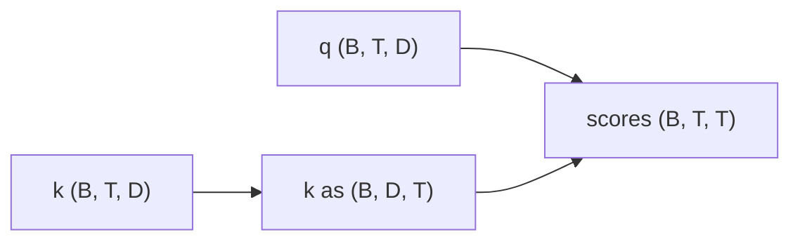

---
{
  "id": "numpy-and-tensor-shapes",
  "title": "Tensors, Shapes & Matrix Arithmetic",
  "slug": "numpy-and-tensor-shapes",
  "section": "Math & Tensor Foundations",
  "category": "Model Architecture",
  "difficulty": "Easy",
  "order": 1,
  "coverImage": "illustrations/_generated/chapter_flow_dark.png",
  "companies": [
    "OpenAI",
    "Anthropic",
    "Google",
    "Meta"
  ],
  "shortDescription": "Two text snippets hold 24 numbers. Naming each axis tells you which values belong to which word before an index, a broadcast, or a reduction can be trusted.",
  "keyConceptsTested": [
    "ndarrays",
    "shape and dtype checks",
    "axis naming",
    "indexing",
    "broadcasting",
    "axis reductions",
    "keepdims",
    "masked token pooling",
    "reshape vs transpose",
    "token projections",
    "matrix multiplication",
    "shape guards",
    "column vs row vectors"
  ],
  "prerequisites": [],
  "relatedQuestions": [],
  "aliases": [
    "vectors-matrices-tensors"
  ]
}
---

Twenty-four numbers in RAM can represent two 3-word snippets with four features per word, or two 4-feature grids across three words, or a flat list of 24 scalars. NumPy will happily reshape, broadcast, or average the wrong layout without raising an error, turning token representations into silent nonsense.

Every deep learning model turns data into contiguous buffers of floats. To read or write model code without silent bugs, you need explicit axis names, broadcasting rules, masked reductions, memory strides, token projections, and batched matrix multiplication.

## Two text snippets, one array

An **array** organizes numbers along numbered **axes**. NumPy calls it an <span data-glossary="numpy-array">ndarray</span>; deep-learning frameworks call the same object a <span data-glossary="tensor">tensor</span>.

Take two 3-<span data-glossary="token">token</span> snippets: `["the", "red", "fox"]` and `["a", "blue", "bird"]`. Give each token a 4-number feature <span data-glossary="vector">vector</span> numbered `0` through `23` so every coordinate stays easy to trace:

```text
x = [ [[ 0,  1,  2,  3], [ 4,  5,  6,  7], [ 8,  9, 10, 11]],
      [[12, 13, 14, 15], [16, 17, 18, 19], [20, 21, 22, 23]] ]
```

Reading outermost to innermost gives shape `(B, T, D) = (2, 3, 4)`, written `(batch, seq, d_model)` in Transformer codebases: axis `0` (`B`/`batch`) counts snippets (`2`), axis `1` (`T`/`seq`) counts token positions (`3`), and axis `2` / `-1` (`D`/`d_model`) counts features per token (`4`). Once axes have names, `x[0, 1]` reads like English: snippet `0`, token `1` (`red`), returning `[4, 5, 6, 7]`.

<figure>
  
  <figcaption>`x[0, 1]` selects snippet 0, then its highlighted `red` row. Both integer indices remove an axis, leaving `[4, 5, 6, 7]` with shape `(4,)`.</figcaption>
</figure>

## Rank, dtype, and indexing

An array's **rank** (`x.ndim`) counts its axes: scalar `()`, 1-D vector `(4,)` (the trailing comma marks a Python tuple), matrix `(3, 4)`, and 3-D tensor `(2, 3, 4)`. Negative indices count from the end, so axis `-1` is always `d_model`. Every array also carries a <span data-glossary="dtype">dtype</span>: pass `dtype=np.float32` explicitly instead of accepting `np.arange`'s integer default, and validate shape and dtype separately.

When indexing left to right, an **integer** selects one entry and *removes* that axis, while a **colon or slice** (`:`, `0:1`) *keeps* it:

| Expression | Meaning | Shape |
|---|---|---|
| `x[0]` vs `x[0:1]` | snippet 0 (dropping vs keeping batch axis) | `(3, 4)` vs `(1, 3, 4)` |
| `x[0, 1]` | token `1` in snippet `0` | `(4,)` |
| `x[:, 1]` | token `1` from every snippet | `(2, 4)` |
| `x[:, :, 0]` | feature `0` from every token in every snippet | `(2, 3)` |

<!-- leetllm: test, deps=numpy, output=show -->
```python title="inspect-one-batch.py"
import numpy as np

x = np.arange(24, dtype=np.float32).reshape(2, 3, 4)
print("shape", x.shape, "dtype", x.dtype)
print("x[0]", x[0].shape, "x[0:1]", x[0:1].shape)
print("x[0, 1]", x[0, 1], "x[:, 1]\n", x[:, 1], sep=" ")
```

<!-- leetllm: output:start -->
```text title="Output" output compact
shape (2, 3, 4) dtype float32
x[0] (3, 4) x[0:1] (1, 3, 4)
x[0, 1] [4. 5. 6. 7.] x[:, 1]
 [[ 4.  5.  6.  7.]
 [16. 17. 18. 19.]]
```
<!-- leetllm: output:end -->

## Broadcasting: reuse one feature bias

To add four feature offsets `bias = [100, 200, 300, 400]` to every token vector, NumPy's <span data-glossary="broadcasting">broadcasting</span> stretches `bias` conceptually across batch and token axes without materializing an expanded copy of `bias`.[^numpyBroadcasting2026] Alignment works strictly **right to left**: match trailing axes if equal or `1`, treat missing leading axes as `1`, and raise `ValueError` on any mismatch.

Against `(2, 3, 4)`: `(4,)` aligns as `(1, 1, 4)` (per-feature bias), `(3, 1)` aligns as `(1, 3, 1)` (per-token scalar), and bare `(3,)` aligns as `(1, 1, 3)` and crashes (`3 != 4`). A 1-D vector `(3,)` has no orientation; insert size-1 axes explicitly with `None` (`v[:, None]` is `(3, 1)`, `v[None, :]` is `(1, 3)`).

<figure>
  
  <figcaption>Broadcasting aligns from the trailing edge. Equal sizes or size-1 axes pair cleanly, while a bare `(3,)` collides with `D=4` unless a trailing `1` shifts `3` onto `T`.</figcaption>
</figure>

> **Common mistake:** On a square `(3, 3)` slice where `T == D`, a bare `(3,)` token bias silently broadcasts across *features* instead of down *tokens*. Both `wrong` and `right` below have shape `(3, 3)`, so only checking a concrete row catches the bug.

<!-- leetllm: test, deps=numpy, output=show -->
```python title="broadcast-bias-and-traps.py"
import numpy as np

x = np.arange(24, dtype=np.float32).reshape(2, 3, 4)
feature_bias = np.array([100, 200, 300, 400], dtype=np.float32)
token_bias = np.array([10, 20, 30], dtype=np.float32)

print("shifted[0, 1]", (x + feature_bias)[0, 1])
try:
    x + token_bias
except ValueError as exc:
    print("bare (3,) error:", exc)

square = x[0, :, :3]
print("square wrong row 0:", (square + token_bias)[0], "right:", (square + token_bias[:, None])[0])
```

<!-- leetllm: output:start -->
```text title="Output" output compact
shifted[0, 1] [104. 205. 306. 407.]
bare (3,) error: operands could not be broadcast together with shapes (2,3,4) (3,) 
square wrong row 0: [10. 21. 32.] right: [10. 11. 12.]
```
<!-- leetllm: output:end -->

## Reductions, keepdims, and masked token pooling

Every reduction removes `axis=...` and keeps the remaining axes. Averaging tokens per snippet collapses `axis=1` (`T`), turning `(2, 3, 4)` into `(2, 4)` (`[4, 5, 6, 7]` for snippet 0). Passing `axis=-1` collapses features (`D`) into `(2, 3)` instead.

To subtract each snippet's token mean back from `x`, pass `keepdims=True`: without it, `(2, 4)` right-aligns against `(2, 3, 4)` and collides (`2 != 3`), or silently subtracts the wrong snippet when `B == T`. Keeping a size-1 slot `(2, 1, 4)` preserves alignment cleanly.

<figure>
  
  <figcaption>`keepdims=True` keeps a size-1 placeholder where the token axis collapsed, so `B` and `D` stay aligned and the mean subtracts cleanly back into `x`.</figcaption>
</figure>

### Exclude padding with masked token pooling

Real batches pad shorter sequences with zeros so every item shares length `T`. Even zero-valued padding biases `mean(axis=1)`: two real token vectors `[1, 0]` and `[0, 1]` average to `[0.5, 0.5]`, yet appending two zero padding rows halves the average to `[0.25, 0.25]`.

A boolean **mask** `valid` of shape `(B, T)` marks real tokens. Expand it with `valid[:, :, None]` to broadcast across `d_model`, zero out padded rows, sum along `axis=1`, and divide by each snippet's real token count (rejecting all-padding rows where `counts == 0`):

<!-- leetllm: test, deps=numpy, output=show -->
```python title="keepdims-and-masked-pooling.py"
import numpy as np

x = np.arange(24, dtype=np.float32).reshape(2, 3, 4)
centered = x - x.mean(axis=1, keepdims=True)
print("pooled", x.mean(axis=1).shape, "centered[0, 0]", centered[0, 0])

def masked_mean(tokens: np.ndarray, valid: np.ndarray) -> np.ndarray:
    if tokens.ndim != 3 or valid.shape != tokens.shape[:2] or valid.dtype != np.bool_:
        raise ValueError("valid mask must be boolean with shape (batch, seq)")
    counts = valid.sum(axis=1, keepdims=True)
    if np.any(counts == 0):
        raise ValueError("each snippet needs at least one real token")
    return np.where(valid[:, :, None], tokens, 0.0).sum(axis=1) / counts

padded = np.array([[[1.0, 0.0], [0.0, 1.0], [0.0, 0.0], [0.0, 0.0]]], dtype=np.float32)
mask = np.array([[True, True, False, False]])
print("plain_mean ", padded.mean(axis=1).tolist(), "masked_mean", masked_mean(padded, mask).tolist())
```

<!-- leetllm: output:start -->
```text title="Output" output compact
pooled (2, 4) centered[0, 0] [-4. -4. -4. -4.]
plain_mean  [[0.25, 0.25]] masked_mean [[0.5, 0.5]]
```
<!-- leetllm: output:end -->

Mean pooling (even masked) is permutation-invariant: `"the red fox"` and `"fox red the"` produce identical averages. Sequence models add positional encodings and attention to capture word order.

<details>
<summary>Deep dive: Accumulation precision in <code>mean()</code></summary>

`float32` reductions accumulate in `float32` by default, while `float16` uses `float32` and integer arrays use `float64`.[^numpyMean2026] Summing `[16777216, 1, -16777216]` in `float32` rounds the `1` away to `0.0`, whereas `mean(dtype=np.float64)` recovers `0.3333333333333333`. Pass `dtype=np.float64` whenever a reduction spans wide magnitudes.

</details>

## Reshape, transpose, views, and copies

Turning `(2, 3, 4)` into `(2, 4, 3)` works with either `reshape` or `transpose`, yet their contents disagree completely. Follow element `3` (feature `d3` of token `the`): `reshape` walks the flat C-order buffer and re-chunks it into rows of three, parking `3` beside `4` (feature `d0` of `red`). `transpose` permutes axes by swapping <span data-glossary="array-stride">strides</span> from `(16, 4)` to `(4, 16)` bytes so `3` stays at feature `d3` of `the`.[^numpyStrides2026] On a 1-D vector `(3,)`, `v.T` stays `(3,)`.

<figure>
  
  <figcaption>Same twelve numbers, two meanings. `reshape` re-chunks the flat stream, making `3` and `4` neighbors; `transpose` swaps axes, keeping `3` as feature `d3` of token `the`.</figcaption>
</figure>

Use `reshape` to merge or split adjacent axes while keeping element order (one `-1` dimension is inferred),[^numpyReshape2026] and `transpose` to permute named axes. Basic slices (`x[:, 1, :]`) and `transpose` return **views** sharing `x`'s memory buffer, whereas **advanced indexing** with integer lists or boolean masks returns a **copy**.[^numpyCopiesViews2026] Because `transpose` makes strides non-contiguous (`C_CONTIGUOUS == False`), calling `.reshape(...)` afterward allocates a fresh contiguous copy. Call `.copy()` before mutating a slice you want isolated:

<!-- leetllm: test, deps=numpy, output=show -->
```python title="reshape-transpose-and-views.py"
import numpy as np

x = np.arange(24, dtype=np.float32).reshape(2, 3, 4)
t = np.transpose(x, (0, 2, 1))
print("reshaped row 1:", x.reshape(2, 4, 3)[0, 1], "transposed row 1:", t[0, 1])
print("t shares memory?", np.shares_memory(t, x), "t.reshape shares?", np.shares_memory(t.reshape(2, 12), t))

token = x[:, 1, :]    # basic slice -> view
token[0, 0] = 99
picked = x[[0, 1]]    # advanced index -> copy
picked[0, 0, 0] = -1
print("after slice edit x[0,1,0]:", x[0, 1, 0], "| after copy edit x[0,0,0]:", x[0, 0, 0])
```

<!-- leetllm: output:start -->
```text title="Output" output compact
reshaped row 1: [3. 4. 5.] transposed row 1: [1. 5. 9.]
t shares memory? True t.reshape shares? False
after slice edit x[0,1,0]: 99.0 | after copy edit x[0,0,0]: 0.0
```
<!-- leetllm: output:end -->

## Token projections and batched matrix multiplication

**Matrix multiplication** (`@`) contracts the shared inner axis across every <span data-glossary="dot-product">dot product</span> at once:

| Left `@` right | Contracted axis | Output shape | Meaning |
|---|---|---|---|
| `(d_model,) @ (d_model,)` | `d_model` | `()` | single dot product |
| `(T, d_model) @ (d_model, d_out)` | `d_model` | `(T, d_out)` | project one token sequence |
| `(B, T, d_model) @ (d_model, d_out)` | `d_model` | `(B, T, d_out)` | project every token in a batch independently |
| `(B, T, d_model) @ (B, d_model, T)` | `d_model` | `(B, T, T)` | pairwise token scores inside each snippet |

A **token projection** multiplies `(B, T, d_model)` by a shared 2-D weight <span data-glossary="matrix">matrix</span> `W` of shape `(d_model, d_out)`. Because `@` multiplies the last two axes and broadcasts leading axes, the same `W` transforms every token vector without mixing batch items or positions.[^numpyMatmul2026] In PyTorch, `nn.Linear(in_features, out_features)` stores `weight` transposed as `(out_features, in_features)` and computes `x @ weight.T + bias`, preserving `(B, T, ...)` automatically.[^pytorchLinear2026]

In <span data-glossary="transformer">Transformer</span> **attention**, projecting `x` into **queries** `q` and **keys** `k` of shape `(B, T, d_model)` and computing `q @ np.swapaxes(k, -1, -2)` contracts `d_model` into `(B, T, T)` unscaled scores (`the` `[0,1,2,3]` dotted with `red` `[4,5,6,7]` equals `38`).[^vaswani2017]



Multi-head attention splits `d_model` into `H` heads of width `head_dim = d_model // H`. Always split in two steps: `reshape(B, T, H, head_dim)` first, then `transpose(0, 2, 1, 3)`. Direct `reshape(B, H, T, head_dim)` passes every shape check while scrambling values across tokens:

<!-- leetllm: test, deps=numpy, output=show -->
```python title="projection-attention-and-heads.py"
import numpy as np

B, T, d_model, d_out, H = 2, 3, 4, 6, 2
x = np.arange(B * T * d_model, dtype=np.float32).reshape(B, T, d_model)

# 1. Token projection: (B, T, 4) @ (4, 6) -> (B, T, 6)
projected = x @ np.eye(d_model, d_out, dtype=np.float32)
print("projected", projected.shape, "token [0, 1]", projected[0, 1])

# 2. Pairwise attention scores: (B, T, D) @ (B, D, T) -> (B, T, T)
scores = x @ np.swapaxes(x, -1, -2)
print("scores", scores.shape, "the.red =", scores[0, 0, 1])

# 3. Multi-head split: reshape then transpose vs buggy direct reshape
heads = x.reshape(B, T, H, d_model // H).transpose(0, 2, 1, 3)
jumbled = x.reshape(B, H, T, d_model // H)
print("head 0, 'red':", heads[0, 0, 1], "vs direct reshape:", jumbled[0, 0, 1])
assert scores[0, 0, 1] == 38.0 and np.array_equal(heads[0, 0, 1], [4, 5])
```

<!-- leetllm: output:start -->
```text title="Output" output compact
projected (2, 3, 6) token [0, 1] [4. 5. 6. 7. 0. 0.]
scores (2, 3, 3) the.red = 38.0
head 0, 'red': [4. 5.] vs direct reshape: [2. 3.]
```
<!-- leetllm: output:end -->

> **Key insight:** Both head arrays have shape `(2, 2, 3, 2)`, yet head 0 for `red` must be `[4, 5]`, not `[2, 3]`. Pair every non-trivial reshape/transpose with one traced value assertion.

## Vision layouts, shape guards, and bug lookup

Vision tensors follow the same rules: a channels-last RGB batch `(B, H, W, C) = (32, 224, 224, 3)` subtracts a 3-channel mean `[0.52, 0.48, 0.44]` directly, and converting to PyTorch's channels-first `(B, C, H, W)` requires `transpose(0, 3, 1, 2)`, never `reshape`.

In helpers, guard shapes with explicit `ValueError` exceptions (unlike `assert`, they remain active under `python -O`):

<!-- leetllm: test, deps=numpy, output=show -->
```python title="shape-guarded-projection.py"
import numpy as np

def project_tokens(x: np.ndarray, weight: np.ndarray, bias: np.ndarray) -> np.ndarray:
    if x.ndim != 3:
        raise ValueError(f"expected (B, T, d_model), got {x.shape}")
    if weight.ndim != 2 or weight.shape[0] != x.shape[-1]:
        raise ValueError(f"expected weight ({x.shape[-1]}, d_out), got {weight.shape}")
    if bias.shape != (weight.shape[1],):
        raise ValueError(f"expected bias ({weight.shape[1]},), got {bias.shape}")
    return x @ weight + bias

x = np.arange(24, dtype=np.float32).reshape(2, 3, 4)
out = project_tokens(x, np.eye(4, 2, dtype=np.float32), np.array([10.0, 20.0], dtype=np.float32))
print("out", out.shape, "out[0, 1]", out[0, 1])
```

<!-- leetllm: output:start -->
```text title="Output" output compact
out (2, 3, 2) out[0, 1] [14. 25.]
```
<!-- leetllm: output:end -->

```checkpoint
Your loader returns a single snippet of shape `(3, 4)` and `project_tokens` rejects it. How do you restore the batch axis without altering token values?
---
Use `single[None, :, :]` to create `(1, 3, 4)`. When slicing from an existing batch `x`, slice `x[0:1]` instead of `x[0]` to preserve the leading batch axis.
```

| Symptom | Cause | Fix |
|---|---|---|
| Broadcast `ValueError` on `(2,3,4)` and `(3,)` | token vector hit feature axis `D=4` | reshape to `(3, 1)` or use `(4,)` |
| `mean` gives `(2, 3)` instead of `(2, 4)` | reduced `axis=-1` instead of `axis=1` | name kept axes before setting `axis=` |
| Padding pulls pooled vectors toward zero | plain `mean(axis=1)` counts zero rows | mask with `valid[:, :, None]` and divide by real counts |
| `reshape` succeeds yet values scramble | re-chunked flat stream instead of permuting | use `transpose` for moving axes |
| `q @ k` shape mismatch | inner axes `D` and `T` disagree | `q @ np.swapaxes(k, -1, -2)` |
| Multi-head values corrupted | direct `reshape(B, H, T, head_dim)` | `reshape(B, T, H, head_dim).transpose(0, 2, 1, 3)` |

```mastery-quiz
[
  {
    "question": "An array `x` has shape `(5, 7, 6)` as `(batch, seq, d_model)`. What does `x[:, 2]` return?",
    "options": [
      "Token position 2 from every snippet with all features, shape `(5, 6)`.",
      "Snippet 2 with all tokens and features, shape `(7, 6)`.",
      "Feature 2 from every token in every snippet, shape `(5, 7)`.",
      "Token position 2 from snippet 0 only, shape `(6,)`."
    ],
    "answer": "Token position 2 from every snippet with all features, shape `(5, 6)`.",
    "explanation": "The colon keeps the batch axis (`5`), integer `2` selects one token and removes axis `1`, and the trailing feature axis (`6`) stays intact."
  },
  {
    "question": "For `a = np.zeros((4, 4))` (tokens × features) and `bias = np.array([3, 6, 9, 12])` (one offset per token), what does `a + bias` produce compared with `a + bias[:, None]`?",
    "options": [
      "Both give `(4, 4)` with row 0 equal to `[3, 3, 3, 3]`.",
      "The first raises `ValueError`; the second gives row 0 equal to `[3, 3, 3, 3]`.",
      "Both give `(4, 4)`; the first gives row 0 `[3, 3, 3, 3]`, the second `[3, 6, 9, 12]`.",
      "Both give `(4, 4)`; the first gives row 0 `[3, 6, 9, 12]`, the second `[3, 3, 3, 3]`."
    ],
    "answer": "Both give `(4, 4)`; the first gives row 0 `[3, 6, 9, 12]`, the second `[3, 3, 3, 3]`.",
    "explanation": "Right-aligned broadcasting attaches bare `(4,)` to the feature axis, putting `[3, 6, 9, 12]` across row 0. Adding `[:, None]` creates `(4, 1)` so each token's offset repeats across its features."
  },
  {
    "question": "A padded batch `x` has shape `(2, 4, 8)`, where snippet 0 holds two real tokens followed by two zero-padded rows. Why does `x.mean(axis=1)` distort snippet 0, and how do you fix it?",
    "options": [
      "It averages features instead of tokens; switch to `x.mean(axis=-1, keepdims=True)`.",
      "It divides by all 4 slots including zero padding, halving the real mean; mask with `valid[:, :, None]`, sum over `axis=1`, and divide by `valid.sum(axis=1, keepdims=True)`.",
      "It drops the batch axis; slice `x[0:1].mean(axis=1)` to skip padded entries.",
      "Zero padding leaves the mean unchanged because zeros add nothing to the numerator."
    ],
    "answer": "It divides by all 4 slots including zero padding, halving the real mean; mask with `valid[:, :, None]`, sum over `axis=1`, and divide by `valid.sum(axis=1, keepdims=True)`.",
    "explanation": "Zero rows still inflate the denominator from 2 to 4. Masking padded positions and dividing by each snippet's real token count yields the unbiased mean."
  },
  {
    "question": "For `x = np.arange(120).reshape(2, 5, 12)`, you want 3 heads of shape `(B, H, T, head_dim) = (2, 3, 5, 4)`. Why does `x.reshape(2, 3, 5, 4)` corrupt the values?",
    "options": [
      "`reshape` copies the buffer while `transpose` returns a view.",
      "Direct `reshape` re-chunks flat memory across tokens; first `reshape(2, 5, 3, 4)` to split each token's features, then `transpose(0, 2, 1, 3)`.",
      "`reshape` cannot add a fourth axis; you must `transpose` `(B, T, D)` first.",
      "Direct `reshape` works whenever `D` is divisible by `H`."
    ],
    "answer": "Direct `reshape` re-chunks flat memory across tokens; first `reshape(2, 5, 3, 4)` to split each token's features, then `transpose(0, 2, 1, 3)`.",
    "explanation": "`reshape(B, T, H, head_dim)` carves each token vector into head chunks, and `transpose(0, 2, 1, 3)` moves the head axis beside the batch axis without mixing tokens."
  },
  {
    "question": "Given hidden states `x` of shape `(4, 16, 64)` and projection `W` of shape `(64, 32)`, what is `h = x @ W`'s shape, and how do you compute `(4, 16, 16)` pairwise token scores?",
    "options": [
      "`(4, 16, 32)` and `h @ np.swapaxes(h, -1, -2)`.",
      "`(4, 16, 32)` and `h @ h`.",
      "`(4, 32, 16)` and `np.swapaxes(h, -1, -2) @ h`.",
      "`(4, 16, 64)` and `(h * h).sum(axis=-1)`."
    ],
    "answer": "`(4, 16, 32)` and `h @ np.swapaxes(h, -1, -2)`.",
    "explanation": "`(4, 16, 64) @ (64, 32)` contracts `64` into `(4, 16, 32)`. Swapping the last two axes yields `(4, 32, 16)`, so `h @ swapaxes(h, -1, -2)` produces `(4, 16, 16)`."
  }
]
```

> **Next:** Continue to [Linear Algebra for ML](/learn/linear-algebra-machine-learning-deeper).
