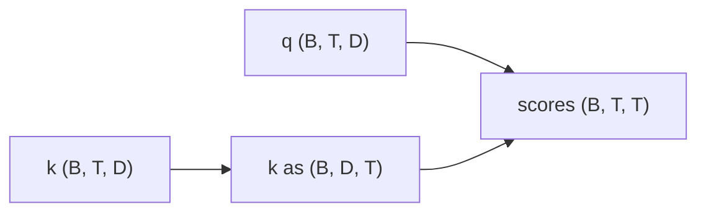

---
{
  "id": "numpy-and-tensor-shapes",
  "title": "NumPy and Tensor Shapes",
  "slug": "numpy-and-tensor-shapes",
  "section": "Computing Foundations",
  "category": "Model Architecture",
  "difficulty": "Easy",
  "order": 4,
  "coverImage": "illustrations/_generated/chapter_flow_dark.png",
  "companies": [
    "OpenAI",
    "Anthropic",
    "Google",
    "Meta"
  ],
  "shortDescription": "Two text snippets hold 24 numbers. Naming each axis tells you which values belong to which word before an index, a broadcast, or a reduction can be trusted.",
  "keyConceptsTested": [
    "ndarrays",
    "shape and dtype checks",
    "axis naming",
    "indexing",
    "broadcasting",
    "axis reductions",
    "keepdims",
    "reshape vs transpose",
    "matrix multiplication",
    "shape guards",
    "column vs row vectors"
  ],
  "prerequisites": [
    "python-for-ai-engineering"
  ],
  "relatedQuestions": [
    "data-structures-for-ai-systems",
    "algorithms-complexity-ml-engineers"
  ]
}
---

Twenty-four numbers in RAM can represent two 3-word snippets with four features per word, or two 4-feature grids across three words, or a flat list of 24 scalars. NumPy will happily reshape, broadcast, or average the wrong layout without raising a single error, turning real token representations into silent nonsense.

In [Python for AI Engineering](/learn/python-for-ai-engineering), we packed raw floats into contiguous buffers. Now we give those buffers structure: explicit axis names, broadcasting rules, axis reductions, memory strides, and batched matrix multiplication.

## Two text snippets, one array

An **array** organizes numbers along numbered **axes**. NumPy calls it an <span data-glossary="numpy-array">ndarray</span>; deep-learning frameworks call the same object a <span data-glossary="tensor">tensor</span>.

Take two 3-<span data-glossary="token">token</span> snippets:

| Batch item | Tokens (words) |
|---|---|
| 0 | `["the", "red", "fox"]` |
| 1 | `["a", "blue", "bird"]` |

Give each token a 4-number feature <span data-glossary="vector">vector</span> filled sequentially from `0` through `23` so every coordinate carries a unique, easy-to-trace value:

```text
x =
[
  [[ 0,  1,  2,  3],
   [ 4,  5,  6,  7],
   [ 8,  9, 10, 11]],

  [[12, 13, 14, 15],
   [16, 17, 18, 19],
   [20, 21, 22, 23]]
]
```

Reading from outermost grouping to innermost gives shape `(B, T, D) = (2, 3, 4)`:

| Axis | Meaning | Size |
|---|---|---:|
| `B` (axis 0) | batch: how many snippets | 2 |
| `T` (axis 1) | token positions per snippet | 3 |
| `D` (axis 2 / `-1`) | features per token | 4 |

Once you name the axes, every index reads like English: `x[0, 1]` selects snippet 0, token 1 (`red`), returning its four features `[4, 5, 6, 7]`.

<figure>
  
  <figcaption>`x[0, 1]` selects snippet 0, then its highlighted `red` row. Both integer indices remove an axis, leaving `[4, 5, 6, 7]` with shape `(4,)`.</figcaption>
</figure>

## Rank, shape, and dtype

An array's **rank** (`x.ndim`) counts its axes. Negative axis indices count backward from the end, so axis `-1` is always the trailing feature axis.

| Term | Shape | What it holds |
|---|---|---|
| **scalar** | `()` | one number, zero axes |
| **vector** | `(4,)` | 4 numbers along one axis (no row/column orientation) |
| **matrix** | `(3, 4)` | 3 rows × 4 columns |
| **3-D tensor** | `(2, 3, 4)` | 3 axes generalizing the same grid |

Notice the trailing comma in `(4,)`: `shape` is always a Python tuple, and omitting the comma turns `(4)` into a plain integer. Alongside shape, every array carries a single <span data-glossary="dtype">dtype</span> controlling how its bytes are interpreted. Neural network inputs typically use `float32`; `np.arange(24)` defaults to integers, so pass `dtype=np.float32` explicitly and validate shape and dtype as two separate checks.

## Indexing: which axes stay and which disappear

Read indices left to right: an **integer** selects one entry and *removes* that axis, while a **colon or slice** (`:`, `0:1`) *keeps* the axis.

| Expression | Plain-English meaning | Result shape |
|---|---|---|
| `x[0]` | snippet 0, all tokens, all features | `(3, 4)` |
| `x[0:1]` | snippet 0, keeping the leading batch axis | `(1, 3, 4)` |
| `x[0, 1]` | token 1 in snippet 0 | `(4,)` |
| `x[:, 1]` | token 1 from every snippet | `(2, 4)` |
| `x[:, :, 0]` | feature 0 from every token in every snippet | `(2, 3)` |

<!-- leetllm: test, deps=numpy, output=show -->
```python title="code-lab-inspect-one-batch.py"
import numpy as np

B, T, D = 2, 3, 4
x = np.arange(B * T * D, dtype=np.float32).reshape(B, T, D)

print("x shape", x.shape)
print("x dtype", x.dtype)
print("x[0] shape", x[0].shape)
print("x[0,1]", x[0, 1])
print("x[:,1]")
print(x[:, 1])
```

<!-- leetllm: output:start -->
```text title="Output" output compact
x shape (2, 3, 4)
x dtype float32
x[0] shape (3, 4)
x[0,1] [4. 5. 6. 7.]
x[:,1]
[[ 4.  5.  6.  7.]
 [16. 17. 18. 19.]]
```
<!-- leetllm: output:end -->

## Broadcasting: reuse one feature bias

Suppose you want to add the same four feature offsets `bias = [100, 200, 300, 400]` to every token vector in `x`:

```text
x[0, 1] = [  4,   5,   6,   7]
bias    = [100, 200, 300, 400]
result  = [104, 205, 306, 407]
```

NumPy's <span data-glossary="broadcasting">broadcasting</span> stretches `bias` conceptually across the batch and token axes without materializing an expanded copy of `bias` first (the output array itself is still `(2, 3, 4)`).[^numpyBroadcasting2026]

The alignment rule works strictly **right to left**:

1. Line both shapes up on their trailing (rightmost) axis.
2. Two aligned axes match if they are equal or one of them is `1`.
3. Missing leading axes behave as size `1`.
4. Any mismatch raises `ValueError`.

| Smaller shape vs. `(2, 3, 4)` | Aligned shape | Outcome |
|---|---|---|
| `(4,)` | `(1, 1, 4)` | adds one bias per feature |
| `(3, 1)` | `(1, 3, 1)` | adds one scalar per token position |
| `(3,)` | `(1, 1, 3)` | `ValueError`: `3 != 4` on trailing axis `D` |

<figure>
  
  <figcaption>Broadcasting aligns from the trailing edge. Equal sizes or size-1 axes pair cleanly, while a bare `(3,)` collides with `D=4` unless a trailing `1` shifts `3` onto `T`.</figcaption>
</figure>

<!-- leetllm: test, deps=numpy, output=show -->
```python title="code-lab-broadcast-one-feature-bias.py"
import numpy as np

B, T, D = 2, 3, 4
x = np.arange(B * T * D, dtype=np.float32).reshape(B, T, D)
bias = np.array([100, 200, 300, 400], dtype=np.float32)
shifted = x + bias

print("shifted shape", shifted.shape)
print("shifted[0,1]", shifted[0, 1])
```

<!-- leetllm: output:start -->
```text title="Output" output compact
shifted shape (2, 3, 4)
shifted[0,1] [104. 205. 306. 407.]
```
<!-- leetllm: output:end -->

Passing a token-length vector `(3,)` directly fails immediately because `3` lands under `D=4`:

<!-- leetllm: test, deps=numpy, output=show -->
```python title="broadcast-shape-error.py"
import numpy as np

x = np.arange(2 * 3 * 4, dtype=np.float32).reshape(2, 3, 4)
token_bias = np.array([10, 20, 30], dtype=np.float32)

try:
    x + token_bias
except ValueError as exc:
    print(str(exc))
else:
    raise RuntimeError("Expected NumPy to reject shape (3,) against (2, 3, 4)")
```

<!-- leetllm: output:start -->
```text title="Output" output compact
operands could not be broadcast together with shapes (2,3,4) (3,)
```
<!-- leetllm: output:end -->

### When broadcasting succeeds with the wrong meaning

A 1-D vector `(3,)` has no row or column orientation; insert size-1 axes explicitly with `None`: `v[:, None]` has shape `(3, 1)` (column vector) and `v[None, :]` has shape `(1, 3)` (row vector).

<!-- leetllm: test, deps=numpy, output=show -->
```python title="the-n-vs-n-1-trap.py"
import numpy as np

v = np.array([1, 2, 3])
print("v shape", v.shape)
print("v[:, None] shape", v[:, None].shape)
print("v[None, :] shape", v[None, :].shape)
```

<!-- leetllm: output:start -->
```text title="Output" output compact
v shape (3,)
v[:, None] shape (3, 1)
v[None, :] shape (1, 3)
```
<!-- leetllm: output:end -->

> **Common mistake:** When two axes happen to share the same length (like a `(3, 3)` square slice), NumPy silently broadcasts a bare `(3,)` token bias across *features* instead of down *tokens*. Both `wrong` and `right` below have shape `(3, 3)`, so only inspecting a concrete row catches the bug.

<!-- leetllm: test, deps=numpy, output=show -->
```python title="silent-broadcast-error.py"
import numpy as np

x = np.arange(24, dtype=np.float32).reshape(2, 3, 4)
square = x[0, :, :3]
token_bias = np.array([10, 20, 30], dtype=np.float32)
wrong = square + token_bias
right = square + token_bias[:, None]

print("both shapes", wrong.shape, right.shape)
print("wrong first token", wrong[0])
print("right first token", right[0])
assert np.array_equal(right[0], [10, 11, 12])
assert not np.array_equal(wrong, right)
```

<!-- leetllm: output:start -->
```text title="Output" output compact
both shapes (3, 3) (3, 3)
wrong first token [10. 21. 32.]
right first token [10. 11. 12.]
```
<!-- leetllm: output:end -->

## Reductions: collapsing the right axis

Every reduction removes the axis you pass to `axis=...` and keeps the rest. To average the three token vectors in each snippet into one 4-feature summary vector per snippet, collapse `axis=1` (`T`): `(2, 3, 4)` becomes `(2, 4)`, and snippet 0's average of `[0,1,2,3]`, `[4,5,6,7]`, `[8,9,10,11]` is `[4, 5, 6, 7]`. Passing `axis=-1` collapses features (`D`) instead, producing `(2, 3)`: one scalar per token.

<!-- leetllm: test, deps=numpy, output=show -->
```python title="code-lab-compare-two-reductions.py"
import numpy as np

B, T, D = 2, 3, 4
x = np.arange(B * T * D, dtype=np.float32).reshape(B, T, D)
pooled_tokens = x.mean(axis=1)
feature_means = x.mean(axis=-1)

print("pooled_tokens shape", pooled_tokens.shape)
print("pooled_tokens dtype", pooled_tokens.dtype)
print("pooled_tokens[0]", pooled_tokens[0])
print("feature_means shape", feature_means.shape)
print("feature_means[0]", feature_means[0])
```

<!-- leetllm: output:start -->
```text title="Output" output compact
pooled_tokens shape (2, 4)
pooled_tokens dtype float32
pooled_tokens[0] [4. 5. 6. 7.]
feature_means shape (2, 3)
feature_means[0] [1.5 5.5 9.5]
```
<!-- leetllm: output:end -->

<details>
<summary>Deep dive: Accumulation precision in <code>mean()</code></summary>

`float32` reductions accumulate in `float32` by default, while `float16` accumulates in `float32` and integer arrays accumulate in `float64`.[^numpyMean2026] When summing values with large magnitude gaps, `float32` can drop small terms entirely; pass `dtype=np.float64` when you need a wider accumulator:

<!-- leetllm: test, deps=numpy, output=show -->
```python title="mean-accumulator-precision.py"
import numpy as np

feature = np.array([16777216, 1, -16777216], dtype=np.float32)
default_mean = feature.mean()
wide_mean = feature.mean(dtype=np.float64)

print("float32 mean", float(default_mean))
print("float64 mean", float(wide_mean))
assert default_mean == 0
assert np.isclose(wide_mean, 1 / 3)
```

<!-- leetllm: output:start -->
```text title="Output" output compact
float32 mean 0.0
float64 mean 0.3333333333333333
```
<!-- leetllm: output:end -->

</details>

### Subtract a mean without losing its position

Collapsing `axis=1` turns `(2, 3, 4)` into `(2, 4)`. Right-aligning `(2, 4)` back against `(2, 3, 4)` pits `2` against `3` and crashes (or silently subtracts the wrong snippet's mean whenever `B == T`). Passing `keepdims=True` retains a size-1 placeholder `(2, 1, 4)` so `x - mean_kept` broadcasts cleanly over every token in its own snippet:

<!-- leetllm: test, deps=numpy, output=show -->
```python title="why-keepdims-true-is-a-safety-switch.py"
import numpy as np

B, T, D = 2, 3, 4
x = np.arange(B * T * D, dtype=np.float32).reshape(B, T, D)

# Without keepdims: shape becomes (2, 4), which no longer broadcasts with (2, 3, 4)
mean_flat = x.mean(axis=1)
print("mean_flat shape", mean_flat.shape)

# With keepdims: shape stays (2, 1, 4), which still broadcasts with (2, 3, 4)
mean_kept = x.mean(axis=1, keepdims=True)
print("mean_kept shape", mean_kept.shape)
centered = x - mean_kept
print("centered snippet 0")
print(centered[0])
assert np.allclose(centered.mean(axis=1), 0)
```

<!-- leetllm: output:start -->
```text title="Output" output compact
mean_flat shape (2, 4)
mean_kept shape (2, 1, 4)
centered snippet 0
[[-4. -4. -4. -4.]
 [ 0.  0.  0.  0.]
 [ 4.  4.  4.  4.]]
```
<!-- leetllm: output:end -->

<figure>
  
  <figcaption>`keepdims=True` keeps a size-1 placeholder where the token axis collapsed, so `B` and `D` stay aligned and the mean subtracts cleanly back into `x`.</figcaption>
</figure>

## Reshape vs. transpose: regrouping or reordering

Turning `(2, 3, 4)` into `(2, 4, 3)` can be done with `reshape` or `transpose`. Both yield the exact same shape, yet their contents disagree completely:

<!-- leetllm: test, deps=numpy, output=show -->
```python title="reshape-vs-transpose.py"
import numpy as np

x = np.arange(24, dtype=np.float32).reshape(2, 3, 4)
reshaped = x.reshape(2, 4, 3)
transposed = np.transpose(x, (0, 2, 1))

print("x[0]")
print(x[0])
print("reshaped[0]")
print(reshaped[0])
print("transposed[0]")
print(transposed[0])
```

<!-- leetllm: output:start -->
```text title="Output" output compact
x[0]
[[ 0.  1.  2.  3.]
 [ 4.  5.  6.  7.]
 [ 8.  9. 10. 11.]]
reshaped[0]
[[ 0.  1.  2.]
 [ 3.  4.  5.]
 [ 6.  7.  8.]
 [ 9. 10. 11.]]
transposed[0]
[[ 0.  4.  8.]
 [ 1.  5.  9.]
 [ 2.  6. 10.]
 [ 3.  7. 11.]]
```
<!-- leetllm: output:end -->

Follow element `3` (feature `d3` of token `the`). `reshape` walks the flat C-order memory stream and slices it into chunks of three, parking `3` next to `4` (feature `d0` of `red`). `transpose` permutes the axes by swapping <span data-glossary="array-stride">strides</span> from `(16, 4)` to `(4, 16)` bytes so `3` stays attached to token `the` and feature `d3`.[^numpyStrides2026]

<figure>
  
  <figcaption>Same twelve numbers, two meanings. `reshape` re-chunks the flat stream, making `3` and `4` neighbors; `transpose` swaps axes, keeping `3` as feature `d3` of token `the`.</figcaption>
</figure>

| Operation | What it does | When to use it |
|---|---|---|
| `reshape` | regroups flat elements (C-order by default); one `-1` dimension is inferred | merging or splitting adjacent axes while keeping element order[^numpyReshape2026] |
| `transpose` | permutes axis order via strides | moving named axes (e.g. `(B, T, D)` to `(B, D, T)`) |

Note one quick gotcha: on a 1-D array `v` of shape `(3,)`, `v.T` still has shape `(3,)` because there is only one axis to permute.

<!-- leetllm: test, deps=numpy, output=show -->
```python title="vector-transpose-stays-1d.py"
import numpy as np

v = np.array([1, 2, 3])
print(v.shape)
print(v.T.shape)
```

<!-- leetllm: output:start -->
```text title="Output" output compact
(3,)
(3,)
```
<!-- leetllm: output:end -->

### Views and copies: who shares memory

An ndarray pairs a raw memory buffer with metadata (shape, dtype, strides). Basic slices (`x[:, 1, :]`) and `transpose` return **views** sharing that buffer, so mutating a slice mutates `x`. **Advanced indexing** with integer lists or boolean masks returns an independent **copy**.[^numpyCopiesViews2026] Call `.copy()` before mutating a slice you want isolated, and inspect `np.shares_memory(a, b)` whenever buffer ownership matters.

<!-- leetllm: test, deps=numpy, output=show -->
```python title="views-vs-copies.py"
import numpy as np

x = np.arange(24, dtype=np.float32).reshape(2, 3, 4)

token = x[:, 1, :]   # basic slice -> view shares memory with x
token[0, 0] = 99
print("after editing a slice, x[0, 1, 0] =", x[0, 1, 0])

picked = x[[0, 1]]   # advanced indexing -> independent copy
picked[0, 0, 0] = -1
print("after editing an advanced-index copy, x[0, 0, 0] =", x[0, 0, 0])
```

<!-- leetllm: output:start -->
```text title="Output" output compact
after editing a slice, x[0, 1, 0] = 99.0
after editing an advanced-index copy, x[0, 0, 0] = 0.0
```
<!-- leetllm: output:end -->

<details>
<summary>Deep dive: Why <code>transpose().reshape()</code> triggers a copy</summary>

Because `transpose` swaps strides without moving bytes, its output is non-contiguous (`C_CONTIGUOUS == False`). A subsequent `reshape` walks the transposed logical order (`[0, 4, 8, ...]`) and allocates a fresh contiguous copy rather than reusing the original buffer:[^numpyReshape2026]

<!-- leetllm: test, deps=numpy, output=show -->
```python title="transpose-then-reshape-copy.py"
import numpy as np

x = np.arange(24, dtype=np.float32).reshape(2, 3, 4)
t = x.transpose(0, 2, 1)
print("source shape and strides", x.shape, x.strides)
print("transpose shape and strides", t.shape, t.strides)
print("transpose shares memory?", np.shares_memory(t, x))
print("transpose contiguous?", t.flags["C_CONTIGUOUS"])
reshaped = t.reshape(2, 12)
print("reshape shares memory with transpose?", np.shares_memory(reshaped, t))
print("reshaped shape", reshaped.shape)
print("reshaped snippet 0", reshaped[0])
assert np.array_equal(reshaped[0], [0, 4, 8, 1, 5, 9, 2, 6, 10, 3, 7, 11])
```

<!-- leetllm: output:start -->
```text title="Output" output compact
source shape and strides (2, 3, 4) (48, 16, 4)
transpose shape and strides (2, 4, 3) (48, 4, 16)
transpose shares memory? True
transpose contiguous? False
reshape shares memory with transpose? False
reshaped shape (2, 12)
reshaped snippet 0 [ 0.  4.  8.  1.  5.  9.  2.  6. 10.  3.  7. 11.]
```
<!-- leetllm: output:end -->

Use `np.ascontiguousarray(t)` when downstream code explicitly requires a C-contiguous buffer.

</details>

## Matrix multiplication: compare every pair of tokens

**Matrix multiplication** (`@`) computes all pairwise <span data-glossary="dot-product">dot products</span> at once by contracting the inner axis. Token `the` (`[0, 1, 2, 3]`) dotted with token `red` (`[4, 5, 6, 7]`) gives $0\times4 + 1\times5 + 2\times6 + 3\times7 = 38$.

This exact operation powers <span data-glossary="transformer">Transformer</span> **attention**: each token projects via `(D, D)` <span data-glossary="matrix">matrices</span> into a **query** `q` and a **key** `k` of shape `(B, T, D)`.[^vaswani2017] For 3-D+ tensors, `@` treats the last two axes as matrices and batches over leading axes.[^numpyMatmul2026] Swapping the last two axes of `k` to `(B, D, T)` aligns `D` in the middle so `(B, T, D) @ (B, D, T)` yields `(B, T, T)` unscaled attention scores.



<!-- leetllm: test, deps=numpy, output=show -->
```python title="code-lab-check-attention-scores.py"
import numpy as np

B, T, D = 2, 3, 4
x = np.arange(B * T * D, dtype=np.float32).reshape(B, T, D)
wq = np.eye(D, dtype=np.float32)
wk = np.eye(D, dtype=np.float32)

q = x @ wq
k = x @ wk

try:
    q @ k
except ValueError:
    print("q @ k fails: inner axes are D=4 and T=3")
else:
    raise RuntimeError("Expected q @ k to fail for shapes (2, 3, 4) and (2, 3, 4)")

unscaled_scores = q @ np.swapaxes(k, -1, -2)

print("q", q.shape)
print("k", k.shape)
print("unscaled_scores", unscaled_scores.shape)
print("first query against first key", unscaled_scores[0, 0, 0])
print("token 'the' against token 'red'", unscaled_scores[0, 0, 1])
assert unscaled_scores[0, 0, 1] == 38
```

<!-- leetllm: output:start -->
```text title="Output" output compact
q @ k fails: inner axes are D=4 and T=3
q (2, 3, 4)
k (2, 3, 4)
unscaled_scores (2, 3, 3)
first query against first key 14.0
token 'the' against token 'red' 38.0
```
<!-- leetllm: output:end -->

Every entry `unscaled_scores[b, i, j]` scores query token `i` against key token `j` in snippet `b` ($0^2+1^2+2^2+3^2 = 14$ and $0\cdot4+1\cdot5+2\cdot6+3\cdot7 = 38$).

### Split each token's features, then move the new axis

Multi-head attention splits each `D`-dimensional token vector into `H` **heads** of width `head_dim = D // H`.[^vaswani2017] Always do this in two steps: first `reshape(B, T, H, head_dim)` to split each token's features, then `transpose(0, 2, 1, 3)` to move `H` next to `B`. Reshaping directly to `(B, H, T, head_dim)` passes every shape check while scrambling tokens across heads:

<!-- leetllm: test, deps=numpy, output=show -->
```python title="split-attention-heads.py"
import numpy as np

B, T, D, H = 2, 3, 4, 2
assert D % H == 0
head_dim = D // H
x = np.arange(B * T * D, dtype=np.float32).reshape(B, T, D)

# Right: expose the head axis, then move it next to the batch axis.
heads = x.reshape(B, T, H, head_dim).transpose(0, 2, 1, 3)

# Wrong: same target shape, but the values land in the wrong heads.
jumbled = x.reshape(B, H, T, head_dim)

print("heads shape", heads.shape)
print("same positions?", np.array_equal(heads, jumbled))
print("head 0, token 'red'", heads[0, 0, 1])
print("direct reshape, same index", jumbled[0, 0, 1])
assert np.array_equal(heads[0, 0, 1], x[0, 1, :head_dim])
```

<!-- leetllm: output:start -->
```text title="Output" output compact
heads shape (2, 2, 3, 2)
same positions? False
head 0, token 'red' [4. 5.]
direct reshape, same index [2. 3.]
```
<!-- leetllm: output:end -->

> **Key insight:** Both arrays have shape `(2, 2, 3, 2)`, yet head 0 for token `red` must be `[4, 5]`, not `[2, 3]` (the tail of token `the`). Pair every complex reshape/transpose with one traced value assertion.

## Transfer: the same rule on images

The same trailing-axis rule governs vision tensors. A batch of 32 RGB tiles of size `224 × 224` has shape `(B, H, W, C) = (32, 224, 224, 3)`. Subtracting a 3-channel dataset mean `[0.52, 0.48, 0.44]` broadcasts right-aligned across every pixel and tile automatically:

<!-- leetllm: test, deps=numpy, output=show -->
```python title="normalize-satellite-tiles.py"
import numpy as np

images = np.ones((32, 224, 224, 3), dtype=np.float32)
mean_color = np.array([0.52, 0.48, 0.44], dtype=np.float32)

normalized = images - mean_color
print("normalized shape", normalized.shape)
print("one centered pixel", normalized[0, 0, 0].round(2))
```

<!-- leetllm: output:start -->
```text title="Output" output compact
normalized shape (32, 224, 224, 3)
one centered pixel [0.48 0.52 0.56]
```
<!-- leetllm: output:end -->

Watch for framework conventions: channels-last `(B, H, W, C)` puts channels on axis `-1`, while PyTorch vision models expect channels-first `(B, C, H, W)`, which calls for `transpose(0, 3, 1, 2)` rather than `reshape`.

## Common shape bugs: symptoms and fixes

| Symptom | Likely cause | Fix |
|---|---|---|
| `ValueError: operands could not be broadcast together with shapes (2,3,4) (3,)` | token-sized vector collided with feature axis `D=4` | reshape to `(3, 1)` for tokens or `(4,)` for features |
| `mean` gives `(2, 3)` instead of `(2, 4)` | collapsed feature axis `-1` instead of token axis `1` | name the kept axes before choosing `axis=` |
| Works on `x[0]` but breaks on batches | integer index dropped the batch axis | slice `x[0:1]` or add `single[None, :, :]` |
| `v.T` stays `(4,)` | 1-D array has one axis | use `v[None, :]` or `v[:, None]` |
| `reshape` succeeds but values scramble | re-chunked flat stream instead of permuting axes | use `transpose` when moving named axes |
| `q @ k` raises shape mismatch | inner axes `D` and `T` do not match | `q @ np.swapaxes(k, -1, -2)` |
| Editing a slice mutates the source | basic slices return views | call `.copy()` before mutating |
| Multi-head output is garbage despite valid shape | direct `reshape(B, H, T, head_dim)` | `reshape(B, T, H, head_dim).transpose(0, 2, 1, 3)` |

## Build a shape guard script

Wrap the three core operations into functions that validate inputs with explicit `ValueError` exceptions (unlike `assert`, `ValueError` stays active under `python -O`) and check output shapes plus traced values:

<!-- leetllm: test, deps=numpy, output=show -->
```python title="build-a-shape-guard-script.py"
import numpy as np

def add_feature_bias(x: np.ndarray, bias: np.ndarray) -> np.ndarray:
    if x.ndim != 3:
        raise ValueError(f"expected (B, T, D), got {x.shape}")
    expected_bias_shape = (x.shape[-1],)
    if bias.shape != expected_bias_shape:
        raise ValueError(f"expected bias shape {expected_bias_shape}, got {bias.shape}")
    out = x + bias
    assert out.shape == x.shape
    return out

def pool_tokens(x: np.ndarray) -> np.ndarray:
    if x.ndim != 3:
        raise ValueError(f"expected (B, T, D), got {x.shape}")
    out = x.mean(axis=1)
    assert out.shape == (x.shape[0], x.shape[2])
    return out

def unscaled_attention_scores(x: np.ndarray, wq: np.ndarray, wk: np.ndarray) -> np.ndarray:
    if x.ndim != 3:
        raise ValueError(f"expected (B, T, D), got {x.shape}")
    batch, tokens, width = x.shape
    expected_weight_shape = (width, width)
    if wq.shape != expected_weight_shape or wk.shape != expected_weight_shape:
        raise ValueError(
            f"expected weight shapes {expected_weight_shape}, got {wq.shape} and {wk.shape}"
        )
    q = x @ wq
    k = x @ wk
    unscaled_scores = q @ np.swapaxes(k, -1, -2)
    assert unscaled_scores.shape == (batch, tokens, tokens)
    return unscaled_scores

x = np.arange(24, dtype=np.float32).reshape(2, 3, 4)
bias = np.array([100, 200, 300, 400], dtype=np.float32)
wq = np.eye(4, dtype=np.float32)
wk = np.eye(4, dtype=np.float32)

shifted = add_feature_bias(x, bias)
pooled = pool_tokens(shifted)
unscaled_scores = unscaled_attention_scores(x, wq, wk)

# Expected values come from the earlier feature sums and token dot products.
assert np.array_equal(shifted[0, 1], [104, 205, 306, 407])
assert np.array_equal(pooled[0], [104, 205, 306, 407])
assert np.array_equal(unscaled_scores[0], [
    [14, 38, 62],
    [38, 126, 214],
    [62, 214, 366],
])

print("shifted", shifted.shape)
print("pooled", pooled.shape)
print("unscaled_scores", unscaled_scores.shape)
print("pooled snippet 0", pooled[0])
print("score row for token 'the'", unscaled_scores[0, 0])

try:
    add_feature_bias(x, np.array([10, 20, 30], dtype=np.float32))
except ValueError as exc:
    print("caught:", exc)
else:
    raise RuntimeError("Expected the shape guard to reject a token-sized bias")
```

<!-- leetllm: output:start -->
```text title="Output" output compact
shifted (2, 3, 4)
pooled (2, 4)
unscaled_scores (2, 3, 3)
pooled snippet 0 [104. 205. 306. 407.]
score row for token 'the' [14. 38. 62.]
caught: expected bias shape (4,), got (3,)
```
<!-- leetllm: output:end -->

```checkpoint
Your loader now returns one snippet as shape `(3, 4)`. The shape guard rejects it. How can you add a batch axis without changing which values belong to each token?
---
For `single.shape == (3, 4)`, use `single[None, :, :]` to get `(1, 3, 4)`. The new leading axis says there's one snippet. If you're selecting from the original batch instead, `x[0:1]` preserves that leading axis directly, whereas `x[0]` removes it.
```

Write out `(B, T, D)` before every tensor expression, test with both unequal and equal axis lengths, and trace one concrete token value through the output.

```mastery-quiz
[
  {
    "question": "An array `x` has shape `(5, 7, 6)`, interpreted as `(B, T, D)`: 5 snippets, 7 token positions, and 6 features per token. What does `x[:, 2]` return?",
    "options": [
      "Token position 2 from every snippet with all features, shape `(5, 6)`.",
      "Snippet 2 with all token positions and all features, shape `(7, 6)`.",
      "Feature 2 from every token in every snippet, shape `(5, 7)`.",
      "Token position 2 from snippet 0 only with all features, shape `(6,)`."
    ],
    "answer": "Token position 2 from every snippet with all features, shape `(5, 6)`.",
    "explanation": "The colon keeps the batch axis. Meanwhile, an integer `2` selects one token position and drops that axis, leaving the feature coordinates intact to produce a `(5, 6)` matrix."
  },
  {
    "question": "A data loader requires a `(5, 7, 6)` batch of `float32` token features. It returns an array with shape `(5, 7, 6)` and dtype `int16`. Which diagnosis is correct?",
    "options": [
      "Both checks pass; numeric inputs satisfy the requirement whenever their values can be represented as `float32`.",
      "Shape passes, but dtype fails; axis sizes match while integer storage violates the required `float32` input.",
      "Shape fails, but dtype passes; the loader must return a flat `(210,)` array before model arithmetic begins.",
      "Both checks fail; converting the input to `float32` also requires regrouping its axes into `(5, 6, 7)`."
    ],
    "answer": "Shape passes, but dtype fails; axis sizes match while integer storage violates the required `float32` input.",
    "explanation": "Shape and dtype are separate parts of the input specification. The three axis lengths are correct, but each element is stored as an integer rather than the required 32-bit floating-point value. Create or cast the array as `float32` before model arithmetic without changing its axes."
  },
  {
    "question": "For `x.shape == (5, 7, 6)` interpreted as `(B, T, D)`, you want to add one scalar to each token position and reuse it across every feature and snippet. Which bias shape encodes that intent, and why does a bare `(7,)` fail?",
    "options": [
      "Use `(7,)`; NumPy aligns it with the token axis by name and then repeats it across features and snippets.",
      "Use `(1, 7)`; the leading `1` expands across batch and the `7` expands across token positions.",
      "Use `(7, 1)`; the `7` aligns with tokens and `1` expands across features, while `(7,)` hits trailing size `6`.",
      "Use `(5, 7)`; it covers the batch and token axes, and NumPy automatically creates a missing feature axis."
    ],
    "answer": "Use `(7, 1)`; the `7` aligns with tokens and `1` expands across features, while `(7,)` hits trailing size `6`.",
    "explanation": "NumPy aligns shapes from the right. To attach seven values to the token axis, the smaller array needs an explicit trailing size-1 feature axis: `(7, 1)`. A bare `(7,)` is lined up against the feature axis, so `7` is compared with `6` and broadcasting fails."
  },
  {
    "question": "A text-snippet tensor uses `(B, T, D) = (32, 10, 64)`, where `T` is token positions and `D` is features. A teammate writes `x.mean(axis=-1)` while saying they want one feature vector per snippet. What went wrong?",
    "options": [
      "They should have reduced the batch axis with `axis=0`; keeping the leading `32` means the operation never combined examples into snippet-level vectors.",
      "Nothing went wrong with the axis choice: for this tensor the `64` dimension is the token length, so averaging it leaves one `(10,)` vector per snippet.",
      "They reduced the token axis correctly, but misread the output: `(32, 10)` should be interpreted as 32 snippet vectors with 10 retained feature coordinates.",
      "They reduced the feature axis instead of the token axis. `axis=-1` turns `(32, 10, 64)` into `(32, 10)`, one scalar per token position."
    ],
    "answer": "They reduced the feature axis instead of the token axis. `axis=-1` turns `(32, 10, 64)` into `(32, 10)`, one scalar per token position.",
    "explanation": "For a `(B, T, D)` tensor, one vector per snippet means keep `B` and `D` and collapse `T`, so the intended operation is `x.mean(axis=1)` with result shape `(32, 64)`. `axis=-1` always means the last axis here, the feature axis, so it removes the vector coordinates instead of pooling tokens."
  },
  {
    "question": "For `x.shape == (5, 7, 6)` interpreted as `(B, T, D)`, you want to subtract each snippet's mean token vector from every token: `x - x.mean(axis=1)`. NumPy raises a broadcast error. Which change preserves the intended axes?",
    "options": [
      "Use `x.mean(axis=1, keepdims=True)`, producing `(5, 1, 6)` so the mean broadcasts across the token axis.",
      "Use `x.mean(axis=-1)`, producing `(5, 7)` so NumPy can stretch one mean across the feature axis.",
      "Use `x.mean(axis=0)`, producing `(7, 6)` so the batch mean broadcasts over snippets without needing a token placeholder.",
      "Use `x.mean(axis=1)[:, :, None]`, producing `(5, 6, 1)` so the feature axis becomes explicit for broadcasting."
    ],
    "answer": "Use `x.mean(axis=1, keepdims=True)`, producing `(5, 1, 6)` so the mean broadcasts across the token axis.",
    "explanation": "Without `keepdims`, reducing axis 1 changes `(5, 7, 6)` to `(5, 6)`. Aligned from the right, that collides with `(5, 7, 6)` because the `5` lands against the token axis size `7`. `keepdims=True` leaves a size-1 token slot, `(5, 1, 6)`, which can broadcast back over the seven tokens in each snippet."
  },
  {
    "question": "For `x = np.arange(120).reshape(2, 5, 12)`, you want three attention heads with final shape `(B, H, T, head_dim) = (2, 3, 5, 4)`. Why does reshaping directly to that shape assign values incorrectly?",
    "options": [
      "Because the problem is mainly memory sharing: `reshape` makes an independent copy for head tensors, while `transpose` preserves a view so every head stays tied to the original buffer.",
      "Reshape to expose heads, then transpose to move the head axis; reshape alone only regroups flat values and leaves token-head order unchanged.",
      "Because `reshape` can't introduce a head axis at all. You should transpose `(B, T, D)` to move the feature axis first, then reshape after the heads have been separated.",
      "Because `reshape` is sufficient as long as `D` is divisible by `H`; once NumPy returns `(B, H, T, head_dim)`, each consecutive feature block has already been assigned to the correct head and token."
    ],
    "answer": "Reshape to expose heads, then transpose to move the head axis; reshape alone only regroups flat values and leaves token-head order unchanged.",
    "explanation": "Splitting heads has two separate steps. First reshape `(B, T, D)` to `(B, T, H, head_dim)` so each token's feature vector is carved into head-sized chunks. Then transpose to `(B, H, T, head_dim)` so the head axis moves next to the batch axis. A direct reshape to the target shape can pass a shape check while assigning values to the wrong head-token positions."
  },
  {
    "question": "You have `q.shape == k.shape == (5, 7, 6)` from a `(B, T, D)` batch. You need unscaled attention scores where each query token is compared with every key token in the same snippet. Which code and assertion match that requirement?",
    "options": [
      "`scores = q @ k` and `assert scores.shape == (5, 7, 7)`",
      "`scores = np.swapaxes(q, -1, -2) @ k` and `assert scores.shape == (5, 6, 6)`",
      "`scores = q @ np.swapaxes(k, -1, -2)` and `assert scores.shape == (5, 7, 7)`",
      "`scores = (q * k).sum(axis=-1)` and `assert scores.shape == (5, 7)`"
    ],
    "answer": "`scores = q @ np.swapaxes(k, -1, -2)` and `assert scores.shape == (5, 7, 7)`",
    "explanation": "For attention scores, each query token needs a dot product with every key token. Swapping the last two axes of `k` changes each batch item from `(T, D)` to `(D, T)`, so `(T, D) @ (D, T)` gives a `(T, T)` score matrix per batch item. The two `T` axes mean asking token and compared-against token."
  },
  {
    "question": "A token-by-feature array is `a = np.zeros((4, 4))`, and `bias = np.array([3, 6, 9, 12])` contains one offset per token. What happens with `a + bias` compared with the intended `a + bias[:, None]`?",
    "options": [
      "Both produce `(4, 4)` and first row `[3, 3, 3, 3]`; the matching token count makes the inserted axis optional.",
      "The first raises a broadcast error; the second produces `(4, 4)` with first row `[3, 3, 3, 3]`.",
      "Both produce `(4, 4)`; the first gives row `[3, 3, 3, 3]`, while the second gives `[3, 6, 9, 12]`.",
      "Both produce `(4, 4)`; the first gives row `[3, 6, 9, 12]`, while the second gives `[3, 3, 3, 3]`."
    ],
    "answer": "Both produce `(4, 4)`; the first gives row `[3, 6, 9, 12]`, while the second gives `[3, 3, 3, 3]`.",
    "explanation": "The bare vector aligns with the last axis, so every row gets different offsets across features. Inserting a trailing size-1 axis makes each token's offset repeat across its features. Equal axis sizes hide the error from shape checks, so inspect a known row."
  },
  {
    "question": "Given `x = np.arange(60, dtype=np.float32).reshape(3, 4, 5)`, what happens after `token = x[:, 2, :]`; `token[0, 0] = 7`; `picked = x[[0, 2]]`; `picked[0, 0, 0] = -8`?",
    "options": [
      "`x[0, 2, 0]` becomes `7`, but `x[0, 0, 0]` remains `0`, because basic slicing gives a view and advanced indexing made a copy.",
      "Both `x[0, 2, 0]` and `x[0, 0, 0]` change, because slicing and advanced indexing always share the same data buffer.",
      "Neither value in `x` changes, because NumPy creates independent arrays whenever an indexed result is assigned to a variable.",
      "`x[0, 0, 0]` changes to `-8`, but `x[0, 2, 0]` stays `10`, because advanced indexing is a view and basic slicing is a copy."
    ],
    "answer": "`x[0, 2, 0]` becomes `7`, but `x[0, 0, 0]` remains `0`, because basic slicing gives a view and advanced indexing made a copy.",
    "explanation": "Basic slicing creates a view, so `token = x[:, 2, :]` reaches the same data buffer as `x`; mutating `token[0, 0]` changes `x[0, 2, 0]`. Advanced indexing with an integer array creates a copy, so mutating `picked` doesn't change `x[0, 0, 0]`."
  },
  {
    "question": "Which guard belongs inside `add_feature_bias(x, bias)` when the function promises to add one feature bias to a `(B, T, D)` tensor and return the same shape?",
    "options": [
      "Check `bias.ndim == 1` only, because any 1-D vector will broadcast to the intended feature axis.",
      "Raise `ValueError` unless `x.ndim == 3` and `bias.shape == (x.shape[-1],)`, then assert `out.shape == x.shape`.",
      "Require `x.shape[1] == bias.shape[0]`, because a feature bias should match the middle token axis.",
      "Check only that `out.size == x.size`, because preserving element count proves the axis meaning is unchanged."
    ],
    "answer": "Raise `ValueError` unless `x.ndim == 3` and `bias.shape == (x.shape[-1],)`, then assert `out.shape == x.shape`.",
    "explanation": "A feature bias for `(B, T, D)` must match the final feature dimension exactly, so the bias shape should be `(D,)`, not any 1-D length. Explicit exceptions remain active at input boundaries even when Python optimization disables assertions; the output assertion checks the expected result shape."
  }
]
```

> **Next:** Continue to [CUDA for ML Training](/learn/cuda-gpu-computing-for-ml). Shape and dtype describe your batch, but they don't say where it lives or runs. <span data-glossary="cuda">CUDA</span> adds device placement: moving tensors between CPU and <span data-glossary="gpu">GPU</span> memory, then running operations on the right device.
