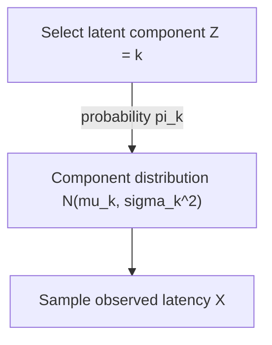

---
{
  "id": "probabilistic-generative-models-em",
  "title": "Probabilistic Generative Models",
  "slug": "probabilistic-generative-models-em",
  "section": "ML Algorithms & Evaluation",
  "category": "Model Architecture",
  "difficulty": "Medium",
  "order": 9,
  "coverImage": "illustrations/_generated/chapter_flow_dark.png",
  "companies": ["OpenAI", "Anthropic", "Google", "Meta"],
  "shortDescription": "When six latencies average 60 ms but none is 60, a mixture can fit both peaks, EM climbs a lower bound, and a variational autoencoder approximates that same bound.",
  "keyConceptsTested": ["generative vs discriminative modeling", "latent variables", "marginal likelihood", "evidence lower bound (ELBO)", "Jensen's inequality", "expectation-maximization", "Gaussian mixture models", "soft responsibilities", "covariance collapse", "variational autoencoders"],
  "prerequisites": ["clustering-pca-representation-learning", "bayesian-inference-priors-posteriors"]
}
---

Six request latencies, `[28, 30, 32, 86, 90, 94]` milliseconds, average to 60 ms, yet not a single request landed anywhere near 60 ms. The average sits in the empty valley between two tight clusters, describing a request that never happens.

A single fitted Gaussian centers its peak right in that empty valley and stretches wide to span both groups. A <span data-glossary="gaussian-mixture-model">Gaussian mixture model</span> instead fits two separate peaks and assigns each observation fractional membership in each component.[^bishop2006] The log records only durations, with no labels for what caused the split, so we want an algorithm that discovers both clusters directly from the numbers.

<figure>
  
  <figcaption>Both fitted models share a mean of 60 ms, yet only the mixture places density where the six latencies actually occur. Rug marks show the observations along the latency axis; the 50 ms membership breakdown below uses provisional variances to illustrate soft assignment.</figcaption>
</figure>

## Generative versus discriminative modeling

Those six latencies highlight a fundamental divide in probabilistic modeling: do we model how the data could have been generated, or only how to predict a label from an input?

- **Discriminative modeling** learns $P(Y \mid X)$ (or a decision boundary) directly from labeled inputs, such as predicting whether a request hit a cache given its latency and payload size. Because it never models $P(X)$, it cannot tell whether a new input is typical or corrupted, and can still output high class confidence on out-of-distribution inputs.
- **Generative modeling** specifies a full sampling distribution, either jointly as $P(X, Y) = P(Y)P(X \mid Y)$ (from which Bayes' rule recovers $P(Y \mid X)$) or over unlabeled observations $p(X)$ via hidden structure.[^bishop2006] Modeling $p(X)$ lets you score how typical an input is and generate synthetic observations from the fitted law.

Notice that "generative" also applies to conditional distributions over rich outputs: an LLM models $P(\text{text} \mid \text{prompt})$ and generates sequences from it. Here we focus on unlabeled density estimation: how a mixture model describes our six latencies using an unobserved <span data-glossary="latent-variable">latent variable</span> $Z$ that tracks which cluster produced each point.

## Latent variables and the coupled log-sum

Start with the six observed request latencies: `[28, 30, 32, 86, 90, 94]`. Their arithmetic mean is 60 ms, but the numbers naturally cluster into two distinct groups.

| Request | Latency | Observed group |
|---|---:|---|
| A | 28 ms | Lower latencies |
| B | 30 ms | Lower latencies |
| C | 32 ms | Lower latencies |
| D | 86 ms | Higher latencies |
| E | 90 ms | Higher latencies |
| F | 94 ms | Higher latencies |

A probabilistic generative model formulates a two-stage story for each observation:



In the model, first select component $z_i = k \in \{1,\dots,K\}$ with probability $\pi_k$, where $\sum_k \pi_k=1$ and $\pi_k \ge 0$. Then sample $x_i$ from $p(x_i \mid z_i=k,\theta)=\mathcal{N}(x_i \mid \mu_k,\sigma_k^2)$ with $\sigma_k^2>0$. The weight $\pi_k$ describes component frequency, not confidence in a fitted mean.

Because the log records $X=\{x_1,\dots,x_n\}$ but not $Z=\{z_1,\dots,z_n\}$, calculate an observation's **density** by summing the contributions from its $K$ possible components:

$$
p(x_i \mid \theta) = \sum_{k=1}^{K} p(x_i, z_i = k \mid \theta) = \sum_{k=1}^{K} \pi_k\,\mathcal{N}(x_i \mid \mu_k, \sigma_k^2).
$$

Assuming independent observations, <span data-glossary="maximum-likelihood">maximum likelihood estimation</span> chooses $\theta=\{\pi_k,\mu_k,\sigma_k^2\}_{k=1}^K$ to maximize the log-likelihood:

$$
\ell(\theta) = \log p(X \mid \theta) = \sum_{i=1}^{n} \log \left( \sum_{k=1}^{K} \pi_k\,\mathcal{N}(x_i \mid \mu_k, \sigma_k^2) \right).
$$

Notice the mathematical barrier: the sum over components sits **inside** the logarithm. For a single Gaussian, taking derivatives yields closed-form mean and variance formulas. For a mixture, the log-sum couples every component's parameters together and makes the objective non-convex.[^bishop2006]

> **Key insight:** Evaluating a mixture with fixed parameters is exact and easy; *fitting* the parameters is hard because the logarithm wraps the sum over latent components.

To break that coupling, first hold a provisional model fixed and see how a request landing at 50 ms divides its membership between the two peaks.

## Soft responsibilities in Gaussian mixtures

If component labels were observed and each group had positive empirical variance, we'd fit separate Gaussian means and variances. With parameters already fixed, we'd instead calculate posterior membership using Bayes' rule.

The labels weren't recorded, and the parameters aren't fitted yet, so score that 50 ms request under a provisional model. Consider two provisional components: a fast component at $\mu_1 = 30$ ms, a slow component at $\mu_2 = 90$ ms, equal standard deviations $\sigma_1 = \sigma_2 = 20$ ms, and equal prior weights $\pi_1 = \pi_2 = 0.5$.

Now evaluate a new request at 50 ms, between the two means. The fast Gaussian's density there is roughly 0.01210 per ms; the slow Gaussian's density is roughly 0.00270 per ms. Weighting each by 0.5 gives contributions 0.00605 and 0.00135. The two components share responsibility equally at 60 ms.

Normalizing these two numbers yields the posterior probability that component $k$ generated observation $x_i$, known as the component's <span data-glossary="mixture-responsibility">responsibility</span> $\gamma_{ik}$:[^bishop2006]

$$
\gamma_{ik} = P(z_i = k \mid x_i, \theta) = \frac{\pi_k\,\mathcal{N}(x_i \mid \mu_k, \sigma_k^2)}{\sum_{j=1}^{K} \pi_j\,\mathcal{N}(x_i \mid \mu_j, \sigma_j^2)}.
$$

For our 50 ms request, the fast responsibility is $0.00605 / (0.00605 + 0.00135) \approx 0.818$, and the slow responsibility is $0.00135 / 0.00740 \approx 0.182$. The next code snippet calculates these values without intermediate rounding:

<!-- leetllm: test, id=mixture-responsibilities, deps=numpy, output=show -->
```python title="calculate-mixture-responsibilities.py"
import numpy as np

def gaussian_density(value, mean, deviation):
    exponent = -((value - mean) ** 2) / (2 * deviation**2)
    return np.exp(exponent) / (np.sqrt(2 * np.pi) * deviation)

latency = 50.0
means = np.array([30.0, 90.0])
weighted = 0.5 * gaussian_density(latency, means, deviation=20.0)
responsibility = weighted / weighted.sum()

assert np.isclose(responsibility.sum(), 1.0)
print(f"fast responsibility: {responsibility[0]:.3f}")
print(f"slow responsibility: {responsibility[1]:.3f}")
```

<!-- leetllm: output:start -->
```text title="Output" output compact
fast responsibility: 0.818
slow responsibility: 0.182
```
<!-- leetllm: output:end -->

The fast component receives greater responsibility here because its mean is closer and variances are equal. If components had unequal spreads or priors, the closer mean wouldn't automatically win.

Keep the observation, means, and spreads fixed, but suppose the fast component's prior weight is 0.1 instead of 0.5. Reuse the density function to isolate that change:

<!-- leetllm: test, continue=mixture-responsibilities, deps=numpy, output=show -->
```python title="component-frequency-can-change-membership.py"
priors = np.array([0.1, 0.9])
weighted = priors * gaussian_density(latency, means, deviation=20.0)
posterior = weighted / weighted.sum()
print(f"fast responsibility with prior 0.1: {posterior[0]:.3f}")
print(f"slow responsibility with prior 0.9: {posterior[1]:.3f}")
```

<!-- leetllm: output:start -->
```text title="Output" output compact
fast responsibility with prior 0.1: 0.332
slow responsibility with prior 0.9: 0.668
```
<!-- leetllm: output:end -->

The likelihood ratio favors the closer fast component by about 4.48 to 1, but its prior odds are 1 to 9. Multiplying them gives posterior odds about 0.498 to 1, so the slow component wins. This is the same Bayes update used in [Bayesian Inference](/learn/bayesian-inference-priors-posteriors). A responsibility combines component frequency with fit to the observation; it isn't just a softened nearest-center rule.

Compare this with [K-means](/learn/clustering-pca-representation-learning), which assigns each point to a nearest center. With shared spherical covariance $\Sigma_k=\sigma^2 I$, responsibilities satisfy

$$
\gamma_{ik} \propto \pi_k \exp\left(-\frac{\|x_i-\mu_k\|^2}{2\sigma^2}\right).
$$

Hold centers and positive priors fixed while shrinking a shared variance $\sigma^2 \to 0$. A uniquely closest center receives responsibility approaching one (and at an exact distance tie, responsibilities stay proportional to the tied components' priors). The weighted mean update then converges to K-means' hard mean update.

Keep two probability objects distinct: responsibilities $\gamma_{ik}$ are discrete probabilities summing to one per observation ($\sum_k \gamma_{ik} = 1$), whereas $p(x \mid \theta)$ is a continuous probability **density** whose height can exceed `1.0` for narrow peaks and whose integral over an interval gives probability. Remember too that an unlabeled latency fit identifies statistical clusters, not physical causes like cache hits.

```checkpoint
A 50-millisecond request receives fast-component responsibility 0.818. What happens to the remaining 0.182, and does the larger number prove that an in-memory cache handled the request?
---
The remaining 0.182 belongs to the slow component, so both responsibilities sum to exactly one. The 0.818 score is a conditional probability under the assumed statistical model. Hardware traces or queue states would be needed to identify the physical cause.
```

```checkpoint
A fitted Gaussian with standard deviation 0.1 ms has density 3.989 per millisecond at its mean. An analyst reports a 399% probability that a cache handled that request. Which replacement respects the statistical model?

1. Convert the density into cache odds using its peak as one reference, then normalize over the two causes.
2. Integrate density over a latency interval for its probability, and use external evidence to identify a cache cause.
3. Clip the density at one for cache responsibility, and let the remaining probability describe the other cause.
4. Divide the density by its own peak for cache responsibility, and let the residual describe the other cause.
---
**Answer:** Integrate density over a latency interval for its probability, and use external evidence to identify a cache cause.

A continuous density may exceed one because it has inverse-time units; its integral over an interval gives a probability. Component responsibilities instead normalize weighted component densities. Names can be exchanged without changing the mixture, and physical cache identity needs evidence beyond an unlabeled latency fit.
```

## Expectation-Maximization as lower-bound ascent

We need responsibilities to learn parameters, but we need parameters to calculate responsibilities. The <span data-glossary="expectation-maximization">expectation-maximization (EM)</span> algorithm alternates between the two. Dempster, Laird, and Rubin's classic 1977 paper formalized the general algorithm and its likelihood-improvement argument.[^dempster1977em]

Introduce a probability distribution $q(Z)$ over the latent variables and an **evidence lower bound (ELBO)** on the log likelihood. Whether the bound is practical to calculate depends on the model and the choice of $q$. In our independent-observation GMM, both the joint model and its posterior factorize by observation, avoiding enumeration of all $K^n$ assignment vectors.

For a concave function $f$, Jensen's inequality gives $f(\mathbb{E}[Y]) \ge \mathbb{E}[f(Y)]$ when the expectations exist. To derive the bound below, take $q(Z)>0$ wherever $p(X,Z \mid \theta)>0$, so multiplying and dividing by $q$ doesn't discard part of the sum. The logarithm is concave:

$$
\log p(X \mid \theta) = \log \sum_{Z} q(Z) \frac{p(X, Z \mid \theta)}{q(Z)} = \log \mathbb{E}_q \left[ \frac{p(X, Z \mid \theta)}{q(Z)} \right] \ge \mathbb{E}_q \left[ \log \frac{p(X, Z \mid \theta)}{q(Z)} \right].
$$

Expanding that expectation defines the Evidence Lower Bound $\mathcal{L}(q, \theta)$:[^stanfordCS229EM2022]

$$
\mathcal{L}(q, \theta) \equiv \sum_{Z} q(Z) \log \frac{p(X, Z \mid \theta)}{q(Z)}.
$$

We can also express the relationship as an exact algebraic decomposition:

$$
\log p(X \mid \theta) = \mathcal{L}(q, \theta) + D_{\mathrm{KL}}(q(Z) \parallel p(Z \mid X, \theta)),
$$

where $D_{\mathrm{KL}}(q \parallel p)$ is the Kullback-Leibler divergence measuring the divergence between our distribution $q(Z)$ and the true posterior $p(Z \mid X, \theta)$:

$$
D_{\mathrm{KL}}(q(Z) \parallel p(Z \mid X, \theta)) = \sum_{Z} q(Z) \log \frac{q(Z)}{p(Z \mid X, \theta)}.
$$

Because KL divergence is nonnegative and equals zero if and only if $q(Z) = p(Z \mid X, \theta)$, we always have $\mathcal{L}(q,\theta) \le \ell(\theta)$, with equality precisely when $q$ matches the exact posterior.

<figure>
  
  <figcaption>With equal weights, variances of 400 ms², and the second mean fixed at 90 ms, the E-step at m = 70 ms makes the lower bound touch the log-likelihood curve. Holding q fixed during the M-step climbs to m = 47.33 ms (purple arrow), and a fresh E-step closes the 1.052 KL gap to meet the higher log-likelihood (green arrow).</figcaption>
</figure>

The algorithm climbs this geometry through coordinate ascent:

1. **E-step:** Hold $\theta^{(t)}$ fixed and set $q(Z) = p(Z \mid X, \theta^{(t)})$ by computing responsibilities. The KL gap drops to zero, making the bound touch the log-likelihood at $\theta^{(t)}$:
   $$
   \mathcal{L}(q, \theta^{(t)}) = \log p(X \mid \theta^{(t)}).
   $$

2. **M-step:** Freeze $q$ and maximize the bound over $\theta$:
   $$
   \theta^{(t+1)} = \arg\max_\theta \mathcal{L}(q, \theta) = \arg\max_\theta \sum_{Z} q(Z) \log p(X, Z \mid \theta).
   $$
   The entropy $-\sum_Z q(Z)\log q(Z)$ does not depend on $\theta$, leaving the expected complete-data log-likelihood $Q$. For a GMM, $Q$ decouples into separate weighted Gaussian fits.

3. **Monotonic ascent:** Combining both steps guarantees that log-likelihood never decreases:[^dempster1977em]
   $$
   \log p(X \mid \theta^{(t+1)}) \ge \mathcal{L}(q, \theta^{(t+1)}) \ge \mathcal{L}(q, \theta^{(t)}) = \log p(X \mid \theta^{(t)}).
   $$

Read the chain from right to left: the old bound touches the old likelihood, the M-step improves (or preserves) that bound, and the true likelihood lies at or above the new bound. Even an M-step that merely increases $Q$ without maximizing it completely (generalized EM) preserves this inequality.[^dempster1977em]

> **Common mistake:** Monotonic log-likelihood ascent means EM never goes downhill, not that it finds the global maximum. Because mixture likelihood is non-convex, EM can settle in a local optimum or saddle point depending on initialization.

Reproduce the figure's restricted example before fitting all parameters. Keep means `[m, 90]`, weights `[0.5, 0.5]`, and both variances at 400 ms². The only free parameter is `m`. For each observation, `q[i][k]` holds its component responsibility; independence lets us sum over observations instead of all assignment vectors:

<!-- leetllm: test, id=em-geometry, deps=numpy, output=show -->
```python title="compute-em-bounds.py"
import numpy as np

observations = np.array([28.0, 30.0, 32.0, 86.0, 90.0, 94.0])

def logsumexp(scores):
    largest = scores.max(axis=1, keepdims=True)
    return (largest + np.log(np.exp(scores - largest).sum(axis=1, keepdims=True))).ravel()

def joint_log_scores(mean):
    means = np.array([mean, 90.0])
    squared = (observations[:, None] - means[None, :]) ** 2
    return np.log(0.5) - 0.5 * (np.log(2 * np.pi * 400.0) + squared / 400.0)

def likelihood(mean):
    return logsumexp(joint_log_scores(mean)).sum()

def posterior(mean):
    scores = joint_log_scores(mean)
    return np.exp(scores - logsumexp(scores)[:, None])

def elbo(q, mean):
    return (q * (joint_log_scores(mean) - np.log(q))).sum()

old_mean = 70.0
q_old = posterior(old_mean)
new_mean = (q_old[:, 0] * observations).sum() / q_old[:, 0].sum()
q_new = posterior(new_mean)

assert abs(elbo(q_old, old_mean) - likelihood(old_mean)) < 1e-10
assert abs(elbo(q_new, new_mean) - likelihood(new_mean)) < 1e-10
assert likelihood(new_mean) >= elbo(q_old, new_mean) >= likelihood(old_mean)
for candidate in range(20, 81):
    assert elbo(q_old, candidate) <= likelihood(candidate) + 1e-10
    assert elbo(q_new, candidate) <= likelihood(candidate) + 1e-10

print(f"first mean: {old_mean:.2f} -> {new_mean:.2f} ms")
print(f"old likelihood / touching bound: {likelihood(old_mean):.3f}")
print(f"old bound after M-step: {elbo(q_old, new_mean):.3f}")
print(f"new likelihood / touching bound: {likelihood(new_mean):.3f}")
print(f"KL gap before next E-step: {likelihood(new_mean) - elbo(q_old, new_mean):.3f}")
```

<!-- leetllm: output:start -->
```text title="Output" output compact
first mean: 70.00 -> 47.33 ms
old likelihood / touching bound: -32.028
old bound after M-step: -29.517
new likelihood / touching bound: -28.465
KL gap before next E-step: 1.052
```
<!-- leetllm: output:end -->

The M-step changes the mean and increases likelihood. The next E-step changes responsibilities and makes the bound touch that *unchanged* new likelihood. Our two bounds can cross elsewhere: tightening at the current parameter doesn't lift the whole curve everywhere.

```checkpoint
Does an E-step improve the model's marginal likelihood by changing its parameters?
---
No. It holds the parameters fixed and updates the latent-variable posterior. The bound becomes tight at those parameters, but marginal likelihood itself stays the same. The subsequent M-step changes the model.
```

### Closed-form updates and numerical stability

For Gaussian mixture models, maximizing $\sum_Z q(Z) \log p(X, Z \mid \theta)$ produces intuitive weighted updates for each component $k$:

$$
N_k = \sum_{i=1}^{n} \gamma_{ik}, \qquad
\pi_k^{\text{new}} = \frac{N_k}{n}, \qquad
\mu_k^{\text{new}} = \frac{\sum_{i=1}^{n} \gamma_{ik} x_i}{N_k}, \qquad
(\sigma_k^2)^{\text{new}} = \frac{\sum_{i=1}^{n} \gamma_{ik} (x_i - \mu_k^{\text{new}})^2}{N_k}.
$$

Here $N_k>0$ is an effective count, not necessarily an integer. Divide by $N_k$ for the maximum-likelihood variance; an unbiased weighted-variance correction is a different problem. With an empty component, the mean and variance formulas divide by zero. In this example we'll stop and ask for another initialization if numerical underflow leaves negligible membership.

When implementing these updates in software, direct calculation of tiny Gaussian densities leads to floating-point underflow. For points far from a mean, raw evaluation of $\exp(-0.5 (x - \mu)^2 / \sigma^2)$ produces zero. When every component underflows, computing $\gamma_{ik} = 0 / 0$ results in `NaN`.

The <span data-glossary="log-sum-exp">log-sum-exp trick</span> protects calculations by operating in log space:

$$
\log \sum_{k=1}^{K} \exp(s_k) = s_{\max} + \log \left( \sum_{k=1}^{K} \exp(s_k - s_{\max}) \right),
$$

Here $s_k=\log \pi_k+\log \mathcal{N}(x_i \mid \mu_k,\sigma_k^2)$ and $s_{\max}=\max_k s_k$. Shifting by $s_{\max}$ makes the largest exponential equal `1`, keeping the denominator strictly positive even when raw densities would underflow to zero.

The next snippet fits all six latencies from provisional means at `25` and `95` ms, initial variances of `900` ms², and a minimum variance floor of `1` ms², checking that log-likelihood rises monotonically across eight EM updates:

<!-- leetllm: test, id=em-fit, deps=numpy, output=show -->
```python title="fit-two-component-mixture.py"
import numpy as np

values = np.array([28.0, 30.0, 32.0, 86.0, 90.0, 94.0])

def logsumexp(scores):
    largest = scores.max(axis=1, keepdims=True)
    return (largest + np.log(np.exp(scores - largest).sum(axis=1, keepdims=True))).ravel()

def log_scores(data, model):
    weights, means, variances = model
    squared = (data[:, None] - means[None, :]) ** 2
    return np.log(weights) - 0.5 * (np.log(2 * np.pi * variances) + squared / variances)

def log_likelihood(data, model):
    return logsumexp(log_scores(data, model)).sum()

def fit_mixture(data, start_means, steps=8, variance_floor=1.0):
    assert data.size and len(start_means) and 0 < variance_floor <= 900.0
    k = len(start_means)
    model = (np.full(k, 1.0 / k), np.array(start_means, dtype=float), np.full(k, 900.0))
    history = [log_likelihood(data, model)]
    for _ in range(steps):
        scores = log_scores(data, model)
        responsibilities = np.exp(scores - logsumexp(scores)[:, None])
        assert np.allclose(responsibilities.sum(axis=1), 1.0)

        counts = responsibilities.sum(axis=0)
        if counts.min() < 1e-12:
            raise ValueError("Numerically empty component: try another initialization")
        means = responsibilities.T @ data / counts
        spread = responsibilities * (data[:, None] - means[None, :]) ** 2
        variances = np.maximum(spread.sum(axis=0) / counts, variance_floor)
        model = (counts / data.size, means, variances)
        history.append(log_likelihood(data, model))

    assert all(new >= old - 1e-10 for old, new in zip(history, history[1:]))
    return model, history

model, history = fit_mixture(values, [25.0, 95.0])
print("log likelihood:", [round(float(value), 3) for value in history])
for index, (weight, mean, variance) in enumerate(zip(*model), start=1):
    print(f"component {index}: weight={weight:.3f}, mean={mean:.1f} ms, variance={variance:.3f} ms²")
```

<!-- leetllm: output:start -->
```text title="Output" output compact
log likelihood: [-29.62, -27.056, -20.641, -17.694, -17.694, -17.694, -17.694, -17.694, -17.694]
component 1: weight=0.500, mean=30.0 ms, variance=2.667 ms²
component 2: weight=0.500, mean=90.0 ms, variance=10.667 ms²
```
<!-- leetllm: output:end -->

The model settles on component means at `30.0` and `90.0` ms, with variances of `8/3` (`2.667` ms²) and `32/3` (`10.667` ms²). The slow component's variance is four times larger because `[86, 90, 94]` sits twice as far from its center as `[28, 30, 32]`.

The variance floor prevents covariance collapse while keeping the EM monotonicity guarantee intact over the feasible space $v_k \ge v_{\min}$.

<details>
<summary>Deep dive: why clamping at a floor is an exact constrained M-step</summary>

With fixed responsibilities and updated mean, write the weighted squared deviation as $S_k$. The variance-dependent term in $Q$ is:

$$
-\frac{N_k}{2}\log v_k - \frac{S_k}{2v_k} + \text{constant}.
$$

Its derivative is positive below $S_k/N_k$ and negative above it, so over $v_k \ge v_{\min} > 0$, the exact maximizer is $\max(S_k/N_k, v_{\min})$. Because every component density is bounded above by $(2\pi v_{\min})^{-1/2}$, the constrained training log-likelihood also has a finite ceiling.

</details>

```checkpoint
The printed trace rounds to -17.694 for several updates. Has the code proved convergence or found the global maximum?
---
No. The loop runs a fixed eight updates, and rounded output can hide small changes. Its monotonicity assertion checks this trace, not optimality. Different initializations can end at different fits; even a fixed point can fail to be the best mode.
```

## Diagnosing failure modes: singularities and symmetric traps

Means at 30 ms and 90 ms are not the end of the story. Two familiar failures can still wreck a mixture, and both show up on small latency samples.

The first is **covariance collapse**. In any mixture with at least two components, centering one component on a single data point and shrinking $\sigma_k^2 \to 0$ drives its density $(2\pi\sigma_k^2)^{-1/2} \to \infty$ while the other component keeps finite density on the rest of the sample.[^bishop2006] The unconstrained training log-likelihood becomes unbounded above, producing a useless Dirac spike around one point.

Practical implementations guard against collapse with a positive variance floor, a Bayesian prior over covariances, or diagonal covariance regularization (for example, scikit-learn's `GaussianMixture` adds a small diagonal ridge `reg_covar`, defaulting to `1e-6`).[^sklearnGaussianMixture2026] Note that adding a ridge and clamping at a floor modify the M-step differently.

The second failure mode is the **symmetric initialization trap**. If both components start with identical means, variances, and weights (such as $\mu_1 = \mu_2 = 60.0$ ms), every observation gets identical responsibilities $\gamma_{i1} = \gamma_{i2} = 0.5$. The M-step then moves both components to the pooled mean (`60.0` ms) and pooled variance (`906.7` ms²), and exact EM can never break that symmetry.

Compare separated versus symmetric starts on four held-out latencies `[29, 31, 88, 92]`:

<!-- leetllm: test, continue=em-fit, deps=numpy, output=show -->
```python title="compare-mixture-initializations.py"
validation = np.array([29.0, 31.0, 88.0, 92.0])
for start in ([25.0, 95.0], [60.0, 60.0]):
    fitted, trace = fit_mixture(values, start)
    validation_score = log_likelihood(validation, fitted) / validation.size
    print(f"start={start}: means={[round(float(mean), 1) for mean in fitted[1]]}, "
          f"train={trace[-1]:.3f}, validation/point={validation_score:.3f}")
```

<!-- leetllm: output:start -->
```text title="Output" output compact
start=[25.0, 95.0]: means=[30.0, 90.0], train=-17.694, validation/point=-2.637
start=[60.0, 60.0]: means=[60.0, 60.0], train=-28.943, validation/point=-4.822
```
<!-- leetllm: output:end -->

The separated start wins decisively on both training (`-17.694` vs `-28.943`) and held-out log-likelihood (`-2.637` vs `-4.822` per point). In practice, break symmetry with K-means initialization and run multiple random restarts (such as setting `n_init=10` in scikit-learn's `GaussianMixture`, which defaults to `init_params="kmeans"` and `n_init=1`), keeping the best training objective for a fixed $K$.[^sklearnGaussianMixture2026]

To choose the number of components $K$, compare held-out log-likelihood alongside complexity-penalized criteria such as AIC or BIC.[^sklearnMixtures2026] You can also run a generative check: sample component $k$ with probability $\pi_k$, draw $x \sim \mathcal{N}(\mu_k,\sigma_k^2)$, and compare simulated shapes and tails against held-out observations (a Bayesian **posterior predictive** check further integrates over parameter uncertainty[^stanPosteriorPredictiveChecks2026]). Because Gaussian components put nonzero mass on negative durations, positive-support families such as lognormal or Gamma mixtures are often a better match for latency data. Finally, component indices are arbitrary: swapping components 1 and 2 leaves the mixture density unchanged, so naming a peak after a physical mechanism requires external labels.

## From exact responsibilities to an encoder

Our GMM has a small discrete latent index and an exactly computable posterior. Now let $z \in \mathbb{R}^d$ and use a nonlinear neural decoder $p_\theta(x \mid z)$. The integral $p_\theta(x)=\int p_\theta(x,z)\,dz$ and the posterior generally aren't available in closed form. This difficulty comes from the model, not merely from $z$ being continuous.

A **variational autoencoder (VAE)** uses an encoder $q_\phi(z \mid x)$ to approximate that posterior. **Amortized inference** shares the encoder parameters $\phi$ across observations rather than optimizing a separate distribution for each one. Variational EM and VAE training share a lower-bound objective. Ordinary VAE training updates encoder and decoder parameters jointly instead of performing exact alternating E- and M-steps.[^stanfordCS229EM2022]

| Operation | This GMM | Typical Gaussian-latent VAE |
|---|---|---|
| Generative model | Select a component, then sample a Gaussian | Sample a latent vector, then a decoder's output distribution |
| Latent inference | Exact component posterior per observation | Shared encoder outputs approximate posterior parameters |
| Learning | Alternate exact responsibilities and weighted fits | Usually update encoder and decoder together using sampled gradients |
| Bound gap | Zero after an exact E-step | May remain positive because inference is restricted and approximate |

The same ELBO identity applies:

$$
\mathcal{L}(\phi, \theta; x) = \mathbb{E}_{q_\phi(z \mid x)} [\log p_\theta(x \mid z)] - D_{\mathrm{KL}}(q_\phi(z \mid x) \parallel p(z)).
$$

The expected decoder log-likelihood is the reconstruction term, while the second term pulls the approximate posterior toward the prior $p(z)$.

> **Common mistake:** Do not confuse the **prior KL penalty** $D_{\mathrm{KL}}(q_\phi(z \mid x) \parallel p(z))$ inside the ELBO with the **posterior KL gap** $D_{\mathrm{KL}}(q_\phi(z \mid x) \parallel p_\theta(z \mid x)) = \log p_\theta(x) - \mathcal{L}(\phi,\theta;x)$ between the ELBO and exact log-evidence.[^kingma2014]

For a diagonal Gaussian encoder and a standard normal prior, sample $\epsilon \sim \mathcal{N}(0,I)$ and write:

$$
z=\mu_\phi(x)+\sigma_\phi(x)\odot\epsilon,
$$

where $\sigma_\phi$ is standard deviation, not variance. This **reparameterization trick** moves randomness into $\epsilon$, making the sampled reconstruction loss differentiable with respect to both encoder and decoder parameters so SGD can train them jointly.[^kingma2014]

Think through a scalar draw: hold $\epsilon=0.5$ and set $z=\mu+0.5\sigma$. Changing $\mu$ changes the decoder's reconstruction term through $z$, with $\partial z/\partial\mu=1$. Changing $\sigma$ changes it too, with $\partial z/\partial\sigma=0.5$. This explains why reconstruction trains the encoder as well as the decoder.

```checkpoint
A VAE's estimated minibatch ELBO increases. Does exact EM's likelihood non-decrease guarantee apply to that optimizer step?
---
No. The approximate encoder can leave the old bound below the likelihood, and the sampled minibatch objective can fail to increase the full-data ELBO. Even an increase in the exact ELBO alone doesn't ensure likelihood increases when the posterior KL gap changes.
```

```checkpoint
A scalar VAE draw uses z = μ + σε with μ = 2, standard deviation σ = 4 and fixed ε = −0.25. Which tuple gives z, ∂z/∂μ and ∂z/∂σ?

1. (−2.00, 1.00, −0.25)
2. (1.00, −0.25, 1.00)
3. (1.00, 1.00, −0.25)
4. (−2.00, 1.00, −1.00)
---
**Answer:** (1.00, 1.00, −0.25)

The draw is 2 + 4 × (−0.25) = 1. Holding noise fixed gives derivatives 1 and −0.25. Squaring the standard deviation before the draw incorrectly produces −2. Reconstruction can train encoder parameters through these paths, as well as the decoder.
```

```mastery-quiz
[
  {
    "question": "Two populations share P(cache hit | input x) = 0.8. The first has P(x) = 0.1 and the second P(x) = 0.9. Which joint-probability pair is compatible with that unchanged classifier?",
    "options": [
      "P(x, cache hit) is 0.8 in both populations.",
      "P(x, cache hit) is 0.08 and 0.72, respectively.",
      "P(x, cache hit) is 0.125 and 1.125, respectively.",
      "P(x, cache hit) is 0.02 and 0.18, respectively."
    ],
    "answer": "P(x, cache hit) is 0.08 and 0.72, respectively.",
    "explanation": "Multiply the conditional by each input marginal: 0.8 × 0.1 = 0.08 and 0.8 × 0.9 = 0.72. The same conditional permits different input distributions. Its class confidence alone does not determine input typicality or a joint model."
  },
  {
    "question": "At one observation, two components contribute weighted densities 0.018 and 0.012 per millisecond. What is the first responsibility?",
    "options": [
      "0.400",
      "0.018",
      "1.500",
      "0.600"
    ],
    "answer": "0.600",
    "explanation": "The total density is 0.030 per millisecond. Divide the first contribution by that total: 0.018 / 0.030 = 0.6. The other responsibility is 0.4. Raw densities and their ratio are different from a normalized membership probability."
  },
  {
    "question": "Two finite mixture log scores are −900 and −903. Direct exponentials underflow in this implementation. Which repair preserves their exact mathematical normalization?",
    "options": [
      "Subtract −900, normalize [1, exp(−3)], and obtain first membership about 0.953.",
      "Replace both zero exponentials by one, normalize [1, 1], and obtain first membership 0.5.",
      "Subtract −903, normalize [exp(−3), 1], and obtain first membership about 0.047.",
      "Divide both scores by −900, exponentiate, and obtain first membership about 0.499."
    ],
    "answer": "Subtract −900, normalize [1, exp(−3)], and obtain first membership about 0.953.",
    "explanation": "Use the largest finite score as the shared baseline. The shifted scores are [0, −3], so the first membership is 1 / (1 + exp(−3)) ≈ 0.952574. This repair changes neither the relative log scores nor the objective. It does not repair invalid model parameters. At chosen parameters the sum is exact; fitting remains coupled by the log of the component sum."
  },
  {
    "question": "At fixed model parameters, log likelihood is −12 and a trial q gives ELBO −12.08. An exact E-step is performed with no parameter update. What are the resulting log likelihood, ELBO and posterior KL gap?",
    "options": [
      "−11.92, −12.00, 0.08",
      "−12.00, −12.08, 0.08",
      "−12.00, −12.00, 0.00",
      "−11.92, −11.92, 0.00"
    ],
    "answer": "−12.00, −12.00, 0.00",
    "explanation": "The initial gap is −12 − (−12.08) = 0.08. The E-step sets q to the exact posterior, so the gap falls to zero and the ELBO reaches −12.00. Keeping the ELBO at −12.08 would preserve the old gap. Both results with a log likelihood of −11.92 wrongly add 0.08 to the model score even though only q changed."
  },
  {
    "question": "A two-component Gaussian mixture with a shared variance has means 10 and 50 and corresponding priors 0.2 and 0.8. For an observation of 30, what happens to its responsibilities as the shared variance approaches zero?",
    "options": [
      "They approach 0.5 and 0.5 because the distances tie.",
      "They remain 0.2 and 0.8 because the likelihood factors tie.",
      "They approach 1 and 0 because the first mean is listed first.",
      "They approach 0 and 1 because the second prior is larger."
    ],
    "answer": "They remain 0.2 and 0.8 because the likelihood factors tie.",
    "explanation": "Equal distances cancel the shared Gaussian likelihood factors, leaving normalized priors 0.2 and 0.8 at every positive variance. A uniquely closer mean instead approaches full responsibility in the shared-variance limit. Independently shrinking fitted component variances is a separate collapse mechanism."
  },
  {
    "question": "For one univariate Gaussian M-step, effective count N = 6 and weighted squared deviation S = 9 are fixed after updating the mean. The feasible variance is v ≥ 2. What variance maximizes this constrained Q?",
    "options": [
      "1.5",
      "3.5",
      "1.8",
      "2.0"
    ],
    "answer": "2.0",
    "explanation": "The unconstrained maximum-likelihood variance is S/N = 1.5. The constrained maximizer is max(1.5, 2) = 2. Adding a ridge of 2 would yield 3.5, while division by N−1 gives 1.8; neither is this stated constrained update. A fixed positive floor prevents the point-spike limit and bounds density."
  },
  {
    "question": "Two equally weighted Gaussian components start with identical parameters on data [2, 4, 10, 12]. After one exact E-step and unconstrained M-step, which means and variances result?",
    "options": [
      "Means [7, 7] and variances [17, 17].",
      "Means [3, 11] and variances [1, 1].",
      "Means [7, 7] and variances [68, 68].",
      "Means [3, 11] and variances [17, 17]."
    ],
    "answer": "Means [7, 7] and variances [17, 17].",
    "explanation": "Every observation gives each identical component responsibility 0.5. Both weighted means become 7. Squared deviations are 25, 9, 9 and 25; the pooled MLE variance is 68/4 = 17. EM preserves the symmetry instead of producing distinct groups. A finite variance floor below 17 would not break that symmetry."
  },
  {
    "question": "Two and three-component fits use the same fixed variance floor, and zero-weight or duplicate components are allowed. Separate EM runs return training log likelihoods −100 and −103. What diagnosis follows?",
    "options": [
      "The three-component optimum is lower because its parameter count is larger.",
      "The three-component model cannot represent the two-component density at that floor.",
      "The lower score verifies that three physical causes are absent from the observations.",
      "The three-component run found a worse local fit; try other starts at the same floor."
    ],
    "answer": "The three-component run found a worse local fit; try other starts at the same floor.",
    "explanation": "The three-component family contains the two-component density through duplication or zero weight, so its best possible training objective cannot be lower. Separate local optimization runs can still return a lower score. Compare starts within a configuration, then use held-out fit or AIC/BIC for model-count selection. Statistical components say nothing about physical causes by themselves."
  },
  {
    "question": "An exact E-step makes the old bound equal the old log likelihood of −18. A proposed generalized M-step leaves q fixed. Which (new bound, new log likelihood) pair supports the standard non-decrease argument?",
    "options": [
      "(−17.0, −17.5)",
      "(−18.5, −17.5)",
      "(−17.0, −16.5)",
      "(−18.25, −18.5)"
    ],
    "answer": "(−17.0, −16.5)",
    "explanation": "With q fixed, the bound rises from −18 to −17.0, and the new log likelihood of −16.5 is above it. The pair (−17.0, −17.5) puts the bound above the new log likelihood. A bound of −18.5 falls below the old bound even though the log likelihood rises. The pair (−18.25, −18.5) fails both comparisons."
  },
  {
    "question": "For a VAE observation, exact log evidence is −4, the ELBO is −6, and KL from the encoder distribution to its fixed prior is 0.7. What are the reconstruction expectation and posterior KL gap?",
    "options": [
      "(−5.3, 2.0)",
      "(−6.7, 2.0)",
      "(−5.3, 0.7)",
      "(−4.0, 2.7)"
    ],
    "answer": "(−5.3, 2.0)",
    "explanation": "ELBO = reconstruction − prior KL gives reconstruction = −6 + 0.7 = −5.3. The posterior gap is log evidence − ELBO = 2. It is distinct from the 0.7 prior penalty. Typical VAE training learns encoder and decoder jointly using estimated gradients, so an improving sampled bound does not inherit exact EM likelihood monotonicity."
  }
]
```

> **Next:** Continue to [Core Retrieval Algorithms](/learn/core-retrieval-algorithms). The six latencies can take two peaks, an exact E-step can leave the likelihood where it is, and a fit can collapse or stay symmetric. Retrieval asks which stored examples are close enough to return.
