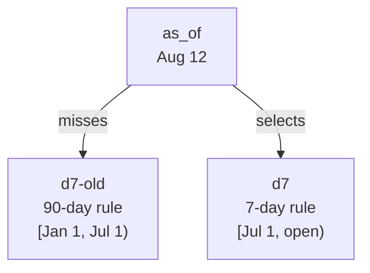

---
{
  "id": "sql-databases-data-modeling-ai",
  "title": "SQL and Data Modeling",
  "slug": "sql-databases-data-modeling-ai",
  "section": "Computing Foundations",
  "category": "MLOps & Deployment",
  "difficulty": "Easy",
  "order": 8,
  "coverImage": "illustrations/_generated/chapter_flow_dark.png",
  "companies": [
    "OpenAI",
    "Anthropic",
    "Google",
    "Meta",
    "xAI"
  ],
  "shortDescription": "When the support retriever restarts and its document dictionary is empty, SQL tables keep the versioned guides, permissions, and citations that make the answer recoverable.",
  "keyConceptsTested": [
    "tables, rows, columns, and durable state",
    "primary keys, foreign keys, and uniqueness constraints",
    "parameterized SELECT queries and SQL injection prevention",
    "JOIN queries that carry citation sources",
    "GROUP BY aggregation and NULL-aware filters",
    "time-aware document versions and as-of queries",
    "workspace scope and normalized permission tables",
    "transaction atomicity, rollback, and isolation",
    "durable idempotency keys for retried writes",
    "indexes and query-plan inspection",
    "PostgreSQL and pgvector as a semantic-search extension",
    "embedding feature and retrieval-evaluation lineage"
  ],
  "prerequisites": [
    "data-structures-for-ai-systems"
  ],
  "relatedQuestions": [
    "algorithms-complexity-ml-engineers",
    "core-retrieval-algorithms"
  ]
}
---

Your RAG retriever finds the exact paragraph, answers the question, and then the container restarts. Every in-memory Python dictionary vanishes. Worse, even before the restart, two versions of Acme Cloud's API-key handbook existed: an older version saying "rotate within ninety days" and the active version saying "rotate within seven days." Without structured storage, your retriever can cite a retired paragraph or leak a chunk from another customer's workspace.

<span data-glossary="sql">SQL</span> solves durability, attribution, versioning, and access filtering in one relational model. We will build a complete local lab in Python's `sqlite3` (run the cells in order so they share the same database file) and then extend the exact same schema to <span data-glossary="postgresql">PostgreSQL</span> and `pgvector`.

| Retrieval question | SQL feature that answers it |
|---|---|
| Does the corpus survive a restart? | Rows committed to durable tables |
| Which document version produced this chunk? | Foreign key + `JOIN` |
| Which rule was active at a given instant? | Half-open `[valid_from, valid_to)` time filter |
| Who may see this paragraph? | Normalized permission table + workspace filter |
| What if ingestion crashes halfway through? | Atomic transaction + `ROLLBACK` |

## From Python objects to rows

Split the corpus into four tables so every link is enforced by the database rather than developer discipline:

| Table | One row represents | Key relationship |
|---|---|---|
| `workspaces` | one tenant workspace | `id` identifies the tenant |
| `documents` | one published version of a source doc | `workspace_id` -> `workspaces(id)` |
| `chunks` | one retrievable paragraph | `document_id` -> `documents(id)` |
| `chunk_permissions` | one allowed principal for one chunk | `chunk_id` -> `chunks(id)` |

A <span data-glossary="primary-key">primary key</span> uniquely identifies each row; a `NOT NULL` <span data-glossary="foreign-key">foreign key</span> blocks orphan chunks that point to nonexistent documents. Keep ownership, versions, and permissions in relational columns where constraints apply, and reserve optional JSON columns for flexible parser metadata like detected headings.[^postgresqlConstraints2026]

<figure>
  
  <figcaption>Follow the foreign-key arrows from chunk <code>c7a</code> to document <code>d7</code> and workspace <code>w01</code> to recover its source and owner, with permissions and embeddings attached directly to the chunk.</figcaption>
</figure>

## Create the smallest useful schema

We store the SQLite database in a temporary directory so the file survives closing and reopening (unlike `:memory:`).[^pythonSqlite2026] Enable `PRAGMA foreign_keys = ON` on every SQLite connection,[^sqliteForeignKeys2026] declare `PRIMARY KEY NOT NULL` explicitly (SQLite otherwise allows `NULL` in non-integer primary keys), and remember `CHECK` passes on `NULL` unless paired with `NOT NULL`.[^sqliteCreateTable2026]

<!-- leetllm: test, id=sql-lab, output=show -->
```python title="01_create_schema.py"
import sqlite3
from pathlib import Path
from tempfile import TemporaryDirectory

lab_directory = TemporaryDirectory(prefix="leetllm-sql-")
db_path = Path(lab_directory.name) / "support.sqlite"
conn = sqlite3.connect(db_path, autocommit=sqlite3.LEGACY_TRANSACTION_CONTROL)
conn.execute("PRAGMA foreign_keys = ON")

conn.executescript(
    """
    CREATE TABLE workspaces (
        id TEXT PRIMARY KEY NOT NULL,
        name TEXT NOT NULL
    );

    CREATE TABLE documents (
        id TEXT PRIMARY KEY NOT NULL,
        workspace_id TEXT NOT NULL REFERENCES workspaces(id),
        source_key TEXT NOT NULL,
        title TEXT NOT NULL,
        valid_from TEXT NOT NULL,
        valid_to TEXT,
        CHECK (valid_to IS NULL OR valid_to > valid_from),
        UNIQUE (workspace_id, source_key, valid_from)
    );

    CREATE TABLE chunks (
        id TEXT PRIMARY KEY NOT NULL,
        document_id TEXT NOT NULL REFERENCES documents(id),
        chunk_text TEXT NOT NULL,
        UNIQUE (document_id, chunk_text)
    );

    CREATE TABLE chunk_permissions (
        chunk_id TEXT NOT NULL REFERENCES chunks(id),
        principal TEXT NOT NULL,
        PRIMARY KEY (chunk_id, principal)
    );
    """
)

conn.executemany(
    "INSERT INTO workspaces (id, name) VALUES (?, ?)",
    [("w01", "Acme Cloud"), ("w02", "Other Workspace")],
)
conn.executemany(
    """
    INSERT INTO documents
        (id, workspace_id, source_key, title, valid_from, valid_to)
    VALUES (?, ?, ?, ?, ?, ?)
    """,
    [
        (
            "d7-old",
            "w01",
            "api-key-guide",
            "API Key Guide",
            "2024-01-01T00:00:00Z",
            "2024-07-01T00:00:00Z",
        ),
        (
            "d7",
            "w01",
            "api-key-guide",
            "API Key Guide",
            "2024-07-01T00:00:00Z",
            None,
        ),
        (
            "d9",
            "w01",
            "account-help",
            "Account Help",
            "2024-01-01T00:00:00Z",
            None,
        ),
        (
            "d99",
            "w02",
            "private-token-guide",
            "Private Token Guide",
            "2024-01-01T00:00:00Z",
            None,
        ),
    ],
)
conn.executemany(
    "INSERT INTO chunks (id, document_id, chunk_text) VALUES (?, ?, ?)",
    [
        ("c7-old", "d7-old", "API keys rotate within ninety days."),
        ("c7a", "d7", "API keys rotate within seven days."),
        ("c7b", "d7", "Email security with your workspace ID for key rotation."),
        ("c9a", "d9", "Reset passwords from account settings."),
        ("c99", "d99", "Private key exception for another workspace."),
    ],
)
conn.executemany(
    "INSERT INTO chunk_permissions (chunk_id, principal) VALUES (?, ?)",
    [
        ("c7-old", "agent:u3"),
        ("c7a", "agent:u1"),
        ("c7a", "agent:u3"),
        ("c7b", "agent:u1"),
        ("c7b", "agent:u3"),
        ("c9a", "agent:u1"),
        ("c99", "agent:u3"),
    ],
)
conn.commit()

print(
    "rows",
    [
        conn.execute("SELECT COUNT(*) FROM workspaces").fetchone()[0],
        conn.execute("SELECT COUNT(*) FROM documents").fetchone()[0],
        conn.execute("SELECT COUNT(*) FROM chunks").fetchone()[0],
        conn.execute("SELECT COUNT(*) FROM chunk_permissions").fetchone()[0],
    ],
)
```

<!-- leetllm: output:start -->
```text title="Output" output compact
rows [2, 4, 5, 7]
```
<!-- leetllm: output:end -->

`d7-old` and `d7` share `source_key = "api-key-guide"` with adjacent half-open validity intervals `[valid_from, valid_to)` (`NULL` `valid_to` means open-ended). Ownership and validity live on `documents`, while read grants live per paragraph in `chunk_permissions`.

## Select rows with parameters

Never interpolate user or model text into SQL strings. Pass `?` placeholders (or `$1`, `$2` in PostgreSQL) with a separate value tuple so untrusted input cannot alter SQL syntax via <span data-glossary="sql-injection">SQL injection</span>.[^pythonSqlite2026] Remember SQL's three-valued logic for `NULL`: write `valid_to IS NULL`, because `valid_to = NULL` evaluates to unknown rather than true.

<!-- leetllm: test, continue=sql-lab, id=select-lab, output=show -->
```python title="02_select_with_parameters.py"
workspace_id = "w01"

rows = conn.execute(
    """
    SELECT id, title
    FROM documents
    WHERE workspace_id = ?
      AND valid_to IS NULL
    ORDER BY id
    """,
    (workspace_id,),
).fetchall()

print(rows)
```

<!-- leetllm: output:start -->
```text title="Output" output compact
[('d7', 'API Key Guide'), ('d9', 'Account Help')]
```
<!-- leetllm: output:end -->

## Join a chunk to its source

A retrieved paragraph needs its source title and version window for citations. Follow `chunks.document_id = documents.id` with a `JOIN`:

<!-- leetllm: test, continue=select-lab, id=join-lab, output=show -->
```python title="03_join_chunks_to_documents.py"
term = "%key%"

citations = conn.execute(
    """
    SELECT c.id, d.title, d.valid_from, d.valid_to, c.chunk_text
    FROM chunks AS c
    JOIN documents AS d ON d.id = c.document_id
    WHERE d.workspace_id = ?
      AND LOWER(c.chunk_text) LIKE ?
    ORDER BY d.valid_from, c.id
    """,
    ("w01", term),
).fetchall()

for chunk_id, title, valid_from, valid_to, text in citations:
    print(f"{chunk_id} [{title}] {valid_from} -> {valid_to or 'open'} | {text}")
```

<!-- leetllm: output:start -->
```text title="Output" output compact
c7-old [API Key Guide] 2024-01-01T00:00:00Z -> 2024-07-01T00:00:00Z | API keys rotate within ninety days.
c7a [API Key Guide] 2024-07-01T00:00:00Z -> open | API keys rotate within seven days.
c7b [API Key Guide] 2024-07-01T00:00:00Z -> open | Email security with your workspace ID for key rotation.
```
<!-- leetllm: output:end -->

> **Common mistake:** Binding a parameter prevents SQL injection, yet `%` and `_` inside a bound `LIKE` value still act as wildcards. Escape them explicitly before exposing substring search to users.

Notice the retrieval bug this output reveals: both retired `c7-old` (ninety days) and active `c7a` (seven days) matched `key`.

```checkpoint
Which safeguard does a bound SQL parameter provide, and what does it leave unaddressed inside `LIKE`?
---
It keeps user data from becoming SQL syntax. It doesn't make `%` or `_` literal characters, so escape those wildcards when literal matching is the product requirement.
```

## Query the version that was valid at a specific time

Filter by the half-open interval `valid_from <= as_of AND (valid_to IS NULL OR as_of < valid_to)`. At `2024-07-01T00:00:00Z`, `d7-old` expires cleanly and `d7` takes over with zero gap and zero overlap:

<!-- leetllm: test, continue=join-lab, id=as-of-lab, output=show -->
```python title="04_query_as_of_time.py"
AS_OF = "2024-08-12T12:00:00Z"

current_citations = conn.execute(
    """
    SELECT c.id, d.title, c.chunk_text
    FROM chunks AS c
    JOIN documents AS d ON d.id = c.document_id
    WHERE d.workspace_id = ?
      AND d.valid_from <= ?
      AND (d.valid_to IS NULL OR ? < d.valid_to)
      AND LOWER(c.chunk_text) LIKE ?
    ORDER BY c.id
    """,
    ("w01", AS_OF, AS_OF, "%key%"),
).fetchall()

for chunk_id, title, text in current_citations:
    print(f"{chunk_id} [{title}] {text}")
```

<!-- leetllm: output:start -->
```text title="Output" output compact
c7a [API Key Guide] API keys rotate within seven days.
c7b [API Key Guide] Email security with your workspace ID for key rotation.
```
<!-- leetllm: output:end -->



SQLite compares fixed-width UTC ISO strings lexicographically; in PostgreSQL, use `TIMESTAMPTZ` and add an exclusion constraint when you want the database to reject overlapping intervals automatically.[^postgresqlConstraints2026][^postgresqlDateTime2026]

## Group rows to inspect the corpus

Use `GROUP BY` and `COUNT(*)` to summarize how many active chunks each document contributes:

<!-- leetllm: test, continue=as-of-lab, id=group-lab, output=show -->
```python title="05_group_current_chunks.py"
summary = conn.execute(
    """
    SELECT d.id, d.title, COUNT(*) AS chunk_count
    FROM documents AS d
    JOIN chunks AS c ON c.document_id = d.id
    WHERE d.workspace_id = ?
      AND d.valid_from <= ?
      AND (d.valid_to IS NULL OR ? < d.valid_to)
    GROUP BY d.id, d.title
    ORDER BY d.id
    """,
    ("w01", AS_OF, AS_OF),
).fetchall()

for document_id, title, chunk_count in summary:
    print(document_id, title, chunk_count)
```

<!-- leetllm: output:start -->
```text title="Output" output compact
d7 API Key Guide 2
d9 Account Help 1
```
<!-- leetllm: output:end -->

`WHERE` filters rows before grouping; `HAVING COUNT(*) >= 2` filters groups afterward.[^postgresqlAggregates2026] To spot zero-chunk documents during ingestion checks, switch to `LEFT JOIN chunks AS c` and count `COUNT(c.id)` rather than `COUNT(*)` (which would count the null-padded placeholder row as `1`).

## Constraints catch broken relationships

Schema constraints protect every writer, including buggy ingestion jobs. Inserting an orphan chunk or a `NULL` primary key raises `sqlite3.IntegrityError` immediately:

<!-- leetllm: test, continue=group-lab, id=constraint-lab, output=show -->
```python title="06_foreign_key_guard.py"
try:
    conn.execute(
        "INSERT INTO chunks (id, document_id, chunk_text) VALUES (?, ?, ?)",
        ("broken", "missing-document", "This row has no source."),
    )
except sqlite3.IntegrityError:
    print("blocked orphan chunk")
    conn.rollback()

try:
    conn.execute(
        "INSERT INTO chunks (id, document_id, chunk_text) VALUES (?, ?, ?)",
        (None, "d7", "A chunk can't have a missing identity."),
    )
except sqlite3.IntegrityError:
    print("blocked null primary key")
    conn.rollback()

missing = conn.execute(
    "SELECT COUNT(*) FROM chunks WHERE id = ?",
    ("broken",),
).fetchone()[0]
print("orphan rows stored", missing)
```

<!-- leetllm: output:start -->
```text title="Output" output compact
blocked orphan chunk
blocked null primary key
orphan rows stored 0
```
<!-- leetllm: output:end -->

### Deleting a parent doesn't silently erase its children

Because this schema omits `ON DELETE CASCADE`, deleting `d7` fails while chunks reference it, and deleting those chunks fails while `chunk_permissions` reference them. Delete leaf rows first (permissions -> chunks -> document), shown below inside a rehearsed transaction that rolls back cleanly:[^sqliteForeignKeys2026]

<!-- leetllm: test, continue=constraint-lab, id=delete-lab, output=show -->
```python title="06b_delete_dependencies.py"
try:
    conn.execute("DELETE FROM documents WHERE id = ?", ("d7",))
except sqlite3.IntegrityError:
    print("blocked parent deletion")
    conn.rollback()

try:
    conn.execute(
        "DELETE FROM chunks WHERE document_id = ?", ("d7",)
    )
except sqlite3.IntegrityError:
    print("blocked chunk deletion: permissions still reference it")
    conn.rollback()

# Rehearse dependency order without deleting the lesson's corpus permanently.
conn.execute("BEGIN")
conn.execute(
    """DELETE FROM chunk_permissions WHERE chunk_id IN
       (SELECT id FROM chunks WHERE document_id = ?)""", ("d7",)
)
conn.execute("DELETE FROM chunks WHERE document_id = ?", ("d7",))
conn.execute("DELETE FROM documents WHERE id = ?", ("d7",))
print("d7 exists inside deletion", bool(conn.execute(
    "SELECT 1 FROM documents WHERE id = ?", ("d7",)
).fetchone()))
conn.rollback()
print("d7 restored after rollback", bool(conn.execute(
    "SELECT 1 FROM documents WHERE id = ?", ("d7",)
).fetchone()))
```

<!-- leetllm: output:start -->
```text title="Output" output compact
blocked parent deletion
blocked chunk deletion: permissions still reference it
d7 exists inside deletion False
d7 restored after rollback True
```
<!-- leetllm: output:end -->

## Make permissions queryable data

Storing `(chunk_id, principal)` grants in `chunk_permissions` lets SQL enforce access control directly. In production, the authenticated session supplies both `workspace_id` and `principal` (never a chat prompt). Alice (`agent:u1`) can read both key and password chunks in `w01`; Bob (`agent:u3`) can read key chunks only:

<!-- leetllm: test, continue=delete-lab, id=auth-lab, output=show -->
```python title="07_authorized_lookup.py"
def permitted_matches(
    workspace_id: str,
    principal: str,
    word: str,
    as_of: str,
) -> list[str]:
    return [
        row[0]
        for row in conn.execute(
            """
            SELECT c.id
            FROM chunks AS c
            JOIN documents AS d ON d.id = c.document_id
            JOIN chunk_permissions AS p ON p.chunk_id = c.id
            WHERE d.workspace_id = ?
              AND d.valid_from <= ?
              AND (d.valid_to IS NULL OR ? < d.valid_to)
              AND p.principal = ?
              AND LOWER(c.chunk_text) LIKE ?
            ORDER BY c.id
            """,
            (workspace_id, as_of, as_of, principal, f"%{word.lower()}%"),
        ).fetchall()
    ]

print("Bob key", permitted_matches("w01", "agent:u3", "key", AS_OF))
print("Bob password", permitted_matches("w01", "agent:u3", "password", AS_OF))
print("Alice password", permitted_matches("w01", "agent:u1", "password", AS_OF))
```

<!-- leetllm: output:start -->
```text title="Output" output compact
Bob key ['c7a', 'c7b']
Bob password []
Alice password ['c9a']
```
<!-- leetllm: output:end -->

## A missing workspace predicate leaks a row

Bob also has access to `c99` inside workspace `w02`. If a query filters by `principal` and time while forgetting `d.workspace_id = ?`, Bob's Acme (`w01`) support search leaks `c99` from `w02`:

<!-- leetllm: test, continue=auth-lab, id=leak-lab, output=show -->
```python title="08_missing_tenant_filter.py"
unsafe = conn.execute(
    """
    SELECT c.id
    FROM chunks AS c
    JOIN chunk_permissions AS p ON p.chunk_id = c.id
    JOIN documents AS d ON d.id = c.document_id
    WHERE d.valid_from <= ?
      AND (d.valid_to IS NULL OR ? < d.valid_to)
      AND p.principal = ?
      AND LOWER(c.chunk_text) LIKE ?
    ORDER BY c.id
    """,
    (AS_OF, AS_OF, "agent:u3", "%key%"),
).fetchall()

safe = permitted_matches("w01", "agent:u3", "key", AS_OF)

print("unsafe", [row[0] for row in unsafe])
print("safe", safe)
```

<!-- leetllm: output:start -->
```text title="Output" output compact
unsafe ['c7a', 'c7b', 'c99']
safe ['c7a', 'c7b']
```
<!-- leetllm: output:end -->

<figure>
  
  <figcaption>Time validity drops retired chunk <code>c7-old</code>, and workspace isolation drops <code>c99</code> from <code>w02</code>, leaving only <code>c7a</code> and <code>c7b</code>.</figcaption>
</figure>

<details>
<summary>Deep dive: PostgreSQL Row-Level Security (RLS)</summary>

In PostgreSQL, enabling <span data-glossary="row-level-security">row-level security (RLS)</span> adds database-enforced tenant filters as defense in depth (an RLS-enabled table with no access rule defaults to deny).[^postgresql_rls_docs] Superusers and roles with `BYPASSRLS` always bypass RLS, and table owners bypass it unless you enable `FORCE ROW LEVEL SECURITY`. Always connect your application as a non-superuser role subject to RLS and test it directly.

</details>

```checkpoint
Why is filtering only by `principal` insufficient when the active support screen is scoped to workspace `w01`?
---
The same principal may have access in another workspace. Every retrieval path must enforce both active workspace and principal, or relevant rows from a different tenant can enter the prompt.
```

## Use a transaction for all-or-nothing ingestion

A <span data-glossary="database-transaction">database transaction</span> makes multi-table ingestion atomic: either the document and all its chunks commit together, or `ROLLBACK` discards the whole unit. Wrapping writes in `with conn:` commits on clean exit and rolls back when an exception escapes the block (catch the exception *outside* `with conn:`, because swallowing it inside lets earlier writes commit):[^pythonSqlite2026]

<!-- leetllm: test, continue=leak-lab, id=transaction-lab, output=show -->
```python title="09_transaction_rollback.py"
try:
    with conn:
        conn.execute(
            """
            INSERT INTO documents
                (id, workspace_id, source_key, title, valid_from, valid_to)
            VALUES (?, ?, ?, ?, ?, ?)
            """,
            (
                "d20",
                "w01",
                "outage-runbook",
                "Outage Runbook",
                "2024-08-01T00:00:00Z",
                None,
            ),
        )
        conn.execute(
            "INSERT INTO chunks (id, document_id, chunk_text) VALUES (?, ?, ?)",
            ("c20", "not-d20", "Outages are reviewed within two days."),
        )
except sqlite3.IntegrityError:
    print("transaction rolled back")

visible = conn.execute(
    "SELECT COUNT(*) FROM documents WHERE id = ?",
    ("d20",),
).fetchone()[0]
print("partial document visible", bool(visible))
```

<!-- leetllm: output:start -->
```text title="Output" output compact
transaction rolled back
partial document visible False
```
<!-- leetllm: output:end -->

Because a database transaction cannot roll back an external <span data-glossary="embedding">embedding</span> API call, compute embeddings *before* opening the DB transaction, or stage a pending ingestion row and publish only once all chunks are ready.

Publishing a replacement version must retire the old version and insert the new document, chunks, and grants inside one transaction. `BEGIN IMMEDIATE` claims SQLite's writer lock upfront so a competing writer gets `SQLITE_BUSY` while concurrent readers continue seeing committed `d7`:[^sqliteTransactions2026]

<!-- leetllm: test, continue=transaction-lab, id=publication-lab, output=show -->
```python title="09b_publish_one_complete_version.py"
other = sqlite3.connect(
    db_path, timeout=0, autocommit=sqlite3.LEGACY_TRANSACTION_CONTROL
)
other.execute("PRAGMA foreign_keys = ON")

def active_guide_ids(db):
    return [row[0] for row in db.execute(
        """SELECT id FROM documents
           WHERE workspace_id = 'w01' AND source_key = 'api-key-guide'
             AND valid_from <= ? AND (valid_to IS NULL OR ? < valid_to)
           ORDER BY id""", (AS_OF, AS_OF)
    ).fetchall()]

try:
    conn.execute("BEGIN IMMEDIATE")
    try:
        other.execute("BEGIN IMMEDIATE")
    except sqlite3.OperationalError as error:
        assert error.sqlite_errorcode == sqlite3.SQLITE_BUSY
        print("competing writer must wait or retry")
    else:
        raise AssertionError("two writers must not own publication together")

    ended = conn.execute(
        "UPDATE documents SET valid_to = ? WHERE id = ? AND valid_to IS NULL",
        (AS_OF, "d7"),
    ).rowcount
    if ended != 1:
        raise ValueError("expected open version changed; reload publication state")
    print("writer before replacement", active_guide_ids(conn))
    print("reader during publication", active_guide_ids(other))

    conn.execute(
        "INSERT INTO documents VALUES (?, ?, ?, ?, ?, ?)",
        ("d7-next", "w01", "api-key-guide", "API Key Guide", AS_OF, None),
    )
    conn.execute(
        "INSERT INTO chunks VALUES (?, ?, ?)",
        ("c7-next", "d7-next", "API keys rotate within five days."),
    )
    conn.execute(
        "INSERT INTO chunk_permissions VALUES (?, ?)", ("c7-next", "agent:u3")
    )
    print("writer's complete replacement", active_guide_ids(conn))
    print("writer's authorized result", permitted_matches("w01", "agent:u3", "key", AS_OF))
finally:
    conn.rollback()  # Rehearsal: keep later cells on the original seven-day rule.
    other.rollback()
    other.close()
print("after rehearsal rollback", active_guide_ids(conn))
```

<!-- leetllm: output:start -->
```text title="Output" output compact
competing writer must wait or retry
writer before replacement []
reader during publication ['d7']
writer's complete replacement ['d7-next']
writer's authorized result ['c7-next']
after rehearsal rollback ['d7']
```
<!-- leetllm: output:end -->

```checkpoint
An ingestion transaction inserts a document, then fails while inserting one chunk. What state should remain after rollback?
---
Neither the document nor any of its chunks should remain. The transaction preserves all-or-nothing atomicity and prevents a visible partial ingestion.
```

## Atomicity doesn't choose what concurrent readers see

**Atomicity** ensures one transaction's writes land together or roll back. **Isolation** controls what concurrent readers see while writers commit.

PostgreSQL defaults to **Read Committed**, where each `SELECT` takes a fresh snapshot. An evaluation export that counts chunks in query 1 and lists them in query 2 can see inconsistent totals if an ingestion commits in between.[^postgresqlIsolation2026] Pin both queries to one consistent snapshot with a read-only **Repeatable Read** transaction:

```sql title="postgres_stable_eval_snapshot.sql"
BEGIN TRANSACTION ISOLATION LEVEL REPEATABLE READ READ ONLY;

SELECT d.id, COUNT(*)
FROM documents AS d
JOIN chunks AS c ON c.document_id = d.id
WHERE d.workspace_id = 'w01'
  AND d.valid_from <= TIMESTAMPTZ '2024-08-12 12:00:00+00'
  AND (
      d.valid_to IS NULL
      OR TIMESTAMPTZ '2024-08-12 12:00:00+00' < d.valid_to
  )
GROUP BY d.id;

-- Later reads in this transaction keep the same snapshot.
SELECT c.id, c.chunk_text
FROM chunks AS c
JOIN documents AS d ON d.id = c.document_id
WHERE d.workspace_id = 'w01'
  AND d.valid_from <= TIMESTAMPTZ '2024-08-12 12:00:00+00'
  AND (
      d.valid_to IS NULL
      OR TIMESTAMPTZ '2024-08-12 12:00:00+00' < d.valid_to
  );

COMMIT;
```

For cross-row business rules under concurrent writes, **Serializable** isolation is stricter, and your application must retry the entire transaction when PostgreSQL raises a serialization error.

<figure>
  
  <figcaption>Atomicity rolls back pending <code>d20</code> on a bad chunk insert; PostgreSQL's read-only Repeatable Read pins count and detail queries to the same snapshot even as concurrent writers commit.</figcaption>
</figure>

## Keep retries from duplicating completed work

If a worker commits rows and crashes before returning HTTP 200, the caller retries the same request. Store a unique <span data-glossary="idempotency">idempotency</span> key plus a SHA-256 fingerprint of the payload inside the same transaction: an identical retry skips the write cleanly, while reusing the same key with altered text raises an error:

<!-- leetllm: test, continue=publication-lab, id=idempotency-lab, output=show -->
```python title="10_idempotent_ingestion.py"
import hashlib
import json

conn.execute(
    """
    CREATE TABLE ingestion_requests (
        request_id TEXT PRIMARY KEY NOT NULL,
        document_id TEXT NOT NULL,
        payload_hash TEXT NOT NULL
    )
    """
)
conn.commit()

def ingest_document_once(
    request_id: str,
    document_id: str,
    source_key: str,
    title: str,
    valid_from: str,
    chunk_id: str,
    chunk_text: str,
) -> str:
    payload = json.dumps(
        ["w01", document_id, source_key, title, valid_from, chunk_id, chunk_text],
        ensure_ascii=False,
        separators=(",", ":"),
    )
    payload_hash = hashlib.sha256(payload.encode("utf-8")).hexdigest()
    with conn:
        created = conn.execute(
            """
            INSERT INTO ingestion_requests (request_id, document_id, payload_hash)
            VALUES (?, ?, ?)
            ON CONFLICT(request_id) DO NOTHING
            """,
            (request_id, document_id, payload_hash),
        ).rowcount
        if created == 0:
            existing_hash = conn.execute(
                "SELECT payload_hash FROM ingestion_requests WHERE request_id = ?",
                (request_id,),
            ).fetchone()[0]
            if existing_hash != payload_hash:
                raise ValueError("idempotency key reused with changed input")
            return "skipped retry"

        conn.execute(
            """
            INSERT INTO documents
                (id, workspace_id, source_key, title, valid_from, valid_to)
            VALUES (?, ?, ?, ?, ?, NULL)
            """,
            (document_id, "w01", source_key, title, valid_from),
        )
        conn.execute(
            "INSERT INTO chunks (id, document_id, chunk_text) VALUES (?, ?, ?)",
            (chunk_id, document_id, chunk_text),
        )
    return "inserted"

print(
    "first",
    ingest_document_once(
        "req-30",
        "d30",
        "key-rotation-faq",
        "Key Rotation FAQ",
        "2024-08-10T00:00:00Z",
        "c30",
        "Temporary keys expire after 30 days.",
    ),
)
print(
    "retry",
    ingest_document_once(
        "req-30",
        "d30",
        "key-rotation-faq",
        "Key Rotation FAQ",
        "2024-08-10T00:00:00Z",
        "c30",
        "Temporary keys expire after 30 days.",
    ),
)
stored = conn.execute(
    "SELECT COUNT(*) FROM documents WHERE id = ?",
    ("d30",),
).fetchone()[0]
print("d30 rows", stored)

try:
    ingest_document_once(
        "req-30", "d30", "key-rotation-faq", "Key Rotation FAQ",
        "2024-08-10T00:00:00Z", "c30", "Changed guide text.",
    )
except ValueError as exc:
    print("changed retry", exc)
else:
    raise AssertionError("changed input must not reuse an idempotency key")
```

<!-- leetllm: output:start -->
```text title="Output" output compact
first inserted
retry skipped retry
d30 rows 1
changed retry idempotency key reused with changed input
```
<!-- leetllm: output:end -->

Notice that `c30` stays invisible until explicit permission rows are inserted (default-closed). For side effects hitting a remote API outside the database, pass an idempotency key to that downstream service or reconcile its state before replaying.

## Index the predicates you run often

An **index** lets the query engine jump straight to matching keys instead of scanning every row. Add composite indexes on `(principal, chunk_id)` and `(workspace_id, valid_from, valid_to, id)`, then inspect SQLite's <span data-glossary="query-plan">query plan</span>:[^sqliteQueryPlan2026]

<!-- leetllm: test, continue=idempotency-lab, id=index-lab, output=show -->
```python title="11_add_indexes_and_explain.py"
conn.executescript(
    """
    CREATE INDEX permission_principal_idx
        ON chunk_permissions (principal, chunk_id);
    CREATE INDEX document_workspace_idx
        ON documents (workspace_id, valid_from, valid_to, id);
    """
)

authorized_sql = """
SELECT c.id, d.title, c.chunk_text
FROM chunks AS c
JOIN documents AS d ON d.id = c.document_id
JOIN chunk_permissions AS p ON p.chunk_id = c.id
WHERE d.workspace_id = ?
  AND d.valid_from <= ?
  AND (d.valid_to IS NULL OR ? < d.valid_to)
  AND p.principal = ?
  AND LOWER(c.chunk_text) LIKE ? ESCAPE '!'
ORDER BY c.id
"""

plan = conn.execute(
    "EXPLAIN QUERY PLAN " + authorized_sql,
    ("w01", AS_OF, AS_OF, "agent:u3", "%key%"),
).fetchall()
for _node_id, _parent_id, _unused, detail in plan:
    print(detail)
```

<!-- leetllm: output:start -->
```text title="Output" output compact
SEARCH p USING COVERING INDEX permission_principal_idx (principal=?)
SEARCH c USING INDEX sqlite_autoindex_chunks_1 (id=?)
SEARCH d USING INDEX sqlite_autoindex_documents_1 (id=?)
USE TEMP B-TREE FOR ORDER BY
```
<!-- leetllm: output:end -->

`SEARCH ... USING COVERING INDEX` reads `(principal, chunk_id)` directly from the index without touching the base permission table, while `USE TEMP B-TREE FOR ORDER BY` flags a remaining sort step. In PostgreSQL, use `EXPLAIN` for estimated plans and `EXPLAIN ANALYZE` for live timings (remember `EXPLAIN ANALYZE` executes the statement, including writes).[^postgresqlExplain2026] B-tree indexes speed up equality and range filters; at scale, substring `LIKE` calls for full-text search, trigram indexes, or vector retrieval.

<figure>
  
  <figcaption>A full table scan inspects all seven permission rows; <code>permission_principal_idx</code> seeks straight to Bob's four entries before joins and validity filters narrow to <code>c7a</code> and <code>c7b</code>.</figcaption>
</figure>

## Build a small authorized retriever

Wrap the query in one function that strips blank input and escapes `!`, `%`, and `_` under `ESCAPE '!'` before adding surrounding `%` wildcards:

<!-- leetllm: test, continue=index-lab, id=search-lab, output=show -->
```python title="12_authorized_retriever.py"
def search_support(
    workspace_id: str,
    principal: str,
    query: str,
    as_of: str,
) -> list[tuple[str, str, str]]:
    text = query.strip().lower()
    if not text:
        return []
    literal = text.replace("!", "!!").replace("%", "!%").replace("_", "!_")
    pattern = f"%{literal}%"
    return conn.execute(
        authorized_sql,
        (workspace_id, as_of, as_of, principal, pattern),
    ).fetchall()

for chunk_id, title, text in search_support("w01", "agent:u3", "key", AS_OF):
    print(f"{chunk_id} | {title} | {text}")
```

<!-- leetllm: output:start -->
```text title="Output" output compact
c7a | API Key Guide | API keys rotate within seven days.
c7b | API Key Guide | Email security with your workspace ID for key rotation.
```
<!-- leetllm: output:end -->

## Test forbidden rows too

Always test negative cases whose text *matches* the query (`c99` contains `key`), so a missing workspace filter actually fails the test:

<!-- leetllm: test, continue=search-lab, id=auth-tests, output=show -->
```python title="13_authorization_tests.py"
bob_key = [row[0] for row in search_support("w01", "agent:u3", "key", AS_OF)]
bob_password = search_support("w01", "agent:u3", "password", AS_OF)
other_workspace_key = [
    row[0] for row in search_support("w02", "agent:u3", "key", AS_OF)
]
unknown_user = search_support("w01", "agent:unknown", "key", AS_OF)
retired_key = [
    row[0]
    for row in search_support("w01", "agent:u3", "key", "2024-06-01T00:00:00Z")
]

assert bob_key == ["c7a", "c7b"]
assert bob_password == []
assert other_workspace_key == ["c99"]
assert "c99" not in bob_key
assert unknown_user == []
assert retired_key == ["c7-old"]
assert search_support("w01", "agent:u3", "%", AS_OF) == []
assert search_support("w01", "agent:u3", "   ", AS_OF) == []
assert [
    row[0]
    for row in search_support("w01", "agent:u3", "key", "2024-07-01T00:00:00Z")
] == ["c7a", "c7b"]

print("authorized retrieval tests passed")
```

<!-- leetllm: output:start -->
```text title="Output" output compact
authorized retrieval tests passed
```
<!-- leetllm: output:end -->

## Close the connection and read the file again

Commit, close the connection, reopen `db_path` fresh, and verify the committed rows survive a full process restart:

<!-- leetllm: test, continue=auth-tests, output=show -->
```python title="14_reopen_database.py"
conn.commit()
conn.close()

conn = sqlite3.connect(db_path, autocommit=sqlite3.LEGACY_TRANSACTION_CONTROL)
conn.execute("PRAGMA foreign_keys = ON")
reopened = [row[0] for row in search_support("w01", "agent:u3", "key", AS_OF)]
assert reopened == ["c7a", "c7b"]
print("reopened", reopened)

conn.close()
lab_directory.cleanup()  # Remove only this lab's temporary files.
```

<!-- leetllm: output:start -->
```text title="Output" output compact
reopened ['c7a', 'c7b']
```
<!-- leetllm: output:end -->

Inside containers, mount the database directory on persistent storage rather than an ephemeral container filesystem so restarts keep the file intact.[^pythonSqlite2026]

## Extend the model with PostgreSQL and pgvector

When multiple application servers share one corpus and need semantic search beyond keyword `LIKE`, PostgreSQL with `pgvector` stores <span data-glossary="vector">embeddings</span> in a sibling `chunk_embeddings` table keyed by `(chunk_id, embedding_model)`. Every vector query keeps the exact same workspace, half-open validity, model, and permission predicates:

```sql title="postgres_pgvector_extension.sql"
CREATE EXTENSION vector;

CREATE TABLE chunk_embeddings (
    id TEXT PRIMARY KEY,
    chunk_id TEXT NOT NULL REFERENCES chunks(id),
    embedding_model TEXT NOT NULL,
    created_at TIMESTAMPTZ NOT NULL DEFAULT now(),
    embedding vector(3) NOT NULL,
    UNIQUE (chunk_id, embedding_model)
);

-- Optional once exact scans no longer meet the latency target:
CREATE INDEX chunks_embedding_hnsw
    ON chunk_embeddings USING hnsw (embedding vector_cosine_ops);

SELECT e.id AS embedding_id,
       e.embedding_model,
       c.id AS chunk_id,
       d.title,
       c.chunk_text,
       1 - (e.embedding <=> $1) AS cosine_similarity
FROM chunk_embeddings AS e
JOIN chunks AS c ON c.id = e.chunk_id
JOIN documents AS d ON d.id = c.document_id
WHERE d.workspace_id = $2
  AND d.valid_from <= $3
  AND (d.valid_to IS NULL OR $3 < d.valid_to)
  AND e.embedding_model = $4
  AND EXISTS (
      SELECT 1
      FROM chunk_permissions AS p
      WHERE p.chunk_id = c.id
        AND p.principal = $5
  )
ORDER BY e.embedding <=> $1
LIMIT 3;
```

`<=>` computes cosine distance (`1 - cosine_similarity`).[^pgvector_docs] Without an index, `pgvector` performs exact search; add an <span data-glossary="hnsw">HNSW</span> index only when exact scans exceed latency targets.

> **Key insight:** Filtering *after* taking top-$k$ nearest neighbors can starve results whenever top vectors belong to another workspace or retired version. The NumPy mirror below shows naive post-filtering returning `[]` while authorized pre-filtering returns `['c7a', 'c7b']`.

<!-- leetllm: test, id=pgvector-numpy, output=show -->
```python title="15_authorized_cosine_retrieval.py"
import numpy as np

query_vec = np.array([0.8, 0.6, 0.0])
rows = [
    ("c99", np.array([0.85, 0.52, 0.07]), False),     # w02 cross-tenant leak
    ("c7-old", np.array([0.79, 0.61, 0.05]), False),  # retired version
    ("c7a", np.array([0.74, 0.66, 0.14]), True),      # active, authorized
    ("c7b", np.array([0.55, 0.80, 0.24]), True),      # active, authorized
]


def cosine_distance(a, b):
    return 1.0 - float(np.dot(a, b) / (np.linalg.norm(a) * np.linalg.norm(b)))


scored = sorted(
    ((cid, round(cosine_distance(query_vec, vec), 4), ok) for cid, vec, ok in rows),
    key=lambda r: r[1],
)
post_filtered_top2 = [cid for cid, _dist, ok in scored[:2] if ok]
pre_filtered_top2 = [cid for cid, _dist, ok in scored if ok][:2]

print("naive top-2 then filter:", post_filtered_top2)
print("authorized top-2:", pre_filtered_top2)
assert post_filtered_top2 == []
assert pre_filtered_top2 == ["c7a", "c7b"]
```

<!-- leetllm: output:start -->
```text title="Output" output compact
naive top-2 then filter: []
authorized top-2: ['c7a', 'c7b']
```
<!-- leetllm: output:end -->

<details>
<summary>Deep dive: Filtered HNSW scans with <code>hnsw.iterative_scan</code></summary>

With an approximate HNSW index, selective workspace or permission filters can discard most initial graph candidates and return fewer than `LIMIT` rows. Enabling `SET hnsw.iterative_scan = strict_order` in `pgvector` keeps expanding the HNSW search until enough filtered rows are found (or scan limits are reached); always benchmark recall under realistic tenant selectivity.[^pgvector_docs][^pgvector_iterative]

</details>

## Keep feature and evaluation lineage in the schema

Treat every embedding as an immutable derived **feature**. Link evaluation runs directly to `chunk_embeddings(id)` alongside dataset and query-model versions, and insert a new row (never overwrite vectors or text in place) whenever source text or embedding models change:

```sql title="postgres_retrieval_eval_lineage.sql"
CREATE TABLE retrieval_eval_runs (
    id TEXT PRIMARY KEY,
    dataset_version TEXT NOT NULL,
    query_embedding_model TEXT NOT NULL,
    created_at TIMESTAMPTZ NOT NULL DEFAULT now()
);

CREATE TABLE retrieval_eval_results (
    eval_run_id TEXT NOT NULL REFERENCES retrieval_eval_runs(id),
    query_id TEXT NOT NULL,
    rank INTEGER NOT NULL CHECK (rank > 0),
    embedding_id TEXT NOT NULL REFERENCES chunk_embeddings(id),
    score DOUBLE PRECISION NOT NULL,
    PRIMARY KEY (eval_run_id, query_id, rank),
    UNIQUE (eval_run_id, query_id, embedding_id)
);
```

Pair these tables with the requested `as_of` timestamp, retrieval configuration, and versioned relevance labels so any historical metric stays reproducible.

## Database skills used in retrieval

| Skill | Why it matters in an AI system |
|---|---|
| Normalized tables (`workspaces`, `documents`, `chunks`, `chunk_permissions`) | Keeps explicit ownership, validity, and <span data-glossary="provenance">origin</span> |
| Primary and foreign keys (`NOT NULL`) | Broken citation links fail early |
| Parameterized queries + escaped `LIKE` | Blocks SQL injection and wildcard abuse |
| Half-open `[valid_from, valid_to)` + workspace + principal filters | Returns only active, authorized context |
| `GROUP BY` + `LEFT JOIN` + `COUNT(col)` | Summarizes corpus health without miscounting `NULL` |
| Transactions + `ROLLBACK` + Repeatable Read | Keeps ingestion atomic and multi-query exports consistent |
| Idempotency key + payload hash | Prevents retried workers from duplicating writes |
| Composite indexes + `EXPLAIN QUERY PLAN` | Measures access paths instead of guessing |
| Versioned `chunk_embeddings` + eval lineage | Keeps vector similarity and offline metrics reproducible |

```mastery-quiz
[
  {
    "question": "Foreign keys are enabled. A new ordinary SQLite table has id TEXT PRIMARY KEY NOT NULL, parent TEXT NOT NULL REFERENCES docs(id), and score INTEGER CHECK(score > 0). Only parent R exists. Independent insertions A/B/C use (new ID,R,NULL), (new ID,missing,2), and (an already existing ID,R,2). Which acceptance tuple follows?",
    "options": [
      "A rejects; B rejects; C accepts.",
      "A rejects; B accepts; C rejects.",
      "A accepts; B rejects; C rejects.",
      "A accepts; B accepts; C rejects."
    ],
    "answer": "A accepts; B rejects; C rejects.",
    "explanation": "CHECK(score > 0) produces NULL for the null score, which passes without a separate NOT NULL on score. The required parent is present for A. B violates its foreign key and C violates primary-key uniqueness. NOT NULL on id does not make score required. Each insertion is independent, so an earlier failure does not change the other premises."
  },
  {
    "question": "A substring helper declares ! as the LIKE escape, doubles ! first, then escapes _ and %, surrounds the result with %, and binds it. Its literal input is release_20%!. Which bound pattern and matching stored rows are correct for R1=\"release_20%!\", R2=\"releaseX20aa!\", R3=\"pre release_20%! post\"?",
    "options": [
      "%release!_20!%!!%; R1 and R3.",
      "%release_20%!!%; R1, R2 and R3.",
      "%release!_20!%!!%; R1 only.",
      "%release!_20!%!%; R1 and R3."
    ],
    "answer": "%release!_20!%!!%; R1 and R3.",
    "explanation": "Escaping produces release!_20!%!!, then the helper adds the two outer wildcards. Those wildcards permit extra prefix/suffix text, so R1 and R3 match. R2 lacks the literal underscore and percent. Leaving inner wildcards active changes the search; escaping the final ! incorrectly changes the represented text. Binding SQL and escaping LIKE address separate layers of query safety."
  },
  {
    "question": "At exactly May 10, an authenticated reader requests workspace W. All four chunks match the search text. A belongs to W, is granted and ends May 10. B belongs to W, starts May 10 and has no grant. C is granted and active in workspace X. D belongs to W, is granted, starts May 1 and ends May 20. Which IDs enter context, using start-inclusive/end-exclusive intervals?",
    "options": [
      "A and D.",
      "B and D.",
      "C and D.",
      "D only."
    ],
    "answer": "D only.",
    "explanation": "A fails the exclusive end, B fails the grant, C fails workspace and D passes all three predicates. A title or text match cannot substitute for those checks. The authenticated reader and verified workspace are supplied, so no client identity or date assumption is needed."
  },
  {
    "question": "Parents R,S,T have active/inactive child counts R: 2/1, S: 1/0, T: 0/0. A LEFT JOIN places active=1 in its ON condition, groups by parent, counts child.id, then uses HAVING COUNT(child.id) < 2. Which returned groups and counts follow?",
    "options": [
      "R: 2 and S: 1.",
      "S: 1 and T: 0.",
      "S: 1 and T: 1.",
      "T: 0 only."
    ],
    "answer": "S: 1 and T: 0.",
    "explanation": "The join selects active children while retaining every parent. COUNT(child.id) ignores the null placeholder for T. The grouped counts are 2,1,0; HAVING < 2 keeps S and T. COUNT(*) would give T one, while applying the child filter in WHERE could remove T before grouping."
  },
  {
    "question": "Two independent empty SQLite tables use the article’s explicit legacy transaction mode and a unique ID. Each with-connection body inserts ID K, then attempts K again. In A, the duplicate error is caught inside the body and normal control reaches its end. In B, it escapes the body and is caught outside. How many K rows remain after each context exits?",
    "options": [
      "A: 0; B: 0.",
      "A: 1; B: 1.",
      "A: 1; B: 0.",
      "A: 0; B: 1."
    ],
    "answer": "A: 1; B: 0.",
    "explanation": "The duplicate statement fails in both. A swallows the error before exiting the with-block, so the earlier successful insert is committed at normal exit. B rolls the open transaction back when the error escapes. The selected legacy mode and initially empty independent tables make the outcome determinate; with-connection does not itself open or close a connection."
  },
  {
    "question": "A PostgreSQL export runs three queries in one read-only transaction. All three use the same filter for workspace W. The first counts five matching rows, the second lists every matching row, and the third repeats the count. Between the first two queries, a writer inserts two matching rows and commits. Between the last two, the writer deletes one matching row in a second transaction and commits. There are no other writes. What are the first count, the number of rows listed, and the final count under each isolation level?",
    "options": [
      "Read Committed 5/7/6; Repeatable Read 5/5/5.",
      "Read Committed 5/5/5; Repeatable Read 5/7/6.",
      "Read Committed 5/7/7; Repeatable Read 5/5/5.",
      "Read Committed 5/7/6; Repeatable Read 5/7/6."
    ],
    "answer": "Read Committed 5/7/6; Repeatable Read 5/5/5.",
    "explanation": "Under Read Committed, each query takes a snapshot when it starts. The list includes the two new rows, so it has seven. A final count of seven would miss the committed deletion, which leaves six. Under Repeatable Read, all three queries use the first query’s snapshot and see five rows. Predicting five throughout for Read Committed and changing counts for Repeatable Read swaps the two rules. Predicting 5/7/6 for both gives Repeatable Read a new snapshot at each query."
  },
  {
    "question": "Trace A commits rows and its matching unique request marker atomically, then loses the reply; the identical input/key returns. Trace B sends a remote action successfully, crashes before a local completion marker, and the destination has no stated deduplication support. Which recovery pair is justified?",
    "options": [
      "A reruns local inserts; B reconciles the destination outcome before choosing a replay.",
      "A returns the retained local result; B treats the absent local marker as a failed remote action.",
      "A rejects the unchanged key; B replays under the local request marker’s equality check.",
      "A returns the retained local result; B reconciles the destination outcome before choosing a replay."
    ],
    "answer": "A returns the retained local result; B reconciles the destination outcome before choosing a replay.",
    "explanation": "A’s durable marker and result share the completed local transaction, so matching replay can return that result. B’s external effect is outside that atomic unit; a missing local marker does not mean remote failure. Reconcile the actual destination state or use an explicit destination idempotency key. A fingerprint compares input equality and does not create authorization."
  },
  {
    "question": "An executed SQLite EXPLAIN QUERY PLAN has SEARCH p USING COVERING INDEX (principal=?), further primary-key searches for chunks/documents, and USE TEMP B-TREE FOR ORDER BY. A separate benchmark trace reduces 70 permission rows to nine candidates and five allowed results. Which interpretation follows?",
    "options": [
      "The permission index supplies the entire join; the nine candidates prove nine physical reads and the order is already sorted.",
      "The permission index supplies its required fields; other joins and sorting remain, and those counts do not predict I/O or latency.",
      "The permission index supplies its required fields; other joins remain, but the temporary B-tree proves the selected path is slower.",
      "The permission index supplies the entire join; sorting remains, and the five final rows fix the query’s physical work."
    ],
    "answer": "The permission index supplies its required fields; other joins and sorting remain, and those counts do not predict I/O or latency.",
    "explanation": "Covering applies to the permission access, while the other plan lines still access joined tables and sort. Candidate/result counts are logical selectivity observations. They do not specify page reads, measured duration or a speed comparison. Measure the workload; PostgreSQL EXPLAIN ANALYZE runs its statement, unlike a plain estimated plan."
  },
  {
    "question": "A nonzero query is [0,2]. Candidates B=[0,5] lacks the reader grant; A=[3,4] is in another workspace; C=[−4,3] and D=[5,0] are allowed. All are current. An exact cosine-ranked prefix of two is filtered, and the request needs two allowed results. What are C’s cosine distance and the allowed result list after continuing the exact ranking?",
    "options": [
      "0.6; C then D.",
      "0.4; B then A.",
      "0.4; C then D.",
      "0.0; C then D."
    ],
    "answer": "0.4; C then D.",
    "explanation": "B has similarity 1 and A 0.8, so the first two candidates both fail access predicates. C has dot product 6 and length product 2×5=10, giving similarity 0.6 and cosine distance 0.4. D has similarity 0. Continuing the exact order returns C then D. Filtering a short approximate prefix can instead stop before enough allowed neighbors are found."
  },
  {
    "question": "Run R saves rank/score and a valid foreign key to embedding E1, with dataset/model/configuration/as-of timestamp/corpus versions recorded. E1’s vector is later overwritten under the same ID. A separate new report keeps immutable vectors but changes its relevance-label dataset. Which repair pair preserves the claims?",
    "options": [
      "R can retain its reproducibility claim because E1 exists; the new report must identify and recompute its new label version.",
      "R needs its original immutable E1 values or an explicit missing-evidence status; the new report must identify and recompute its new label version.",
      "R needs its original immutable E1 values or an explicit missing-evidence status; the new report can reuse the old metric because vectors stayed fixed.",
      "R can retain its reproducibility claim because E1 exists; the new report can reuse the old metric because vectors stayed fixed."
    ],
    "answer": "R needs its original immutable E1 values or an explicit missing-evidence status; the new report must identify and recompute its new label version.",
    "explanation": "A foreign key checks row existence rather than historical coordinate equality. Without the original E1 values, its saved operands cannot be reconstructed merely by retaining the ID. Changed relevance labels also change a metric’s evidence even if vectors are fixed. Version and recompute that new report while preserving the old report’s original dataset binding."
  }
]
```

> **Next:** Continue to [Algorithms for ML Engineers](/learn/algorithms-complexity-ml-engineers). You can now keep only the chunks a workspace and principal may see, with versions and citations attached. The next chapter asks whether ranking those authorized rows still finishes when the set grows from a handful of chunks to millions.
