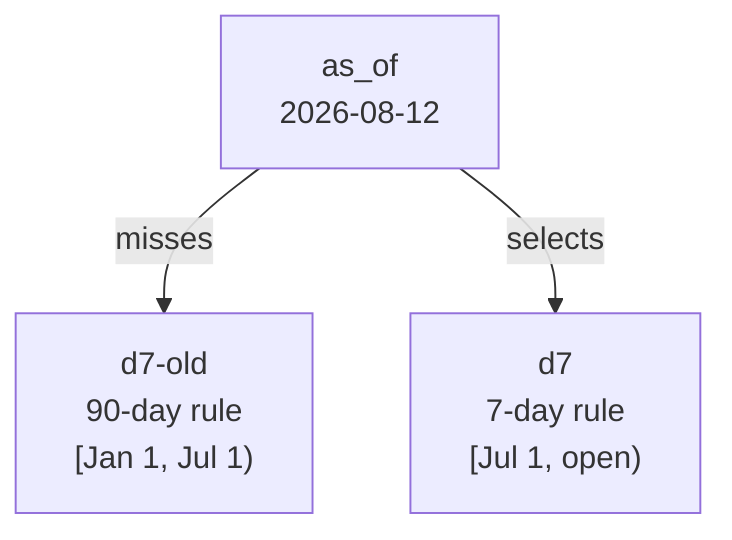

---
{
  "id": "sql-databases-data-modeling-ai",
  "title": "SQL and Data Modeling",
  "slug": "sql-databases-data-modeling-ai",
  "section": "Computing Foundations",
  "category": "MLOps & Deployment",
  "difficulty": "Easy",
  "order": 8,
  "coverImage": "illustrations/_generated/chapter_flow_dark.png",
  "companies": [
    "OpenAI",
    "Anthropic",
    "Google",
    "Meta",
    "xAI"
  ],
  "shortDescription": "When the support retriever restarts and its document dictionary is empty, SQL tables keep the versioned policy, permissions, and citations that make the answer recoverable.",
  "keyConceptsTested": [
    "tables, rows, columns, and durable state",
    "primary keys, foreign keys, and uniqueness constraints",
    "parameterized SELECT queries and SQL injection prevention",
    "JOIN queries that carry citation sources",
    "GROUP BY aggregation and NULL-aware filters",
    "time-aware document versions and as-of queries",
    "workspace scope and normalized permission tables",
    "transaction atomicity, rollback, and isolation",
    "durable idempotency keys for retried writes",
    "indexes and query-plan inspection",
    "PostgreSQL and pgvector as a semantic-search extension",
    "embedding feature and retrieval-evaluation lineage"
  ],
  "prerequisites": [
    "data-structures-for-ai-systems"
  ],
  "relatedQuestions": [
    "algorithms-complexity-ml-engineers",
    "core-retrieval-algorithms"
  ]
}
---

Your retriever finds the right paragraph. Then the process restarts, and its document dictionary is empty. The [Data Structures for AI](/learn/data-structures-for-ai-systems) lesson made lookup efficient inside one process; now the documents need a home that outlives it.

Structured Query Language (<span data-glossary="sql">SQL</span>) lets you read and change data in a relational database. The database stores durable state in **tables**. Named **columns** describe fields, and each stored fact is a **row**. Constraints turn assumptions into rules the database can enforce, even when another process writes the data.

Use a small Acme Cloud support-policy corpus. Its current API-key policy says "rotate within seven days," while an older version says ninety days. Both paragraphs can match a search, but only the active record should support a current answer.

SQLite and Python's standard-library `sqlite3` interface keep the lab local and runnable. Run the Python cells in order in one session; they share the connection and tables. The later <span data-glossary="postgresql">PostgreSQL</span> sections are extensions, not additional software you need for the SQLite lab.

| Question | Database feature that answers it |
|---|---|
| Does this document still exist after a restart? | A table row saved in a database |
| Can two chunks claim the same identity? | A primary key or uniqueness constraint |
| Which document version produced this quoted chunk? | A foreign key plus a `JOIN` |
| Is this agent allowed to retrieve it? | A permission row plus a filter |
| What if chunk insertion fails halfway through? | A transaction that rolls back |

## From Python objects to rows

In memory, you might keep documents in a dictionary keyed by `document_id`. A database makes those identities and their relationships explicit. A **workspace** separates one customer's data from another's; a **chunk** is a paragraph we might retrieve; a **principal** is the user or service whose access we're checking:

| Table | One row means | Important link |
|---|---|---|
| `workspaces` | one tenant workspace | `id` identifies tenant |
| `documents` | one published version of a source document | `workspace_id` refers to owner |
| `chunks` | one retrievable paragraph | `document_id` refers to source |
| `chunk_permissions` | one allowed principal for one chunk | `chunk_id` refers to content |

Now the links are data rather than a convention in application code. In-memory Python dictionaries let you nest chunks inside documents, but they leave integrity to developer discipline. Separate writes to a persistent store can leave a document without its chunks if an ingestion worker fails halfway through. A relational schema turns relationship assumptions into database-enforced rules: a <span data-glossary="primary-key">primary key</span> uniquely identifies each row, while a <span data-glossary="foreign-key">foreign key</span> ensures references point to existing records. Our references specify `NOT NULL`, so a chunk can't omit its source document or point into the void. A transaction will later keep the related writes together.

Keep identity, ownership, and permission links in these relational columns. Optional parser metadata, such as detected headings, can live in a separate JSON field. Putting a `document_id` inside JSON doesn't make it a foreign key; the declared column constraint is what enforces that relationship.[^postgresqlConstraints2026]

<figure>
  
  <figcaption>Each arrow points from a stored foreign-key value to the row it references. Follow c7a to d7 to w01 to recover its source and owner. Permissions and embeddings attach directly to the chunk.</figcaption>
</figure>

## Create the smallest useful schema

The first example creates four tables and inserts a tiny corpus. `CREATE TABLE` declares columns and constraints; `INSERT INTO` adds rows. `TEXT` holds strings, `NOT NULL` requires a value, and `UNIQUE` rejects a repeated combination of values. A `CHECK` rejects a row when its condition is false. A check that evaluates to `NULL` can pass, so it doesn't replace `NOT NULL`.[^sqliteCreateTable2026]

The database file lives in a fresh temporary directory so rerunning the lesson won't overwrite earlier work. A file-backed connection can be closed and reopened without losing committed rows. `sqlite3.connect(":memory:")` would be convenient for scratch work, but it would lose the database when that connection closes.[^pythonSqlite2026]

Its validity interval is half-open: active at `valid_from`, inactive at `valid_to`. A `NULL` `valid_to` means the version has no known end yet. This local SQLite lab stores canonical UTC timestamps as text; the PostgreSQL version later uses `TIMESTAMPTZ`.

`PRAGMA foreign_keys = ON` enables SQLite's foreign-key rules on this connection. Don't depend on the build's default setting.[^sqliteForeignKeys2026] SQLite also preserves a historical exception: an ordinary `TEXT PRIMARY KEY` can accept `NULL` unless it explicitly says `NOT NULL`. PostgreSQL primary keys reject `NULL` automatically, but this lab declares both constraints.[^sqliteCreateTable2026]

This lab requires Python 3.12 or later and explicitly selects its legacy transaction mode. In that mode, data-changing statements can open a transaction, while `SELECT` doesn't automatically start a multi-statement snapshot. Pinning the mode keeps the examples independent of a future change to Python's default.[^pythonSqlite2026]

We commit the seed data so later examples can open and <span data-glossary="rollback">roll back</span> new transactions on purpose.

<!-- leetllm: test, id=sql-lab, output=show -->
```python title="01_create_schema.py"
import sqlite3
from pathlib import Path
from tempfile import TemporaryDirectory

lab_directory = TemporaryDirectory(prefix="leetllm-sql-")
db_path = Path(lab_directory.name) / "support.sqlite"
conn = sqlite3.connect(db_path, autocommit=sqlite3.LEGACY_TRANSACTION_CONTROL)
conn.execute("PRAGMA foreign_keys = ON")

conn.executescript(
    """
    CREATE TABLE workspaces (
        id TEXT PRIMARY KEY NOT NULL,
        name TEXT NOT NULL
    );

    CREATE TABLE documents (
        id TEXT PRIMARY KEY NOT NULL,
        workspace_id TEXT NOT NULL REFERENCES workspaces(id),
        source_key TEXT NOT NULL,
        title TEXT NOT NULL,
        valid_from TEXT NOT NULL,
        valid_to TEXT,
        CHECK (valid_to IS NULL OR valid_to > valid_from),
        UNIQUE (workspace_id, source_key, valid_from)
    );

    CREATE TABLE chunks (
        id TEXT PRIMARY KEY NOT NULL,
        document_id TEXT NOT NULL REFERENCES documents(id),
        chunk_text TEXT NOT NULL,
        UNIQUE (document_id, chunk_text)
    );

    CREATE TABLE chunk_permissions (
        chunk_id TEXT NOT NULL REFERENCES chunks(id),
        principal TEXT NOT NULL,
        PRIMARY KEY (chunk_id, principal)
    );
    """
)

conn.executemany(
    "INSERT INTO workspaces (id, name) VALUES (?, ?)",
    [("w01", "Acme Cloud"), ("w02", "Other Workspace")],
)
conn.executemany(
    """
    INSERT INTO documents
        (id, workspace_id, source_key, title, valid_from, valid_to)
    VALUES (?, ?, ?, ?, ?, ?)
    """,
    [
        (
            "d7-old",
            "w01",
            "api-key-policy",
            "API Key Policy",
            "2026-01-01T00:00:00Z",
            "2026-07-01T00:00:00Z",
        ),
        (
            "d7",
            "w01",
            "api-key-policy",
            "API Key Policy",
            "2026-07-01T00:00:00Z",
            None,
        ),
        (
            "d9",
            "w01",
            "account-help",
            "Account Help",
            "2026-01-01T00:00:00Z",
            None,
        ),
        (
            "d99",
            "w02",
            "private-token-policy",
            "Private Token Policy",
            "2026-01-01T00:00:00Z",
            None,
        ),
    ],
)
conn.executemany(
    "INSERT INTO chunks (id, document_id, chunk_text) VALUES (?, ?, ?)",
    [
        ("c7-old", "d7-old", "API keys rotate within ninety days."),
        ("c7a", "d7", "API keys rotate within seven days."),
        ("c7b", "d7", "Email security with your workspace ID for key rotation."),
        ("c9a", "d9", "Reset passwords from account settings."),
        ("c99", "d99", "Private key exception for another workspace."),
    ],
)
conn.executemany(
    "INSERT INTO chunk_permissions (chunk_id, principal) VALUES (?, ?)",
    [
        ("c7-old", "agent:u3"),
        ("c7a", "agent:u1"),
        ("c7a", "agent:u3"),
        ("c7b", "agent:u1"),
        ("c7b", "agent:u3"),
        ("c9a", "agent:u1"),
        ("c99", "agent:u3"),
    ],
)
conn.commit()

print(
    "rows",
    [
        conn.execute("SELECT COUNT(*) FROM workspaces").fetchone()[0],
        conn.execute("SELECT COUNT(*) FROM documents").fetchone()[0],
        conn.execute("SELECT COUNT(*) FROM chunks").fetchone()[0],
        conn.execute("SELECT COUNT(*) FROM chunk_permissions").fetchone()[0],
    ],
)
```

<!-- leetllm: output:start -->
```text title="Output" output compact
rows [2, 4, 5, 7]
```
<!-- leetllm: output:end -->

Those counts describe two workspaces, four document versions, five chunks, and seven permission rows. `executemany` repeats one parameterized insert for each Python tuple. `commit()` makes those inserts a completed unit rather than leaving them pending on this connection.

`d7-old` and `d7` share `source_key = "api-key-policy"`, but their validity intervals don't overlap. Ownership and version time live on the document; visibility lives on the chunk. Two paragraphs in one document can have different visibility, and every retrieved paragraph still points at the exact source version.

The `(document_id, chunk_text)` uniqueness rule treats identical text in one version as a duplicate for this tiny corpus. Real chunkers may produce identical paragraphs at different positions; use a stable chunk position or source span if those occurrences must remain distinct. A unique text value also doesn't prove that a chunk or document is immutable.

## Select rows with parameters

`SELECT` chooses columns. `WHERE` keeps some rows and drops the rest. `ORDER BY` makes the output order something you can test. This query keeps Acme versions that have no recorded end time.

Keep the query shape and its values separate. Put a placeholder in the statement and pass the value beside it. That split prevents untrusted data from changing the statement's structure through <span data-glossary="sql-injection">SQL injection</span>.[^pythonSqlite2026]

<!-- leetllm: test, continue=sql-lab, id=select-lab, output=show -->
```python title="02_select_with_parameters.py"
workspace_id = "w01"

rows = conn.execute(
    """
    SELECT id, title
    FROM documents
    WHERE workspace_id = ?
      AND valid_to IS NULL
    ORDER BY id
    """,
    (workspace_id,),
).fetchall()

print(rows)
```

<!-- leetllm: output:start -->
```text title="Output" output compact
[('d7', 'API Key Policy'), ('d9', 'Account Help')]
```
<!-- leetllm: output:end -->

The SQL statement has a `?` where a value belongs, and the tuple `(workspace_id,)` holds that value. `execute` runs the query; `fetchall` collects its result rows as Python tuples. These rows have no end time, which isn't yet the same as proving they're active now: a future version could also have `valid_to IS NULL`.

Placeholder spelling depends on the driver. Python's SQLite interface uses `?`; PostgreSQL prepared statements use `$1` and `$2`, as shown in the [PostgreSQL `PREPARE` reference](https://www.postgresql.org/docs/current/sql-prepare.html). Use the parameter API your driver gives you. Keep values out of SQL text.

`NULL` means missing or unknown, not an ordinary value. Comparisons with it yield an unknown truth value, so `valid_to = NULL` doesn't select open-ended rows. Write `valid_to IS NULL`. PostgreSQL follows the same three-valued rule in its [comparison documentation](https://www.postgresql.org/docs/current/functions-comparison.html).

| Check | Expression | What to notice |
|---|---|---|
| Bind the workspace value | `workspace_id = ?` | SQL structure stays separate from the value tuple. |
| Select an open-ended version | `valid_to IS NULL` | `NULL` needs `IS NULL`, not ordinary equality. |

Binding keeps a value from becoming SQL syntax. A chat message is still untrusted input, even when another model wrote it. It must not rewrite the statement shape.

## Join a chunk to its source

Matching text isn't enough for an answer generator. The UI also needs the title, version, or document ID that makes the evidence citable. A **join** combines rows according to a condition. Ours matches a chunk's document reference to the corresponding document identity.

Here, `chunks.document_id` refers to `documents.id`. Follow that link and one result set can return both the paragraph and its source title:

<!-- leetllm: test, continue=select-lab, id=join-lab, output=show -->
```python title="03_join_chunks_to_documents.py"
term = "%key%"

citations = conn.execute(
    """
    SELECT c.id, d.title, d.valid_from, d.valid_to, c.chunk_text
    FROM chunks AS c
    JOIN documents AS d ON d.id = c.document_id
    WHERE d.workspace_id = ?
      AND LOWER(c.chunk_text) LIKE ?
    ORDER BY d.valid_from, c.id
    """,
    ("w01", term),
).fetchall()

for chunk_id, title, valid_from, valid_to, text in citations:
    print(f"{chunk_id} [{title}] {valid_from} -> {valid_to or 'open'} | {text}")
```

<!-- leetllm: output:start -->
```text title="Output" output compact
c7-old [API Key Policy] 2026-01-01T00:00:00Z -> 2026-07-01T00:00:00Z | API keys rotate within ninety days.
c7a [API Key Policy] 2026-07-01T00:00:00Z -> open | API keys rotate within seven days.
c7b [API Key Policy] 2026-07-01T00:00:00Z -> open | Email security with your workspace ID for key rotation.
```
<!-- leetllm: output:end -->

For `c7a`, `document_id` is `d7`, so the join attaches the title and dates from `d7`. It doesn't attach `d7-old` merely because that row has the same title. `AS c` and `AS d` are short table aliases, and `c.id` identifies which table supplies the column. The pattern `%key%` was bound as a value, not pasted into SQL text.

In `LIKE`, `%` matches any sequence of characters and `_` matches one character. Binding doesn't make either wildcard literal. This exploratory query intentionally uses `%key%` to find `key` anywhere in the text. Before exposing search to a caller, we'll escape user-supplied wildcards and reject blank input.

It also showed a new problem. Both the retired ninety-day rule and the current seven-day rule match `key`, so a correct join alone doesn't decide which fact was valid for this request.

```checkpoint
Which safeguard does a bound SQL parameter provide, and what does it leave unaddressed inside `LIKE`?
---
It keeps user data from becoming SQL syntax. It doesn't make `%` or `_` literal characters, so escape those wildcards when literal matching is the product requirement.
```

## Query the version that was valid at a specific time

Now ask a time-bound question: which policy was true at a particular instant? The lab uses a fixed timestamp so every rerun has the same answer. A version is valid when `valid_from <= as_of` and either its end is unknown or `as_of < valid_to`:

<!-- leetllm: test, continue=join-lab, id=as-of-lab, output=show -->
```python title="04_query_as_of_time.py"
AS_OF = "2026-08-12T12:00:00Z"

current_citations = conn.execute(
    """
    SELECT c.id, d.title, c.chunk_text
    FROM chunks AS c
    JOIN documents AS d ON d.id = c.document_id
    WHERE d.workspace_id = ?
      AND d.valid_from <= ?
      AND (d.valid_to IS NULL OR ? < d.valid_to)
      AND LOWER(c.chunk_text) LIKE ?
    ORDER BY c.id
    """,
    ("w01", AS_OF, AS_OF, "%key%"),
).fetchall()

for chunk_id, title, text in current_citations:
    print(f"{chunk_id} [{title}] {text}")
```

<!-- leetllm: output:start -->
```text title="Output" output compact
c7a [API Key Policy] API keys rotate within seven days.
c7b [API Key Policy] Email security with your workspace ID for key rotation.
```
<!-- leetllm: output:end -->

The half-open interval `[valid_from, valid_to)` gives a crisp cutoff: at exactly `2026-07-01T00:00:00Z`, `d7-old` is inactive and `d7` is active.

SQLite's text comparison works here because every timestamp uses the same fixed-width UTC format. Mixing offsets or formats would break that ordering.



The schema prevents duplicate start times for a source, but it doesn't reject overlapping intervals. For example, a second row beginning June 15 and ending July 15 could overlap both versions without violating any current constraint. An ingestion transaction must check the existing intervals under appropriate concurrency control, or PostgreSQL can enforce a suitable exclusion constraint.[^postgresqlConstraints2026]

PostgreSQL should store these instants as `TIMESTAMPTZ`; it normalizes zoned input internally and converts it for display in the active session time zone.[^postgresqlDateTime2026]

`LIKE` is enough for this tiny vocabulary demonstration. It isn't semantic retrieval: it will miss paraphrases such as "rotate credentials" when no row contains "key." The PostgreSQL extension later adds <span data-glossary="vector">vector</span> similarity without discarding time, tenant, or permission checks.

## Group rows to inspect the corpus

Retrieval returns individual chunks. Operators often need a summary instead: how many current chunks does each Acme source contribute? `GROUP BY` collects input rows that share the named keys, and `COUNT(*)` reduces each group to one number.

At `AS_OF`, predict two chunks for `d7` and one for `d9`; retired `d7-old` should contribute none. The query makes that prediction testable:

<!-- leetllm: test, continue=as-of-lab, id=group-lab, output=show -->
```python title="05_group_current_chunks.py"
summary = conn.execute(
    """
    SELECT d.id, d.title, COUNT(*) AS chunk_count
    FROM documents AS d
    JOIN chunks AS c ON c.document_id = d.id
    WHERE d.workspace_id = ?
      AND d.valid_from <= ?
      AND (d.valid_to IS NULL OR ? < d.valid_to)
    GROUP BY d.id, d.title
    ORDER BY d.id
    """,
    ("w01", AS_OF, AS_OF),
).fetchall()

for document_id, title, chunk_count in summary:
    print(document_id, title, chunk_count)
```

<!-- leetllm: output:start -->
```text title="Output" output compact
d7 API Key Policy 2
d9 Account Help 1
```
<!-- leetllm: output:end -->

`WHERE` filters rows before grouping, so retired `d7-old` never contributes to these counts. To filter completed groups, such as keeping sources with at least two chunks, add `HAVING COUNT(*) >= 2` after `GROUP BY`.[^postgresqlAggregates2026]

An ordinary `JOIN` also drops documents with no matching chunks. For an ingestion audit that must show zero-chunk documents, use `LEFT JOIN chunks AS c ON c.document_id = d.id` and `COUNT(c.id)`. A left join preserves the document with null chunk fields; counting `c.id` gives zero, whereas `COUNT(*)` would count that placeholder row as one.

## Constraints catch broken relationships

Code can be buggy. An ingestion job can create a chunk for a document ID that never arrived. Without a constraint, that orphan may show up in retrieval with no trustworthy source.

Inserting a chunk for `missing-document` must fail before it becomes data. The foreign key on `chunks` turns that silent corruption into an immediate integrity error.

Under the lab's pinned `sqlite3` transaction mode, a data-changing statement opens a transaction implicitly. These immediate constraint failures revert the failing statement; earlier successful statements in that transaction can still be pending. `rollback()` discards the whole pending unit before the lab continues:

<!-- leetllm: test, continue=group-lab, id=constraint-lab, output=show -->
```python title="06_foreign_key_guard.py"
try:
    conn.execute(
        "INSERT INTO chunks (id, document_id, chunk_text) VALUES (?, ?, ?)",
        ("broken", "missing-document", "This row has no source."),
    )
except sqlite3.IntegrityError:
    print("blocked orphan chunk")
    conn.rollback()

try:
    conn.execute(
        "INSERT INTO chunks (id, document_id, chunk_text) VALUES (?, ?, ?)",
        (None, "d7", "A chunk can't have a missing identity."),
    )
except sqlite3.IntegrityError:
    print("blocked null primary key")
    conn.rollback()

missing = conn.execute(
    "SELECT COUNT(*) FROM chunks WHERE id = ?",
    ("broken",),
).fetchone()[0]
print("orphan rows stored", missing)
```

<!-- leetllm: output:start -->
```text title="Output" output compact
blocked orphan chunk
blocked null primary key
orphan rows stored 0
```
<!-- leetllm: output:end -->

Primary keys catch duplicate identities. The explicit `NOT NULL` catches SQLite's otherwise-accepted missing text identity. Foreign keys catch broken references.

These rules belong in the schema because every writer must obey them, including the current Python script. Remove `NOT NULL` from `chunks.id` and the second check stops printing `blocked null primary key`: SQLite accepts the missing identity even though the column says `PRIMARY KEY`.

### Deleting a parent doesn't silently erase its children

The current schema doesn't declare `ON DELETE CASCADE`. Deleting `d7` while `c7a` and `c7b` still reference it should fail. Deleting those chunks first also requires handling their permission rows. Predict which table must be cleared first:

<!-- leetllm: test, continue=constraint-lab, id=delete-lab, output=show -->
```python title="06b_delete_dependencies.py"
try:
    conn.execute("DELETE FROM documents WHERE id = ?", ("d7",))
except sqlite3.IntegrityError:
    print("blocked parent deletion")
    conn.rollback()

try:
    conn.execute(
        "DELETE FROM chunks WHERE document_id = ?", ("d7",)
    )
except sqlite3.IntegrityError:
    print("blocked chunk deletion: permissions still reference it")
    conn.rollback()

# Rehearse dependency order without deleting the lesson's corpus permanently.
conn.execute("BEGIN")
conn.execute(
    """DELETE FROM chunk_permissions WHERE chunk_id IN
       (SELECT id FROM chunks WHERE document_id = ?)""", ("d7",)
)
conn.execute("DELETE FROM chunks WHERE document_id = ?", ("d7",))
conn.execute("DELETE FROM documents WHERE id = ?", ("d7",))
print("d7 exists inside deletion", bool(conn.execute(
    "SELECT 1 FROM documents WHERE id = ?", ("d7",)
).fetchone()))
conn.rollback()
print("d7 restored after rollback", bool(conn.execute(
    "SELECT 1 FROM documents WHERE id = ?", ("d7",)
).fetchone()))
```

<!-- leetllm: output:start -->
```text title="Output" output compact
blocked parent deletion
blocked chunk deletion: permissions still reference it
d7 exists inside deletion False
d7 restored after rollback True
```
<!-- leetllm: output:end -->

Choose deletion behavior deliberately: reject deletion while references exist, delete dependent rows together, or declare cascades where that matches the product. A cascade follows declared foreign keys; it doesn't delete remote vectors or cached answers. Historical evidence needed by evaluations may need retention rather than cascading deletion.[^sqliteForeignKeys2026]

## Make permissions queryable data

Integrity tells us which rows connect. It doesn't tell us who may read one. An access-control list says which principals may view a resource. Instead of hiding that list in application logic, this schema stores one permitted `(chunk_id, principal)` pair per row. The retrieval rule is:

> Return a chunk only when its document belongs to the active workspace and a permission row exists for the active principal.

Alice (`agent:u1`) may read key and account help. Bob (`agent:u3`) may read key paragraphs for Acme, but not Acme account-help content. The query below turns that distinction into rows we can inspect:

In an application, the authenticated session supplies `principal`, and the server verifies the requested workspace against that session. They aren't claims a chat message or model may choose. The function accepts them as arguments here only so the lab can exercise several identities explicitly.

<!-- leetllm: test, continue=delete-lab, id=auth-lab, output=show -->
```python title="07_authorized_lookup.py"
def permitted_matches(
    workspace_id: str,
    principal: str,
    word: str,
    as_of: str,
) -> list[str]:
    return [
        row[0]
        for row in conn.execute(
            """
            SELECT c.id
            FROM chunks AS c
            JOIN documents AS d ON d.id = c.document_id
            JOIN chunk_permissions AS p ON p.chunk_id = c.id
            WHERE d.workspace_id = ?
              AND d.valid_from <= ?
              AND (d.valid_to IS NULL OR ? < d.valid_to)
              AND p.principal = ?
              AND LOWER(c.chunk_text) LIKE ?
            ORDER BY c.id
            """,
            (workspace_id, as_of, as_of, principal, f"%{word.lower()}%"),
        ).fetchall()
    ]

print("Bob key", permitted_matches("w01", "agent:u3", "key", AS_OF))
print("Bob password", permitted_matches("w01", "agent:u3", "password", AS_OF))
print("Alice password", permitted_matches("w01", "agent:u1", "password", AS_OF))
```

<!-- leetllm: output:start -->
```text title="Output" output compact
Bob key ['c7a', 'c7b']
Bob password []
Alice password ['c9a']
```
<!-- leetllm: output:end -->

## A missing workspace predicate leaks a row

Bob also has permission to read one row in `w02`. That's useful for showing the failure rather than assuming the rule is correct.

Suppose the active support screen is displaying Acme (`w01`), but a programmer filters only by user and query word. Bob's `key` search can now pull a private rule from `w02` even though the UI is scoped to Acme:

<!-- leetllm: test, continue=auth-lab, id=leak-lab, output=show -->
```python title="08_missing_tenant_filter.py"
unsafe = conn.execute(
    """
    SELECT c.id
    FROM chunks AS c
    JOIN chunk_permissions AS p ON p.chunk_id = c.id
    JOIN documents AS d ON d.id = c.document_id
    WHERE d.valid_from <= ?
      AND (d.valid_to IS NULL OR ? < d.valid_to)
      AND p.principal = ?
      AND LOWER(c.chunk_text) LIKE ?
    ORDER BY c.id
    """,
    (AS_OF, AS_OF, "agent:u3", "%key%"),
).fetchall()

safe = permitted_matches("w01", "agent:u3", "key", AS_OF)

print("unsafe", [row[0] for row in unsafe])
print("safe", safe)
```

<!-- leetllm: output:start -->
```text title="Output" output compact
unsafe ['c7a', 'c7b', 'c99']
safe ['c7a', 'c7b']
```
<!-- leetllm: output:end -->

The scoped query checks both dimensions: current workspace and current principal. Bob can read `c99` in a different request, but that doesn't make it valid context for an Acme answer. This is a cross-workspace disclosure in the active request, not evidence that Bob lacks all access to `c99`.

<figure>
  
  <figcaption>Each filter stage narrows the candidate pool: time validity drops retired chunk <code>c7-old</code>, and tenant isolation drops <code>c99</code> from workspace <code>w02</code>. Only <code>c7a</code> and <code>c7b</code> satisfy every predicate.</figcaption>
</figure>

For a production PostgreSQL application, <span data-glossary="row-level-security">row-level security (RLS)</span> adds database-enforced row filtering as defense in depth. RLS isn't automatic: once it's enabled for a table, normal access must satisfy a policy, and an enabled table with no policy uses default deny.[^postgresql_rls_docs]

Superusers and roles with `BYPASSRLS` always bypass those policies. Table owners normally bypass them too unless the table uses `FORCE ROW LEVEL SECURITY`. Run application queries with a role that's subject to the policy, then test that role directly.

```checkpoint
Why is filtering only by `principal` insufficient when the active support screen is scoped to workspace `w01`?
---
The same principal may have access in another workspace. Every retrieval path must enforce both active workspace and principal, or relevant rows from a different tenant can enter the prompt.
```

## Use a transaction for all-or-nothing ingestion

A <span data-glossary="database-transaction">database transaction</span> groups changes into one unit. A commit makes that unit permanent; a rollback discards it. That matters when a new document and its chunks must appear together. A visible document with missing chunks is confusing; visible chunks with no source are worse.

Use `with conn:` here so Python commits an open transaction on success or rolls it back when an exception escapes the block. Catch the exception outside the block: swallowing it inside could let earlier writes commit. The context manager doesn't open a transaction by itself.[^pythonSqlite2026]

With this lab's pinned transaction mode, the first `INSERT` inside the block opens one. The second `INSERT` intentionally points at a missing source, so its foreign-key error rolls back the document insertion too:

<!-- leetllm: test, continue=leak-lab, id=transaction-lab, output=show -->
```python title="09_transaction_rollback.py"
try:
    with conn:
        conn.execute(
            """
            INSERT INTO documents
                (id, workspace_id, source_key, title, valid_from, valid_to)
            VALUES (?, ?, ?, ?, ?, ?)
            """,
            (
                "d20",
                "w01",
                "incident-policy",
                "Incident Policy",
                "2026-08-01T00:00:00Z",
                None,
            ),
        )
        conn.execute(
            "INSERT INTO chunks (id, document_id, chunk_text) VALUES (?, ?, ?)",
            ("c20", "not-d20", "Incidents are reviewed in two days."),
        )
except sqlite3.IntegrityError:
    print("transaction rolled back")

visible = conn.execute(
    "SELECT COUNT(*) FROM documents WHERE id = ?",
    ("d20",),
).fetchone()[0]
print("partial document visible", bool(visible))
```

<!-- leetllm: output:start -->
```text title="Output" output compact
transaction rolled back
partial document visible False
```
<!-- leetllm: output:end -->

The transaction protects database rows, not a remote <span data-glossary="embedding">embedding</span> service. You have two reasonable designs: compute embeddings before the database transaction and commit document plus chunks together, or write a pending ingestion record and publish a new complete version only after all chunks are ready. Don't expose half an index to retrieval without making that state deliberate.

Publication must also retire the old version in that same unit. Committing its end time before the replacement is ready creates a gap; publishing the replacement without ending the old version creates overlapping facts. The earlier interval `CHECK` doesn't prevent either mistake.

Rehearse replacing `d7` at `AS_OF`. `BEGIN IMMEDIATE` claims SQLite's one writer slot before inspecting or changing publication state. A second connection can still read the committed policy, but its competing writer attempt fails immediately because this example sets `timeout=0`. A real caller would wait within a bound or retry the whole publication transaction.[^sqliteTransactions2026]

<!-- leetllm: test, continue=transaction-lab, id=publication-lab, output=show -->
```python title="09b_publish_one_complete_version.py"
other = sqlite3.connect(
    db_path, timeout=0, autocommit=sqlite3.LEGACY_TRANSACTION_CONTROL
)
other.execute("PRAGMA foreign_keys = ON")

def active_policy_ids(db):
    return [row[0] for row in db.execute(
        """SELECT id FROM documents
           WHERE workspace_id = 'w01' AND source_key = 'api-key-policy'
             AND valid_from <= ? AND (valid_to IS NULL OR ? < valid_to)
           ORDER BY id""", (AS_OF, AS_OF)
    ).fetchall()]

try:
    conn.execute("BEGIN IMMEDIATE")
    try:
        other.execute("BEGIN IMMEDIATE")
    except sqlite3.OperationalError as error:
        assert error.sqlite_errorcode == sqlite3.SQLITE_BUSY
        print("competing writer must wait or retry")
    else:
        raise AssertionError("two writers must not own publication together")

    ended = conn.execute(
        "UPDATE documents SET valid_to = ? WHERE id = ? AND valid_to IS NULL",
        (AS_OF, "d7"),
    ).rowcount
    if ended != 1:
        raise ValueError("expected open version changed; reload publication state")
    print("writer before replacement", active_policy_ids(conn))
    print("reader during publication", active_policy_ids(other))

    conn.execute(
        "INSERT INTO documents VALUES (?, ?, ?, ?, ?, ?)",
        ("d7-next", "w01", "api-key-policy", "API Key Policy", AS_OF, None),
    )
    conn.execute(
        "INSERT INTO chunks VALUES (?, ?, ?)",
        ("c7-next", "d7-next", "API keys rotate within five days."),
    )
    conn.execute(
        "INSERT INTO chunk_permissions VALUES (?, ?)", ("c7-next", "agent:u3")
    )
    print("writer's complete replacement", active_policy_ids(conn))
    print("writer's authorized result", permitted_matches("w01", "agent:u3", "key", AS_OF))
finally:
    conn.rollback()  # Rehearsal: keep later cells on the original seven-day rule.
    other.rollback()
    other.close()
print("after rehearsal rollback", active_policy_ids(conn))
```

<!-- leetllm: output:start -->
```text title="Output" output compact
competing writer must wait or retry
writer before replacement []
reader during publication ['d7']
writer's complete replacement ['d7-next']
writer's authorized result ['c7-next']
after rehearsal rollback ['d7']
```
<!-- leetllm: output:end -->

The writer temporarily sees a gap inside its own unfinished transaction; the other connection continues to see committed `d7`. In production, commit only after the replacement chunks and intended grants are complete. Here rollback restores the original rows for later exercises. This serializes cooperating SQLite publishers; it doesn't add a global overlap constraint, validate remote embeddings, or prevent another code path from publishing invalid intervals. PostgreSQL needs its own locking, exclusion, or serializable-transaction design for that invariant.

```checkpoint
An ingestion transaction inserts a document, then fails while inserting one chunk. What state should remain after rollback?
---
Neither the document nor any of its chunks should remain. The transaction preserves the all-or-nothing invariant and prevents a visible partial ingestion.
```

## Atomicity doesn't choose what concurrent readers see

Rollback demonstrates **atomicity**: one transaction's writes appear together or not at all. **Isolation** answers a different question: what can one transaction observe while another transaction commits changes?

PostgreSQL defaults to Read Committed isolation. Each ordinary `SELECT` sees a snapshot taken when that statement begins, so two `SELECT` statements in one transaction can observe different committed states.

That behavior is fine for many request paths. It can undermine an evaluation export that first counts current chunks and later reads them, because a concurrent ingestion may commit between those statements.[^postgresqlIsolation2026]

When several reads must describe one stable corpus snapshot, use a read-only Repeatable Read transaction. This is PostgreSQL syntax, not part of the SQLite lab:

```sql title="postgres_stable_eval_snapshot.sql"
BEGIN TRANSACTION ISOLATION LEVEL REPEATABLE READ READ ONLY;

SELECT d.id, COUNT(*)
FROM documents AS d
JOIN chunks AS c ON c.document_id = d.id
WHERE d.workspace_id = 'w01'
  AND d.valid_from <= TIMESTAMPTZ '2026-08-12 12:00:00+00'
  AND (
      d.valid_to IS NULL
      OR TIMESTAMPTZ '2026-08-12 12:00:00+00' < d.valid_to
  )
GROUP BY d.id;

-- Later reads in this transaction keep the same snapshot.
SELECT c.id, c.chunk_text
FROM chunks AS c
JOIN documents AS d ON d.id = c.document_id
WHERE d.workspace_id = 'w01'
  AND d.valid_from <= TIMESTAMPTZ '2026-08-12 12:00:00+00'
  AND (
      d.valid_to IS NULL
      OR TIMESTAMPTZ '2026-08-12 12:00:00+00' < d.valid_to
  );

COMMIT;
```

Repeatable Read fixes the snapshot after the first non-control statement, so the count and detail rows agree even if another transaction commits later.

Serializable isolation is stricter when concurrent transactions enforce a cross-row business rule, but PostgreSQL may abort one transaction with a serialization failure. Applications using that level must retry the whole transaction rather than the final statement alone.

<figure>
  
  <figcaption>The failed chunk insert rolls back d20 along with its pending writes. PostgreSQL's read-only Repeatable Read transaction keeps the count and detail queries on the same snapshot, even when another writer commits between them.</figcaption>
</figure>

## Keep retries from duplicating completed work

A transaction makes one attempt all-or-nothing. It doesn't tell a worker whether the request already succeeded before a timeout. If the worker commits new rows, crashes before sending its response, and retries the same request, a second write attempt can duplicate work.

For retried writes, store a stable <span data-glossary="idempotency">idempotency</span> key in the same transaction as the rows created for that request. A uniqueness constraint lets the database accept the first attempt and recognize later repeats even after the original process disappears:

The same key must also mean the same input. Store a fingerprint of all input fields alongside it. Here, `json.dumps` gives a fixed field list a consistent representation, and SHA-256 turns those bytes into a compact comparison value. A changed title or paragraph must raise an error, not be mistaken for a successful retry.

<!-- leetllm: test, continue=publication-lab, id=idempotency-lab, output=show -->
```python title="10_idempotent_ingestion.py"
import hashlib
import json

conn.execute(
    """
    CREATE TABLE ingestion_requests (
        request_id TEXT PRIMARY KEY NOT NULL,
        document_id TEXT NOT NULL,
        payload_hash TEXT NOT NULL
    )
    """
)
conn.commit()

def ingest_document_once(
    request_id: str,
    document_id: str,
    source_key: str,
    title: str,
    valid_from: str,
    chunk_id: str,
    chunk_text: str,
) -> str:
    payload = json.dumps(
        ["w01", document_id, source_key, title, valid_from, chunk_id, chunk_text],
        ensure_ascii=False,
        separators=(",", ":"),
    )
    payload_hash = hashlib.sha256(payload.encode("utf-8")).hexdigest()
    with conn:
        created = conn.execute(
            """
            INSERT INTO ingestion_requests (request_id, document_id, payload_hash)
            VALUES (?, ?, ?)
            ON CONFLICT(request_id) DO NOTHING
            """,
            (request_id, document_id, payload_hash),
        ).rowcount
        if created == 0:
            existing_hash = conn.execute(
                "SELECT payload_hash FROM ingestion_requests WHERE request_id = ?",
                (request_id,),
            ).fetchone()[0]
            if existing_hash != payload_hash:
                raise ValueError("idempotency key reused with changed input")
            return "skipped retry"

        conn.execute(
            """
            INSERT INTO documents
                (id, workspace_id, source_key, title, valid_from, valid_to)
            VALUES (?, ?, ?, ?, ?, NULL)
            """,
            (document_id, "w01", source_key, title, valid_from),
        )
        conn.execute(
            "INSERT INTO chunks (id, document_id, chunk_text) VALUES (?, ?, ?)",
            (chunk_id, document_id, chunk_text),
        )
    return "inserted"

print(
    "first",
    ingest_document_once(
        "req-30",
        "d30",
        "key-rotation-faq",
        "Key Rotation FAQ",
        "2026-08-10T00:00:00Z",
        "c30",
        "Temporary keys expire after 30 days.",
    ),
)
print(
    "retry",
    ingest_document_once(
        "req-30",
        "d30",
        "key-rotation-faq",
        "Key Rotation FAQ",
        "2026-08-10T00:00:00Z",
        "c30",
        "Temporary keys expire after 30 days.",
    ),
)
stored = conn.execute(
    "SELECT COUNT(*) FROM documents WHERE id = ?",
    ("d30",),
).fetchone()[0]
print("d30 rows", stored)

try:
    ingest_document_once(
        "req-30", "d30", "key-rotation-faq", "Key Rotation FAQ",
        "2026-08-10T00:00:00Z", "c30", "Changed policy text.",
    )
except ValueError as exc:
    print("changed retry", exc)
else:
    raise AssertionError("changed input must not reuse an idempotency key")
```

<!-- leetllm: output:start -->
```text title="Output" output compact
first inserted
retry skipped retry
d30 rows 1
changed retry idempotency key reused with changed input
```
<!-- leetllm: output:end -->

The first call stores the request marker, document, and chunk together. An identical retry skips the write. Reusing `req-30` with different text raises an error and leaves the original policy untouched. The fingerprint is an equality check, not authentication; the server still owns workspace and user identity.

This function leaves the new chunk ungranted, so retrieval won't expose it yet. A complete ingestion operation would also write the intended permission rows before publishing the document. Keeping that default closed is safer than treating a missing permission as public access.

This pattern works when the protected side effect lives in the same database transaction. A local marker can't atomically cover a deployment API or another remote service. For an external side effect, pass the same key to a downstream API that enforces it, or use a workflow such as an outbox with an idempotent consumer.

## Index the predicates you run often

Without an index, a database may need to inspect many rows to answer a filter. An **index** is an additional data structure that lets the engine reach selected rows more directly, at the cost of storage and write work.

Our authorized query repeatedly filters permissions by `principal` and follows document ownership. Add indexes for those paths, then ask SQLite for its <span data-glossary="query-plan">query plan</span>. The plan describes the database's chosen access strategy; measure runtime separately.[^sqliteQueryPlan2026]

<!-- leetllm: test, continue=idempotency-lab, id=index-lab, output=show -->
```python title="11_add_indexes_and_explain.py"
conn.executescript(
    """
    CREATE INDEX permission_principal_idx
        ON chunk_permissions (principal, chunk_id);
    CREATE INDEX document_workspace_idx
        ON documents (workspace_id, valid_from, valid_to, id);
    """
)

authorized_sql = """
SELECT c.id, d.title, c.chunk_text
FROM chunks AS c
JOIN documents AS d ON d.id = c.document_id
JOIN chunk_permissions AS p ON p.chunk_id = c.id
WHERE d.workspace_id = ?
  AND d.valid_from <= ?
  AND (d.valid_to IS NULL OR ? < d.valid_to)
  AND p.principal = ?
  AND LOWER(c.chunk_text) LIKE ? ESCAPE '!'
ORDER BY c.id
"""

plan = conn.execute(
    "EXPLAIN QUERY PLAN " + authorized_sql,
    ("w01", AS_OF, AS_OF, "agent:u3", "%key%"),
).fetchall()
for _node_id, _parent_id, _unused, detail in plan:
    print(detail)
```

<!-- leetllm: output:start -->
```text title="Output" output compact
SEARCH p USING COVERING INDEX permission_principal_idx (principal=?)
SEARCH c USING INDEX sqlite_autoindex_chunks_1 (id=?)
SEARCH d USING INDEX sqlite_autoindex_documents_1 (id=?)
USE TEMP B-TREE FOR ORDER BY
```
<!-- leetllm: output:end -->

Plan details vary as engines and statistics change. Inspect the production query plan with realistic tenant and permission selectivity, then measure request latency on the intended workload.

`SEARCH` visits a selected subset through the named access path; `SCAN` visits a full table or index. `COVERING` means the selected fields can come from that index without an additional table lookup for those fields. `USE TEMP B-TREE FOR ORDER BY` identifies sorting work that remains after indexed lookups. Seeing one index name doesn't guarantee that every join or filter became cheap.[^sqliteQueryPlan2026]

In this corpus, a sequential path inspects all seven `chunk_permissions` rows. An index on `(principal, chunk_id)` can seek the four rows for `agent:u3` (`c7-old`, `c7a`, `c7b`, `c99`). Workspace and validity predicates then drop the retired version and the other-workspace chunk, leaving `c7a` and `c7b`.

Those numbers count candidate rows. They do not describe storage operations or runtime. An index still has to traverse its own structure, and the planner can choose a different join order. Whatever path it picks, the authorization rule must stay unchanged.

> **Query-plan check:** PostgreSQL uses `EXPLAIN` for estimated plans and `EXPLAIN ANALYZE` for actual row counts and timing. The latter executes the statement, including writes. Use a read query here. A surrounding rollback can undo ordinary database writes, but it can't undo every possible effect, such as a function calling an external service. Plans from tiny tables also don't predict plans for large ones.[^postgresqlExplain2026]

Indexes on `principal`, workspace, and validity time give the planner candidate access paths for authorization and version filters. They don't make `LOWER(c.chunk_text) LIKE ?` a fast B-tree lookup on `chunk_text`. Substring `LIKE` at scale needs full-text search, a trigram index, or a vector path. This demo corpus is small enough that a scan is fine.

<figure>
  
  <figcaption>A permission-table scan considers seven rows; a principal index can seek Bob's four entries. Joins and filters still do work. These candidate counts illustrate two possible access paths. The planner may use other indexes or table scans.</figcaption>
</figure>

## Build a small authorized retriever

The schema, filters, and indexes now fit one function a caller can test. It returns permitted matching paragraphs beside their document titles. The query above uses `ESCAPE '!'`: `!%` matches a literal `%`, `!_` matches a literal `_`, and `!!` matches a literal `!`. Escape those characters in the user's text before adding our own surrounding `%` wildcards.

<!-- leetllm: test, continue=index-lab, id=search-lab, output=show -->
```python title="12_authorized_retriever.py"
def search_support(
    workspace_id: str,
    principal: str,
    query: str,
    as_of: str,
) -> list[tuple[str, str, str]]:
    text = query.strip().lower()
    if not text:
        return []
    literal = text.replace("!", "!!").replace("%", "!%").replace("_", "!_")
    pattern = f"%{literal}%"
    return conn.execute(
        authorized_sql,
        (workspace_id, as_of, as_of, principal, pattern),
    ).fetchall()

for chunk_id, title, text in search_support("w01", "agent:u3", "key", AS_OF):
    print(f"{chunk_id} | {title} | {text}")
```

<!-- leetllm: output:start -->
```text title="Output" output compact
c7a | API Key Policy | API keys rotate within seven days.
c7b | API Key Policy | Email security with your workspace ID for key rotation.
```
<!-- leetllm: output:end -->

This is lexical search: it looks for a literal text fragment. A query of `%` now searches for an actual percent sign rather than matching every row. Blank queries return no rows. The SQL parameter still protects statement structure; escaping protects the product's substring-search behavior. Neither one supplies authorization.

Passing `as_of` keeps a retired policy out of current answers and still lets a historical audit reproduce an older one. A retrieval-augmented generation (RAG) system usually also retrieves semantically related text before a large language model (LLM) drafts an answer. That path should reuse the same source, time, and permission model.

## Test forbidden rows too

Test forbidden results as well as matches. Make the excluded test case match the query first: a cross-workspace test using `token` would be weak here because `c99` contains `key`, not `token`. It would return nothing even if the workspace predicate were missing.

<!-- leetllm: test, continue=search-lab, id=auth-tests, output=show -->
```python title="13_authorization_tests.py"
bob_key = [row[0] for row in search_support("w01", "agent:u3", "key", AS_OF)]
bob_password = search_support("w01", "agent:u3", "password", AS_OF)
other_workspace_key = [
    row[0] for row in search_support("w02", "agent:u3", "key", AS_OF)
]
unknown_user = search_support("w01", "agent:unknown", "key", AS_OF)
retired_key = [
    row[0]
    for row in search_support("w01", "agent:u3", "key", "2026-06-01T00:00:00Z")
]

assert bob_key == ["c7a", "c7b"]
assert bob_password == []
assert other_workspace_key == ["c99"]
assert "c99" not in bob_key
assert unknown_user == []
assert retired_key == ["c7-old"]
assert search_support("w01", "agent:u3", "%", AS_OF) == []
assert search_support("w01", "agent:u3", "   ", AS_OF) == []
assert [
    row[0]
    for row in search_support("w01", "agent:u3", "key", "2026-07-01T00:00:00Z")
] == ["c7a", "c7b"]

print("authorized retrieval tests passed")
```

<!-- leetllm: output:start -->
```text title="Output" output compact
authorized retrieval tests passed
```
<!-- leetllm: output:end -->

The tests guard the core retrieval invariant: context must be relevant, authorized, and valid at the requested time before it reaches an LLM prompt.

The historical assertion also proves that keeping old versions isn't the same as leaking them into current answers.

## Close the connection and read the file again

So far, every query has used the same open connection. Test the promise that motivated the database: after committing and closing it, can another connection recover the same authorized rows?

The global `conn` name is rebound below, so `search_support` now queries the reopened file. No schema creation or seeding runs a second time:

<!-- leetllm: test, continue=auth-tests, output=show -->
```python title="14_reopen_database.py"
conn.commit()
conn.close()

conn = sqlite3.connect(db_path, autocommit=sqlite3.LEGACY_TRANSACTION_CONTROL)
conn.execute("PRAGMA foreign_keys = ON")
reopened = [row[0] for row in search_support("w01", "agent:u3", "key", AS_OF)]
assert reopened == ["c7a", "c7b"]
print("reopened", reopened)

conn.close()
lab_directory.cleanup()  # Remove only this lab's temporary files.
```

<!-- leetllm: output:start -->
```text title="Output" output compact
reopened ['c7a', 'c7b']
```
<!-- leetllm: output:end -->

The file, not the connection object, preserved the rows. Cleanup removes this lab's file only after the check. An application would use a stable path on persistent storage and keep it across runs. Don't rerun the seed script against that existing database; open it and query it. A file inside an ephemeral container filesystem still disappears when that container is removed, so the Docker storage distinction applies here too.[^pythonSqlite2026]

## Extend the model with PostgreSQL and pgvector

SQLite gave us a fully runnable lab without a separate database server. A PostgreSQL server becomes useful when application processes on several machines need a shared database and its concurrency controls. The table relationships stay useful, but adapt column types, driver placeholders, and transaction behavior rather than assuming the files are interchangeable.

When keyword matching isn't enough, the `pgvector` extension adds a vector column and distance operators. A vector is a list of numbers representing an embedding. Nearby embeddings can capture semantic similarity even when the exact words differ.

This PostgreSQL sketch assumes you've installed pgvector on the server and created the equivalent base tables, using `TIMESTAMPTZ` for the validity columns. `$1` through `$5` are server-side query parameters, not literals to paste into an ordinary SQL console. A Python driver may use different placeholder syntax.

Three vector dimensions keep the declaration readable. Choose the dimension required by your embedding model in a real system, and embed the query with the same model and preprocessing as the stored vectors. Matching dimensions alone doesn't make two models' vector spaces compatible. Embeddings live in their own table so each derived feature keeps its source chunk, model identifier, and creation time.

```sql title="postgres_pgvector_extension.sql"
CREATE EXTENSION vector;

CREATE TABLE chunk_embeddings (
    id TEXT PRIMARY KEY,
    chunk_id TEXT NOT NULL REFERENCES chunks(id),
    embedding_model TEXT NOT NULL,
    created_at TIMESTAMPTZ NOT NULL DEFAULT now(),
    embedding vector(3) NOT NULL,
    UNIQUE (chunk_id, embedding_model)
);

-- Optional once exact scans no longer meet the latency target:
CREATE INDEX chunks_embedding_hnsw
    ON chunk_embeddings USING hnsw (embedding vector_cosine_ops);

SELECT e.id AS embedding_id,
       e.embedding_model,
       c.id AS chunk_id,
       d.title,
       c.chunk_text,
       1 - (e.embedding <=> $1) AS cosine_similarity
FROM chunk_embeddings AS e
JOIN chunks AS c ON c.id = e.chunk_id
JOIN documents AS d ON d.id = c.document_id
WHERE d.workspace_id = $2
  AND d.valid_from <= $3
  AND (d.valid_to IS NULL OR $3 < d.valid_to)
  AND e.embedding_model = $4
  AND EXISTS (
      SELECT 1
      FROM chunk_permissions AS p
      WHERE p.chunk_id = c.id
        AND p.principal = $5
  )
ORDER BY e.embedding <=> $1
LIMIT 3;
```

In `pgvector`, `<=>` means cosine distance, so `1 - distance` is <span data-glossary="cosine-similarity">cosine similarity</span>. The query works without an approximate index: `pgvector` performs exact nearest-neighbor search by default. <span data-glossary="hnsw">HNSW</span> (Hierarchical Navigable Small World) builds a graph of nearby vectors to search a promising subset instead of exhaustively comparing every vector.

Add an HNSW index when exact scans no longer meet the latency target, then measure the recall tradeoff introduced by approximate search.[^pgvector_docs]

Filtered search has one caveat. With an approximate vector index, filtering conditions can be applied after the index scans candidates. If workspace or permission filters reject many candidates, a query may return fewer rows than requested even when allowed matches exist.

Iterative index scans continue searching when filters remove too many candidates. Available since pgvector 0.8.0 and off by default, they can be enabled for this HNSW example with `SET hnsw.iterative_scan = strict_order`. Configured limits can stop the scan before it finds every exact neighbor. Re-measure recall with realistic workspace, model, and permission filters.[^pgvector_docs][^pgvector_iterative]

The next script uses NumPy to mirror `pgvector` cosine distance (`1 - cos_sim`) on 3-D unit-normed chunk embeddings, contrasting naive top-2 ranking followed by filtering (which can drop too few allowed chunks) against SQL pre-filtering before ranking:

<!-- leetllm: test, id=pgvector-numpy, output=show -->
```python title="15_authorized_cosine_retrieval.py"
import numpy as np

query_vec = np.array([0.8, 0.6, 0.0])
rows = [
    ("c99", np.array([0.85, 0.52, 0.07]), False),     # w02 cross-tenant leak
    ("c7-old", np.array([0.79, 0.61, 0.05]), False),  # retired policy version
    ("c7a", np.array([0.74, 0.66, 0.14]), True),      # active, authorized
    ("c7b", np.array([0.55, 0.80, 0.24]), True),      # active, authorized
]


def cosine_distance(a, b):
    return 1.0 - float(np.dot(a, b) / (np.linalg.norm(a) * np.linalg.norm(b)))


scored = sorted(
    ((cid, round(cosine_distance(query_vec, vec), 4), ok) for cid, vec, ok in rows),
    key=lambda r: r[1],
)
post_filtered_top2 = [cid for cid, _dist, ok in scored[:2] if ok]
pre_filtered_top2 = [cid for cid, _dist, ok in scored if ok][:2]

print("naive top-2 then filter:", post_filtered_top2)
print("authorized top-2:", pre_filtered_top2)
assert post_filtered_top2 == []
assert pre_filtered_top2 == ["c7a", "c7b"]
```

<!-- leetllm: output:start -->
```text title="Output" output compact
naive top-2 then filter: []
authorized top-2: ['c7a', 'c7b']
```
<!-- leetllm: output:end -->

> **Vector check:** Four checks carry into vector retrieval:

1. Authorization predicates belong in every retrieval query.
2. Version and embedding-model predicates make current answers reproducible.
3. Approximate vector retrieval still needs plan inspection and recall testing under restrictive filters.
4. A database policy such as PostgreSQL RLS can reinforce authorization, but it doesn't replace designing and testing retrieval behavior.

## Keep feature and evaluation lineage in the schema

An embedding is a derived **feature**. If an evaluation improves after changing the embedding model, you need to know which feature row produced each ranked result. Store that identity instead of keeping only a floating-point score.

These PostgreSQL tables keep one evaluation run beside the embedding rows it ranked, so a later reader can point at the feature behind each score:

```sql title="postgres_retrieval_eval_lineage.sql"
CREATE TABLE retrieval_eval_runs (
    id TEXT PRIMARY KEY,
    dataset_version TEXT NOT NULL,
    query_embedding_model TEXT NOT NULL,
    created_at TIMESTAMPTZ NOT NULL DEFAULT now()
);

CREATE TABLE retrieval_eval_results (
    eval_run_id TEXT NOT NULL REFERENCES retrieval_eval_runs(id),
    query_id TEXT NOT NULL,
    rank INTEGER NOT NULL CHECK (rank > 0),
    embedding_id TEXT NOT NULL REFERENCES chunk_embeddings(id),
    score DOUBLE PRECISION NOT NULL,
    PRIMARY KEY (eval_run_id, query_id, rank),
    UNIQUE (eval_run_id, query_id, embedding_id)
);
```

`embedding_id` leads back to the chunk and embedding model. `eval_run_id` records dataset and query-model versions. Preserve those rows as immutable versions: overwriting the vector or source text in place would change what an old result points to. Use a versioned model identifier and a new chunk identity when the source text changes.

For a reproducible evaluation, also record the retrieval query/configuration, requested policy time, and corpus snapshot. This minimal schema still needs those fields. A stored foreign key identifies a row; preserving its version and the ranking inputs makes the comparison reproducible.

A timestamp alone can't answer that question because two runs may use different models at the same time.

This schema stores ranked evidence alongside scores. Compute recall or hit rate by adding relevance labels for each evaluation query. Store those labels in the versioned dataset named by the run.

## Database skills used in retrieval

The process can restart now without emptying the corpus. These checks keep a retrieved paragraph tied to its version, tenant, and principal:

| Skill | Why it matters in an AI system |
|---|---|
| Model versioned documents, chunks, and permissions as rows | Context keeps explicit ownership, validity, and <span data-glossary="provenance">origin</span> |
| Use primary and foreign keys | Broken citation links fail early |
| Bind parameters rather than formatting SQL | Inputs can't change query structure |
| Join source and permission tables | Retrieval returns only attributable, allowed text |
| Group rows and handle `NULL` explicitly | Summaries don't silently mix current and retired state |
| Wrap multi-row ingestion in a transaction | Partially written context stays hidden |
| Choose isolation for multi-query reads | One evaluation packet describes one corpus snapshot |
| Store a unique idempotency key with retried writes | Completed work doesn't run twice after a timeout |
| Inspect indexes and plans | Performance is measured, not assumed |
| Version derived embeddings and eval results | Model changes remain traceable to exact evidence |
| Add vectors after access rules are correct | Semantic rank preserves tenant and time rules |

```mastery-quiz
[
  {
    "question": "Foreign keys are enabled. A new ordinary SQLite table has id TEXT PRIMARY KEY NOT NULL, parent TEXT NOT NULL REFERENCES docs(id), and score INTEGER CHECK(score > 0). Only parent R exists. Independent insertions A/B/C use (new ID,R,NULL), (new ID,missing,2), and (an already existing ID,R,2). Which acceptance tuple follows?",
    "options": [
      "A rejects; B rejects; C accepts.",
      "A rejects; B accepts; C rejects.",
      "A accepts; B rejects; C rejects.",
      "A accepts; B accepts; C rejects."
    ],
    "answer": "A accepts; B rejects; C rejects.",
    "explanation": "CHECK(score > 0) produces NULL for the null score, which passes without a separate NOT NULL on score. The required parent is present for A. B violates its foreign key and C violates primary-key uniqueness. NOT NULL on id does not make score required. Each insertion is independent, so an earlier failure does not change the other premises."
  },
  {
    "question": "A substring helper declares ! as the LIKE escape, doubles ! first, then escapes _ and %, surrounds the result with %, and binds it. Its literal input is release_20%!. Which bound pattern and matching stored rows are correct for R1=\"release_20%!\", R2=\"releaseX20aa!\", R3=\"pre release_20%! post\"?",
    "options": [
      "%release!_20!%!!%; R1 and R3.",
      "%release_20%!!%; R1, R2 and R3.",
      "%release!_20!%!!%; R1 only.",
      "%release!_20!%!%; R1 and R3."
    ],
    "answer": "%release!_20!%!!%; R1 and R3.",
    "explanation": "Escaping produces release!_20!%!!, then the helper adds the two outer wildcards. Those wildcards permit extra prefix/suffix text, so R1 and R3 match. R2 lacks the literal underscore and percent. Leaving inner wildcards active changes the search; escaping the final ! incorrectly changes the represented text. Binding SQL and escaping LIKE address separate layers of query safety."
  },
  {
    "question": "At exactly May 10, an authenticated reader requests workspace W. All four chunks match the search text. A belongs to W, is granted and ends May 10. B belongs to W, starts May 10 and has no grant. C is granted and active in workspace X. D belongs to W, is granted, starts May 1 and ends May 20. Which IDs enter context, using start-inclusive/end-exclusive intervals?",
    "options": [
      "A and D.",
      "B and D.",
      "C and D.",
      "D only."
    ],
    "answer": "D only.",
    "explanation": "A fails the exclusive end, B fails the grant, C fails workspace and D passes all three predicates. A title or text match cannot substitute for those checks. The authenticated reader and verified workspace are supplied, so no client identity or date assumption is needed."
  },
  {
    "question": "Parents R,S,T have active/inactive child counts R: 2/1, S: 1/0, T: 0/0. A LEFT JOIN places active=1 in its ON condition, groups by parent, counts child.id, then uses HAVING COUNT(child.id) < 2. Which returned groups and counts follow?",
    "options": [
      "R: 2 and S: 1.",
      "S: 1 and T: 0.",
      "S: 1 and T: 1.",
      "T: 0 only."
    ],
    "answer": "S: 1 and T: 0.",
    "explanation": "The join selects active children while retaining every parent. COUNT(child.id) ignores the null placeholder for T. The grouped counts are 2,1,0; HAVING < 2 keeps S and T. COUNT(*) would give T one, while applying the child filter in WHERE could remove T before grouping."
  },
  {
    "question": "Two independent empty SQLite tables use the article’s explicit legacy transaction mode and a unique ID. Each with-connection body inserts ID K, then attempts K again. In A, the duplicate error is caught inside the body and normal control reaches its end. In B, it escapes the body and is caught outside. How many K rows remain after each context exits?",
    "options": [
      "A: 0; B: 0.",
      "A: 1; B: 1.",
      "A: 1; B: 0.",
      "A: 0; B: 1."
    ],
    "answer": "A: 1; B: 0.",
    "explanation": "The duplicate statement fails in both. A swallows the error before exiting the with-block, so the earlier successful insert is committed at normal exit. B rolls the open transaction back when the error escapes. The selected legacy mode and initially empty independent tables make the outcome determinate; with-connection does not itself open or close a connection."
  },
  {
    "question": "A PostgreSQL export runs three queries in one read-only transaction. All three use the same filter for workspace W. The first counts five matching rows, the second lists every matching row, and the third repeats the count. Between the first two queries, a writer inserts two matching rows and commits. Between the last two, the writer deletes one matching row in a second transaction and commits. There are no other writes. What are the first count, the number of rows listed, and the final count under each isolation level?",
    "options": [
      "Read Committed 5/7/6; Repeatable Read 5/5/5.",
      "Read Committed 5/5/5; Repeatable Read 5/7/6.",
      "Read Committed 5/7/7; Repeatable Read 5/5/5.",
      "Read Committed 5/7/6; Repeatable Read 5/7/6."
    ],
    "answer": "Read Committed 5/7/6; Repeatable Read 5/5/5.",
    "explanation": "Under Read Committed, each query takes a snapshot when it starts. The list includes the two new rows, so it has seven. A final count of seven would miss the committed deletion, which leaves six. Under Repeatable Read, all three queries use the first query’s snapshot and see five rows. Predicting five throughout for Read Committed and changing counts for Repeatable Read swaps the two rules. Predicting 5/7/6 for both gives Repeatable Read a new snapshot at each query."
  },
  {
    "question": "Trace A commits rows and its matching unique request marker atomically, then loses the reply; the identical input/key returns. Trace B sends a remote action successfully, crashes before a local completion marker, and the destination has no stated deduplication policy. Which recovery pair is justified?",
    "options": [
      "A reruns local inserts; B reconciles the destination outcome before choosing a replay.",
      "A returns the retained local result; B treats the absent local marker as a failed remote action.",
      "A rejects the unchanged key; B replays under the local request marker’s equality check.",
      "A returns the retained local result; B reconciles the destination outcome before choosing a replay."
    ],
    "answer": "A returns the retained local result; B reconciles the destination outcome before choosing a replay.",
    "explanation": "A’s durable marker and result share the completed local transaction, so matching replay can return that result. B’s external effect is outside that atomic unit; a missing local marker does not prove remote failure. Reconcile the actual destination state or use an explicit destination idempotency key. A fingerprint compares input equality and does not create authorization."
  },
  {
    "question": "An executed SQLite EXPLAIN QUERY PLAN has SEARCH p USING COVERING INDEX (principal=?), further primary-key searches for chunks/documents, and USE TEMP B-TREE FOR ORDER BY. A separate benchmark trace reduces 70 permission rows to nine candidates and five allowed results. Which interpretation follows?",
    "options": [
      "The permission index supplies the entire join; the nine candidates prove nine physical reads and the order is already sorted.",
      "The permission index supplies its required fields; other joins and sorting remain, and those counts do not predict I/O or latency.",
      "The permission index supplies its required fields; other joins remain, but the temporary B-tree proves the selected path is slower.",
      "The permission index supplies the entire join; sorting remains, and the five final rows fix the query’s physical work."
    ],
    "answer": "The permission index supplies its required fields; other joins and sorting remain, and those counts do not predict I/O or latency.",
    "explanation": "Covering applies to the permission access, while the other plan lines still access joined tables and sort. Candidate/result counts are logical selectivity observations. They do not specify page reads, measured duration or a speed comparison. Measure the workload; PostgreSQL EXPLAIN ANALYZE runs its statement, unlike a plain estimated plan."
  },
  {
    "question": "A nonzero query is [0,2]. Candidates B=[0,5] lacks the reader grant; A=[3,4] is in another workspace; C=[−4,3] and D=[5,0] are allowed. All are current. An exact cosine-ranked prefix of two is filtered, and the request needs two allowed results. What are C’s cosine distance and the allowed result list after continuing the exact ranking?",
    "options": [
      "0.6; C then D.",
      "0.4; B then A.",
      "0.4; C then D.",
      "0.0; C then D."
    ],
    "answer": "0.4; C then D.",
    "explanation": "B has similarity 1 and A 0.8, so the first two candidates both fail access predicates. C has dot product 6 and length product 2×5=10, giving similarity 0.6 and cosine distance 0.4. D has similarity 0. Continuing the exact order returns C then D. Filtering a short approximate prefix can instead stop before enough allowed neighbors are found."
  },
  {
    "question": "Run R saves rank/score and a valid foreign key to embedding E1, with dataset/model/configuration/policy-time/corpus versions recorded. E1’s vector is later overwritten under the same ID. A separate new report keeps immutable vectors but changes its relevance-label dataset. Which repair pair preserves the claims?",
    "options": [
      "R can retain its reproducibility claim because E1 exists; the new report must identify and recompute its new label version.",
      "R needs its original immutable E1 values or an explicit missing-evidence status; the new report must identify and recompute its new label version.",
      "R needs its original immutable E1 values or an explicit missing-evidence status; the new report can reuse the old metric because vectors stayed fixed.",
      "R can retain its reproducibility claim because E1 exists; the new report can reuse the old metric because vectors stayed fixed."
    ],
    "answer": "R needs its original immutable E1 values or an explicit missing-evidence status; the new report must identify and recompute its new label version.",
    "explanation": "A foreign key checks row existence rather than historical coordinate equality. Without the original E1 values, its saved operands cannot be reconstructed merely by retaining the ID. Changed relevance labels also change a metric’s evidence even if vectors are fixed. Version and recompute that new report while preserving the old report’s original dataset binding."
  }
]
```

> **Next:** Continue to [Algorithms for ML Engineers](/learn/algorithms-complexity-ml-engineers). You can now keep only the chunks a workspace and principal may see, with versions and citations attached. The next chapter asks whether ranking those authorized rows still finishes when the set grows from a handful of chunks to millions.
