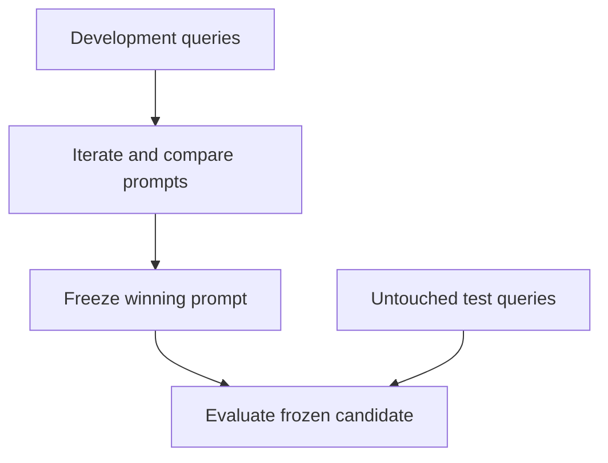

---
{
  "id": "statistical-learning-theory-generalization",
  "title": "Statistical Learning and Generalization",
  "slug": "statistical-learning-theory-generalization",
  "section": "ML Algorithms & Evaluation",
  "category": "Evaluation & Benchmarks",
  "difficulty": "Medium",
  "order": 6,
  "coverImage": "illustrations/_generated/chapter_flow_dark.png",
  "companies": ["OpenAI", "Anthropic", "Google", "Meta"],
  "shortDescription": "After a search over 1,000 prompts, 36 correct queries out of 40 is not yet a population error claim, because the search itself is part of the bill.",
  "keyConceptsTested": [
    "empirical risk",
    "population risk",
    "generalization gap",
    "Hoeffding inequality",
    "union bound",
    "VC dimension",
    "Sauer-Shelah lemma",
    "Rademacher complexity",
    "double descent",
    "benign overfitting",
    "excess risk",
    "sample complexity"
  ],
  "prerequisites": ["cross-validation-leakage-generalization", "hypothesis-tests-confidence-intervals-passk"]
}
---

Test 1,000 prompt templates on the same 40 user queries and pick the winner. It nails 36 of 40: `90%` accuracy. Did you discover a genuinely strong router, or did 1,000 rolls of the dice simply hand you a lucky fit to those 40 queries?

[Validation and Leakage](/learn/cross-validation-leakage-generalization) showed how train-test contamination inflates scores. Even without a leak, searching over many candidates bends an evaluation set toward the winner. <span data-glossary="statistical-learning-theory">Statistical learning theory</span> prices that search explicitly, telling you how much data, how much model capacity, and which split discipline an accuracy claim requires to hold up on fresh traffic.[^liang2016learningtheory]

## Start with one predictor and one loss

Start with a single frozen router evaluated on 40 fresh queries: 36 correct and 4 misrouted. We need one exact number for what happened on this batch, and a separate probabilistic target for future queries.

Assign <span data-glossary="loss-function">loss</span> `0` to a correct route and `1` to a misroute (zero-one classification loss). The sample average is $4/40 = 0.10$, the router's <span data-glossary="empirical-risk">empirical risk</span>. That `10%` error is exact for these 40 rows, while true performance on unseen traffic is the unknown <span data-glossary="population-risk">population risk</span>.

Formally, for predictor $h$, sample $S = \{(x_1, y_1), \dots, (x_n, y_n)\}$, and bounded loss $\ell(h(x_i), y_i) \in [0, 1]$, empirical risk is:

$$
R_{\text{emp}}(h) = \frac{1}{n} \sum_{i=1}^{n} \ell(h(x_i), y_i)
$$

Population risk $R(h) = \mathbb{E}_{(X, Y) \sim \mathcal{D}}[\ell(h(X), Y)]$ is expected loss under the target distribution $\mathcal{D}$. Their difference is the <span data-glossary="generalization-gap">generalization gap</span>:

$$
\text{gen-gap}(h) = R(h) - R_{\text{emp}}(h)
$$

| Quantity | Source | Observable directly? |
|---|---|---|
| Empirical risk $R_{\text{emp}}(h)$ | The finite evaluated sample | Yes |
| Population risk $R(h)$ | Future draws from target distribution $\mathcal{D}$ | No |
| Generalization gap $\text{gen-gap}(h)$ | Population risk minus empirical risk | No; bounded or estimated on fresh data |

For a predictor fixed before drawing 40 independent queries from $\mathcal{D}$, $R_{\text{emp}}(h)$ is an unbiased estimate of $R(h)$, though any single sample can fluctuate above or below the truth. Adding a two-sided concentration radius at failure probability $\delta = 0.05$ yields a `95%` confidence upper bound on $R(h)$:

<!-- leetllm: test, deps=numpy, output=show -->
```python title="fixed-predictor-uncertainty.py"
from math import log, sqrt

sample_size = 40
failures = 4
delta = 0.05

empirical_risk = failures / sample_size
radius = sqrt(log(2 / delta) / (2 * sample_size))

print(f"empirical risk: {empirical_risk:.3f}")
print(f"fixed-predictor radius: {radius:.3f}")
print(f"conservative upper risk: {min(1.0, empirical_risk + radius):.3f}")
```

<!-- leetllm: output:start -->
```text title="Output" output compact
empirical risk: 0.100
fixed-predictor radius: 0.215
conservative upper risk: 0.315
```
<!-- leetllm: output:end -->

```checkpoint
The router's observed risk is 0.100 and its fixed-predictor radius is 0.215. Does 0.315 represent the router's measured error rate in production?
---
No. The observed empirical error is 0.100 on this finite sample. Adding 0.215 yields a conservative 95% upper confidence bound on true population risk under strict independence and bounded-loss assumptions; it's an upper bound, not an observed rate.
```

## Bound one fixed predictor with Hoeffding's inequality

A <span data-glossary="concentration-inequality">concentration inequality</span> bounds the probability that an empirical average of independent random variables drifts far from its expectation. When losses are bounded in $[0, 1]$ and cases are sampled independently from the same distribution, <span data-glossary="hoeffding-inequality">Hoeffding's inequality</span> bounds the probability of a deviation greater than $\varepsilon > 0$:[^liang2016learningtheory]

$$
\mathbb{P}\left(\left|R_{\text{emp}}(h) - R(h)\right| \ge \varepsilon\right) \le 2e^{-2n\varepsilon^2}
$$

Setting the right side to an allowed failure probability $\delta$ and solving for $\varepsilon$ gives the two-sided estimation radius:

$$
\varepsilon = \sqrt{\frac{\log(2/\delta)}{2n}}
$$

Four conditions govern this guarantee:

1. **Fixed predictor:** Choose model weights, prompt text, and thresholds independently of the evaluation sample. Freezing them before drawing fresh cases is a simple way to enforce this.
2. **Bounded losses:** Zero-one classification loss satisfies $\ell \in [0, 1]$. Unbounded loss functions like raw mean squared error or cross-entropy require separate concentration machinery.
3. **Independent draws (i.i.d.):** Cases must be independent draws from the target population $\mathcal{D}$. Forty repeated retries of a single difficult query don't provide 40 units of statistical evidence.
4. **Tail direction:** The two-sided bound allows for deviations in either direction. For a one-sided upper bound $\mathbb{P}(R(h) - R_{\text{emp}}(h) \ge \varepsilon) \le e^{-2n\varepsilon^2}$, replacing the numerator $\log(2/\delta)$ with $\log(1/\delta)$ yields a slightly tighter upper tail limit.

```checkpoint
Why can't this fixed-predictor Hoeffding bound evaluate the best prompt selected from a pool of 1,000 candidates tested on those same 40 queries?
---
The winning prompt was chosen precisely because it scored high on those specific 40 queries. Selecting a model after reviewing sample scores introduces positive selection bias, violating the assumption that the predictor was fixed independently of the evaluation data.
```

## Pay for candidate search with the union bound

When a team searches across candidate models, empirical risk minimization selects the candidate with the lowest empirical loss: $\widehat{h}_S = \arg\min_{h \in \mathcal{H}} R_{\text{emp},S}(h)$. For an exact minimizer in a fixed candidate pool and i.i.d. sampling, empirical risk is optimistic **in expectation over samples**:

$$
\mathbb{E}_S[R_{\text{emp},S}(\widehat{h}_S)] \le \min_{h\in\mathcal{H}} R(h) \le \mathbb{E}_S[R(\widehat{h}_S)]
$$

The first inequality follows because the sample minimum is no larger than the sample loss of any fixed candidate. The second follows because every selected candidate has risk at least the population minimum. Both expectations matter: $\widehat{h}_S$ changes with the sample, so this statement describes average behavior across samples. A particular dataset can produce a score above or below its expectation.

To bound the true risk of any selected candidate, we need a guarantee that holds simultaneously across every hypothesis in the candidate pool $\mathcal{H}$. This uniform guarantee uses the <span data-glossary="union-bound">union bound</span>: the probability that *any* candidate fails its bound is at most the sum of their individual failure probabilities.

If $|\mathcal{H}|$ denotes the number of candidates in a prespecified <span data-glossary="hypothesis-class">hypothesis class</span>, the probability that any candidate deviates by more than $\varepsilon$ is bounded by:

$$
\mathbb{P}\left(\exists h \in \mathcal{H} : \left|R_{\text{emp}}(h) - R(h)\right| \ge \varepsilon\right) \le \sum_{h \in \mathcal{H}} 2e^{-2n\varepsilon^2} = 2|\mathcal{H}|e^{-2n\varepsilon^2}
$$

Setting this sum to $\delta$ and solving for $\varepsilon$ yields the uniform convergence radius:

$$
\varepsilon = \sqrt{\frac{\log(2|\mathcal{H}|/\delta)}{2n}}
$$

The $\log |\mathcal{H}|$ term prices the candidate search conservatively: searching 10x as many models adds $\log 10$ inside the square root, even when candidates correlate (the union bound requires i.i.d. data cases and a prespecified pool, never independent candidates).

Watch how the uncertainty radius grows on the same 40 queries as the prespecified prompt pool expands from 1 to 10 to 1,000:

<!-- leetllm: test, deps=numpy, output=show -->
```python title="compare-hypothesis-search-bounds.py"
from math import log, sqrt

sample_size = 40
delta = 0.05

for candidate_count in [1, 10, 1_000]:
    radius = sqrt(log(2 * candidate_count / delta) / (2 * sample_size))
    print(f"candidates={candidate_count:>4}  radius={radius:.3f}")
```

<!-- leetllm: output:start -->
```text title="Output" output compact
candidates=   1  radius=0.215
candidates=  10  radius=0.274
candidates=1000  radius=0.364
```
<!-- leetllm: output:end -->

At `10%` observed error on 40 cases, the upper bound rises from `31.5%` for one fixed predictor to `46.4%` for the winner of a 1,000-prompt search. With only 40 queries, neither bound can establish an error rate below `20%`.

> **Key insight:** Candidate search enters the generalization radius only logarithmically ($\sqrt{\log|\mathcal{H}| / n}$), which is why evaluating a fixed pool is manageable with enough data, while *adaptive* hill-climbing on the same validation set breaks the finite-pool assumption altogether.

<figure>
  
  <figcaption>All three intervals start at the same 4/40 observed error, but the two-sided Hoeffding upper bound (δ = 0.05) widens from 31.5% to 46.4% as the prespecified prompt pool grows from 1 to 1,000.</figcaption>
</figure>

When engineers inspect validation failures and iteratively write new prompts to patch them, the search becomes adaptive and the pool is no longer prespecified. The clean remedy is to freeze the chosen prompt and evaluate it once on an untouched test split:



```checkpoint
Suppose team A specifies 1,000 prompt variations in a config file before running benchmarks. Team B writes each prompt interactively after inspecting query routing mistakes from earlier runs. Does the finite-class union bound apply equally to both?
---
No. Team A's pool is independent of the evaluation sample, so the finite-class bound applies directly. For team B, counting saved iterations alone does not justify that bound. A fresh evaluation of its frozen winner is a straightforward remedy; bounding a larger class that contains all possible adaptations, or using specialized adaptive-data analysis, are other approaches.
```

## Separate accurate estimation from excess risk

A uniform convergence bound guarantees that every candidate's empirical risk stays within $\varepsilon$ of its true population risk. This controls estimation error; the candidate pool's best achievable risk still matters. If every candidate in $\mathcal{H}$ has true population error exceeding 35%, accurate measurement still selects an unacceptable model.

We can, however, bound the **excess risk**: the gap between our empirical risk minimizer $\widehat{h}$ and the theoretical best predictor $h^* = \arg\min_{h \in \mathcal{H}} R(h)$ in that class.

When uniform convergence holds with radius $\varepsilon$, the following chain of inequalities bounds the performance of $\widehat{h}$:[^liang2016learningtheory]

$$
R(\widehat{h}) \le R_{\text{emp}}(\widehat{h}) + \varepsilon \le R_{\text{emp}}(h^*) + \varepsilon \le R(h^*) + 2\varepsilon
$$

Breaking down each step:
1. $R(\widehat{h}) \le R_{\text{emp}}(\widehat{h}) + \varepsilon$ accounts for potential optimism in the winner's empirical score.
2. $R_{\text{emp}}(\widehat{h}) \le R_{\text{emp}}(h^*)$ holds by definition, because $\widehat{h}$ minimized empirical risk across $\mathcal{H}$.
3. $R_{\text{emp}}(h^*) \le R(h^*) + \varepsilon$ accounts for potential pessimism in the best model's sample score.

Adding the two estimation errors produces a factor of $2\varepsilon$. A uniform estimation radius of $\varepsilon = 0.05$ bounds excess risk by $0.10$ on the same event, with probability at least $1-\delta$. This argument assumes the population minimum exists and empirical minimization is exact. If optimization returns a candidate within $\eta$ of the sample minimum, the bound becomes $2\varepsilon+\eta$.

This structure forms the backbone of <span data-glossary="pac-learning">Probably Approximately Correct (PAC) learning</span>:
- In the **realizable setting**, there exists a perfect hypothesis in $\mathcal{H}$ with $R(h^*) = 0$. The objective is finding a hypothesis with $R(\widehat{h}) \le \varepsilon$.
- In the **agnostic setting**, no perfect hypothesis is assumed. The objective is finding $\widehat{h}$ whose excess risk $R(\widehat{h}) - R(h^*)$ doesn't exceed $\varepsilon$.

```checkpoint
If a uniform convergence bound gives estimation radius 0.04 over a candidate pool, does selecting the lowest-error model guarantee true error below 0.08?
---
No. The argument guarantees excess risk at most 0.08 above the best predictor in that candidate pool. If the best prompt in the pool has 25% true error, the selected prompt is guaranteed to have at most 33% true error with high probability.
```

## Measure infinite hypothesis classes with VC dimension

Finite hypothesis classes work well for prompt sweeps and discrete grid searches. But modern machine learning models operate with continuous parameters: linear classifiers, logistic regression, support vector machines, and deep neural networks. When a model family contains continuously many functions, $|\mathcal{H}| = \infty$, which causes $\log |\mathcal{H}| = \infty$. The union bound becomes vacuous.

Even though a continuous model class contains infinitely many candidate functions, its ability to assign labels to a finite dataset of $n$ points is strictly constrained by geometry. On $n$ points, there are only $2^n$ possible binary labelings. A hypothesis class can't produce arbitrarily complex labelings if its decision boundaries are restricted.

A hypothesis class $\mathcal{H}$ **shatters** a set of points $\{x_1, \dots, x_n\}$ if it can realize all $2^n$ possible binary labelings on those points. The <span data-glossary="vc-dimension">Vapnik-Chervonenkis (VC) dimension</span> $d_{\text{VC}}(\mathcal{H})$ is the maximum number of points that $\mathcal{H}$ can shatter. If $\mathcal{H}$ can shatter arbitrarily large point sets, its VC dimension is infinite.[^liang2016learningtheory]

Consider a simple 1D threshold classifier: predict $1$ if query confidence score $x \ge \theta$, and $0$ otherwise.
- On a single point $x_1$, we can place $\theta \le x_1$ to output $1$, or $\theta > x_1$ to output $0$. It shatters 1 point.
- On two ordered points $x_1 < x_2$, the threshold can produce `(0, 0)`, `(0, 1)`, and `(1, 1)`. But it can never assign `(1, 0)`: it can't label the smaller point positive while labeling the larger point negative. It can't realize all 4 labelings.
- Therefore, the 1D threshold class has $d_{\text{VC}} = 1$.

Now examine **affine halfspaces** in two dimensions: $h(x) = \text{sign}(w_1 x_1 + w_2 x_2 + b)$. The freely chosen intercept $b$ lets the boundary move away from the origin.
- Three non-collinear points in the plane can be fully shattered. Any assignment of positive and negative labels across the three vertices can be separated by a straight line, yielding all $2^3 = 8$ labelings.
- But can linear halfspaces shatter four points in the plane? No!

<figure>
  
  <figcaption>The eight panels use one fixed non-collinear triangle. Each labeling has an affine separator; constant labels place the line outside the triangle. These constructions prove the lower bound of 3. The XOR labeling has intersecting label hulls, while Radon's theorem supplies the obstruction for every four-point configuration, proving the upper bound.</figcaption>
</figure>

If four points form a convex quadrilateral, assign positive labels to one diagonal pair and negative labels to the other diagonal pair (the classic XOR pattern). The line segment connecting the two positive points intersects the line segment connecting the two negative points. By Radon's theorem, no straight line can separate the two sets because their convex hulls intersect.

For a convex quadrilateral, exactly 14 of the 16 labelings are attainable; the two alternating patterns fail. But some four-point sets are not quadrilaterals. If one point lies inside the triangle formed by the other three, label that interior point negative and all three vertices positive. An affine function positive at the vertices is positive at their convex combinations, so this labeling also fails. Radon's theorem supplies the general statement, including degenerate configurations: every four-point set in the plane can be partitioned into two subsets whose convex hulls intersect. Giving the subsets opposite labels prevents strict affine separation. Thus **no** four-point set is shattered.

The lower bound is constructive. For a non-collinear triangle, augment each point with a constant coordinate for the intercept. Its three-by-three matrix is invertible, so we can solve for weights that produce any three desired signs:

<!-- leetllm: test, deps=numpy, output=show -->
```python title="shatter-a-triangle.py"
from itertools import product
import numpy as np

design = np.array([[0., 0., 1.], [1., 0., 1.], [0., 1., 1.]])
checked = 0
for labels in product([-1., 1.], repeat=3):
    target = np.array(labels)
    weights = np.linalg.solve(design, target)
    assert np.array_equal(np.sign(design @ weights), target)
    checked += 1
print(f"triangle labelings separated: {checked}/8")
```

<!-- leetllm: output:start -->
```text title="Output" output compact
triangle labelings separated: 8/8
```
<!-- leetllm: output:end -->

Combining an attainable three-point set with the obstruction for all four-point sets gives:

$$
d_{\text{VC}}(\text{affine halfspaces in } \mathbb{R}^2) = 3
$$

In $\mathbb{R}^d$, affine halfspaces have VC dimension $d + 1$, while homogeneous halfspaces passing through the origin have VC dimension $d$. Removing the intercept removes one degree of geometric freedom, and parameter count alone can be misleading: ten redundant weights can collapse to $d_{\text{VC}} = 1$, while a single frequency parameter in $\sin(\theta x)$ can shatter arbitrarily many points.[^liang2016learningtheory]

```checkpoint
If a classifier has 10 continuous weights, is its VC dimension guaranteed to be 10?
---
No. Ten redundant weights that enter only through their sum can still describe a right-threshold class with VC dimension 1. In the other direction, the class x → 1[sin(theta * x) >= 0], with unrestricted real theta and real inputs, has infinite VC dimension despite using one parameter. Restrictions on inputs, parameter range, and numerical precision matter for an implemented classifier.
```

## Count attainable labels with the Sauer-Shelah lemma

To derive generalization bounds for infinite classes, we track the **growth function** $\Pi_{\mathcal{H}}(n)$: the maximum number of distinct labelings that $\mathcal{H}$ can induce on any $n$ points.

When $n \le d_{\text{VC}}$, some set of $n$ points is shattered, so $\Pi_{\mathcal{H}}(n) = 2^n$. Once $n$ crosses $d_{\text{VC}}$, a dramatic phase change occurs. For finite $d_{\text{VC}} \ge 1$ and $n > d_{\text{VC}}$, the **Sauer-Shelah lemma** bounds the growth function polynomially:[^liang2016learningtheory]

$$
\Pi_{\mathcal{H}}(n) \le \sum_{i=0}^{d_{\text{VC}}} \binom{n}{i} \le \left(\frac{en}{d_{\text{VC}}}\right)^{d_{\text{VC}}} = \mathcal{O}\left(n^{d_{\text{VC}}}\right)
$$

Growth shifts from exponential ($2^n$) to polynomial ($n^{d_{\text{VC}}}$), which is slow enough for concentration to win as $n$ grows. Compare the Sauer-Shelah bound with all $2^n$ binary labelings for 2D affine halfspaces ($d_{\text{VC}} = 3$):

<!-- leetllm: test, deps=numpy, output=show -->
```python title="sauer-shelah-phase-change.py"
from math import comb

d_vc = 3
sample_sizes = [1, 2, 3, 4, 5, 10, 50]

for n in sample_sizes:
    total_labelings = 2**n
    sauer_bound = sum(comb(n, i) for i in range(d_vc + 1))
    ratio = sauer_bound / total_labelings
    print(f"n={n:>2}: 2^n={total_labelings:>16}  Sauer={sauer_bound:>6}  ratio={ratio:.3e}")
```

<!-- leetllm: output:start -->
```text title="Output" output compact
n= 1: 2^n=               2  Sauer=     2  ratio=1.000e+00
n= 2: 2^n=               4  Sauer=     4  ratio=1.000e+00
n= 3: 2^n=               8  Sauer=     8  ratio=1.000e+00
n= 4: 2^n=              16  Sauer=    15  ratio=9.375e-01
n= 5: 2^n=              32  Sauer=    26  ratio=8.125e-01
n=10: 2^n=            1024  Sauer=   176  ratio=1.719e-01
n=50: 2^n=1125899906842624  Sauer= 20876  ratio=1.854e-11
```
<!-- leetllm: output:end -->

At $n = 50$, over $1.12 \times 10^{15}$ binary labelings exist, yet a class with $d_{\text{VC}} = 3$ can realize at most `20,876` (and affine halfspaces in $\mathbb{R}^2$ realize slightly fewer, e.g., `14` rather than `15` at $n = 4$).

Combining the Sauer-Shelah lemma with a ghost-sample symmetrization argument gives the classic VC generalization bound for zero-one loss over a fixed class ($n \ge d_{\text{VC}} \ge 1$). With probability at least $1 - \delta$, simultaneously for all $h \in \mathcal{H}$:

$$
|R(h)-R_{\text{emp}}(h)| \le \mathcal{O}\left(\sqrt{\frac{d_{\text{VC}} \log(en / d_{\text{VC}}) + \log(1/\delta)}{n}}\right)
$$

Inverting this rate gives the agnostic sample complexity for estimation radius $\varepsilon$:

$$
n = \mathcal{O}\left(\frac{d_{\text{VC}} \log(1/\varepsilon) + \log(1/\delta)}{\varepsilon^2}\right)
$$

In the realizable setting (where $R(h^*) = 0$), consistent learners improve this dependence from $1/\varepsilon^2$ to $1/\varepsilon$ up to log factors.

```checkpoint
Can we directly replace |H| by the number of label patterns seen on our evaluation sample in the finite-class union bound?
---
No. Those patterns depend on the sample, so they are not an independent finite candidate pool. A symmetrization proof introduces an independent ghost sample and controls patterns on the combined points, often through Pi_H(2n). Sauer-Shelah then bounds this growth term. This justifies the capacity dependence, with additional constants, rather than a literal substitution into the finite-class formula.
```

## Probe data-dependent capacity with Rademacher complexity

VC dimension measures capacity in the worst-case arrangement of inputs. Some datasets have geometry, margins, or norm restrictions that support sharper analyses. Others do not. A data-dependent measure lets us ask what the class can do on the actual observed inputs.

For a class of real-valued functions $\mathcal{G}$, **empirical Rademacher complexity** measures the expected best correlation with independent fair coin flips $\sigma_i\in\{-1,+1\}$:

$$
\widehat{\mathcal{R}}_S(\mathcal{G}) = \mathbb{E}_\sigma \left[ \sup_{g \in \mathcal{G}} \frac{1}{n} \sum_{i=1}^n \sigma_i g(z_i) \right]
$$

The supremum is inside the expectation: choose the best function separately for each noise assignment, then average. For predictors restricted to outputs $-1$ and $+1$ on distinct inputs:

- A singleton class containing only $h(x)\equiv+1$ has complexity zero. It cannot adapt to the signs.
- The class containing both constant predictors chooses whichever sign agrees with more coin flips. Its complexity is $\mathbb{E}_\sigma|\sum_i\sigma_i|/n$, which is positive and shrinks with sample size.
- A lookup-table class that can realize **every** assignment has complexity 1. Unbounded real-valued outputs have a different scale and can even give infinite complexity.

With eight ordered, distinct inputs, we can enumerate all $2^8=256$ assignments and compute exact averages. A right-threshold predictor outputs $-1$ before its split and $+1$ afterward:

<!-- leetllm: test, deps=numpy, output=show -->
```python title="rademacher-noise-correlation.py"
from itertools import product

n = 8
correlations = {name: [] for name in
                ["fixed +1", "two constants", "right thresholds", "lookup table"]}

for sigma in product([-1, 1], repeat=n):
    correlations["fixed +1"].append(sum(sigma) / n)
    correlations["two constants"].append(abs(sum(sigma)) / n)
    best = max(
        sum(sigma[i] if i >= split else -sigma[i] for i in range(n)) / n
        for split in range(n + 1)
    )
    correlations["right thresholds"].append(best)
    correlations["lookup table"].append(1.0)

for name, values in correlations.items():
    print(f"{name:>16}: {sum(values) / len(values):.6f}")
```

<!-- leetllm: output:start -->
```text title="Output" output compact
        fixed +1: 0.000000
   two constants: 0.273438
right thresholds: 0.456055
    lookup table: 1.000000
```
<!-- leetllm: output:end -->

Each number is an exact average over all 256 sign vectors on these eight inputs: the fixed predictor ignores noise (`0.000`), thresholds absorb nearly half of it (`0.456`), and the lookup table matches every random flip (`1.000`).

To bound generalization error, apply Rademacher complexity to the **loss class** $\mathcal{F} = \{(x,y) \mapsto \ell(h(x), y) : h \in \mathcal{H}\}$ for losses in $[0, 1]$. With probability at least $1 - \delta$, simultaneously for all $h \in \mathcal{H}$:[^liang2016learningtheory]

$$
R(h) \le R_{\text{emp}}(h) + 2\widehat{\mathcal{R}}_S(\mathcal{F}) + 3\sqrt{\frac{\log(2/\delta)}{2n}}
$$

<details>
<summary>Deep dive: linking loss-class complexity to predictor complexity</summary>

For binary classifiers $h(x) \in \{-1, +1\}$ and zero-one loss $\ell(h(x_i), y_i) = (1 - y_i h(x_i))/2$, the constant $1/2$ vanishes in expectation over fair signs $\sigma_i$, and multiplying $\sigma_i$ by $-y_i \in \{-1, +1\}$ leaves its distribution unchanged. Hence $\widehat{\mathcal{R}}_S(\mathcal{F}) = \widehat{\mathcal{R}}_S(\mathcal{H})/2$. On our eight inputs, the threshold class has $\widehat{\mathcal{R}}_S(\mathcal{F}) = 0.228$, contributing $2\widehat{\mathcal{R}}_S(\mathcal{F}) = 0.456$ before the confidence term. For continuous scores and a Lipschitz loss (such as hinge or margin loss), Talagrand's contraction lemma links $\widehat{\mathcal{R}}_S(\mathcal{F})$ directly to $\widehat{\mathcal{R}}_S(\mathcal{H})$.

</details>

```checkpoint
Does fitting one randomly relabeled dataset prove that a network class has predictor Rademacher complexity 1?
---
No. Complexity averages the best correlation over all sign assignments. One successful fit is evidence about one assignment. A class of predictors with outputs in {-1, +1} that can fit every assignment on these inputs has complexity 1. A loose bound for that broad class does not prove that a particular training algorithm generalizes poorly.
```

## Ask when interpolation hurts, and when it does not

Classical intuition draws a U-shaped test-error curve: add capacity and error drops, push past the sweet spot and **interpolation** (fitting training targets exactly) ruins generalization. Yet Belkin and colleagues documented **double descent**: test error can fall, spike near the interpolation threshold where exact fitting becomes barely possible, and then fall a second time in the overparameterized regime.[^belkin2019doubleDescent]

An exact linear model exposes the mechanism cleanly. Take well-specified linear regression with i.i.d. standard Gaussian features, unit signal norm $r^2 = 1$, independent noise variance $\sigma^2 = 1$, and the minimum Euclidean norm least-squares estimator. As $n, p \to \infty$ with ratio $p/n \to \gamma \ne 1$, its limiting excess squared prediction risk against the noiseless target is:[^hastie2019Ridgeless]

$$
\mathcal{E}(\gamma)=
\begin{cases}
\gamma/(1-\gamma), & 0<\gamma<1,\\
(1-1/\gamma)+1/(\gamma-1), & \gamma>1.
\end{cases}
$$

Near $\gamma = 1$, the design matrix becomes nearly singular and noise amplification blows up the variance. Past $\gamma = 1$, extra dimensions absorb the noise more smoothly: variance falls back toward `0` while squared bias rises toward `1`, sending total excess risk down toward `1` (the risk of the zero predictor in this isotropic setting).

<figure>
  
  <figcaption>Limiting excess squared risk for isotropic minimum-norm linear regression spikes at γ = p/n = 1, then descends again: at γ = 2, variance (1.0) plus squared bias (0.5) gives total excess risk 1.5, approaching 1.0 as γ grows.</figcaption>
</figure>

Check the formula across both sides of the threshold:

<!-- leetllm: test, deps=numpy, output=show -->
```python title="limiting-linear-prediction-risk.py"
from math import isfinite

def excess_risk(gamma):
    if not isfinite(gamma) or gamma <= 0:
        raise ValueError("gamma = p/n must be finite and positive.")
    if gamma == 1:
        raise ValueError("The limiting formula excludes gamma = 1.")
    if gamma < 1:
        return gamma / (1 - gamma)
    return (1 - 1 / gamma) + 1 / (gamma - 1)

for gamma in [0.2, 0.5, 0.8, 1.2, 2., 3., 10.]:
    print(f"gamma={gamma:>4.1f}  excess risk={excess_risk(gamma):.3f}")
```

<!-- leetllm: output:start -->
```text title="Output" output compact
gamma= 0.2  excess risk=0.250
gamma= 0.5  excess risk=1.000
gamma= 0.8  excess risk=4.000
gamma= 1.2  excess risk=5.167
gamma= 2.0  excess risk=1.500
gamma= 3.0  excess risk=1.167
gamma=10.0  excess risk=1.011
```
<!-- leetllm: output:end -->

When $p > n$ for a full-row-rank linear design, infinitely many weight vectors achieve zero training loss, so the **optimizer** picks which interpolant you get. Ordinary gradient descent from zero stays inside the row span and converges to the minimum Euclidean norm solution.[^hastie2019Ridgeless] Starting with a null-space component retains it forever, and preconditioning shifts the preferred geometry. Watch all three fit the same single equation $w_1 + 2w_2 = 1$ yet land on three distinct solutions:

<!-- leetllm: test, deps=numpy, output=show -->
```python title="initialization-changes-the-interpolant.py"
import numpy as np

x = np.array([1., 2.])
solutions = {
    "zero-init GD": (np.zeros(2), np.ones(2)),
    "nullspace-init GD": (np.array([-2., 1.]), np.ones(2)),
    "preconditioned GD": (np.zeros(2), np.array([1., 4.])),
}
for name, (weights, diagonal) in solutions.items():
    for _ in range(300):
        weights += 0.05 * diagonal * x * (1. - x @ weights)
    assert abs(x @ weights - 1.) < 1e-10
    print(f"{name}: weights={np.round(weights, 6)}  norm={np.linalg.norm(weights):.6f}")

identity = np.eye(2)
assert np.array_equal(np.linalg.solve(identity, np.array([1., -1.])), [1., -1.])
print(f"square identity condition number: {np.linalg.cond(identity):.1f}")
```

<!-- leetllm: output:start -->
```text title="Output" output compact
zero-init GD: weights=[0.2 0.4]  norm=0.447214
nullspace-init GD: weights=[-1.8  1.4]  norm=2.280351
preconditioned GD: weights=[0.058824 0.470588]  norm=0.474250
square identity condition number: 1.0
```
<!-- leetllm: output:end -->

Notice the last line too: a square identity matrix has $p = n$ and condition number `1.0`, showing that the random-design spike at $\gamma = 1$ comes from near-singularity of random matrices rather than $p = n$ itself.

**Benign overfitting** happens when a model fits noisy training labels exactly while still achieving near-optimal test error. In minimum-norm linear regression, that requires an anisotropic covariance spectrum with enough low-variance directions to soak up noise without distorting the high-variance signal directions.[^bartlett2020BenignOverfitting]

> **Common mistake:** Seeing test error dip after an interpolation peak is not automatic proof of benign overfitting, nor is $p = n$ a universal threshold for nonlinear networks. In the isotropic curve above, risk falls back only to `1.0`, the same excess risk as predicting zero.

```checkpoint
A model has zero training error and its test error decreases after the interpolation threshold. Does that curve prove benign overfitting?
---
No. A decrease need not bring prediction risk close to the optimal achievable risk. In the plotted example, the overparameterized limiting excess risk approaches 1, whereas the noiseless regression function has excess risk zero. We need the actual risk level and assumptions, not just the shape of a curve.
```

## Calculate sample complexity for production guarantees

Inverting the finite-class Hoeffding bound gives a **sufficient** sample size for achieving estimation radius $\varepsilon$ with failure probability at most $\delta$:

$$
n \ge \frac{\log(2|\mathcal{H}|/\delta)}{2\varepsilon^2}
$$

Because $\varepsilon$ appears squared in the denominator, halving your allowed estimation radius requires four times as many evaluation queries:

<!-- leetllm: test, deps=numpy, output=show -->
```python title="calculate-uniform-sample-complexity.py"
from math import ceil, log

delta = 0.05
for candidates, target_radius in [(1, 0.05), (1_000, 0.10), (1_000, 0.05)]:
    sufficient = ceil(log(2 * candidates / delta) / (2 * target_radius**2))
    print(f"candidates={candidates:>4}  radius={target_radius:.2f}  cases={sufficient}")
```

<!-- leetllm: output:start -->
```text title="Output" output compact
candidates=   1  radius=0.05  cases=738
candidates=1000  radius=0.10  cases=530
candidates=1000  radius=0.05  cases=2120
```
<!-- leetllm: output:end -->

- **One fixed model:** `738` independent queries give radius $\varepsilon \le 0.05$.
- **1,000 prespecified candidates:** `2,120` queries give the same uniform radius across the whole sweep.
- **Excess risk $\le 0.05$ for ERM:** requires $\varepsilon = 0.025$ (because of the $2\varepsilon$ factor), quadrupling the budget to `8,478` queries.

Freezing the winning prompt and testing it on a fresh split resets $|\mathcal{H}|$ back to `1`, letting you evaluate with `738` queries instead of paying the search penalty again. Also match the independent unit to your target metric: 500 conversation turns from 10 users are correlated within each user, so an i.i.d. user-level bound requires independently sampled users and a bounded per-user loss.

## Map claims to the evaluation design

Match the statistical claim to how the candidate was chosen:

| Scenario | What the bound supports | Key caveat |
|---|---|---|
| One frozen model on fresh i.i.d. queries | Bounded-loss risk bound on the target distribution | Assumes traffic matches the sampled distribution |
| Prespecified finite candidate search | Simultaneous estimation radius across the pool | Adaptive prompt edits require a fresh split |
| Correlated multi-turn conversations | Cluster-level analysis over independent users | User-weighted and turn-weighted risk can differ |
| Shifted deployment traffic | Risk bound only on the new target distribution | Bounds on old data expire under distribution shift |

Disagreements across splits point straight to distinct failure modes:

- **Low training error, high validation error:** overfitting, noisy labels, cohort mismatch, or preprocessing skew.
- **Low validation error, high test error:** selection overfitting from repeated sweeps, split difficulty differences, or small test size.
- **Low test error, poor live performance:** distribution shift, serving mismatches, or changed metric definitions.

Returning to our opening router: `4` misroutes on `40` queries gives an upper bound of `0.315` for a frozen model or `0.464` after a 1,000-prompt search, leaving a `20%` error target unresolved. Freezing the winner and evaluating it on `738` fresh i.i.d. queries shrinks the radius to `0.05`, so an observed error below `0.15` on that fresh split certifies population risk below `0.20` at 95% confidence.

```mastery-quiz
[
  {
    "question": "A frozen router misroutes 9 of 60 independent queries. What is directly measured?",
    "options": [
      "An upper population-risk limit of 0.15.",
      "Population risk 0.15 on future traffic.",
      "Generalization gap 0.15.",
      "Empirical risk 0.15 on this sample."
    ],
    "answer": "Empirical risk 0.15 on this sample.",
    "explanation": "Nine divided by sixty is the observed sample loss. Population risk and its gap need evidence beyond this batch."
  },
  {
    "question": "A team repeats exact ERM over a fixed candidate pool on many new i.i.d. batches. Why can average winning sample loss be lower than average winner population loss?",
    "options": [
      "Each selected candidate receives fewer independent scoring cases.",
      "Each comparison changes the target population to match that batch.",
      "Each batch selects low-loss fluctuations along with useful task signal.",
      "Each gradient update reduces the scale of the bounded loss function."
    ],
    "answer": "Each batch selects low-loss fluctuations along with useful task signal.",
    "explanation": "The sample minimum is no greater than any fixed candidate’s sample loss. Averaging over samples gives optimism in expectation, while an individual sample need not be optimistic."
  },
  {
    "question": "Before drawing n independent cases from the target population, a team expands its pool from 20 to 200 candidates. It scores each with zero-one loss. Which two-sided Hoeffding radius does the union bound give for all 200 risk estimates at total failure probability delta?",
    "options": [
      "sqrt(log(200/delta)/(2n)).",
      "sqrt(log(400/delta)/(2n)).",
      "sqrt(log(40/delta)/(2n)).",
      "sqrt(log(2/delta)/(2n))."
    ],
    "answer": "sqrt(log(400/delta)/(2n)).",
    "explanation": "For radius r, the two-sided tail bound for one candidate is 2 exp(-2nr²). Adding 200 such bounds gives 400 exp(-2nr²). Set that equal to delta and solve for r to get sqrt(log(400/delta)/(2n)). Using 200 inside the log counts one tail per candidate. Using 40 counts both tails for the old pool, and using 2 covers just one candidate."
  },
  {
    "question": "Exact ERM has uniform estimation radius 0.03 and best class population risk 0.22. What upper risk follows on that event?",
    "options": [
      "0.25",
      "0.06",
      "0.28",
      "0.22"
    ],
    "answer": "0.28",
    "explanation": "Two deviations give excess allowance 0.06. Add 0.22 to get 0.28; 0.06 alone is not an absolute risk bound."
  },
  {
    "question": "A class shatters some five-point set but fails one six-point configuration. Which further result would prove VC dimension exactly five?",
    "options": [
      "Every five-point configuration admits at least one attainable labeling.",
      "Some seven-point configuration admits at least one attainable labeling.",
      "The failed six-point configuration admits several other labelings.",
      "Every six-point configuration has at least one unattainable labeling."
    ],
    "answer": "Every six-point configuration has at least one unattainable labeling.",
    "explanation": "Shattering one five-point set gives the lower bound. The upper bound needs a failure labeling for every six-point set, not just one selected configuration."
  },
  {
    "question": "A binary classifier class has VC dimension two. What upper bound does the Sauer-Shelah binomial sum give for the number of label patterns on seven distinct inputs?",
    "options": [
      "21 patterns",
      "29 patterns",
      "28 patterns",
      "128 patterns"
    ],
    "answer": "29 patterns",
    "explanation": "VC dimension two means the sum stops at pairs. Count one empty subset, seven singletons and 7 × 6 / 2 = 21 pairs. They give a ceiling of 29 patterns. Counting only pairs gives 21. Omitting the empty subset gives 28. Counting all binary labelings gives 128 and ignores the VC dimension."
  },
  {
    "question": "A binary class fits one random sign assignment on six fixed inputs. Which further evidence guarantees predictor Rademacher complexity one on these inputs?",
    "options": [
      "A perfect fit to one fixed clean-label assignment.",
      "Six repeated perfect fits to that one assignment.",
      "Six independent parameters with nonzero gradients.",
      "A perfect fit to all 64 assignments of the six signs."
    ],
    "answer": "A perfect fit to all 64 assignments of the six signs.",
    "explanation": "The complexity averages the best correlation over all sign assignments. A single perfect fit accounts for one assignment; fitting every assignment makes every best correlation one."
  },
  {
    "question": "Two square linear designs both have p = n. One is an identity matrix; the other has two identical columns. Which diagnosis follows?",
    "options": [
      "The identity has condition number one; the repeated-column design is rank deficient.",
      "Both have unique interpolants because their row counts match.",
      "The identity is rank deficient; repeated columns improve conditioning.",
      "Both have the same interpolation risk because their parameter counts match."
    ],
    "answer": "The identity has condition number one; the repeated-column design is rank deficient.",
    "explanation": "The actual matrix determines rank and conditioning. The identity is well conditioned. Identical columns create a null direction, so row and column counts alone cannot determine a risk peak or unique solution."
  },
  {
    "question": "Two runs of ordinary, unpreconditioned gradient descent on squared loss use the same full-row-rank design, the same nonzero targets and a sufficiently small positive constant step. One starts at zero and the other at a nonzero null-space vector v. If m is the exact fit of smallest Euclidean norm, which pair gives their limiting weights in that order?",
    "options": [
      "(m, m)",
      "(0, v)",
      "(m, m + v)",
      "(m, m - v)"
    ],
    "answer": "(m, m + v)",
    "explanation": "Each update is a linear combination of the design rows. From zero, the first run stays in their span and converges to m, the only exact fit there. Adding v leaves every training prediction unchanged, so the second run makes the same updates and converges to m + v. Reaching m twice would erase v. Reaching m - v would reverse it. Both starts predict zero for nonzero targets, so both runs move."
  },
  {
    "question": "A team uses the two-sided finite-class Hoeffding formula to plan an evaluation with zero-one loss. For an estimation radius of 0.08, the formula gives 900 independent cases before rounding. With the same pool and failure probability, how many cases does it give for a radius of 0.04?",
    "options": [
      "450",
      "1800",
      "3600",
      "900"
    ],
    "answer": "3600",
    "explanation": "At fixed pool size and confidence, the sample count scales as one over the radius squared. Halving the radius multiplies the count by (0.08 / 0.04)² = 4, giving 3600 cases. Doubling to 1800 uses inverse-linear scaling. Keeping 900 leaves the radius at 0.08, and cutting to 450 makes it wider."
  }
]
```

> **Next:** Continue to [Conformal Prediction and Uncertainty](/learn/conformal-prediction-uncertainty-sets). A 90 percent score on 40 searched queries is a different claim from a risk bound on fresh traffic. Conformal prediction uses held-out errors for a different promise: a set or interval whose coverage averages over new cases, rather than a guarantee for every particular input.
