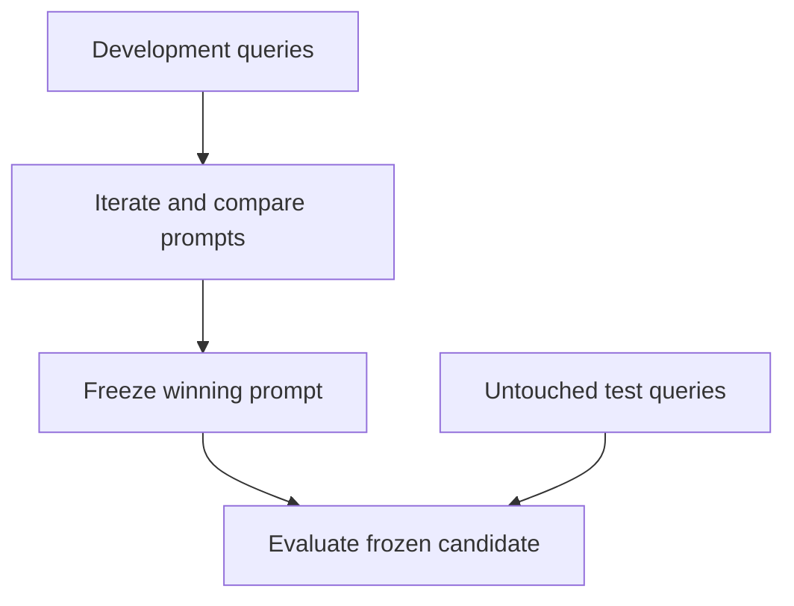

---
{
  "id": "statistical-learning-theory-generalization",
  "title": "Statistical Learning and Generalization",
  "slug": "statistical-learning-theory-generalization",
  "section": "ML Algorithms & Evaluation",
  "category": "Evaluation & Benchmarks",
  "difficulty": "Medium",
  "order": 6,
  "coverImage": "illustrations/_generated/chapter_flow_dark.png",
  "companies": ["OpenAI", "Anthropic", "Google", "Meta"],
  "shortDescription": "After a search over 1,000 prompts, 36 correct queries out of 40 is not yet a population error claim, because the search itself is part of the bill.",
  "keyConceptsTested": [
    "empirical risk",
    "population risk",
    "generalization gap",
    "Hoeffding inequality",
    "union bound",
    "VC dimension",
    "Sauer-Shelah lemma",
    "Rademacher complexity",
    "double descent",
    "benign overfitting",
    "excess risk",
    "sample complexity"
  ],
  "prerequisites": ["cross-validation-leakage-generalization", "hypothesis-tests-confidence-intervals-passk"]
}
---

Suppose a team evaluates 1,000 routing prompt templates against the same 40 user queries. The winning prompt classifies 36 correctly: 90% empirical accuracy. How much of that score reflects a good router, and how much reflects selecting a lucky fit to this small benchmark? The score is valid development evidence, but it needs an analysis that accounts for the search before it can support a population error claim.

[Validation and Leakage](/learn/cross-validation-leakage-generalization) showed how easily information leaks across train-test splits. When teams run extensive prompt sweeps or hyperparameter searches, the search process itself overfits the benchmark. <span data-glossary="statistical-learning-theory">Statistical learning theory</span> measures how much data, how many candidate models, and which evaluation splits an accuracy claim needs before it holds up on fresh traffic.[^liang2016learningtheory]

## Start with one predictor and one loss

Suppose our router evaluates 40 evaluation queries: 36 routes are correct and 4 misroute. We need one exact number for what happened on these 40 rows, and a separate probabilistic concept for future queries.

Assign <span data-glossary="loss-function">loss</span> 0 to a correct route and loss 1 to an incorrect one (standard zero-one classification loss). The average loss on this dataset is $4/40 = 0.10$. This number is its <span data-glossary="empirical-risk">empirical risk</span>. While this 10% error rate is exact for these 40 specific queries, it does not prove that future queries will fail 10% of the time.

To express this formally, let $h$ denote the predictor, $n$ the sample size, $x_i$ the query input, and $y_i$ the true label. The loss function $\ell(h(x_i), y_i) \in [0, 1]$ scores each individual prediction. The empirical risk averages these losses over the observed sample $S = \{(x_1, y_1), \dots, (x_n, y_n)\}$:

$$
R_{\text{emp}}(h) = \frac{1}{n} \sum_{i=1}^{n} \ell(h(x_i), y_i)
$$

<span data-glossary="population-risk">Population risk</span> $R(h) = \mathbb{E}_{(X, Y) \sim \mathcal{D}}[\ell(h(X), Y)]$ is expected loss under a specified target distribution $\mathcal{D}$. It describes future traffic only to the extent that this traffic follows that distribution. The difference between population risk and the observed sample average is the <span data-glossary="generalization-gap">generalization gap</span>:

$$
\text{gen-gap}(h) = R(h) - R_{\text{emp}}(h)
$$

| Quantity | Source | Can engineers observe it directly? |
|---|---|---|
| Empirical risk $R_{\text{emp}}(h)$ | The finite evaluated sample | Yes |
| Population risk $R(h)$ | Future draws from target distribution $\mathcal{D}$ | No |
| Generalization gap $\text{gen-gap}(h)$ | Population risk minus empirical risk | No; bounds or independent samples estimate its size |

For a predictor chosen independently of 40 i.i.d. cases, $R_{\text{emp}}(h)$ is an unbiased estimate of $R(h)$. The realized gap can be positive or negative: a difficult sample can make the model look worse than its population average. A conservative calculation adds an uncertainty radius to the observed risk. With failure probability $\delta = 0.05$, the resulting bound covers population risk with probability at least 95% over repeated sampling under these assumptions. This frequentist statement does not assign a 95% posterior probability to the particular interval after observing it.

We can compute this uncertainty radius directly with Python:

<!-- leetllm: test, deps=numpy, output=show -->
```python title="fixed-predictor-uncertainty.py"
from math import log, sqrt

sample_size = 40
failures = 4
delta = 0.05

empirical_risk = failures / sample_size
radius = sqrt(log(2 / delta) / (2 * sample_size))

print(f"empirical risk: {empirical_risk:.3f}")
print(f"fixed-predictor radius: {radius:.3f}")
print(f"conservative upper risk: {min(1.0, empirical_risk + radius):.3f}")
```

<!-- leetllm: output:start -->
```text title="Output" output compact
empirical risk: 0.100
fixed-predictor radius: 0.215
conservative upper risk: 0.315
```
<!-- leetllm: output:end -->

```checkpoint
The router's observed risk is 0.100 and its fixed-predictor radius is 0.215. Does 0.315 represent the router's measured error rate in production?
---
No. The observed empirical error is 0.100 on this finite sample. Adding 0.215 yields a conservative 95% upper confidence bound on true population risk under strict independence and bounded-loss assumptions; it's an upper bound, not an observed rate.
```

## Bound one fixed predictor with Hoeffding's inequality

A <span data-glossary="concentration-inequality">concentration inequality</span> bounds the probability that an empirical average of independent random variables drifts far from its expectation. When losses are bounded in $[0, 1]$ and cases are sampled independently from the same distribution, <span data-glossary="hoeffding-inequality">Hoeffding's inequality</span> bounds the probability of a deviation greater than $\varepsilon > 0$:[^liang2016learningtheory]

$$
\mathbb{P}\left(\left|R_{\text{emp}}(h) - R(h)\right| \ge \varepsilon\right) \le 2e^{-2n\varepsilon^2}
$$

Setting the right side to an allowed failure probability $\delta$ and solving for $\varepsilon$ gives the two-sided estimation radius:

$$
\varepsilon = \sqrt{\frac{\log(2/\delta)}{2n}}
$$

Four conditions govern this guarantee:

1. **Fixed predictor:** Choose model weights, prompt text, and thresholds independently of the evaluation sample. Freezing them before drawing fresh cases is a simple way to enforce this.
2. **Bounded losses:** Zero-one classification loss satisfies $\ell \in [0, 1]$. Unbounded loss functions like raw mean squared error or cross-entropy require separate concentration machinery.
3. **Independent draws (i.i.d.):** Cases must be independent draws from the target population $\mathcal{D}$. Forty repeated retries of a single difficult query don't provide 40 units of statistical evidence.
4. **Tail direction:** The two-sided bound allows for deviations in either direction. For a one-sided upper bound $\mathbb{P}(R(h) - R_{\text{emp}}(h) \ge \varepsilon) \le e^{-2n\varepsilon^2}$, replacing the numerator $\log(2/\delta)$ with $\log(1/\delta)$ yields a slightly tighter upper tail limit.

```checkpoint
Why can't this fixed-predictor Hoeffding bound evaluate the best prompt selected from a pool of 1,000 candidates tested on those same 40 queries?
---
The winning prompt was chosen precisely because it scored high on those specific 40 queries. Selecting a model after reviewing sample scores introduces positive selection bias, violating the assumption that the predictor was fixed independently of the evaluation data.
```

## Pay for candidate search with the union bound

When a team searches across candidate models, empirical risk minimization selects the candidate with the lowest empirical loss: $\widehat{h}_S = \arg\min_{h \in \mathcal{H}} R_{\text{emp},S}(h)$. For an exact minimizer in a fixed candidate pool and i.i.d. sampling, empirical risk is optimistic **in expectation over samples**:

$$
\mathbb{E}_S[R_{\text{emp},S}(\widehat{h}_S)] \le \min_{h\in\mathcal{H}} R(h) \le \mathbb{E}_S[R(\widehat{h}_S)]
$$

The first inequality follows because the sample minimum is no larger than the sample loss of any fixed candidate. The second follows because every selected candidate has risk at least the population minimum. Both expectations matter: $\widehat{h}_S$ changes with the sample, so this statement describes average behavior across samples. A particular dataset can produce a score above or below its expectation.

To bound the true risk of any selected candidate, we need a guarantee that holds simultaneously across every hypothesis in the candidate pool $\mathcal{H}$. This uniform guarantee uses the <span data-glossary="union-bound">union bound</span>: the probability that *any* candidate fails its bound is at most the sum of their individual failure probabilities.

If $|\mathcal{H}|$ denotes the number of candidates in a prespecified <span data-glossary="hypothesis-class">hypothesis class</span>, the probability that any candidate deviates by more than $\varepsilon$ is bounded by:

$$
\mathbb{P}\left(\exists h \in \mathcal{H} : \left|R_{\text{emp}}(h) - R(h)\right| \ge \varepsilon\right) \le \sum_{h \in \mathcal{H}} 2e^{-2n\varepsilon^2} = 2|\mathcal{H}|e^{-2n\varepsilon^2}
$$

Setting this sum to $\delta$ and solving for $\varepsilon$ yields the uniform convergence radius:

$$
\varepsilon = \sqrt{\frac{\log(2|\mathcal{H}|/\delta)}{2n}}
$$

The $\log |\mathcal{H}|$ term is a conservative allowance for search in this bound. It is not the exact amount of selection bias: duplicate or highly similar candidates can make the union bound loose. Candidate errors need not be independent of one another; the i.i.d. assumption concerns the sampled cases, and the pool must be independent of that sample.

The same 40 queries and the same 10 percent error now pay for a larger search. Compare the radius at 1, 10, and 1,000 prespecified prompts:

<!-- leetllm: test, deps=numpy, output=show -->
```python title="compare-hypothesis-search-bounds.py"
from math import log, sqrt

sample_size = 40
delta = 0.05

for candidate_count in [1, 10, 1_000]:
    radius = sqrt(log(2 * candidate_count / delta) / (2 * sample_size))
    print(f"candidates={candidate_count:>4}  radius={radius:.3f}")
```

<!-- leetllm: output:start -->
```text title="Output" output compact
candidates=   1  radius=0.215
candidates=  10  radius=0.274
candidates=1000  radius=0.364
```
<!-- leetllm: output:end -->

At 10% observed error on 40 cases, the conservative upper bound for a single fixed predictor is $0.100 + 0.215 = 0.315$ (31.5%). For the winner of a 1,000-candidate search, it becomes $0.100 + 0.364 = 0.464$ (46.4%). Neither calculation certifies a population error below 20%. Failing this conservative check does not prove that either model's true risk exceeds 20%.

<figure>
  
  <figcaption>Each interval starts at the same 4/40 observed loss. The allowance grows with a prespecified candidate pool. These upper endpoints use a two-sided Hoeffding union bound at δ = 0.05 for i.i.d. cases with loss in [0, 1].</figcaption>
</figure>

Adaptive prompt engineering complicates this calculation further. If engineers manually inspect validation failures and craft new prompts to address those exact failures, the search space isn't prespecified. Counting only the 1,000 saved iterations understates the true search capacity. The cleanest production remedy freezes the chosen prompt and evaluates it on an untouched, held-out test split:



```checkpoint
Suppose team A specifies 1,000 prompt variations in a config file before running benchmarks. Team B writes each prompt interactively after inspecting query routing mistakes from earlier runs. Does the finite-class union bound apply equally to both?
---
No. Team A's pool is independent of the evaluation sample, so the finite-class bound applies directly. For team B, counting saved iterations alone does not justify that bound. A fresh evaluation of its frozen winner is a straightforward remedy; bounding a larger class that contains all possible adaptations, or using specialized adaptive-data analysis, are other approaches.
```

## Separate accurate estimation from excess risk

A uniform convergence bound guarantees that every candidate's empirical risk stays within $\varepsilon$ of its true population risk. This controls estimation error; the candidate pool's best achievable risk still matters. If every candidate in $\mathcal{H}$ has true population error exceeding 35%, accurate measurement still selects an unacceptable model.

We can, however, bound the **excess risk**: the gap between our empirical risk minimizer $\widehat{h}$ and the theoretical best predictor $h^* = \arg\min_{h \in \mathcal{H}} R(h)$ in that class.

When uniform convergence holds with radius $\varepsilon$, the following chain of inequalities bounds the performance of $\widehat{h}$:[^liang2016learningtheory]

$$
R(\widehat{h}) \le R_{\text{emp}}(\widehat{h}) + \varepsilon \le R_{\text{emp}}(h^*) + \varepsilon \le R(h^*) + 2\varepsilon
$$

Breaking down each step:
1. $R(\widehat{h}) \le R_{\text{emp}}(\widehat{h}) + \varepsilon$ accounts for potential optimism in the winner's empirical score.
2. $R_{\text{emp}}(\widehat{h}) \le R_{\text{emp}}(h^*)$ holds by definition, because $\widehat{h}$ minimized empirical risk across $\mathcal{H}$.
3. $R_{\text{emp}}(h^*) \le R(h^*) + \varepsilon$ accounts for potential pessimism in the best model's sample score.

Adding the two estimation errors produces a factor of $2\varepsilon$. A uniform estimation radius of $\varepsilon = 0.05$ bounds excess risk by $0.10$ on the same event, with probability at least $1-\delta$. This argument assumes the population minimum exists and empirical minimization is exact. If optimization returns a candidate within $\eta$ of the sample minimum, the bound becomes $2\varepsilon+\eta$.

This structure forms the backbone of <span data-glossary="pac-learning">Probably Approximately Correct (PAC) learning</span>:
- In the **realizable setting**, there exists a perfect hypothesis in $\mathcal{H}$ with $R(h^*) = 0$. The objective is finding a hypothesis with $R(\widehat{h}) \le \varepsilon$.
- In the **agnostic setting**, no perfect hypothesis is assumed. The objective is finding $\widehat{h}$ whose excess risk $R(\widehat{h}) - R(h^*)$ doesn't exceed $\varepsilon$.

```checkpoint
If a uniform convergence bound gives estimation radius 0.04 over a candidate pool, does selecting the lowest-error model guarantee true error below 0.08?
---
No. The argument guarantees excess risk at most 0.08 above the best predictor in that candidate pool. If the best prompt in the pool has 25% true error, the selected prompt is guaranteed to have at most 33% true error with high probability.
```

## Measure infinite hypothesis classes with VC dimension

Finite hypothesis classes work well for prompt sweeps and discrete grid searches. But modern machine learning models operate with continuous parameters: linear classifiers, logistic regression, support vector machines, and deep neural networks. When a model family contains continuously many functions, $|\mathcal{H}| = \infty$, which causes $\log |\mathcal{H}| = \infty$. The union bound becomes vacuous.

Even though a continuous model class contains infinitely many candidate functions, its ability to assign labels to a finite dataset of $n$ points is strictly constrained by geometry. On $n$ points, there are only $2^n$ possible binary labelings. A hypothesis class can't produce arbitrarily complex labelings if its decision boundaries are restricted.

A hypothesis class $\mathcal{H}$ **shatters** a set of points $\{x_1, \dots, x_n\}$ if it can realize all $2^n$ possible binary labelings on those points. The <span data-glossary="vc-dimension">Vapnik-Chervonenkis (VC) dimension</span> $d_{\text{VC}}(\mathcal{H})$ is the maximum number of points that $\mathcal{H}$ can shatter. If $\mathcal{H}$ can shatter arbitrarily large point sets, its VC dimension is infinite.[^liang2016learningtheory]

Consider a simple 1D threshold classifier: predict $1$ if query confidence score $x \ge \theta$, and $0$ otherwise.
- On a single point $x_1$, we can place $\theta \le x_1$ to output $1$, or $\theta > x_1$ to output $0$. It shatters 1 point.
- On two ordered points $x_1 < x_2$, the threshold can produce `(0, 0)`, `(0, 1)`, and `(1, 1)`. But it can never assign `(1, 0)`: it can't label the smaller point positive while labeling the larger point negative. It can't realize all 4 labelings.
- Therefore, the 1D threshold class has $d_{\text{VC}} = 1$.

Now examine **affine halfspaces** in two dimensions: $h(x) = \text{sign}(w_1 x_1 + w_2 x_2 + b)$. The freely chosen intercept $b$ lets the boundary move away from the origin.
- Three non-collinear points in the plane can be fully shattered. Any assignment of positive and negative labels across the three vertices can be separated by a straight line, yielding all $2^3 = 8$ labelings.
- But can linear halfspaces shatter four points in the plane? No!

<figure>
  
  <figcaption>The eight panels use one fixed non-collinear triangle. Each labeling has an affine separator; constant labels place the line outside the triangle. These constructions prove the lower bound of 3. The XOR labeling has intersecting label hulls, while Radon's theorem supplies the obstruction for every four-point configuration, proving the upper bound.</figcaption>
</figure>

If four points form a convex quadrilateral, assign positive labels to one diagonal pair and negative labels to the other diagonal pair (the classic XOR pattern). The line segment connecting the two positive points intersects the line segment connecting the two negative points. By Radon's theorem, no straight line can separate the two sets because their convex hulls intersect.

For a convex quadrilateral, exactly 14 of the 16 labelings are attainable; the two alternating patterns fail. But some four-point sets are not quadrilaterals. If one point lies inside the triangle formed by the other three, label that interior point negative and all three vertices positive. An affine function positive at the vertices is positive at their convex combinations, so this labeling also fails. Radon's theorem supplies the general statement, including degenerate configurations: every four-point set in the plane can be partitioned into two subsets whose convex hulls intersect. Giving the subsets opposite labels prevents strict affine separation. Thus **no** four-point set is shattered.

The lower bound is constructive. For a non-collinear triangle, augment each point with a constant coordinate for the intercept. Its three-by-three matrix is invertible, so we can solve for weights that produce any three desired signs:

<!-- leetllm: test, deps=numpy, output=show -->
```python title="shatter-a-triangle.py"
from itertools import product
import numpy as np

design = np.array([[0., 0., 1.], [1., 0., 1.], [0., 1., 1.]])
checked = 0
for labels in product([-1., 1.], repeat=3):
    target = np.array(labels)
    weights = np.linalg.solve(design, target)
    assert np.array_equal(np.sign(design @ weights), target)
    checked += 1
print(f"triangle labelings separated: {checked}/8")
```

<!-- leetllm: output:start -->
```text title="Output" output compact
triangle labelings separated: 8/8
```
<!-- leetllm: output:end -->

Combining an attainable three-point set with the obstruction for all four-point sets gives:

$$
d_{\text{VC}}(\text{affine halfspaces in } \mathbb{R}^2) = 3
$$

In $\mathbb{R}^d$, affine halfspaces have VC dimension $d+1$; homogeneous halfspaces whose boundaries pass through the origin have VC dimension $d$. The intercept changes the class. Raw parameter count alone does not determine VC dimension.[^liang2016learningtheory]

```checkpoint
If a classifier has 10 continuous weights, is its VC dimension guaranteed to be 10?
---
No. Ten redundant weights that enter only through their sum can still describe a right-threshold class with VC dimension 1. In the other direction, the class x → 1[sin(theta * x) >= 0], with unrestricted real theta and real inputs, has infinite VC dimension despite using one parameter. Restrictions on inputs, parameter range, and numerical precision matter for an implemented classifier.
```

## Count attainable labels with the Sauer-Shelah lemma

To derive generalization bounds for infinite classes, we track the **growth function** $\Pi_{\mathcal{H}}(n)$: the maximum number of distinct labelings that $\mathcal{H}$ can induce on any $n$ points.

When $n \le d_{\text{VC}}$, there exists a set of $n$ points that is shattered, so the **maximum** $\Pi_{\mathcal{H}}(n)=2^n$. This does not say every observed dataset is shattered. Repeated inputs, for example, cannot receive conflicting labels from a deterministic predictor.

For finite $d_{\text{VC}}\ge1$ and $n>d_{\text{VC}}$, the **Sauer-Shelah lemma** gives a polynomial upper bound:[^liang2016learningtheory]

$$
\Pi_{\mathcal{H}}(n) \le \sum_{i=0}^{d_{\text{VC}}} \binom{n}{i} \le \left(\frac{en}{d_{\text{VC}}}\right)^{d_{\text{VC}}} = \mathcal{O}\left(n^{d_{\text{VC}}}\right)
$$

For a fixed VC dimension, the upper bound grows polynomially with $n$ rather than exponentially. The number of attainable patterns does not suddenly decrease when another point is added. A nonempty class with VC dimension zero has growth function 1 and can be handled separately.

Compare the generic upper bound with all binary labelings for affine halfspaces in two dimensions ($d_{\text{VC}}=3$):

<!-- leetllm: test, deps=numpy, output=show -->
```python title="sauer-shelah-phase-change.py"
from math import comb

d_vc = 3
sample_sizes = [1, 2, 3, 4, 5, 10, 50]

for n in sample_sizes:
    total_labelings = 2**n
    sauer_bound = sum(comb(n, i) for i in range(d_vc + 1))
    ratio = sauer_bound / total_labelings
    print(f"n={n:>2}: 2^n={total_labelings:>16}  Sauer={sauer_bound:>6}  ratio={ratio:.3e}")
```

<!-- leetllm: output:start -->
```text title="Output" output compact
n= 1: 2^n=               2  Sauer=     2  ratio=1.000e+00
n= 2: 2^n=               4  Sauer=     4  ratio=1.000e+00
n= 3: 2^n=               8  Sauer=     8  ratio=1.000e+00
n= 4: 2^n=              16  Sauer=    15  ratio=9.375e-01
n= 5: 2^n=              32  Sauer=    26  ratio=8.125e-01
n=10: 2^n=            1024  Sauer=   176  ratio=1.719e-01
n=50: 2^n=1125899906842624  Sauer= 20876  ratio=1.854e-11
```
<!-- leetllm: output:end -->

At $n=50$, there are over $1.12\times10^{15}$ binary assignments, while this bound allows at most 20,876 attainable patterns. It is an upper bound, not an exact count: at $n=4$ it allows 15 patterns, although affine halfspaces attain at most 14.

Using the Sauer-Shelah lemma combined with a symmetrization argument (introducing an independent ghost sample), Vapnik and Chervonenkis proved that with probability at least $1 - \delta$, for all $h \in \mathcal{H}$:

$$
|R(h)-R_{\text{emp}}(h)| \le \mathcal{O}\left(\sqrt{\frac{d_{\text{VC}} \log(en / d_{\text{VC}}) + \log(1/\delta)}{n}}\right)
$$

Here the loss is zero-one classification loss, the class is fixed independently of the i.i.d. sample, and $n\ge d_{\text{VC}}\ge1$. The big-O hides constants, so it is not a tight numerical bound. A bound larger than 1 is uninformative because bounded losses already give $|R-R_{\text{emp}}|\le1$.

An order-level sufficient sample size for a uniform **estimation radius** $\varepsilon$ is:

$$
n = \mathcal{O}\left(\frac{d_{\text{VC}} \log(1/\varepsilon) + \log(1/\delta)}{\varepsilon^2}\right)
$$

This controls estimation and, consequently, agnostic ERM excess risk up to a factor of two. Absolute population error also depends on how well the class can approximate the task. In realizable classification, consistent learning can achieve faster sample rates of order $1/\varepsilon$ up to logarithms; the generic $1/\varepsilon^2$ rate applies to the stated agnostic setting.

```checkpoint
Can we directly replace |H| by the number of label patterns seen on our evaluation sample in the finite-class union bound?
---
No. Those patterns depend on the sample, so they are not an independent finite candidate pool. A symmetrization proof introduces an independent ghost sample and controls patterns on the combined points, often through Pi_H(2n). Sauer-Shelah then bounds this growth term. This justifies the capacity dependence, with additional constants, rather than a literal substitution into the finite-class formula.
```

## Probe data-dependent capacity with Rademacher complexity

VC dimension measures capacity in the worst-case arrangement of inputs. Some datasets have geometry, margins, or norm restrictions that support sharper analyses. Others do not. A data-dependent measure lets us ask what the class can do on the actual observed inputs.

For a class of real-valued functions $\mathcal{G}$, **empirical Rademacher complexity** measures the expected best correlation with independent fair coin flips $\sigma_i\in\{-1,+1\}$:

$$
\widehat{\mathcal{R}}_S(\mathcal{G}) = \mathbb{E}_\sigma \left[ \sup_{g \in \mathcal{G}} \frac{1}{n} \sum_{i=1}^n \sigma_i g(z_i) \right]
$$

The supremum is inside the expectation: choose the best function separately for each noise assignment, then average. For predictors restricted to outputs $-1$ and $+1$ on distinct inputs:

- A singleton class containing only $h(x)\equiv+1$ has complexity zero. It cannot adapt to the signs.
- The class containing both constant predictors chooses whichever sign agrees with more coin flips. Its complexity is $\mathbb{E}_\sigma|\sum_i\sigma_i|/n$, which is positive and shrinks with sample size.
- A lookup-table class that can realize **every** assignment has complexity 1. Unbounded real-valued outputs have a different scale and can even give infinite complexity.

With eight ordered, distinct inputs, we can enumerate all $2^8=256$ assignments and compute exact averages. A right-threshold predictor outputs $-1$ before its split and $+1$ afterward:

<!-- leetllm: test, deps=numpy, output=show -->
```python title="rademacher-noise-correlation.py"
from itertools import product

n = 8
correlations = {name: [] for name in
                ["fixed +1", "two constants", "right thresholds", "lookup table"]}

for sigma in product([-1, 1], repeat=n):
    correlations["fixed +1"].append(sum(sigma) / n)
    correlations["two constants"].append(abs(sum(sigma)) / n)
    best = max(
        sum(sigma[i] if i >= split else -sigma[i] for i in range(n)) / n
        for split in range(n + 1)
    )
    correlations["right thresholds"].append(best)
    correlations["lookup table"].append(1.0)

for name, values in correlations.items():
    print(f"{name:>16}: {sum(values) / len(values):.6f}")
```

<!-- leetllm: output:start -->
```text title="Output" output compact
        fixed +1: 0.000000
   two constants: 0.273438
right thresholds: 0.456055
    lookup table: 1.000000
```
<!-- leetllm: output:end -->

These are complexities of four different **predictor classes** on these eight inputs. The constants and thresholds can exploit some noise; the lookup table exploits all of it. Changing $n$ changes the numbers. No Monte Carlo estimation is involved here.

To bound risk, apply the machinery to the **loss class**, not automatically to raw predictions. Let $z_i=(x_i,y_i)$ and $\mathcal{F}=\{(x,y)\mapsto\ell(h(x),y):h\in\mathcal{H}\}$. For a fixed class, losses in $[0,1]$, and an i.i.d. sample, an empirical-Rademacher bound holds simultaneously for every $h$ with probability at least $1-\delta$:[^liang2016learningtheory]

$$
R(h) \le R_{\text{emp}}(h) + 2\widehat{\mathcal{R}}_S(\mathcal{F}) + 3\sqrt{\frac{\log(2/\delta)}{2n}}
$$

The loss-class distinction matters. For the binary predictors above and labels $y_i\in\{-1,+1\}$, there's an exact shortcut: $\ell(h(x_i),y_i)=(1-y_i h(x_i))/2$. The constant term has zero expectation over the signs, and multiplying each sign by $-y_i$ leaves its fair-coin distribution unchanged. Therefore $\widehat{\mathcal R}_S(\mathcal F)=\widehat{\mathcal R}_S(\mathcal H)/2$. For our eight-input threshold class, the loss complexity is $0.4560546875/2=0.22802734375$; the bound's $2\widehat{\mathcal R}_S(\mathcal F)$ term is $0.4560546875$ before adding the confidence term. Even this simple class gives a loose certificate at eight cases.

For real-valued scores, relating loss complexity to predictor complexity requires additional arguments, such as contraction for a Lipschitz loss. Zero-one loss is discontinuous, so that Lipschitz step does not apply directly; margin-based analyses often use a suitable surrogate. Norm restrictions can reduce capacity, but a data-dependent bound can still be too large to be useful.

```checkpoint
Does fitting one randomly relabeled dataset prove that a network class has predictor Rademacher complexity 1?
---
No. Complexity averages the best correlation over all sign assignments. One successful fit is evidence about one assignment. A class of predictors with outputs in {-1, +1} that can fit every assignment on these inputs has complexity 1. A loose bound for that broad class does not prove that a particular training algorithm generalizes poorly.
```

## Ask when interpolation hurts, and when it does not

The bias-variance decomposition is an identity for squared prediction error. A U-shaped test-error curve is a common pattern in particular model families, not a theorem saying that every interpolating predictor must fail. **Interpolation** means fitting the training targets exactly; it says nothing by itself about performance on new inputs.

Belkin and colleagues documented **double descent**: test error can first decrease, then rise near the capacity where interpolation becomes possible, and then decrease again at greater capacity.[^belkin2019doubleDescent] The location and shape depend on the model, data, noise, loss, regularization, and optimization. For a nonlinear network, counting parameters and setting $p=n$ does not locate the interpolation threshold. LLM pretraining also does not generally attain zero cross-entropy, and comparing parameter counts with a loosely defined number of training “examples” is not a generalization analysis.

A tractable case makes the assumptions visible. Consider well-specified linear regression with i.i.d. standard Gaussian design entries, fixed signal squared norm $r^2=1$, independent mean-zero noise of variance $\sigma^2=1$, and the minimum Euclidean norm least-squares estimator. As $n,p$ grow with $p/n\to\gamma\ne1$, its excess prediction risk has the limit:[^hastie2019Ridgeless]

$$
\mathcal{E}(\gamma)=
\begin{cases}
\gamma/(1-\gamma), & 0<\gamma<1,\\
(1-1/\gamma)+1/(\gamma-1), & \gamma>1.
\end{cases}
$$

This measures squared prediction error against the noiseless regression function. Predicting a noisy future response adds noise variance 1. It is not a bounded classification error rate. The formula diverges as $\gamma$ approaches 1 and decreases toward 1 on the overparameterized side. That limit is the risk of the zero predictor here, not zero risk or a guarantee of near-optimal prediction.

<figure>
  
  <figcaption>At γ = 2, variance contributes 1 and squared bias contributes 0.5, for total excess risk 1.5. As γ grows, variance approaches zero and bias approaches the zero-predictor risk of 1. This is an asymptotic result under the stated random-design model; neural-network risk needs its own empirical evaluation.</figcaption>
</figure>

Check the formula at a few capacity ratios:

<!-- leetllm: test, deps=numpy, output=show -->
```python title="limiting-linear-prediction-risk.py"
from math import isfinite

def excess_risk(gamma):
    if not isfinite(gamma) or gamma <= 0:
        raise ValueError("gamma = p/n must be finite and positive.")
    if gamma == 1:
        raise ValueError("The limiting formula excludes gamma = 1.")
    if gamma < 1:
        return gamma / (1 - gamma)
    return (1 - 1 / gamma) + 1 / (gamma - 1)

for gamma in [0.2, 0.5, 0.8, 1.2, 2., 3., 10.]:
    print(f"gamma={gamma:>4.1f}  excess risk={excess_risk(gamma):.3f}")
```

<!-- leetllm: output:start -->
```text title="Output" output compact
gamma= 0.2  excess risk=0.250
gamma= 0.5  excess risk=1.000
gamma= 0.8  excess risk=4.000
gamma= 1.2  excess risk=5.167
gamma= 2.0  excess risk=1.500
gamma= 3.0  excess risk=1.167
gamma=10.0  excess risk=1.011
```
<!-- leetllm: output:end -->

For a **full-row-rank linear design** with $p>n$, infinitely many coefficient vectors interpolate. Ordinary gradient descent from zero, with a suitably small constant step, converges to the minimum Euclidean norm solution.[^hastie2019Ridgeless] A nonzero initialization can retain a component in the design's null space. Preconditioning changes the preferred geometry. Neither this linear result nor a generic “implicit bias” claim proves that Adam selects minimum Euclidean norm in a neural network.

Here all three optimizers fit the same one-row problem, $w_1+2w_2=1$, but they choose different weights:

<!-- leetllm: test, deps=numpy, output=show -->
```python title="initialization-changes-the-interpolant.py"
import numpy as np

x = np.array([1., 2.])
solutions = {
    "zero-init GD": (np.zeros(2), np.ones(2)),
    "nullspace-init GD": (np.array([-2., 1.]), np.ones(2)),
    "preconditioned GD": (np.zeros(2), np.array([1., 4.])),
}
for name, (weights, diagonal) in solutions.items():
    for _ in range(300):
        weights += 0.05 * diagonal * x * (1. - x @ weights)
    assert abs(x @ weights - 1.) < 1e-10
    print(f"{name}: weights={np.round(weights, 6)}  norm={np.linalg.norm(weights):.6f}")

identity = np.eye(2)
assert np.array_equal(np.linalg.solve(identity, np.array([1., -1.])), [1., -1.])
print(f"square identity condition number: {np.linalg.cond(identity):.1f}")
```

<!-- leetllm: output:start -->
```text title="Output" output compact
zero-init GD: weights=[0.2 0.4]  norm=0.447214
nullspace-init GD: weights=[-1.8  1.4]  norm=2.280351
preconditioned GD: weights=[0.058824 0.470588]  norm=0.474250
square identity condition number: 1.0
```
<!-- leetllm: output:end -->

The last line is another counterexample to an overgeneralization: a square identity design has $p=n$, a unique interpolant, and perfect conditioning. Equality of parameter and sample counts does not force a nearly singular matrix. Random-design limiting results need their distributional and asymptotic assumptions.

**Benign overfitting** means accurate prediction can coexist with fitting noisy training observations. In analyzed minimum-norm linear settings, this depends on the covariance spectrum, signal, noise, and available directions for fitting noise.[^bartlett2020BenignOverfitting] Parameter count alone does not determine the outcome. Broad uniform bounds remain valid even when they are too loose to explain a successful algorithm.

```checkpoint
A model has zero training error and its test error decreases after the interpolation threshold. Does that curve prove benign overfitting?
---
No. A decrease need not bring prediction risk close to the optimal achievable risk. In the plotted example, the overparameterized limiting excess risk approaches 1, whereas the noiseless regression function has excess risk zero. We need the actual risk level and assumptions, not just the shape of a curve.
```

## Calculate sample complexity for production guarantees

The shape of a test-error curve does not say how many fresh queries this evaluation needs. Inverting the finite-class concentration bound gives a **sufficient** sample size for an estimation radius. That count is not a minimum necessary sample size, and reaching it does not by itself show that error is below a target:

$$
n \ge \frac{\log(2|\mathcal{H}|/\delta)}{2\varepsilon^2}
$$

Because the target tolerance $\varepsilon$ appears squared in the denominator, sample complexity exhibits quadratic scaling. Halving the allowed uncertainty radius from $\varepsilon = 0.10$ to $\varepsilon = 0.05$ requires four times as many evaluation cases before rounding:

<!-- leetllm: test, deps=numpy, output=show -->
```python title="calculate-uniform-sample-complexity.py"
from math import ceil, log

delta = 0.05
for candidates, target_radius in [(1, 0.05), (1_000, 0.10), (1_000, 0.05)]:
    sufficient = ceil(log(2 * candidates / delta) / (2 * target_radius**2))
    print(f"candidates={candidates:>4}  radius={target_radius:.2f}  cases={sufficient}")
```

<!-- leetllm: output:start -->
```text title="Output" output compact
candidates=   1  radius=0.05  cases=738
candidates=1000  radius=0.10  cases=530
candidates=1000  radius=0.05  cases=2120
```
<!-- leetllm: output:end -->

Notice the contrast:
- This Hoeffding calculation gives radius at most $0.05$ for one fixed model with 738 independent cases.
- A prespecified 1,000-candidate pool searched on the same evaluation sample gets that uniform radius with 2,120 cases.
- For exact ERM in that pool, radius $0.025$ suffices to bound excess risk by $0.05$. The calculation gives 8,478 cases. This is a conservative route to the guarantee.

If a winner is frozen and then evaluated on fresh independent cases, the fresh evaluation treats it as **one** predictor. It does not pay the earlier 1,000-candidate penalty again. If those cases instead become the next search benchmark, account for that search.

Sampling units must reflect the target risk. Five hundred conversation turns from 10 users are not automatically 500 independent observations, but neither are they automatically 10 independent sessions. Users may have multiple sessions or share organizational effects. An i.i.d. user-level analysis needs independently sampled users and a bounded per-user loss, such as each user's mean error under a prespecified collection rule. That estimates a user-weighted risk; a turn-weighted risk can differ when users contribute different numbers of turns. Grouping observations does not manufacture independence.

## Map claims to the evaluation design

The 40-query evaluation can now name a sample size, but the bound still depends on how the prompt was chosen. Match the claim to that selection procedure:

| Scenario | What the bound supports | Bound limitations |
|---|---|---|
| One frozen model on fresh i.i.d. queries | Bounded-loss risk bound for the sampled target distribution | No automatic protection against distribution shift |
| Prespecified finite candidate search | Simultaneous estimation allowance for the pool | Saved iteration counts alone do not bound an adaptive search |
| Correlated multi-turn conversations | Cluster-level analysis under an appropriate sampling model | Grouping alone does not create independence or the right weighting |
| Shifted deployment traffic | Evaluate risk under a specified deployment distribution | An old-distribution bound does not certify new traffic |

When metrics disagree across development, test, and traffic monitoring, use the discrepancy as a diagnostic symptom:

- **Low training error, high validation error:** Investigate overfitting, sampling noise, cohort differences, labels, and preprocessing consistency.
- **Low validation error, high test error:** Investigate selection overfitting, different case difficulty, small samples, and evaluation bugs.
- **Low test error, poor production performance:** Investigate distribution shift, serving mismatches, changed labels, and monitoring definitions.

These patterns suggest hypotheses; none identifies a unique cause.

Returning to the opening evaluation, record four misroutes on 40 queries and which selection procedure produced the router. The relevant upper endpoint is $0.315$ for a fixed predictor or $0.464$ for a winner from 1,000 prespecified prompts. This conservative calculation does not verify an error rate below $0.20$. Freeze the winner and prespecify a fresh evaluation: 738 i.i.d. cases suffice for radius at most $0.05$ by this calculation. Passing still requires the **new observed risk plus the actual radius** to be below $0.20$. Merely collecting the planned number of queries does not certify model quality.

```mastery-quiz
[
  {
    "question": "A frozen router misroutes 9 of 60 independent queries. What is directly measured?",
    "options": [
      "An upper population-risk limit of 0.15.",
      "Population risk 0.15 on future traffic.",
      "Generalization gap 0.15.",
      "Empirical risk 0.15 on this sample."
    ],
    "answer": "Empirical risk 0.15 on this sample.",
    "explanation": "Nine divided by sixty is the observed sample loss. Population risk and its gap need evidence beyond this batch."
  },
  {
    "question": "A team repeats exact ERM over a fixed candidate pool on many new i.i.d. batches. Why can average winning sample loss be lower than average winner population loss?",
    "options": [
      "Each selected candidate receives fewer independent scoring cases.",
      "Each comparison changes the target population to match that batch.",
      "Each batch selects low-loss fluctuations along with useful task signal.",
      "Each gradient update reduces the scale of the bounded loss function."
    ],
    "answer": "Each batch selects low-loss fluctuations along with useful task signal.",
    "explanation": "The sample minimum is no greater than any fixed candidate’s sample loss. Averaging over samples gives optimism in expectation, while an individual sample need not be optimistic."
  },
  {
    "question": "Before drawing n independent cases from the target population, a team expands its pool from 20 to 200 candidates. It scores each with zero-one loss. Which two-sided Hoeffding radius does the union bound give for all 200 risk estimates at total failure probability delta?",
    "options": [
      "sqrt(log(200/delta)/(2n)).",
      "sqrt(log(400/delta)/(2n)).",
      "sqrt(log(40/delta)/(2n)).",
      "sqrt(log(2/delta)/(2n))."
    ],
    "answer": "sqrt(log(400/delta)/(2n)).",
    "explanation": "For radius r, the two-sided tail bound for one candidate is 2 exp(-2nr²). Adding 200 such bounds gives 400 exp(-2nr²). Set that equal to delta and solve for r to get sqrt(log(400/delta)/(2n)). Using 200 inside the log counts one tail per candidate. Using 40 counts both tails for the old pool, and using 2 covers just one candidate."
  },
  {
    "question": "Exact ERM has uniform estimation radius 0.03 and best class population risk 0.22. What upper risk follows on that event?",
    "options": [
      "0.25",
      "0.06",
      "0.28",
      "0.22"
    ],
    "answer": "0.28",
    "explanation": "Two deviations give excess allowance 0.06. Add 0.22 to get 0.28; 0.06 alone is not an absolute risk bound."
  },
  {
    "question": "A class shatters some five-point set but fails one six-point configuration. Which further result would prove VC dimension exactly five?",
    "options": [
      "Every five-point configuration admits at least one attainable labeling.",
      "Some seven-point configuration admits at least one attainable labeling.",
      "The failed six-point configuration admits several other labelings.",
      "Every six-point configuration has at least one unattainable labeling."
    ],
    "answer": "Every six-point configuration has at least one unattainable labeling.",
    "explanation": "Shattering one five-point set gives the lower bound. The upper bound needs a failure labeling for every six-point set, not just one selected configuration."
  },
  {
    "question": "A binary classifier class has VC dimension two. What upper bound does the Sauer-Shelah binomial sum give for the number of label patterns on seven distinct inputs?",
    "options": [
      "21 patterns",
      "29 patterns",
      "28 patterns",
      "128 patterns"
    ],
    "answer": "29 patterns",
    "explanation": "VC dimension two means the sum stops at pairs. Count one empty subset, seven singletons and 7 × 6 / 2 = 21 pairs. They give a ceiling of 29 patterns. Counting only pairs gives 21. Omitting the empty subset gives 28. Counting all binary labelings gives 128 and ignores the VC dimension."
  },
  {
    "question": "A binary class fits one random sign assignment on six fixed inputs. Which further evidence guarantees predictor Rademacher complexity one on these inputs?",
    "options": [
      "A perfect fit to one fixed clean-label assignment.",
      "Six repeated perfect fits to that one assignment.",
      "Six independent parameters with nonzero gradients.",
      "A perfect fit to all 64 assignments of the six signs."
    ],
    "answer": "A perfect fit to all 64 assignments of the six signs.",
    "explanation": "The complexity averages the best correlation over all sign assignments. A single perfect fit accounts for one assignment; fitting every assignment makes every best correlation one."
  },
  {
    "question": "Two square linear designs both have p = n. One is an identity matrix; the other has two identical columns. Which diagnosis follows?",
    "options": [
      "The identity has condition number one; the repeated-column design is rank deficient.",
      "Both have unique interpolants because their row counts match.",
      "The identity is rank deficient; repeated columns improve conditioning.",
      "Both have the same interpolation risk because their parameter counts match."
    ],
    "answer": "The identity has condition number one; the repeated-column design is rank deficient.",
    "explanation": "The actual matrix determines rank and conditioning. The identity is well conditioned. Identical columns create a null direction, so row and column counts alone cannot determine a risk peak or unique solution."
  },
  {
    "question": "Two runs of ordinary, unpreconditioned gradient descent on squared loss use the same full-row-rank design, the same nonzero targets and a sufficiently small positive constant step. One starts at zero and the other at a nonzero null-space vector v. If m is the exact fit of smallest Euclidean norm, which pair gives their limiting weights in that order?",
    "options": [
      "(m, m)",
      "(0, v)",
      "(m, m + v)",
      "(m, m - v)"
    ],
    "answer": "(m, m + v)",
    "explanation": "Each update is a linear combination of the design rows. From zero, the first run stays in their span and converges to m, the only exact fit there. Adding v leaves every training prediction unchanged, so the second run makes the same updates and converges to m + v. Reaching m twice would erase v. Reaching m - v would reverse it. Both starts predict zero for nonzero targets, so both runs move."
  },
  {
    "question": "A team uses the two-sided finite-class Hoeffding formula to plan an evaluation with zero-one loss. For an estimation radius of 0.08, the formula gives 900 independent cases before rounding. With the same pool and failure probability, how many cases does it give for a radius of 0.04?",
    "options": [
      "450",
      "1800",
      "3600",
      "900"
    ],
    "answer": "3600",
    "explanation": "At fixed pool size and confidence, the sample count scales as one over the radius squared. Halving the radius multiplies the count by (0.08 / 0.04)² = 4, giving 3600 cases. Doubling to 1800 uses inverse-linear scaling. Keeping 900 leaves the radius at 0.08, and cutting to 450 makes it wider."
  }
]
```

> **Next:** Continue to [Conformal Prediction and Uncertainty](/learn/conformal-prediction-uncertainty-sets). A 90 percent score on 40 searched queries is a different claim from a risk bound on fresh traffic. Conformal prediction uses held-out errors for a different promise: a set or interval whose coverage averages over new cases, rather than a guarantee for every particular input.
