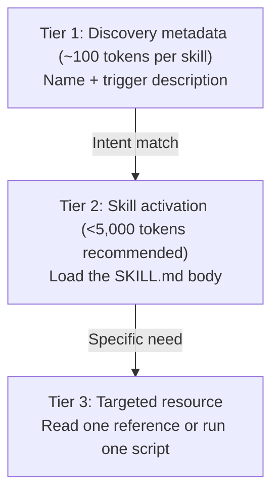

---
{
  "id": "long-context-engineering-beyond-management",
  "title": "Context Engineering",
  "slug": "long-context-engineering-beyond-management",
  "section": "Advanced Agents & Retrieval",
  "category": "LLM Agents & Tool Use",
  "difficulty": "Hard",
  "order": 5,
  "coverImage": "illustrations/_generated/context_engineering_loop_dark.png",
  "companies": [
    "Anthropic",
    "Google",
    "LangChain",
    "Cognition",
    "OpenAI",
    "Chroma"
  ],
  "shortDescription": "An agent can sit inside a 128k window and still chase a disproven hypothesis, so each turn needs focused curation and durable verification state across steps.",
  "keyConceptsTested": [
    "Context engineering vs. context management",
    "Context rot and diminishing token returns",
    "Lost-in-the-middle and attention bias",
    "Needle in a haystack multi-document reasoning",
    "Write, select, compress, isolate taxonomy",
    "Failure modes: poisoning, distraction, confusion, clash",
    "Prompt caching and KV cache economics",
    "Tool-result pruning and output distillation",
    "Sub-agent context isolation",
    "Agent Skills and progressive disclosure",
    "Durable workflow checkpoints and resume verification",
    "Paired curation evaluation and critical-case regressions"
  ],
  "prerequisites": [
    "prompt-engineering-fundamentals",
    "function-calling-tool-use-llms",
    "mcp-tool-protocol-standards"
  ],
  "relatedQuestions": [
    "long-context-window-management",
    "design-production-rag-pipeline",
    "advanced-rag-query-rewriting-self-rag",
    "prefix-caching-prompt-caching",
    "agent-memory-persistence-patterns"
  ],
  "aliases": [
    "recursive-language-models-rlm"
  ]
}
---

<!-- leetllm: edition:reference:start -->

Modern <span data-glossary="context-window">context windows</span> stretch across hundreds of thousands of tokens, yet reasoning accuracy often drops long before the token limit arrives. When an append-only debugging transcript accumulates raw test dumps, unused tool schemas, and early dead-end hypotheses, relevant facts drown inside stale history rather than guiding the next choice. **Context management** asks how much text fits inside a fixed token budget before truncation triggers. **Context engineering** asks a sharper question: what exact working set of instructions, code spans, tool definitions, and verified notes gives the model the cleanest signal for the next step?[^anthropic2025effectivecontext][^contexteng_survey2025][^langchain2025contextengineering]

To see why window capacity differs from usable context, follow pull request `PR-418` in a Transformer attention and tokenization repository. During CI, `test_kv_rope_slice` fails with `ValueError: causal mask shape (1, 1, 64, 128) does not match score shape (1, 8, 64, 64)`. Earlier in the run, the agent recorded a hunch blaming a BPE merge edit in `tokenizer.py`, even though `test_bpe_merges` already passed on held-out sequences and ruled out tokenization changes. Meanwhile, an 8,200-token pytest log sits between `test_log_17` near the front of the prompt and `diff_summary` near the back, leaving the agent anchored to the refuted tokenizer rumor instead of comparing `kv_cache.py:84` with `attention.py:112`.

```checkpoint
How does context engineering differ from basic context management during a long debugging run?
---
Context management enforces hard capacity limits by truncating or sliding windows when tokens run low. Context engineering decides what belongs in the next model call at every turn, removing stale traces and refuted guesses while preserving verified evidence and active tools.
```

## What long-context evaluations reveal

Controlled benchmarks demonstrate that feeding extra tokens into a self-attention layer spreads probability mass across unhelpful positions and degrades multi-step synthesis. In Chroma's context rot evaluations, retrieval and reasoning accuracy decline smoothly as distracting passages grow, even when the decisive facts remain completely inside the model's advertised limit.[^hong2025contextrot] Adding full pytest logs looks harmless in a single-file prototype, because the total sequence length still clears the model limit with room to spare. At inference time, however, every irrelevant token dilutes relative attention weights on the narrow tensor-shape trace that actually diagnoses the failure.

Positional bias compounds this attention dilution whenever key clues sit apart inside a long sequence. Stanford's lost-in-the-middle experiments measure a clear U-shaped recall curve across document depths, where accuracy stays high near the opening and closing edges and drops sharply in the center.[^liu2023lost] Multi-document synthesis degrades faster than single-fact lookup because the model must connect two separated spans while filtering out noisy text sitting between them.[^kamradt2023niah] Even models that score well on single-needle insertion probes miss multi-hop causal links when surface lexical overlap between failure trace and diff summary is weak.

## Four failure modes in long prompts

When uncurated transcripts accumulate across multi-turn agent loops, four failure mechanisms explain why accuracy drops far below the hard token limit.[^breunig2025longcontexts] Keeping these four mechanisms separate makes it straightforward to choose the right context repair instead of shrinking prompts blindly.

1. **Context poisoning:** A disproven claim or misread trace enters history once and keeps reappearing inside summaries and follow-up plans. For `PR-418`, an early note blaming `tokenizer.py` stays active across turns even after `test_bpe_merges` confirms bit-exact token IDs.
2. **Context distraction:** Thousands of tokens from unrelated test runs or verbose JSON dumps pull attention away from `kv_cache.py:84` and `attention.py:112`. The answer sits in the prompt, yet repetitive boilerplate overwhelms the relevant slice shapes.
3. **Context confusion:** Unused tool definitions crowd the schema header and tempt unnecessary calls. Exposing dataset shufflers or vocabulary rebuilders during mask shape diagnosis invites off-track exploration when only `diff_lookup` and `symbol_reader` belong in this phase.
4. **Context clash:** Conflicting formatting or reasoning directives appear inside retrieved notes and fight against system instructions. When an outdated comment inside a test log tells the reader to regenerate tokenizer files, quoting or isolating untrusted instructions prevents retrieved text from overriding the active task goal.

## The four context moves

Four complementary operations reshape the working set between turns: **write**, **select**, **compress**, and **isolate**.[^langchain2025contextengineering] Each operation targets a distinct source of prompt bloat so the next call sees sharp evidence without losing proven findings. Together they shift long-running debugging from passive transcript replay into deliberate state curation.

<figure>
  
  <figcaption>A crowded 12,436-token raw prompt buries separated evidence behind old pytest noise. Applying Select, Write plus Reload, Compress, and Isolate distills the next turn into 3,346 focused tokens so the model links <code>kv_cache.py:84</code> with <code>attention.py:112</code> directly.</figcaption>
</figure>

### Write: persist state outside the prompt

**Write** saves intermediate findings, verified tensor checks, and raw trace archives outside the active prompt so the application reloads only brief notes when required.[^langchain2025contextengineering] External storage does not eliminate prompt cost entirely, because any line reloaded into a later call still consumes input tokens on that request. Its power lies in stripping out multi-page stack traces while preserving durable records of both confirmed clues and ruled-out leads.[^letta2026memory] For `PR-418`, writing confirmed mask dimensions and the ruled-out BPE check into a structured findings store keeps the next call crisp without forgetting past verification.

<!-- leetllm: test, output=show -->
```python title="write-durable-findings.py"
import json
from dataclasses import asdict, dataclass


@dataclass(frozen=True)
class FindingNote:
    note_id: str
    claim: str
    status: str
    source_ref: str
    token_estimate: int


def format_reloaded_notes(notes: list[FindingNote], allowed_ids: set[str]) -> tuple[str, int]:
    """Serialize selected findings for prompt injection and report reloaded token cost."""
    selected = [n for n in notes if n.note_id in allowed_ids]
    lines = [f"- [{n.status}] {n.note_id} ({n.source_ref}): {n.claim}" for n in selected]
    total_tokens = sum(n.token_estimate for n in selected)
    return "\n".join(lines), total_tokens


if __name__ == "__main__":
    findings_store = [
        FindingNote(
            note_id="kv_mask_shape",
            claim="kv_cache.py:84 yields 64 queries against 128 cached keys; mask shape mismatch follows.",
            status="confirmed",
            source_ref="test_log_17",
            token_estimate=90,
        ),
        FindingNote(
            note_id="bpe_merges_ruled_out",
            claim="test_bpe_merges passed with bit-exact token IDs; tokenizer.py is unchanged.",
            status="ruled_out",
            source_ref="ci_tokenizer_suite",
            token_estimate=96,
        ),
    ]
    payload, reloaded_tokens = format_reloaded_notes(
        findings_store,
        {"kv_mask_shape", "bpe_merges_ruled_out"},
    )
    print(f"Reloaded {reloaded_tokens} tokens from external findings store:")
    print(payload)
    print("Archived JSON keys:", list(asdict(findings_store[0]).keys()))
```

<!-- leetllm: output:start -->
```text title="Output" output compact
Reloaded 186 tokens from external findings store:
- [confirmed] kv_mask_shape (test_log_17): kv_cache.py:84 yields 64 queries against 128 cached keys; mask shape mismatch follows.
- [ruled_out] bpe_merges_ruled_out (ci_tokenizer_suite): test_bpe_merges passed with bit-exact token IDs; tokenizer.py is unchanged.
Archived JSON keys: ['note_id', 'claim', 'status', 'source_ref', 'token_estimate']
```
<!-- leetllm: output:end -->

### Select: retrieve evidence and phase tools

**Select** filters candidate files, findings, and tool definitions so only phase-relevant items enter the next request.[^anthropic2025effectivecontext] Placing core failure traces near the leading and trailing edges maximizes attention recall across steps. Hiding off-phase utilities like `dataset_shuffler` or `vocab_rebuild` while diagnosing an attention mask bug trims schema tokens and prevents tool-selection distraction. Explicitly partitioning candidates into mandatory evidence and prioritized optional context protects crucial inputs from accidental truncation.

<!-- leetllm: test, output=show -->
```python title="select-phase-context.py"
from dataclasses import dataclass


@dataclass(frozen=True)
class ContextPiece:
    name: str
    tokens: int
    required: bool
    priority: int
    phase: str


def pack_for_phase(
    pieces: list[ContextPiece],
    active_phase: str,
    budget: int,
) -> tuple[list[ContextPiece], list[ContextPiece]]:
    """Keep required items first for the active phase, then pack optional evidence by priority."""
    in_phase = [p for p in pieces if p.phase in {active_phase, "all"}]
    required = [p for p in in_phase if p.required]
    required_cost = sum(p.tokens for p in required)
    if required_cost > budget:
        raise ValueError(f"Required items use {required_cost} tokens, exceeding budget {budget}")

    kept = list(required)
    dropped = [p for p in pieces if p not in in_phase]
    remaining = budget - required_cost

    optional = sorted(
        (p for p in in_phase if not p.required),
        key=lambda item: (-item.priority, item.tokens, item.name),
    )
    for item in optional:
        if item.tokens <= remaining:
            kept.append(item)
            remaining -= item.tokens
        else:
            dropped.append(item)
    return kept, dropped


if __name__ == "__main__":
    candidates = [
        ContextPiece("pr_418_report", 180, True, 100, "mask_triage"),
        ContextPiece("kv_mask_trace", 420, True, 95, "mask_triage"),
        ContextPiece("attention_api_spec", 1800, True, 90, "mask_triage"),
        ContextPiece("diff_lookup_tool", 240, True, 88, "mask_triage"),
        ContextPiece("symbol_reader_tool", 260, True, 85, "mask_triage"),
        ContextPiece("kv_mask_shape_note", 90, False, 80, "mask_triage"),
        ContextPiece("dataset_shuffler_tool", 360, False, 40, "data_prep"),
        ContextPiece("old_pytest_dump", 8200, False, 10, "mask_triage"),
    ]
    kept, dropped = pack_for_phase(candidates, active_phase="mask_triage", budget=3500)
    print("Kept:", [(c.name, c.tokens) for c in kept])
    print("Kept total:", sum(c.tokens for c in kept))
    print("Dropped:", [c.name for c in dropped])
```

<!-- leetllm: output:start -->
```text title="Output" output compact
Kept: [('pr_418_report', 180), ('kv_mask_trace', 420), ('attention_api_spec', 1800), ('diff_lookup_tool', 240), ('symbol_reader_tool', 260), ('kv_mask_shape_note', 90)]
Kept total: 2990
Dropped: ['dataset_shuffler_tool', 'old_pytest_dump']
```
<!-- leetllm: output:end -->

Explicitly checking required items against the budget before filling optional evidence turns silent failure into an immediate configuration error. If `pr_418_report` and `kv_mask_trace` exceed the available headroom, returning a partial prompt without the failing stack trace wastes an entire model turn. Deterministic sorting on priority and size also ensures repeatable prompt assembly across test runs, making it straightforward to debug why an item stayed out.

### Compress: prune stale tool outputs and keep negatives

**Compress** shrinks lengthy tool outputs and conversation turns without erasing the distinctions that govern the next edit. Replacing a past pytest dump with a concise summary saves thousands of tokens only when the distilled state explicitly retains both confirmed findings and disproven claims. Dropping negative results during summarization creates one of the costliest failure loops in agent engineering, because the planner forgets `test_bpe_merges` passed and starts re-inspecting `tokenizer.py` from scratch.

> **Common mistake:** Compressing a tool output down to "checked tokenizer" hides whether the test passed or failed. Always record ruled-out leads explicitly (for example, `[ruled_out] test_bpe_merges passed`) so later turns do not repeat work you already finished.

Selective tool-result clearing replaces older outputs in place while leaving the newest raw payloads intact for immediate inspection. Preserving call ordering avoids dangling tool IDs in provider APIs and keeps recent traceback lines verbatim. Token-level pruning algorithms such as LLMLingua apply the same principle to dense retrieval passages by scoring token perplexity with a compact language model and discarding low-information words before final dispatch.[^jiang2023a]

<!-- leetllm: test, output=show -->
```python title="compress-tool-history.py"
from dataclasses import dataclass


@dataclass
class ToolTurn:
    call_id: str
    tool_name: str
    raw_output: str
    raw_tokens: int
    distilled_summary: str
    finding_recorded: bool


def prune_older_outputs(turns: list[ToolTurn], keep_recent_raw: int = 2) -> list[dict[str, str | int]]:
    """Replace older tool payloads in place once findings are saved, keeping latest raw results."""
    cutoff = max(0, len(turns) - keep_recent_raw)
    curated: list[dict[str, str | int]] = []
    for idx, turn in enumerate(turns):
        if idx < cutoff and turn.finding_recorded:
            curated.append(
                {
                    "call_id": turn.call_id,
                    "tool_name": turn.tool_name,
                    "mode": "compressed",
                    "content": turn.distilled_summary,
                    "tokens": max(12, len(turn.distilled_summary.split()) * 2),
                }
            )
        else:
            curated.append(
                {
                    "call_id": turn.call_id,
                    "tool_name": turn.tool_name,
                    "mode": "raw",
                    "content": turn.raw_output,
                    "tokens": turn.raw_tokens,
                }
            )
    return curated


if __name__ == "__main__":
    history = [
        ToolTurn("c1", "run_pytest", "<8200 tokens of passed suites>", 8200, "test_bpe_merges passed; tokenizer ruled out.", True),
        ToolTurn("c2", "read_trace", "<1400 tokens of kv stack>", 1400, "test_log_17: kv_cache.py:84 uses 64 queries vs 128 keys.", True),
        ToolTurn("c3", "diff_lookup", "attention.py:112 broadcasts causal_mask without seq offset.", 420, "", False),
    ]
    pruned = prune_older_outputs(history, keep_recent_raw=1)
    for row in pruned:
        print(f"{row['call_id']} ({row['mode']}, {row['tokens']} tok): {row['content']}")
```

<!-- leetllm: output:start -->
```text title="Output" output compact
c1 (compressed, 12 tok): test_bpe_merges passed; tokenizer ruled out.
c2 (compressed, 16 tok): test_log_17: kv_cache.py:84 uses 64 queries vs 128 keys.
c3 (raw, 420 tok): attention.py:112 broadcasts causal_mask without seq offset.
```
<!-- leetllm: output:end -->

### Isolate: delegate noisy search to focused workers

**Isolate** splits broad exploration into dedicated subagent sessions so intermediate file scans never crowd the main debugging window.[^anthropic2025longrunningagents] When `PR-418` needs a historical commit sweep over `tokenizer.py`, running that search inside an isolated worker gives the subagent a clean window and shields the coordinator from dozens of irrelevant diffs. The coordinator ingests only a size-checked JSON handoff listing confirmed claims and real source identifiers. Because isolation acts purely as a focus filter rather than a security boundary, every worker handoff must still pass structural validation and caller-side source checks before entering long-term state.

<!-- leetllm: test, output=show -->
```python title="validate-worker-handoff.py"
import json
from dataclasses import dataclass


@dataclass(frozen=True)
class WorkerHandoff:
    claim: str
    source_ids: list[str]
    next_check: str


def parse_handoff(raw_bytes: bytes, verified_sources: set[str], max_bytes: int = 1600) -> tuple[bool, str]:
    """Validate handoff byte size, schema fields, and verified source identifiers."""
    if len(raw_bytes) > max_bytes:
        return False, f"Payload size {len(raw_bytes)} exceeds {max_bytes}-byte limit"
    data = json.loads(raw_bytes.decode("utf-8"))
    required_keys = {"claim", "source_ids", "next_check"}
    if set(data.keys()) != required_keys:
        return False, f"Unexpected keys: {sorted(data.keys())}"
    handoff = WorkerHandoff(**data)
    if not handoff.claim.strip() or not handoff.next_check.strip():
        return False, "Claim and next_check must be non-empty strings"
    if not handoff.source_ids:
        return False, "At least one source identifier is required"
    unverified = [s for s in handoff.source_ids if s not in verified_sources]
    if unverified:
        return False, f"Unverified sources referenced: {unverified}"
    return True, f"Accepted handoff backed by {handoff.source_ids}"


if __name__ == "__main__":
    allowed = {"test_log_17", "ci_tokenizer_suite", "diff_summary"}
    good_payload = json.dumps({
        "claim": "test_bpe_merges passes bit-exact; regression sits in attention mask slicing.",
        "source_ids": ["ci_tokenizer_suite", "diff_summary"],
        "next_check": "Compare mask offset indexing in attention.py:112.",
    }).encode("utf-8")
    bad_payload = json.dumps({
        "claim": "Vocab files are corrupted.",
        "source_ids": ["unlisted_scratch_note"],
        "next_check": "Rebuild BPE merges.",
    }).encode("utf-8")
    print("Good:", parse_handoff(good_payload, allowed))
    print("Bad:", parse_handoff(bad_payload, allowed))
```

<!-- leetllm: output:start -->
```text title="Output" output compact
Good: (True, "Accepted handoff backed by ['ci_tokenizer_suite', 'diff_summary']")
Bad: (False, "Unverified sources referenced: ['unlisted_scratch_note']")
```
<!-- leetllm: output:end -->

### Prompt caching and KV prefix stability

Reordering sections or mutating dynamic metadata near the opening of a prompt invalidates provider <span data-glossary="rag">key-value</span> prefix caches on every turn. Hosted inference engines reuse precomputed key and value tensors across calls only along exact leading token matches.[^anthropic2026promptcaching][^openai2026promptcaching] Placing stable system directives, tool headers, and long API specifications at the front, while appending volatile turn traces and reloaded notes at the end, converts multi-step debugging into cheap incremental prefill passes without sacrificing fresh curation.

<!-- leetllm: test, deps=numpy, output=show -->
```python title="measure-kv-prefix-reuse.py"
import numpy as np

def shared_prefix_length(previous_tokens: np.ndarray, current_tokens: np.ndarray) -> int:
    """Return the exact token prefix length eligible for KV cache reuse."""
    limit = min(previous_tokens.size, current_tokens.size)
    mismatch = np.flatnonzero(previous_tokens[:limit] != current_tokens[:limit])
    return int(mismatch[0]) if mismatch.size else limit


if __name__ == "__main__":
    system_prompt = np.arange(0, 80, dtype=np.int64)
    api_spec = np.arange(1_000, 1_240, dtype=np.int64)
    turn1_query = np.arange(5_000, 5_016, dtype=np.int64)
    turn2_query = np.arange(6_000, 6_016, dtype=np.int64)

    # Volatile query before large spec breaks prefix reuse after sys prompt (80 tokens).
    volatile_first_a = np.concatenate([system_prompt, turn1_query, api_spec])
    volatile_first_b = np.concatenate([system_prompt, turn2_query, api_spec])

    # Stable spec before volatile query reuses sys + spec (320 tokens).
    stable_first_a = np.concatenate([system_prompt, api_spec, turn1_query])
    stable_first_b = np.concatenate([system_prompt, api_spec, turn2_query])

    print("Volatile-first shared prefix:", shared_prefix_length(volatile_first_a, volatile_first_b))
    print("Stable-first shared prefix:", shared_prefix_length(stable_first_a, stable_first_b))
```

<!-- leetllm: output:start -->
```text title="Output" output compact
Volatile-first shared prefix: 80
Stable-first shared prefix: 320
```
<!-- leetllm: output:end -->

> **Key insight:** KV prefix caching matches strictly from token 0 up to the first changed token. Putting a per-turn timestamp, trace ID, or dynamic note ahead of a large API spec breaks cache reuse for everything that follows it.

## Rebuilding the working set for PR-418

Walking through complete token accounting for `PR-418` turns abstract curation moves into concrete numbers. Before pruning, the raw prompt totals 12,436 tokens because the full 8,200-token pytest output, two unused data-pipeline tools, raw verbose logs, and the disproven BPE claim sit beside the active debugging materials. Dropping stale noise and reloading concise verification notes shrinks the next request to 3,346 tokens, a 73.1% reduction that restores attention sharpness across `kv_cache.py:84` and `attention.py:112`.

<figure>
  
  <figcaption>A single curation pass cuts 12,436 raw tokens down to 3,346 tokens (73.1% smaller). Notice that the two external findings add 186 reloaded tokens back into the budget so verified shapes and negative BPE proof remain explicit.</figcaption>
</figure>

The Python script below models both the raw window inventory and the post-curation token tally so every kept, reloaded, and omitted item reconciles cleanly. Notice how `reload_note` entries stay separate from raw history during initial counting yet contribute directly to the dispatched budget once injected into the next turn. Tracking net reduction alongside gross dropped volume prevents undercounting reloaded notes when sizing strict prompt caps.

<!-- leetllm: test, output=show -->
```python title="pr418-context-curation.py"
from dataclasses import dataclass


@dataclass(frozen=True)
class WindowEntry:
    name: str
    tokens: int
    action: str  # "keep", "reload_note", or "omit"
    reason: str


def summarize_curation_pass(entries: list[WindowEntry]) -> dict[str, int | float]:
    raw_total = sum(e.tokens for e in entries if e.action != "reload_note")
    kept_active = sum(e.tokens for e in entries if e.action == "keep")
    reloaded = sum(e.tokens for e in entries if e.action == "reload_note")
    next_call = kept_active + reloaded
    net_saved = raw_total - next_call
    pct_saved = round((net_saved / raw_total) * 100.0, 1)
    return {
        "raw_total": raw_total,
        "kept_active": kept_active,
        "reloaded_notes": reloaded,
        "next_call": next_call,
        "net_saved": net_saved,
        "pct_saved": pct_saved,
    }


if __name__ == "__main__":
    entries = [
        WindowEntry("pr_418_report", 180, "keep", "Active failing PR description"),
        WindowEntry("kv_mask_trace", 420, "keep", "test_kv_rope_slice error trace"),
        WindowEntry("attention_api_spec", 1800, "keep", "kv_cache and attention mask spec"),
        WindowEntry("scratchpad", 260, "keep", "Working hypothesis and next step"),
        WindowEntry("diff_lookup", 240, "keep", "Phase tool for inspecting attention.py"),
        WindowEntry("symbol_reader", 260, "keep", "Phase tool for reading kv_cache.py"),
        WindowEntry("kv_mask_shape_note", 90, "reload_note", "Confirmed 64 vs 128 slice mismatch"),
        WindowEntry("bpe_ruled_out_note", 96, "reload_note", "Ruled out tokenizer.py BPE change"),
        WindowEntry("old_pytest_dump", 8200, "omit", "Replaced by passing suite note"),
        WindowEntry("dataset_shuffler", 360, "omit", "Unrelated preprocessing tool"),
        WindowEntry("vocab_rebuild", 410, "omit", "Off-phase tokenizer tool"),
        WindowEntry("disproven_bpe_claim", 120, "omit", "Poisoned guess refuted by tests"),
        WindowEntry("raw_merge_logs", 186, "omit", "Verbose raw logs distilled to notes"),
    ]
    stats = summarize_curation_pass(entries)
    for key, value in stats.items():
        print(f"{key}: {value}")
```

<!-- leetllm: output:start -->
```text title="Output" output compact
raw_total: 12436
kept_active: 3160
reloaded_notes: 186
next_call: 3346
net_saved: 9090
pct_saved: 73.1
```
<!-- leetllm: output:end -->

Actual provider tokenizers always add message-role delimiters and JSON wrapper overhead on top of content counts, so item sizes function best as relative planning weights. Always check exact finalized token counts with your target tokenizer endpoint before shipping tight budgets. When purging a stale hypothesis from chat history, also scan remaining assistant recaps so lingering mentions cannot quietly steer future steps back to dead leads.

<!-- leetllm: test, output=show -->
```python title="guard-poison-removal.py"
def contains_poisoned_claim(messages: list[dict[str, str]], forbidden_phrase: str) -> list[int]:
    """Return message indices still echoing a disproven claim outside explicit ruled-out notes."""
    hits: list[int] = []
    target = forbidden_phrase.lower()
    for idx, msg in enumerate(messages):
        text = msg["content"].lower()
        if target in text and "[ruled_out]" not in text:
            hits.append(idx)
    return hits


if __name__ == "__main__":
    clean_window = [
        {"role": "system", "content": "Diagnose PR-418 test_kv_rope_slice failure."},
        {"role": "assistant", "content": "[ruled_out] tokenizer.py BPE merge hypothesis rejected by test_bpe_merges."},
        {"role": "user", "content": "Compare kv_cache.py:84 and attention.py:112 slice shapes."},
    ]
    polluted_window = clean_window + [
        {"role": "assistant", "content": "Recap: investigate tokenizer.py BPE merge regression next."},
    ]
    print("Clean window poison hits:", contains_poisoned_claim(clean_window, "bpe merge"))
    print("Polluted window poison hits:", contains_poisoned_claim(polluted_window, "bpe merge"))
```

<!-- leetllm: output:start -->
```text title="Output" output compact
Clean window poison hits: []
Polluted window poison hits: [3]
```
<!-- leetllm: output:end -->

## Diagnosing context thrashing

When an agent repeats lookups or loses task identifiers across compaction passes, telemetry must surface stalled loops directly rather than masking zero progress inside aggregate averages. Suppose an investigation executes six curation operations (`Write`, `Compress`, `Select`) while completing zero real debugging steps because each free-form summary omitted `PR-418`. Dividing operations by zero completed steps would fail or hide the stall, so instrumentation must log raw counters (`operations=6, completed_steps=0`), mark the loop stalled, and cap automated retries.

```checkpoint
Why should compaction always pin entity identifiers and ruled-out findings inside structured slots?
---
Free-form summarization easily drops exact symbols, file paths, or negative findings such as which hypothesis already failed. Pinning identifier slots outside prose prevents the agent from re-fetching the same diff logs or restarting rejected lines of inquiry.
```

<span data-glossary="tracing">Observability traces</span> become far more actionable when every model step captures token counts before and after pruning alongside active step counters. Plotting retention efficiency alongside step completion exposes thrashing loops immediately so engineers can tighten identifier pinning before runaway retries drain quota.

## Progressive disclosure and Agent Skills

As engineering platforms expand, copying every specialized debugging playbook into the global system prompt inflates costs and breeds constant tool confusion. An **Agent Skill** keeps base prompts lean by packaging procedural knowledge inside a self-contained directory containing a compact `SKILL.md` file together with optional reference docs, helper scripts, and routing checks.[^agentskills2026][^anthropic2026agentskills] Rather than dumping every domain manual upfront, the runtime reveals skills lazily as task intent clarifies.

Skills organize instructions and tooling through **progressive disclosure** across three loading tiers so irrelevant procedures remain out of active memory. Each tier trades minimal upfront token overhead for on-demand activation only when a real task matches. The flow below traces how compact discovery metadata unlocks full procedure bodies and targeted utilities.



1. **Tier 1: Discovery metadata (routing layer):** The host exposes only each skill's name and short trigger description at startup. Measure rendered token counts across skills with your runtime rather than assuming the 100-token figure holds uniformly across templates.
2. **Tier 2: Skill activation (procedure layer):** When a request matches a skill's trigger, the runtime loads the `SKILL.md` body into active context, staying concise so instructions do not crowd out working files.
3. **Tier 3: Targeted resources (on-demand layer):** Deep formatting specifications (`references/handoff-schema.md`) and helper validators (`scripts/validate-handoff.py`) stay on disk until explicitly requested. Reading a reference adds tokens to the window, whereas running a helper script executes deterministically and returns only compact output lines without loading script source code into the model.[^agentskills2026][^anthropic2026agentskills]

```text title="attention-diff-triage-skill.txt"
attention-diff-triage/
├── SKILL.md
├── references/
│   └── handoff-schema.md
├── scripts/
│   └── validate-handoff.py
└── evals/
    └── routing.json
```

The `SKILL.md` header provides the small routing summary inspected at startup, while the body spells out exact tool ordering and fallback steps once activated. Keeping steps numbered and concise leaves the maximum context margin for stack traces and file diffs.

```markdown title="attention-diff-triage/SKILL.md"
---
name: attention-diff-triage
description: Diagnose Transformer attention mask, KV cache, and RoPE slicing failures from PR diffs and pytest traces.
---

# Attention diff triage procedure

1. Read the failing PR description and targeted pytest stack trace.
2. Load only debugging tools (`diff_lookup`, `symbol_reader`).
3. Write confirmed shapes and ruled-out hypotheses into the external findings store.
4. Read `references/handoff-schema.md` before spawning an isolated tokenizer subagent.
5. Run `scripts/validate-handoff.py` before writing the patch plan.

Never rewrite unrelated tokenizer files directly; return a verified mask patch proposal.
```

Separating routing evaluation cases from execution checks prevents prompt regressions from slipping through unnoticed. Testing trigger activation independently verifies both true positives (`PR-418` mask debugging) and intentional non-activations (documentation cleanup), while confirming whether a request only calls for read-only verification.

```json title="attention-diff-triage/evals/routing.json"
[
  {
    "request": "Debug PR-418 test_kv_rope_slice shape mismatch in attention.py.",
    "expected_activation": true,
    "expected_artifact": "verified mask patch plan"
  },
  {
    "request": "Format release notes for docs/changelog.md.",
    "expected_activation": false,
    "expected_artifact": null
  },
  {
    "request": "Confirm whether tokenizer.py changed BPE merges on PR-418.",
    "expected_activation": true,
    "expected_artifact": "validated worker handoff only"
  }
]
```

Skills package natural-language procedures alongside runnable helper utilities, so teams must inspect third-party bundles before enabling them in shared workspaces. Always pair skill activation with strict host-side <span data-glossary="acl">access controls</span> because progressive disclosure regulates prompt inclusion rather than file or network security. Even when script source remains out of context, printed command outputs enter input tokens and count toward the prompt budget.

```checkpoint
When does progressive disclosure outperform placing all instructions in the base system prompt?
---
Progressive disclosure excels when an agent supports dozens of specialized workflows where most requests only need one procedure. A tiny set of universal rules used on every call belongs in the cached base prompt instead.
```

## Resumable workflows and durable checkpoints

Long debugging tasks often span restarts, timeouts, or model handoffs.[^anthropic2025longrunningagents][^anthropic2026harnessdesign] Raw chat logs are not enough to resume safely, because repository files or test acceptance criteria may change while the workflow sits paused. Splitting workflows into clean stages (`collect-traces` -> `verify-mask-cause` -> `write-patch-plan`) lets the coordinator persist SHA-256 verification records tying each stage result to exact dependency hashes.

Whenever an input file changes after initial verification, such as tightening `acceptance_spec` to check variable batch sizes, digest comparison detects the mismatch right away. Instead of blinding downstream stages with obsolete assumptions, the checkpoint store invalidates only the affected stage and triggers targeted re-verification before writing the final patch plan.

<!-- leetllm: test, output=show -->
```python title="durable-workflow-checkpoints.py"
import hashlib
import json
from dataclasses import dataclass, field


def sha256_text(text: str) -> str:
    return hashlib.sha256(text.encode("utf-8")).hexdigest()[:16]


@dataclass(frozen=True)
class PhaseArtifact:
    artifact_id: str
    content: str
    depends_on: list[str] = field(default_factory=list)


@dataclass(frozen=True)
class VerificationRecord:
    artifact_id: str
    artifact_hash: str
    input_hashes: dict[str, str]
    passed: bool


class CheckpointStore:
    def __init__(self, artifacts: dict[str, PhaseArtifact], records: dict[str, VerificationRecord]):
        self.artifacts = artifacts
        self.records = records

    def is_step_current(self, step_id: str, current_files: dict[str, str]) -> tuple[bool, str]:
        artifact = self.artifacts.get(step_id)
        if artifact is None:
            return False, f"Missing artifact for {step_id}"
        record = self.records.get(step_id)
        if record is None or not record.passed:
            return False, f"Missing passing verification record for {step_id}"
        if sha256_text(artifact.content) != record.artifact_hash:
            return False, f"Artifact {step_id} content changed after verification"
        if set(record.input_hashes.keys()) != set(artifact.depends_on):
            return False, f"Dependency list changed for {step_id}"
        for dep_id in artifact.depends_on:
            if dep_id not in current_files:
                return False, f"Missing current dependency {dep_id}"
            expected_hash = sha256_text(current_files[dep_id])
            if record.input_hashes.get(dep_id) != expected_hash:
                return False, f"Input {dep_id} modified since verification"
        return True, f"Step {step_id} verified and current"


if __name__ == "__main__":
    spec_v1 = "Check mask slice for q=64, k=128 in test_kv_rope_slice."
    spec_v2 = "Check mask slice for q=64, k=128 and variable batch size in test_kv_rope_slice."
    diagnosis = "Confirmed attention.py:112 slice offset omits KV offset."

    artifacts = {
        "verify-mask-cause": PhaseArtifact("verify-mask-cause", diagnosis, depends_on=["acceptance_spec"]),
    }
    records = {
        "verify-mask-cause": VerificationRecord(
            artifact_id="verify-mask-cause",
            artifact_hash=sha256_text(diagnosis),
            input_hashes={"acceptance_spec": sha256_text(spec_v1)},
            passed=True,
        ),
    }
    store = CheckpointStore(artifacts, records)
    print("With spec_v1:", store.is_step_current("verify-mask-cause", {"acceptance_spec": spec_v1}))
    print("With spec_v2:", store.is_step_current("verify-mask-cause", {"acceptance_spec": spec_v2}))
```

<!-- leetllm: output:start -->
```text title="Output" output compact
With spec_v1: (True, 'Step verify-mask-cause verified and current')
With spec_v2: (False, 'Input acceptance_spec modified since verification')
```
<!-- leetllm: output:end -->

Separating verified stage outputs from raw chat history also keeps resumed prompts lean and readable. Frameworks such as <span data-glossary="langgraph">LangGraph</span> persist thread-scoped checkpoints reliably across restarts and node transitions.[^langgraph2026memory] Persistence by itself still leaves input freshness, trust permissions, and curation rules up to the application, so pairing checkpoints with digest verification protects both efficiency and accuracy.

## Evaluating context curation policies

Shorter prompts are only better when task accuracy holds steady or improves without breaking critical edge cases. Evaluating any curation change requires paired runs across identical benchmark tasks comparing raw and curated windows side by side. A principled release check scores pass count, average input tokens, recurrence of disproven claims, and zero-regression protection on designated critical test cases.

<!-- leetllm: test, output=show -->
```python title="paired-curation-eval.py"
from dataclasses import dataclass


@dataclass(frozen=True)
class EvalCase:
    case_id: str
    critical: bool
    raw_passed: bool
    curated_passed: bool
    raw_tokens: int
    curated_tokens: int
    curated_poison_hits: int


def evaluate_curation(cases: list[EvalCase]) -> dict[str, object]:
    raw_wins = sum(1 for c in cases if c.raw_passed)
    curated_wins = sum(1 for c in cases if c.curated_passed)
    raw_tok = sum(c.raw_tokens for c in cases)
    curated_tok = sum(c.curated_tokens for c in cases)
    poison_total = sum(c.curated_poison_hits for c in cases)
    critical_failures = [c.case_id for c in cases if c.critical and not c.curated_passed]
    token_saving_pct = round(((raw_tok - curated_tok) / raw_tok) * 100.0, 1)
    approved = (
        curated_wins >= raw_wins
        and curated_tok < raw_tok
        and poison_total == 0
        and len(critical_failures) == 0
    )
    return {
        "approved": approved,
        "raw_wins": raw_wins,
        "curated_wins": curated_wins,
        "token_saving_pct": token_saving_pct,
        "poison_hits": poison_total,
        "critical_failures": critical_failures,
    }


if __name__ == "__main__":
    suite = [
        EvalCase("pr418_mask_slice", True, True, True, 12436, 3346, 0),
        EvalCase("kv_broadcast_head", False, False, True, 11200, 3100, 0),
        EvalCase("rope_cache_offset", True, True, False, 9800, 2900, 0),
    ]
    blocked_result = evaluate_curation(suite)
    print("With critical failure:", blocked_result)

    repaired_suite = suite[:-1] + [EvalCase("rope_cache_offset", True, True, True, 9800, 3050, 0)]
    print("After critical repair:", evaluate_curation(repaired_suite))
```

<!-- leetllm: output:start -->
```text title="Output" output compact
With critical failure: {'approved': False, 'raw_wins': 2, 'curated_wins': 2, 'token_saving_pct': 72.0, 'poison_hits': 0, 'critical_failures': ['rope_cache_offset']}
After critical repair: {'approved': True, 'raw_wins': 2, 'curated_wins': 3, 'token_saving_pct': 71.6, 'poison_hits': 0, 'critical_failures': []}
```
<!-- leetllm: output:end -->

Notice in the first suite how `kv_broadcast_head` swings from a fail to a pass and average tokens fall sharply, yet the single critical failure on `rope_cache_offset` keeps `approved` false. Requiring zero regressions on critical tasks prevents aggressive compression from silently erasing constraints on high-stakes debugging scenarios. Once `rope_cache_offset` is repaired cleanly, the curation pass achieves higher pass count, smaller inputs, and zero poison hits together.

```checkpoint
Why can an improved overall accuracy score still fail a curation check?
---
A pruning rule might raise pass rates across easy examples while accidentally dropping a required safety check or edge-case specification from a critical prompt. Requiring zero critical regressions prevents silent breaks in production.
```

A compact prompt only earns trust when the kept items actually solve the task and untrusted inputs cannot hijack execution. Having mastered how tools, evidence, notes, and skills enter the working set, we are ready to defend those curated prompts whenever untrusted external text enters the window. Every clean selection strategy still needs explicit origin tracking and execution controls around user-provided documents.

```mastery-quiz
[
  {
    "question": "An agent debugging PR-418 keeps proposing edits to tokenizer.py even though test_bpe_merges already passed. Meanwhile a retrieved code comment instructs the planner to emit CSV instead of the application's required JSON output. How should the prompt builder prepare the next request?",
    "options": [
      "Remove the stale tokenizer hypothesis and its recaps, reload a verified ruled-out note, quote the retrieved comment as plain data, and require JSON.",
      "Keep the stale tokenizer hypothesis alongside a correction note, and switch the reply format to CSV to match the code comment.",
      "Remove the stale tokenizer hypothesis and its recaps, reload a verified ruled-out note, and switch the reply format to CSV.",
      "Keep the stale tokenizer hypothesis in full history so the model remembers its earlier reasoning, while quoting the comment as data in JSON."
    ],
    "answer": "Remove the stale tokenizer hypothesis and its recaps, reload a verified ruled-out note, quote the retrieved comment as plain data, and require JSON.",
    "explanation": "Repeating a disproven claim across recaps causes context poisoning. Deleting the stale hypothesis and replacing it with a concise ruled-out finding stops the model from drifting back into tokenizer.py. Treating retrieved instructions inside code comments as quoted data instead of system directives prevents context clash with the JSON output format."
  },
  {
    "question": "On a fixed 20-question evaluation set, moving a key trace from the start of the window to the middle drops single-fact pass count from 18/20 to 12/20, while a two-clue synthesis set scores 9/20. Which conclusion follows accurately?",
    "options": [
      "Middle placement lowered accuracy by 6 percentage points; two-clue synthesis scored 45%; the same drop holds across comparable setups.",
      "Middle placement lowered accuracy by 30 percentage points; two-clue synthesis scored 45%; the result applies to this model and setup.",
      "Middle placement lowered accuracy by 6 percentage points; two-clue synthesis scored 60%; the result applies to this model and setup.",
      "Middle placement lowered accuracy by 30 percentage points; two-clue synthesis scored 60%; the same drop holds across comparable setups."
    ],
    "answer": "Middle placement lowered accuracy by 30 percentage points; two-clue synthesis scored 45%; the result applies to this model and setup.",
    "explanation": "Success fell from 90% (18/20) to 60% (12/20), which is a 30-percentage-point drop rather than 6 points. The synthesis task scored 9/20 = 45%. Because only one model and evaluation suite ran, generalizing the exact numbers to unseen models is unsupported."
  },
  {
    "question": "A context packer has a 3,000-token budget. Required items R (400) and S (700) must fit first. Optional items A (1,400, priority 9), B (600, priority 8), and C (400, priority 7) compete for remaining space. What does the greedy packer select, and what happens on a second run where one required item needs 3,100 tokens?",
    "options": [
      "Pack R, S, A, and C (2,900 tokens); return an empty selection on the second run.",
      "Pack R, S, A, and C (2,900 tokens); raise a budget error on the second run.",
      "Pack R, S, and A (2,500 tokens); raise a budget error on the second run.",
      "Pack R, S, and A (2,500 tokens); return an empty selection on the second run."
    ],
    "answer": "Pack R, S, A, and C (2,900 tokens); raise a budget error on the second run.",
    "explanation": "Required items R and S consume 1,100 tokens. Adding highest-priority optional item A (1,400) brings usage to 2,500, leaving 500 tokens. B needs 600 tokens and does not fit, so the packer skips B and takes C (400) for a total of 2,900 tokens. On the second run, silently returning an empty list hides a critical input, so exceeding the 3,000-token limit must raise an error."
  },
  {
    "question": "Assume exact token reuse up to the first mismatched token. A fixed root instruction spans 80 tokens, a per-request trace ID spans 16 tokens with different first tokens per call, and an unchanging API spec spans 240 tokens. Compare ordering root -> trace_id -> spec against root -> spec -> trace_id. What are the reusable prefix lengths and total tokens sent per call?",
    "options": [
      "Reusable prefix: 80 then 320; total tokens sent: 80 then 320.",
      "Reusable prefix: 0 then 240; total tokens sent: 336 then 336.",
      "Reusable prefix: 0 then 240; total tokens sent: 80 then 320.",
      "Reusable prefix: 80 then 320; total tokens sent: 336 then 336."
    ],
    "answer": "Reusable prefix: 80 then 320; total tokens sent: 336 then 336.",
    "explanation": "When the changing trace ID sits directly after the 80-token root, prefix caching breaks at token 80. Placing the static 240-token spec before the trace ID extends the matched prefix to 80 + 240 = 320 tokens. In both orderings, the complete request still contains all 80 + 16 + 240 = 336 tokens."
  },
  {
    "question": "Five consecutive tool calls indexed 0 through 4 have recorded_finding flags [false, true, true, true, false]. The pruning rule preserves the newest two results raw in case details are still needed. Which earlier payloads can safely be compressed in place, and how should they be stored?",
    "options": [
      "Compress results 1 and 2 in place while preserving their original call IDs.",
      "Compress results 0, 1, and 2 in place while preserving their original call IDs.",
      "Append summaries for results 0, 1, and 2 at the end under new call IDs.",
      "Append summaries for results 1 and 2 at the end under new call IDs."
    ],
    "answer": "Compress results 1 and 2 in place while preserving their original call IDs.",
    "explanation": "Preserving the latest two tool payloads keeps indices 3 and 4 raw. Among indices 0, 1, and 2, only calls 1 and 2 have verified findings saved in the external findings store; compressing call 0 would erase unrecorded data. Editing payloads in place preserves tool-call ordering and avoids dangling call IDs."
  },
  {
    "question": "A subagent returns a 1,590-byte UTF-8 JSON handoff containing claim, source_ids ['test_log_17'], and next_check, whereas test_log_17 actually contradicts that claim. A second otherwise valid handoff arrives at 1,610 bytes under a 1,600-byte limit. How should the coordinator handle both payloads?",
    "options": [
      "Reject the first at schema parsing because test_log_17 contradicts the claim; reject the second for exceeding 1,600 bytes.",
      "Reject the first at schema parsing; trim the second down to 1,600 bytes before parsing.",
      "Pass schema checks on the first then reject its claim after checking test_log_17; reject the second before decoding.",
      "Pass schema checks on the first then reject its claim after checking test_log_17; trim the second to 1,600 bytes."
    ],
    "answer": "Pass schema checks on the first then reject its claim after checking test_log_17; reject the second before decoding.",
    "explanation": "The first payload fits within 1,600 bytes and satisfies every structural check, so schema parsing succeeds and passes control to source verification, which detects the contradiction. The second payload breaks the byte limit and must be rejected unparsed rather than silently truncated."
  },
  {
    "question": "An Agent Skills runtime advertises eight skills whose discovery metadata costs 75 tokens each. For one request, the runtime activates one 1,800-token SKILL.md body, opens a 350-token reference doc, and executes a validation script whose source file is 900 tokens on disk and produces 90 tokens of console output. How many tokens enter the model context, and does activation automatically grant file-write permissions?",
    "options": [
      "2,840 tokens added; skill activation grants file-write permissions directly.",
      "3,740 tokens added; runtime permission checks remain independent of skill activation.",
      "3,740 tokens added; skill activation grants file-write permissions directly.",
      "2,840 tokens added; runtime permission checks remain independent of skill activation."
    ],
    "answer": "2,840 tokens added; runtime permission checks remain independent of skill activation.",
    "explanation": "Eight metadata headers use 600 tokens. Activating the body (1,800), reading the reference (350), and receiving console output (90) total 600 + 1,800 + 350 + 90 = 2,840 tokens, because script source code stays on disk. Prompt loading controls text selection, while host runtime rules continue enforcing write permissions."
  },
  {
    "question": "A saved verification record certifies that module diagnosis A passed against source file S1 and draft spec I1. Before resuming after a crash, the team updates draft spec I1 to final spec I2 while keeping module A and S1 identical. What action allows the resumed run to proceed safely?",
    "options": [
      "Verify that A and S1 match their previously stored SHA-256 digests and reuse the saved pass.",
      "Re-run verification of A against S1 and current spec I2 and store an updated passing record tied to those digests.",
      "Update the dependency list size count and log the filename transition from I1 to I2.",
      "Overwrite the saved digest of I1 inside the old JSON record with the digest of I2."
    ],
    "answer": "Re-run verification of A against S1 and current spec I2 and store an updated passing record tied to those digests.",
    "explanation": "The stored record only certifies compatibility under I1. Checking older hashes confirms S1 stayed intact, not that A satisfies I2. Re-verifying against the active inputs prevents resuming from stale confirmation."
  },
  {
    "question": "In a paired evaluation of 20 debugging cases, the uncurated window solves 13 tasks at 6,000 tokens per case. Curated context solves 16 tasks at 4,200 tokens with zero stale claims, except one protected regression case fails. Fixing that regression brings curated passes to 17 at 4,200 tokens. What should the evaluation check decide before and after the fix, and how much input is saved?",
    "options": [
      "Reject before the fix, approve after; token reduction is 30%.",
      "Approve before and after the fix; the token reduction is 30%.",
      "Reject before and after the fix; the token reduction is 70%.",
      "Reject before the fix, approve after; token reduction is 70%."
    ],
    "answer": "Reject before the fix, approve after; token reduction is 30%.",
    "explanation": "Before the fix, the single broken protected regression blocks release despite higher overall wins and lower cost. After repairing that case, 17 wins beat 13, zero protected failures remain, stale claims stay at zero, and tokens drop by 1,800 out of 6,000 (30%)."
  },
  {
    "question": "After six curation turns on PR-418, an agent logs zero completed verification steps because every compaction summary omitted 'PR-418', forcing repeated trace lookups. Meanwhile a network hiccup left an external issue-update POST without a confirmation reply. What should recovery do?",
    "options": [
      "Re-fetch the PR-418 trace whenever summaries omit it, keep retries unbounded, and retry the POST with a new key.",
      "Log 6 ops / 0 steps as stalled, pin PR-418 in structured state, and retry the POST with a fresh key directly.",
      "Log 6 ops / 0 steps as stalled, pin PR-418 in structured state, and query the tracker with the original key.",
      "Keep polling trace lookups on timeout while immediately querying the tracker under the original key before acting."
    ],
    "answer": "Log 6 ops / 0 steps as stalled, pin PR-418 in structured state, and query the tracker with the original key.",
    "explanation": "Zero completed steps leaves cost per step undefined and requires explicit stall logging plus pinning PR-418 outside prose summaries alongside bounded retries. Retrying a network-uncertain write under a new key risks duplicate side effects, so checking status under the original key first avoids duplicated updates."
  }
]
```

> **Next:** Continue to [Agent Memory & Persistence](/learn/agent-memory-persistence-patterns).

<!-- leetllm: edition:reference:end -->

<!-- leetllm: edition:reader:start -->

Expanding token limits solves capacity overflow, yet larger prompts do not automatically produce sharper reasoning. When an append-only debugging transcript accumulates multi-thousand-line pytest dumps, unrelated tool definitions, and early wrong turns, models lose track of details buried in the middle and stay anchored to stale claims even when plenty of headroom remains.[^anthropic2025effectivecontext][^hong2025contextrot] Context engineering shifts the goal from fitting text inside a maximum window to assembling the smallest complete working set that supports the next decision.[^langchain2025contextengineering][^contexteng_survey2025]

Follow pull request `PR-418` in a Transformer attention repository to see how raw history distorts reasoning. Test `test_kv_rope_slice` fails with `ValueError: causal mask shape (1, 1, 64, 128) does not match score shape (1, 8, 64, 64)`. Early in the debugging run, an unverified note blamed a BPE merge change in `tokenizer.py`, even though `test_bpe_merges` already passed on held-out sequences. Inside a raw 12,436-token window, `test_log_17` (`kv_cache.py:84`) sits near 20% depth and `diff_summary` (`attention.py:112`) sits near 60% depth across an 8,200-token wall of passing test noise.

## Why larger windows still miss the answer

Three recurring patterns explain why adding raw context degrades quality long before hitting the hard ceiling.[^breunig2025longcontexts] First, **lost-in-the-middle recall** pulls attention toward the prompt's opening instructions and closing queries, leaving facts marooned in the center underweighted when connecting two separated clues across files.[^liu2023lost][^kamradt2023niah] Second, **context poisoning and distraction** happen when a disproven hypothesis remains in chat recaps and noisy logs drown out decisive lines, causing the planner to keep probing `tokenizer.py` instead of inspecting causal mask dimensions. Third, **context confusion and clash** occur when unused tools tempt wasted calls or when text inside retrieved files contains conflicting formatting directives that pull against system instructions.

```checkpoint
Why can doubling the token limit fail to improve debugging accuracy on a long agent trajectory?
---
Longer raw histories allow more irrelevant logs and refuted guesses to crowd out the decisive evidence buried mid-window. Accuracy tracks signal concentration and clean attention across relevant clues rather than total capacity alone.
```

## Four moves build the next working set

Disciplined context builders reshape state between turns using four operations: **write**, **select**, **compress**, and **isolate**.[^langchain2025contextengineering] Rather than passing an untouched conversation history into call after call, each step updates an external findings store and composes the next prompt intentionally.[^anthropic2025effectivecontext] Together these moves shrink noise, preserve negative proof, and give the model clean focus for the edit ahead.

<figure>

<figcaption>Each move reshapes a different source of bloat between turns. Keeping active files and tools while offloading bulk logs and negative proof leaves a crisp 3,346-token working set.</figcaption>
</figure>

**Write** persists verified findings, ruled-out paths, and trace links in structured storage outside the window, reloading only what the next call actually requires.[^letta2026memory] Saving `[ruled_out] test_bpe_merges passed` outside chat ensures the planner does not repeat tokenizer debugging on step ten, while keeping verbose stack traces out of input tokens. **Select** keeps only phase-relevant files and tools (`diff_lookup`, `symbol_reader`) while hiding off-phase utilities like dataset shufflers or vocabulary rebuilders. **Compress** shortens older tool outputs in place once key findings are extracted, while keeping both recent raw outputs and negative findings intact.[^jiang2023a] **Isolate** hands messy multi-file exploration to a subagent with its own budget, returning only a size-checked JSON summary backed by verified file names.[^anthropic2025longrunningagents]

## Count the prompt you actually send

Token budgeting becomes concrete when every kept item, reloaded note, and omitted log is tallied explicitly before sending the request. In the `PR-418` debugging pass, dropping the 8,200-token pytest dump, two unused preprocessing tools, raw trace clutter, and the stale BPE claim reduces input size from 12,436 tokens down to 3,346 tokens while adding back 186 tokens of confirmed findings. Tracking reloaded findings separately keeps external storage costs honest when strict capacity limits apply.

<!-- leetllm: test, deps=numpy, id=reader-context-accounting, output=show -->
```python title="context-accounting.py"
from dataclasses import dataclass
import numpy as np


@dataclass(frozen=True)
class Item:
    name: str
    tokens: int
    disposition: str  # "keep", "reload", or "omit"


def tally_working_set(items: list[Item]) -> tuple[int, int, int, float]:
    tokens = np.array([i.tokens for i in items], dtype=np.int64)
    dispositions = np.array([i.disposition for i in items])
    raw_total = int(tokens[dispositions != "reload"].sum())
    next_call = int(tokens[np.isin(dispositions, ["keep", "reload"])].sum())
    saved = raw_total - next_call
    pct_saved = round((saved / raw_total) * 100.0, 1)
    return raw_total, next_call, saved, pct_saved


if __name__ == "__main__":
    entries = [
        Item("pr_418_report", 180, "keep"),
        Item("kv_mask_trace", 420, "keep"),
        Item("attention_api_spec", 1800, "keep"),
        Item("scratchpad_and_tools", 760, "keep"),
        Item("kv_mask_shape_note", 90, "reload"),
        Item("bpe_ruled_out_note", 96, "reload"),
        Item("old_pytest_dump", 8200, "omit"),
        Item("unused_tools", 770, "omit"),
        Item("disproven_bpe_claim", 120, "omit"),
        Item("raw_merge_logs", 186, "omit"),
    ]
    raw_tok, next_tok, saved_tok, pct = tally_working_set(entries)
    print(f"Raw: {raw_tok} -> Next call: {next_tok} (saved {saved_tok}, {pct}%)")
```

<!-- leetllm: output:start -->
```text title="Output" output compact
Raw: 12436 -> Next call: 3346 (saved 9090, 73.1%)
```
<!-- leetllm: output:end -->

<figure>

<figcaption>After one curation pass, 73.1% of the raw token volume disappears before dispatch, while both the mask mismatch clue and the ruled-out BPE note stay visible at full resolution.</figcaption>
</figure>

## Protect required files before packing the rest

Budget constraints break down quickly when optional logs displace critical failure reports. A safe context builder partitions inputs into required items (`pr_418_report`, `kv_mask_trace`) and prioritized optional items, checking upfront that mandatory items fit inside the remaining token limit before greedily adding optional context. Whenever required evidence exceeds the allowed budget, failing explicitly protects downstream reasoning from silent truncation.

<!-- leetllm: test, id=reader-context-packer, output=show -->
```python title="context-packer.py"
from dataclasses import dataclass


@dataclass(frozen=True)
class Candidate:
    name: str
    tokens: int
    required: bool
    priority: int


def pack_budget(candidates: list[Candidate], limit: int) -> tuple[list[str], int]:
    required = [c for c in candidates if c.required]
    used = sum(c.tokens for c in required)
    if used > limit:
        raise ValueError(f"Required context needs {used} tokens, exceeding {limit}")

    chosen = [c.name for c in required]
    optional = sorted((c for c in candidates if not c.required), key=lambda c: (-c.priority, c.name))
    for item in optional:
        if used + item.tokens <= limit:
            chosen.append(item.name)
            used += item.tokens
    return chosen, used


if __name__ == "__main__":
    items = [
        Candidate("pr_418_report", 180, True, 100),
        Candidate("kv_mask_trace", 420, True, 95),
        Candidate("attention_api_spec", 1800, False, 90),
        Candidate("kv_mask_shape_note", 90, False, 85),
        Candidate("old_pytest_dump", 8200, False, 10),
    ]
    selected, total = pack_budget(items, limit=2500)
    print("Packed:", selected, "Total:", total)
```

<!-- leetllm: output:start -->
```text title="Output" output compact
Packed: ['pr_418_report', 'kv_mask_trace', 'attention_api_spec', 'kv_mask_shape_note'] Total: 2490
```
<!-- leetllm: output:end -->

## Keep negative findings when you compress

Summarizing earlier steps saves money only when the summary keeps exact failure outcomes intact. Writing `"investigated tokenizer"` sounds clean, yet omits whether the test passed or failed and almost guarantees another detour back to `tokenizer.py` several turns later. Explicitly tagging negative results as `[ruled_out]` and placing them in structured note fields preserves decision accuracy across long multi-file patches while compressing thousands of lines of log output into two lines.

> **Common mistake:** Treating compression as generic summarization strips out ruled-out leads and exact identifiers. Keep a structured `[ruled_out]` slot alongside confirmed clues so later turns never repeat solved detours.

## Give workers a narrow path back

Delegating noisy commit sweeps or grep searches to subagents protects the main planner's window when exploratory searches span dozens of files. Tight byte limits on JSON handoffs force workers to synthesize concrete claims rather than shipping bloated search logs upstream. Checking output sizes, requiring exact file paths (`kv_cache.py`, `attention.py`), and having the coordinator verify cited sources before storing notes ensures worker errors never silently corrupt top-level state.

## Cache the stable parts, not the stale ones

Prompt caching charges dramatically lower rates only when the leading prefix matches token for token across consecutive requests.[^anthropic2026promptcaching][^openai2026promptcaching] Placing unchanging system prompts, skill metadata, and core API documentation first keeps the heavy prefix intact as conversation turns progress. Appending dynamic traces and reloaded notes at the tail turns iterative debugging loops into fast cache hits without freezing obsolete observations near the root.

## Load procedures only when needed

Embedding twenty workflow guides inside every prompt guarantees high cost and steady context confusion. Packaging reusable playbooks as multi-tier Agent Skills keeps compact discovery headers resident in every call and loads full `SKILL.md` steps only on matched tasks.[^agentskills2026][^anthropic2026agentskills] Executing helper validation scripts directly on disk returns brief pass-or-fail summaries without spending tokens on validator source files. Remember that selective prompt loading manages model focus rather than security, so host runtime permissions (`acl` rules) must still enforce access checks directly.

## Survive restarts with digest verification

Multi-stage pipelines (`collect-traces` -> `verify-mask-cause` -> `write-patch-plan`) frequently resume after process restarts or repository edits.[^anthropic2026harnessdesign] Saving raw chat logs is not enough for safe continuation, because underlying specs or source files might change while the workflow sleeps. Thread checkpoints such as those in <span data-glossary="langgraph">LangGraph</span> persist execution state across pauses cleanly.[^langgraph2026memory] Pairing stored stage artifacts with SHA-256 verification records detects stale inputs immediately and triggers targeted re-verification instead of resuming from outdated assumptions.

## Test every curation rule against regressions

Cutting average token use means nothing if the pruning script drops an essential safety constraint or introduces regressions on hard test cases. Evaluate curation edits with paired runs across identical tasks comparing pass counts, token savings, and recurring stale hypotheses side by side. Requiring zero regressions across designated critical mask-debugging checks confirms that cleaner prompts actually improve reliability.

<!-- leetllm: edition:reader:end -->
