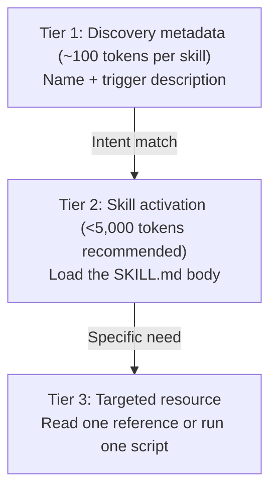

---
{
  "id": "long-context-engineering-beyond-management",
  "title": "Context Engineering",
  "slug": "long-context-engineering-beyond-management",
  "section": "Advanced Agents & Retrieval",
  "category": "LLM Agents & Tool Use",
  "difficulty": "Hard",
  "order": 5,
  "coverImage": "illustrations/_generated/context_engineering_loop_dark.png",
  "companies": [
    "Anthropic",
    "Google",
    "LangChain",
    "Cognition",
    "OpenAI",
    "Chroma"
  ],
  "shortDescription": "An agent can sit inside a 128k window and still chase a disproven hypothesis, so each turn needs focused curation and durable verification state across steps.",
  "keyConceptsTested": [
    "Context engineering vs. context management",
    "Context rot and diminishing token returns",
    "Lost-in-the-middle and attention bias",
    "Needle in a haystack multi-document reasoning",
    "Write, select, compress, isolate taxonomy",
    "Failure modes: poisoning, distraction, confusion, clash",
    "Prompt caching and KV cache economics",
    "Tool-result pruning and output distillation",
    "Sub-agent context isolation",
    "Agent Skills and progressive disclosure",
    "Durable workflow checkpoints and resume verification",
    "Paired curation evaluation and critical-case regressions"
  ],
  "prerequisites": [
    "chain-of-thought-advanced-prompting",
    "function-calling-tool-use-llms"
  ],
  "relatedQuestions": [
    "positional-encoding-rope-alibi",
    "design-production-rag-pipeline",
    "advanced-rag-query-rewriting-self-rag",
    "kv-cache-paged-attention-llm-serving",
    "agent-memory-persistence-patterns"
  ],
  "aliases": [
    "recursive-language-models-rlm"
  ]
}
---

Modern <span data-glossary="context-window">context windows</span> span hundreds of thousands of tokens, yet reasoning accuracy often drops long before the token limit arrives. In an append-only debugging transcript full of raw pytest dumps, unused tool schemas, and early dead ends, relevant facts drown in stale history. **Context management** asks how much text fits before truncation triggers. **Context engineering** asks what exact working set of instructions, code spans, tools, and verified notes gives the model the cleanest signal for the next step.[^anthropic2025effectivecontext][^contexteng_survey2025][^langchain2025contextengineering]

Trace a concrete LLM codebase regression in a Transformer attention repository: `test_kv_rope_slice` fails with `ValueError: causal mask shape (1, 1, 64, 128) does not match score shape (1, 8, 64, 64)`. Earlier in the session, the coding agent suspected a BPE merge edit in `tokenizer.py`, even though `test_bpe_merges` already passed with bit-exact token IDs. Meanwhile, an 8,200-token pytest dump sits between `test_log_17` near the front of the prompt and `diff_summary` in the middle, anchoring the agent to the refuted tokenizer hunch instead of comparing `kv_cache.py:84` with `attention.py:112`.

```checkpoint
How does context engineering differ from basic context management during a long debugging run?
---
Context management enforces hard capacity limits by truncating or sliding windows when tokens run low. Context engineering decides what belongs in the next model call at every turn, removing stale traces and refuted guesses while preserving verified evidence and active tools.
```

## What long-context evaluations reveal

Feeding extra tokens into self-attention spreads probability mass across unhelpful positions and weakens multi-step synthesis. In Chroma's context rot evaluations, retrieval and reasoning accuracy decline smoothly as distracting passages grow, even when the decisive facts sit well inside the advertised window.[^hong2025contextrot]

Positional bias compounds that dilution whenever two clues sit far apart. Stanford's lost-in-the-middle experiments measure a U-shaped recall curve across document depths: accuracy stays high near the opening and closing edges and drops sharply in the middle.[^liu2023lost] Multi-document synthesis degrades even faster than single-needle lookup because the model must link two separated spans (`test_log_17` and `diff_summary`) across noisy text with weak lexical overlap.[^kamradt2023niah]

## Four failure modes in long prompts

Four distinct mechanisms explain why uncurated transcripts fail far below the token limit:[^breunig2025longcontexts]

1. **Context poisoning:** A disproven claim enters history once and keeps reappearing in recaps. An early hunch blaming `tokenizer.py` lingers across turns even after `test_bpe_merges` rules it out.
2. **Context distraction:** Thousands of tokens of unrelated pytest logs pull attention away from `kv_cache.py:84` and `attention.py:112`.
3. **Context confusion:** Off-phase tool definitions (`dataset_shuffler`, `vocab_rebuild`) crowd the schema header and tempt detours when only `diff_lookup` and `symbol_reader` belong in mask triage.
4. **Context clash:** Retrieved text carries conflicting directives (such as a code comment saying "emit CSV" or "regenerate tokenizer files") that fight system instructions. Quote retrieved content as data so it never overrides the required output format.

## The four context moves

Four operations reshape the working set between turns: **write**, **select**, **compress**, and **isolate**.[^langchain2025contextengineering]

<figure>
  
  <figcaption>A crowded 12,436-token raw prompt buries separated evidence behind old pytest noise. Applying Select, Write plus Reload, Compress, and Isolate distills the next turn into 3,346 focused tokens so the model links <code>kv_cache.py:84</code> with <code>attention.py:112</code> directly.</figcaption>
</figure>

### Write: persist state outside the prompt

**Write** saves verified tensor shapes and ruled-out leads outside the active prompt so the host reloads only compact notes when needed.[^langchain2025contextengineering][^letta2026memory] Reloaded notes still count toward input tokens, yet they replace multi-page stack traces while preserving both confirmed facts and negative proofs:

<!-- leetllm: test, output=show -->
```python title="write-durable-findings.py"
# fold:start imports & FindingNote dataclass
from dataclasses import asdict, dataclass


@dataclass(frozen=True)
class FindingNote:
    note_id: str
    claim: str
    status: str
    source_ref: str
    token_estimate: int
# fold:end


def format_reloaded_notes(notes: list[FindingNote], allowed_ids: set[str]) -> tuple[str, int]:
    """Serialize selected findings for prompt injection and report reloaded token cost."""
    selected = [n for n in notes if n.note_id in allowed_ids]
    lines = [f"- [{n.status}] {n.note_id} ({n.source_ref}): {n.claim}" for n in selected]
    return "\n".join(lines), sum(n.token_estimate for n in selected)


# fold:start sample findings store & print driver
if __name__ == "__main__":
    findings_store = [
        FindingNote("kv_mask_shape", "kv_cache.py:84 yields 64 queries against 128 cached keys; mask shape mismatch follows.", "confirmed", "test_log_17", 90),
        FindingNote("bpe_merges_ruled_out", "test_bpe_merges passed with bit-exact token IDs; tokenizer.py is unchanged.", "ruled_out", "ci_tokenizer_suite", 96),
    ]
    payload, reloaded_tokens = format_reloaded_notes(findings_store, {"kv_mask_shape", "bpe_merges_ruled_out"})
    print(f"Reloaded {reloaded_tokens} tokens from external findings store:")
    print(payload)
    print("Archived JSON keys:", list(asdict(findings_store[0]).keys()))
# fold:end
```

<!-- leetllm: output:start -->
```text title="Output" output compact
Reloaded 186 tokens from external findings store:
- [confirmed] kv_mask_shape (test_log_17): kv_cache.py:84 yields 64 queries against 128 cached keys; mask shape mismatch follows.
- [ruled_out] bpe_merges_ruled_out (ci_tokenizer_suite): test_bpe_merges passed with bit-exact token IDs; tokenizer.py is unchanged.
Archived JSON keys: ['note_id', 'claim', 'status', 'source_ref', 'token_estimate']
```
<!-- leetllm: output:end -->

### Select: retrieve evidence and phase tools

**Select** keeps only phase-relevant files, notes, and tools in the next request, placing key traces near the edges and hiding off-phase utilities.[^anthropic2025effectivecontext] Partition items into mandatory evidence (raising a budget error if required items alone overflow) and priority-sorted optional context (skipping oversized optional items to pack smaller lower-priority items that fit):

<!-- leetllm: test, output=show -->
```python title="select-phase-context.py"
# fold:start imports & ContextPiece dataclass
from dataclasses import dataclass


@dataclass(frozen=True)
class ContextPiece:
    name: str
    tokens: int
    required: bool
    priority: int
    phase: str
# fold:end


def pack_for_phase(
    pieces: list[ContextPiece],
    active_phase: str,
    budget: int,
) -> tuple[list[ContextPiece], list[ContextPiece]]:
    """Keep required items first for the active phase, then pack optional evidence by priority."""
    in_phase = [p for p in pieces if p.phase in {active_phase, "all"}]
    required = [p for p in in_phase if p.required]
    required_cost = sum(p.tokens for p in required)
    if required_cost > budget:
        raise ValueError(f"Required items use {required_cost} tokens, exceeding budget {budget}")

    kept = list(required)
    dropped = [p for p in pieces if p not in in_phase]
    remaining = budget - required_cost

    optional = sorted(
        (p for p in in_phase if not p.required),
        key=lambda item: (-item.priority, item.tokens, item.name),
    )
    for item in optional:
        if item.tokens <= remaining:
            kept.append(item)
            remaining -= item.tokens
        else:
            dropped.append(item)
    return kept, dropped


# fold:start candidate items & print driver
if __name__ == "__main__":
    candidates = [
        ContextPiece("kv_rope_bug_report", 180, True, 100, "mask_triage"),
        ContextPiece("kv_mask_trace", 420, True, 95, "mask_triage"),
        ContextPiece("attention_api_spec", 1800, True, 90, "mask_triage"),
        ContextPiece("diff_lookup_tool", 240, True, 88, "mask_triage"),
        ContextPiece("symbol_reader_tool", 260, True, 85, "mask_triage"),
        ContextPiece("kv_mask_shape_note", 90, False, 80, "mask_triage"),
        ContextPiece("dataset_shuffler_tool", 360, False, 40, "data_prep"),
        ContextPiece("old_pytest_dump", 8200, False, 10, "mask_triage"),
    ]
    kept, dropped = pack_for_phase(candidates, active_phase="mask_triage", budget=3500)
    print("Kept:", [(c.name, c.tokens) for c in kept])
    print("Kept total:", sum(c.tokens for c in kept))
    print("Dropped:", [c.name for c in dropped])
# fold:end
```

<!-- leetllm: output:start -->
```text title="Output" output compact
Kept: [('kv_rope_bug_report', 180), ('kv_mask_trace', 420), ('attention_api_spec', 1800), ('diff_lookup_tool', 240), ('symbol_reader_tool', 260), ('kv_mask_shape_note', 90)]
Kept total: 2990
Dropped: ['dataset_shuffler_tool', 'old_pytest_dump']
```
<!-- leetllm: output:end -->

### Compress: prune stale tool outputs and keep negatives

**Compress** replaces older tool outputs in place once their findings are saved, preserving the newest raw turns and original call IDs so provider message ordering stays valid. For dense text passages, perplexity-based pruners like LLMLingua apply the same principle at the token level.[^jiang2023a]

> **Common mistake:** Compressing a tool result down to "checked tokenizer" hides whether the test passed or failed. Always keep explicit negative proofs (`[ruled_out] test_bpe_merges passed`) so later turns do not re-investigate dead leads.

<!-- leetllm: test, output=show -->
```python title="compress-tool-history.py"
# fold:start imports & ToolTurn dataclass
from dataclasses import dataclass


@dataclass
class ToolTurn:
    call_id: str
    tool_name: str
    raw_output: str
    raw_tokens: int
    distilled_summary: str
    finding_recorded: bool
# fold:end


def prune_older_outputs(turns: list[ToolTurn], keep_recent_raw: int = 2) -> list[dict[str, str | int]]:
    """Replace older tool payloads in place once findings are saved, keeping latest raw results."""
    cutoff = max(0, len(turns) - keep_recent_raw)
    curated: list[dict[str, str | int]] = []
    for idx, turn in enumerate(turns):
        if idx < cutoff and turn.finding_recorded:
            curated.append({
                "call_id": turn.call_id, "tool_name": turn.tool_name, "mode": "compressed",
                "content": turn.distilled_summary, "tokens": max(12, len(turn.distilled_summary.split()) * 2),
            })
        else:
            curated.append({
                "call_id": turn.call_id, "tool_name": turn.tool_name, "mode": "raw",
                "content": turn.raw_output, "tokens": turn.raw_tokens,
            })
    return curated


# fold:start sample history & print driver
if __name__ == "__main__":
    history = [
        ToolTurn("c1", "run_pytest", "<8200 tokens of passed suites>", 8200, "test_bpe_merges passed; tokenizer ruled out.", True),
        ToolTurn("c2", "read_trace", "<1400 tokens of kv stack>", 1400, "test_log_17: kv_cache.py:84 uses 64 queries vs 128 keys.", True),
        ToolTurn("c3", "diff_lookup", "attention.py:112 broadcasts causal_mask without seq offset.", 420, "", False),
    ]
    for row in prune_older_outputs(history, keep_recent_raw=1):
        print(f"{row['call_id']} ({row['mode']}, {row['tokens']} tok): {row['content']}")
# fold:end
```

<!-- leetllm: output:start -->
```text title="Output" output compact
c1 (compressed, 12 tok): test_bpe_merges passed; tokenizer ruled out.
c2 (compressed, 16 tok): test_log_17: kv_cache.py:84 uses 64 queries vs 128 keys.
c3 (raw, 420 tok): attention.py:112 broadcasts causal_mask without seq offset.
```
<!-- leetllm: output:end -->

### Isolate: delegate noisy search to focused workers

**Isolate** moves broad exploration (such as sweeping `tokenizer.py` commit history) into a subagent with its own clean window.[^anthropic2025longrunningagents] The coordinator accepts only a byte-capped JSON handoff naming confirmed claims and verified source IDs. Reject oversized payloads before parsing rather than truncating them, and remember that isolation filters attention rather than replacing host verification against the actual sources:

<!-- leetllm: test, output=show -->
```python title="validate-worker-handoff.py"
# fold:start imports & WorkerHandoff dataclass
import json
from dataclasses import dataclass


@dataclass(frozen=True)
class WorkerHandoff:
    claim: str
    source_ids: list[str]
    next_check: str
# fold:end


def parse_handoff(raw_bytes: bytes, verified_sources: set[str], max_bytes: int = 1600) -> tuple[bool, str]:
    """Validate handoff byte size, schema fields, and verified source identifiers."""
    if len(raw_bytes) > max_bytes:
        return False, f"Payload size {len(raw_bytes)} exceeds {max_bytes}-byte limit"
    data = json.loads(raw_bytes.decode("utf-8"))
    if set(data.keys()) != {"claim", "source_ids", "next_check"}:
        return False, f"Unexpected keys: {sorted(data.keys())}"
    handoff = WorkerHandoff(**data)
    if not handoff.claim.strip() or not handoff.next_check.strip():
        return False, "Claim and next_check must be non-empty strings"
    if not handoff.source_ids:
        return False, "At least one source identifier is required"
    unverified = [s for s in handoff.source_ids if s not in verified_sources]
    if unverified:
        return False, f"Unverified sources referenced: {unverified}"
    return True, f"Accepted handoff backed by {handoff.source_ids}"


# fold:start sample handoffs & print driver
if __name__ == "__main__":
    allowed = {"test_log_17", "ci_tokenizer_suite", "diff_summary"}
    good = json.dumps({
        "claim": "test_bpe_merges passes bit-exact; regression sits in attention mask slicing.",
        "source_ids": ["ci_tokenizer_suite", "diff_summary"],
        "next_check": "Compare mask offset indexing in attention.py:112.",
    }).encode("utf-8")
    bad = json.dumps({
        "claim": "Vocab files are corrupted.",
        "source_ids": ["unlisted_scratch_note"],
        "next_check": "Rebuild BPE merges.",
    }).encode("utf-8")
    print("Good:", parse_handoff(good, allowed))
    print("Bad:", parse_handoff(bad, allowed))
# fold:end
```

<!-- leetllm: output:start -->
```text title="Output" output compact
Good: (True, "Accepted handoff backed by ['ci_tokenizer_suite', 'diff_summary']")
Bad: (False, "Unverified sources referenced: ['unlisted_scratch_note']")
```
<!-- leetllm: output:end -->

### Prompt caching and KV prefix stability

Provider <span data-glossary="kv-cache">KV prefix caches</span> reuse prefill tensors strictly from token 0 up to the first mismatched token.[^anthropic2026promptcaching][^openai2026promptcaching] Keep static system rules, tool headers, and long API specs at the front, and append per-turn trace IDs and reloaded notes at the end:

<!-- leetllm: test, deps=numpy, output=show -->
```python title="measure-kv-prefix-reuse.py"
import numpy as np

def shared_prefix_length(previous_tokens: np.ndarray, current_tokens: np.ndarray) -> int:
    """Return the exact token prefix length eligible for KV cache reuse."""
    limit = min(previous_tokens.size, current_tokens.size)
    mismatch = np.flatnonzero(previous_tokens[:limit] != current_tokens[:limit])
    return int(mismatch[0]) if mismatch.size else limit

# fold:start token layout comparison
if __name__ == "__main__":
    system_prompt = np.arange(0, 80, dtype=np.int64)
    api_spec = np.arange(1_000, 1_240, dtype=np.int64)
    turn1_query = np.arange(5_000, 5_016, dtype=np.int64)
    turn2_query = np.arange(6_000, 6_016, dtype=np.int64)

    volatile_first_a = np.concatenate([system_prompt, turn1_query, api_spec])
    volatile_first_b = np.concatenate([system_prompt, turn2_query, api_spec])
    stable_first_a = np.concatenate([system_prompt, api_spec, turn1_query])
    stable_first_b = np.concatenate([system_prompt, api_spec, turn2_query])

    print("Volatile-first shared prefix:", shared_prefix_length(volatile_first_a, volatile_first_b))
    print("Stable-first shared prefix:", shared_prefix_length(stable_first_a, stable_first_b))
# fold:end
```

<!-- leetllm: output:start -->
```text title="Output" output compact
Volatile-first shared prefix: 80
Stable-first shared prefix: 320
```
<!-- leetllm: output:end -->

> **Key insight:** Both layouts send the exact same total tokens (336), yet placing the volatile 16-token query ahead of the 240-token spec cuts KV cache reuse from 320 tokens down to 80.

## Rebuilding the working set for a KV-cache bug

Running complete token accounting on the `test_kv_rope_slice` debugging window makes the savings concrete. Dropping the 8,200-token pytest dump, two off-phase tools, raw logs, and the disproven BPE hunch while reloading 186 tokens of structured notes shrinks the next call from 12,436 tokens to 3,346 tokens (73.1% smaller).

<figure>
  
  <figcaption>A single curation pass cuts 12,436 raw tokens down to 3,346 tokens (73.1% smaller). Notice that the two external findings add 186 reloaded tokens back into the budget so verified shapes and negative BPE proof remain explicit.</figcaption>
</figure>

<!-- leetllm: test, output=show -->
```python title="kv-mask-context-curation.py"
# fold:start imports & WindowEntry dataclass
from dataclasses import dataclass


@dataclass(frozen=True)
class WindowEntry:
    name: str
    tokens: int
    action: str  # "keep", "reload_note", or "omit"
    reason: str
# fold:end


def summarize_curation_pass(entries: list[WindowEntry]) -> dict[str, int | float]:
    raw_total = sum(e.tokens for e in entries if e.action != "reload_note")
    kept_active = sum(e.tokens for e in entries if e.action == "keep")
    reloaded = sum(e.tokens for e in entries if e.action == "reload_note")
    next_call = kept_active + reloaded
    net_saved = raw_total - next_call
    return {
        "raw_total": raw_total, "kept_active": kept_active, "reloaded_notes": reloaded,
        "next_call": next_call, "net_saved": net_saved, "pct_saved": round((net_saved / raw_total) * 100.0, 1),
    }


# fold:start window inventory & print driver
if __name__ == "__main__":
    entries = [
        WindowEntry("kv_rope_bug_report", 180, "keep", "Active failing test description"),
        WindowEntry("kv_mask_trace", 420, "keep", "test_kv_rope_slice error trace"),
        WindowEntry("attention_api_spec", 1800, "keep", "kv_cache and attention mask spec"),
        WindowEntry("scratchpad", 260, "keep", "Working hypothesis and next step"),
        WindowEntry("diff_lookup", 240, "keep", "Phase tool for inspecting attention.py"),
        WindowEntry("symbol_reader", 260, "keep", "Phase tool for reading kv_cache.py"),
        WindowEntry("kv_mask_shape_note", 90, "reload_note", "Confirmed 64 vs 128 slice mismatch"),
        WindowEntry("bpe_ruled_out_note", 96, "reload_note", "Ruled out tokenizer.py BPE change"),
        WindowEntry("old_pytest_dump", 8200, "omit", "Replaced by passing suite note"),
        WindowEntry("dataset_shuffler", 360, "omit", "Unrelated preprocessing tool"),
        WindowEntry("vocab_rebuild", 410, "omit", "Off-phase tokenizer tool"),
        WindowEntry("disproven_bpe_claim", 120, "omit", "Poisoned guess refuted by tests"),
        WindowEntry("raw_merge_logs", 186, "omit", "Verbose raw logs distilled to notes"),
    ]
    for key, value in summarize_curation_pass(entries).items():
        print(f"{key}: {value}")
# fold:end
```

<!-- leetllm: output:start -->
```text title="Output" output compact
raw_total: 12436
kept_active: 3160
reloaded_notes: 186
next_call: 3346
net_saved: 9090
pct_saved: 73.1
```
<!-- leetllm: output:end -->

When purging a disproven hypothesis, scan remaining assistant recaps as well so lingering mentions outside `[ruled_out]` notes cannot pull later turns back into `tokenizer.py`:

<!-- leetllm: test, output=show -->
```python title="guard-poison-removal.py"
def contains_poisoned_claim(messages: list[dict[str, str]], forbidden_phrase: str) -> list[int]:
    """Return message indices still echoing a disproven claim outside explicit ruled-out notes."""
    target = forbidden_phrase.lower()
    return [
        idx for idx, msg in enumerate(messages)
        if target in msg["content"].lower() and "[ruled_out]" not in msg["content"].lower()
    ]


# fold:start clean vs polluted window test
if __name__ == "__main__":
    clean_window = [
        {"role": "system", "content": "Diagnose test_kv_rope_slice mask shape failure."},
        {"role": "assistant", "content": "[ruled_out] tokenizer.py BPE merge hypothesis rejected by test_bpe_merges."},
        {"role": "user", "content": "Compare kv_cache.py:84 and attention.py:112 slice shapes."},
    ]
    polluted_window = clean_window + [
        {"role": "assistant", "content": "Recap: investigate tokenizer.py BPE merge regression next."},
    ]
    print("Clean window poison hits:", contains_poisoned_claim(clean_window, "bpe merge"))
    print("Polluted window poison hits:", contains_poisoned_claim(polluted_window, "bpe merge"))
# fold:end
```

<!-- leetllm: output:start -->
```text title="Output" output compact
Clean window poison hits: []
Polluted window poison hits: [3]
```
<!-- leetllm: output:end -->

## Diagnosing context thrashing

When compaction summaries omit key identifiers (such as `test_kv_rope_slice` or `attention.py:112`), an agent loops through repeated lookups without advancing. If an investigation executes 6 curation operations while completing 0 real steps, dividing operations by completed steps breaks or masks the stall. Log raw counters (`operations=6, completed_steps=0`), mark the run stalled, pin entity identifiers in structured state outside prose summaries, and cap retries. If a network error leaves an external write without a reply during recovery, query status under the original idempotency key rather than firing a duplicate write with a fresh key.

```checkpoint
Why should compaction always pin entity identifiers and ruled-out findings inside structured slots?
---
Free-form summarization easily drops exact symbols, file paths, or negative findings such as which hypothesis already failed. Pinning identifier slots outside prose prevents the agent from re-fetching the same diff logs or restarting rejected lines of inquiry.
```

## Progressive disclosure and Agent Skills

Copying every specialized debugging playbook into the global system prompt inflates tokens and causes tool confusion. An **Agent Skill** keeps base prompts lean by packaging one procedure inside a directory (`SKILL.md`, optional `references/`, `scripts/`, and `evals/`) loaded lazily through **progressive disclosure**:[^agentskills2026][^anthropic2026agentskills]



1. **Tier 1 (Discovery metadata):** Only each skill's name and short trigger description load at startup.
2. **Tier 2 (Skill activation):** On intent match, the host injects the concise `SKILL.md` body into context.
3. **Tier 3 (Targeted resources):** Reference docs (`references/handoff-schema.md`) load only when opened; helper scripts (`scripts/validate-handoff.py`) execute on disk so only their compact console output enters the token budget, not their source code.[^agentskills2026][^anthropic2026agentskills]

```markdown title="attention-diff-triage/SKILL.md"
---
name: attention-diff-triage
description: Diagnose Transformer attention mask, KV cache, and RoPE slicing failures from diffs and pytest traces.
---

# Attention diff triage procedure

1. Read the failing test description and targeted pytest stack trace.
2. Load only debugging tools (`diff_lookup`, `symbol_reader`).
3. Write confirmed shapes and ruled-out hypotheses into the external findings store.
4. Read `references/handoff-schema.md` before spawning an isolated tokenizer subagent.
5. Run `scripts/validate-handoff.py` before writing the patch plan.
```

Evaluate trigger routing separately (true positives like attention mask failures vs. intentional non-activations like changelog formatting). Remember that progressive disclosure controls *prompt inclusion*, never permissions: host <span data-glossary="acl">access controls</span> still govern file writes and tool execution independently of skill activation.

## Resumable workflows and durable checkpoints

Long debugging runs span restarts and timeouts, and repository files or acceptance criteria can change while paused.[^anthropic2025longrunningagents][^anthropic2026harnessdesign] Split work into stages (`collect-traces` -> `verify-mask-cause` -> `write-patch-plan`) and save SHA-256 verification records tying each stage output to its exact input dependency digests. Frameworks like <span data-glossary="langgraph">LangGraph</span> persist checkpoints across restarts,[^langgraph2026memory] while digest checks detect stale assumptions automatically:

<!-- leetllm: test, output=show -->
```python title="durable-workflow-checkpoints.py"
# fold:start imports, hash helper & dataclasses
import hashlib
from dataclasses import dataclass, field


def sha256_text(text: str) -> str:
    return hashlib.sha256(text.encode("utf-8")).hexdigest()[:16]


@dataclass(frozen=True)
class PhaseArtifact:
    artifact_id: str
    content: str
    depends_on: list[str] = field(default_factory=list)


@dataclass(frozen=True)
class VerificationRecord:
    artifact_id: str
    artifact_hash: str
    input_hashes: dict[str, str]
    passed: bool
# fold:end


class CheckpointStore:
    def __init__(self, artifacts: dict[str, PhaseArtifact], records: dict[str, VerificationRecord]):
        self.artifacts = artifacts
        self.records = records

    def is_step_current(self, step_id: str, current_files: dict[str, str]) -> tuple[bool, str]:
        artifact = self.artifacts.get(step_id)
        record = self.records.get(step_id)
        if artifact is None or record is None or not record.passed:
            return False, f"Missing passing artifact/record for {step_id}"
        if sha256_text(artifact.content) != record.artifact_hash:
            return False, f"Artifact {step_id} content changed after verification"
        if set(record.input_hashes.keys()) != set(artifact.depends_on):
            return False, f"Dependency list changed for {step_id}"
        for dep_id in artifact.depends_on:
            if dep_id not in current_files:
                return False, f"Missing current dependency {dep_id}"
            if record.input_hashes.get(dep_id) != sha256_text(current_files[dep_id]):
                return False, f"Input {dep_id} modified since verification"
        return True, f"Step {step_id} verified and current"


# fold:start dependency-change test & prints
if __name__ == "__main__":
    spec_v1 = "Check mask slice for q=64, k=128 in test_kv_rope_slice."
    spec_v2 = "Check mask slice for q=64, k=128 and variable batch size in test_kv_rope_slice."
    diagnosis = "Confirmed attention.py:112 slice offset omits KV offset."

    artifacts = {"verify-mask-cause": PhaseArtifact("verify-mask-cause", diagnosis, depends_on=["acceptance_spec"])}
    records = {
        "verify-mask-cause": VerificationRecord(
            "verify-mask-cause", sha256_text(diagnosis), {"acceptance_spec": sha256_text(spec_v1)}, True,
        ),
    }
    store = CheckpointStore(artifacts, records)
    print("With spec_v1:", store.is_step_current("verify-mask-cause", {"acceptance_spec": spec_v1}))
    print("With spec_v2:", store.is_step_current("verify-mask-cause", {"acceptance_spec": spec_v2}))
# fold:end
```

<!-- leetllm: output:start -->
```text title="Output" output compact
With spec_v1: (True, 'Step verify-mask-cause verified and current')
With spec_v2: (False, 'Input acceptance_spec modified since verification')
```
<!-- leetllm: output:end -->

When `acceptance_spec` changes from `spec_v1` to `spec_v2`, the checkpoint store invalidates `verify-mask-cause` so the resumed run re-verifies against the updated spec and saves a fresh digest record rather than reusing stale confirmation.

## Evaluating context curation policies

Shorter prompts help only when accuracy holds or improves with zero regressions on critical tasks. Compare raw and curated windows on paired benchmark runs across pass count, total tokens, stale-claim hits, and protected critical cases:

<!-- leetllm: test, output=show -->
```python title="paired-curation-eval.py"
# fold:start imports & EvalCase dataclass
from dataclasses import dataclass


@dataclass(frozen=True)
class EvalCase:
    case_id: str
    critical: bool
    raw_passed: bool
    curated_passed: bool
    raw_tokens: int
    curated_tokens: int
    curated_poison_hits: int
# fold:end


def evaluate_curation(cases: list[EvalCase]) -> dict[str, object]:
    raw_wins = sum(1 for c in cases if c.raw_passed)
    curated_wins = sum(1 for c in cases if c.curated_passed)
    raw_tok = sum(c.raw_tokens for c in cases)
    curated_tok = sum(c.curated_tokens for c in cases)
    poison_total = sum(c.curated_poison_hits for c in cases)
    critical_failures = [c.case_id for c in cases if c.critical and not c.curated_passed]
    approved = (
        curated_wins >= raw_wins and curated_tok < raw_tok
        and poison_total == 0 and len(critical_failures) == 0
    )
    return {
        "approved": approved, "raw_wins": raw_wins, "curated_wins": curated_wins,
        "token_saving_pct": round(((raw_tok - curated_tok) / raw_tok) * 100.0, 1),
        "poison_hits": poison_total, "critical_failures": critical_failures,
    }


# fold:start paired eval suite & print driver
if __name__ == "__main__":
    suite = [
        EvalCase("kv_rope_mask_slice", True, True, True, 12436, 3346, 0),
        EvalCase("kv_broadcast_head", False, False, True, 11200, 3100, 0),
        EvalCase("rope_cache_offset", True, True, False, 9800, 2900, 0),
    ]
    print("With critical failure:", evaluate_curation(suite))
    repaired = suite[:-1] + [EvalCase("rope_cache_offset", True, True, True, 9800, 3050, 0)]
    print("After critical repair:", evaluate_curation(repaired))
# fold:end
```

<!-- leetllm: output:start -->
```text title="Output" output compact
With critical failure: {'approved': False, 'raw_wins': 2, 'curated_wins': 2, 'token_saving_pct': 72.0, 'poison_hits': 0, 'critical_failures': ['rope_cache_offset']}
After critical repair: {'approved': True, 'raw_wins': 2, 'curated_wins': 3, 'token_saving_pct': 71.6, 'poison_hits': 0, 'critical_failures': []}
```
<!-- leetllm: output:end -->

In the first run, overall tokens drop 72.0% and `kv_broadcast_head` flips to a pass, yet the single critical regression on `rope_cache_offset` blocks release until fixed.

Effective context engineering treats the prompt as a curated working set rather than an append-only log: persist verified facts and negative proofs externally, load tools and skills lazily, keep static prefixes cache-aligned, verify resumed checkpoints by digest, and ship pruning rules only after paired evaluations clear zero critical regressions.

```mastery-quiz
[
  {
    "question": "An agent debugging test_kv_rope_slice keeps proposing edits to tokenizer.py even though test_bpe_merges already passed. Meanwhile a retrieved code comment instructs the planner to emit CSV instead of the application's required JSON output. How should the prompt builder prepare the next request?",
    "options": [
      "Remove the stale tokenizer hypothesis and its recaps, reload a verified ruled-out note, quote the retrieved comment as plain data, and require JSON.",
      "Keep the stale tokenizer hypothesis alongside a correction note, and switch the reply format to CSV to match the code comment.",
      "Remove the stale tokenizer hypothesis and its recaps, reload a verified ruled-out note, and switch the reply format to CSV.",
      "Keep the stale tokenizer hypothesis in full history so the model remembers its earlier reasoning, while quoting the comment as data in JSON."
    ],
    "answer": "Remove the stale tokenizer hypothesis and its recaps, reload a verified ruled-out note, quote the retrieved comment as plain data, and require JSON.",
    "explanation": "Repeating a disproven claim across recaps causes context poisoning. Deleting the stale hypothesis and replacing it with a concise ruled-out finding stops the model from drifting back into tokenizer.py. Treating retrieved instructions inside code comments as quoted data instead of system directives prevents context clash with the JSON output format."
  },
  {
    "question": "On a fixed 20-question evaluation set, moving a key trace from the start of the window to the middle drops single-fact pass count from 18/20 to 12/20, while a two-clue synthesis set scores 9/20. Which conclusion follows accurately?",
    "options": [
      "Middle placement lowered accuracy by 6 percentage points; two-clue synthesis scored 45%; the same drop holds across comparable setups.",
      "Middle placement lowered accuracy by 30 percentage points; two-clue synthesis scored 45%; the result applies to this model and setup.",
      "Middle placement lowered accuracy by 6 percentage points; two-clue synthesis scored 60%; the result applies to this model and setup.",
      "Middle placement lowered accuracy by 30 percentage points; two-clue synthesis scored 60%; the same drop holds across comparable setups."
    ],
    "answer": "Middle placement lowered accuracy by 30 percentage points; two-clue synthesis scored 45%; the result applies to this model and setup.",
    "explanation": "Success fell from 90% (18/20) to 60% (12/20), which is a 30-percentage-point drop rather than 6 points. The synthesis task scored 9/20 = 45%. Because only one model and evaluation suite ran, generalizing the exact numbers to unseen models is unsupported."
  },
  {
    "question": "A context packer has a 3,000-token budget. Required items R (400) and S (700) must fit first. Optional items A (1,400, priority 9), B (600, priority 8), and C (400, priority 7) compete for remaining space. What does the greedy packer select, and what happens on a second run where one required item needs 3,100 tokens?",
    "options": [
      "Pack R, S, A, and C (2,900 tokens); return an empty selection on the second run.",
      "Pack R, S, A, and C (2,900 tokens); raise a budget error on the second run.",
      "Pack R, S, and A (2,500 tokens); raise a budget error on the second run.",
      "Pack R, S, and A (2,500 tokens); return an empty selection on the second run."
    ],
    "answer": "Pack R, S, A, and C (2,900 tokens); raise a budget error on the second run.",
    "explanation": "Required items R and S consume 1,100 tokens. Adding highest-priority optional item A (1,400) brings usage to 2,500, leaving 500 tokens. B needs 600 tokens and does not fit, so the packer skips B and takes C (400) for a total of 2,900 tokens. On the second run, silently returning an empty list hides a critical input, so exceeding the 3,000-token limit must raise an error."
  },
  {
    "question": "Assume exact token reuse up to the first mismatched token. A fixed root instruction spans 120 tokens, a per-request trace ID spans 24 tokens with different first tokens per call, and an unchanging API spec spans 360 tokens. Compare ordering root -> trace_id -> spec against root -> spec -> trace_id. What are the reusable prefix lengths and total tokens sent per call?",
    "options": [
      "Reusable prefix: 120 then 480; total tokens sent: 120 then 480.",
      "Reusable prefix: 0 then 360; total tokens sent: 504 then 504.",
      "Reusable prefix: 0 then 360; total tokens sent: 120 then 480.",
      "Reusable prefix: 120 then 480; total tokens sent: 504 then 504."
    ],
    "answer": "Reusable prefix: 120 then 480; total tokens sent: 504 then 504.",
    "explanation": "When the changing trace ID sits directly after the 120-token root, prefix caching breaks at token 120. Placing the static 360-token spec before the trace ID extends the matched prefix to 120 + 360 = 480 tokens. In both orderings, the complete request still contains all 120 + 24 + 360 = 504 tokens."
  },
  {
    "question": "Five consecutive tool calls indexed 0 through 4 have recorded_finding flags [false, true, true, true, false]. The pruning rule preserves the newest two results raw in case details are still needed. Which earlier payloads can safely be compressed in place, and how should they be stored?",
    "options": [
      "Compress results 1 and 2 in place while preserving their original call IDs.",
      "Compress results 0, 1, and 2 in place while preserving their original call IDs.",
      "Append summaries for results 0, 1, and 2 at the end under new call IDs.",
      "Append summaries for results 1 and 2 at the end under new call IDs."
    ],
    "answer": "Compress results 1 and 2 in place while preserving their original call IDs.",
    "explanation": "Preserving the latest two tool payloads keeps indices 3 and 4 raw. Among indices 0, 1, and 2, only calls 1 and 2 have verified findings saved in the external findings store; compressing call 0 would erase unrecorded data. Editing payloads in place preserves tool-call ordering and avoids dangling call IDs."
  },
  {
    "question": "A subagent returns a 1,590-byte UTF-8 JSON handoff containing claim, source_ids ['test_log_17'], and next_check, whereas test_log_17 actually contradicts that claim. A second otherwise valid handoff arrives at 1,610 bytes under a 1,600-byte limit. How should the coordinator handle both payloads?",
    "options": [
      "Reject the first at schema parsing because test_log_17 contradicts the claim; reject the second for exceeding 1,600 bytes.",
      "Reject the first at schema parsing; trim the second down to 1,600 bytes before parsing.",
      "Pass schema checks on the first then reject its claim after checking test_log_17; reject the second before decoding.",
      "Pass schema checks on the first then reject its claim after checking test_log_17; trim the second to 1,600 bytes."
    ],
    "answer": "Pass schema checks on the first then reject its claim after checking test_log_17; reject the second before decoding.",
    "explanation": "The first payload fits within 1,600 bytes and satisfies every structural check, so schema parsing succeeds and passes control to source verification, which detects the contradiction. The second payload breaks the byte limit and must be rejected unparsed rather than silently truncated."
  },
  {
    "question": "An Agent Skills runtime advertises eight skills whose discovery metadata costs 75 tokens each. For one request, the runtime activates one 1,800-token SKILL.md body, opens a 350-token reference doc, and executes a validation script whose source file is 900 tokens on disk and produces 90 tokens of console output. How many tokens enter the model context, and does activation automatically grant file-write permissions?",
    "options": [
      "2,840 tokens added; skill activation grants file-write permissions directly.",
      "3,740 tokens added; runtime permission checks remain independent of skill activation.",
      "3,740 tokens added; skill activation grants file-write permissions directly.",
      "2,840 tokens added; runtime permission checks remain independent of skill activation."
    ],
    "answer": "2,840 tokens added; runtime permission checks remain independent of skill activation.",
    "explanation": "Eight metadata headers use 600 tokens. Activating the body (1,800), reading the reference (350), and receiving console output (90) total 600 + 1,800 + 350 + 90 = 2,840 tokens, because script source code stays on disk. Prompt loading controls text selection, while host runtime rules continue enforcing write permissions."
  },
  {
    "question": "A saved verification record certifies that module diagnosis A passed against source file S1 and draft spec I1. Before resuming after a crash, the team updates draft spec I1 to final spec I2 while keeping module A and S1 identical. What action allows the resumed run to proceed safely?",
    "options": [
      "Verify that A and S1 match their previously stored SHA-256 digests and reuse the saved pass.",
      "Re-run verification of A against S1 and current spec I2 and store an updated passing record tied to those digests.",
      "Update the dependency list size count and log the filename transition from I1 to I2.",
      "Overwrite the saved digest of I1 inside the old JSON record with the digest of I2."
    ],
    "answer": "Re-run verification of A against S1 and current spec I2 and store an updated passing record tied to those digests.",
    "explanation": "The stored record only certifies compatibility under I1. Checking older hashes confirms S1 stayed intact, not that A satisfies I2. Re-verifying against the active inputs prevents resuming from stale confirmation."
  },
  {
    "question": "In a paired evaluation of 20 debugging cases, the uncurated window solves 13 tasks at 6,000 tokens per case. Curated context solves 16 tasks at 4,200 tokens with zero stale claims, except one protected regression case fails. Fixing that regression brings curated passes to 17 at 4,200 tokens. What should the evaluation check decide before and after the fix, and how much input is saved?",
    "options": [
      "Reject before the fix, approve after; token reduction is 30%.",
      "Approve before and after the fix; the token reduction is 30%.",
      "Reject before and after the fix; the token reduction is 70%.",
      "Reject before the fix, approve after; token reduction is 70%."
    ],
    "answer": "Reject before the fix, approve after; token reduction is 30%.",
    "explanation": "Before the fix, the single broken protected regression blocks release despite higher overall wins and lower cost. After repairing that case, 17 wins beat 13, zero protected failures remain, stale claims stay at zero, and tokens drop by 1,800 out of 6,000 (30%)."
  },
  {
    "question": "After six curation turns on test_kv_rope_slice, an agent logs zero completed verification steps because every compaction summary omitted 'test_kv_rope_slice', forcing repeated trace lookups. Meanwhile a network hiccup left an external issue-update POST without a confirmation reply. What should recovery do?",
    "options": [
      "Re-fetch the test_kv_rope_slice trace whenever summaries omit it, keep retries unbounded, and retry the POST with a new key.",
      "Log 6 ops / 0 steps as stalled, pin test_kv_rope_slice in structured state, and retry the POST with a fresh key directly.",
      "Log 6 ops / 0 steps as stalled, pin test_kv_rope_slice in structured state, and query the tracker with the original key.",
      "Keep polling trace lookups on timeout while immediately querying the tracker under the original key before acting."
    ],
    "answer": "Log 6 ops / 0 steps as stalled, pin test_kv_rope_slice in structured state, and query the tracker with the original key.",
    "explanation": "Zero completed steps leaves cost per step undefined and requires explicit stall logging plus pinning test_kv_rope_slice outside prose summaries alongside capped retries. Retrying a network-uncertain write under a new key risks duplicate side effects, so checking status under the original key first avoids duplicated updates."
  }
]
```

> **Next:** Continue to [Agent Memory & Persistence](/learn/agent-memory-persistence-patterns).
