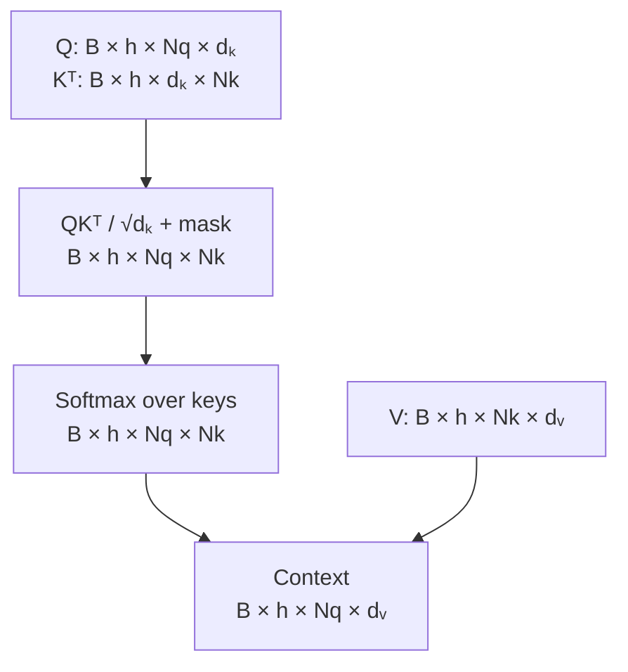

---
{
  "id": "scaled-dot-product-attention",
  "title": "Scaled Dot-Product Attention",
  "slug": "scaled-dot-product-attention",
  "category": "Transformer Architecture",
  "difficulty": "Hard",
  "coverImage": "social_banner.png",
  "companies": [
    "Google",
    "Meta",
    "OpenAI",
    "Anthropic",
    "Microsoft",
    "NVIDIA"
  ],
  "shortDescription": "Each token mixes content from positions it may read. The score scale, the mask, and the memory traffic decide whether that mix stays usable.",
  "prerequisites": [
    "embeddings-cosine-dot-product-quantization"
  ],
  "keyConceptsTested": [
    "Scaled dot-product attention formula derivation",
    "Q/K/V projections and their roles (routing vs content)",
    "Variance proof for √d_k scaling factor",
    "Three attention types: bidirectional, causal, cross",
    "Multi-head attention: parallel subspaces, same asymptotic attention FLOPs",
    "Multi-head routing capacity without assumed head interpretations",
    "Single-head vs full multi-head attention complexity",
    "Training vs inference bottlenecks: score matrix vs KV cache bandwidth",
    "MQA/GQA: shrinking KV-cache traffic and measuring decode trade-offs",
    "FlashAttention: IO-aware tiling with O(n) auxiliary attention state",
    "Softmax numerical stability (max-shift technique)",
    "Gradients through attention scores and values"
  ],
  "section": "Transformer Deep Dives",
  "order": 3
}
---

A retriever compares a query <span data-glossary="embedding">embedding</span> against stored key vectors with cosine similarity or a <span data-glossary="dot-product">dot product</span> to decide which passages deserve high weight. A <span data-glossary="transformer">transformer</span> layer runs that same routing operation across every position in a sequence: each <span data-glossary="token">token</span> emits a query asking what context it needs, a key advertising what it holds, and a value carrying the content to mix. Scaled dot-product attention computes all pairwise compatibilities with <span data-glossary="matrix">matrix</span> multiplication, turns each row of scores into probability weights, and blends the chosen value vectors.

To make every number concrete, take the sentence “Birds in the garden sing softly at dawn” and zoom in on the two-token slice “Birds sing.” When updating its own representation, “sing” can draw context from the subject “Birds” while still weighting its own state. A <span data-glossary="causal-mask">causal mask</span> prevents earlier tokens from reading future ones by setting future-key logits to $-\infty$ before softmax, giving them zero weight. Because masking answers legality while dot products measure relevance, we will compute the unmasked two-token pass by hand first and add the causal mask right after.

<figure>
  
  <figcaption>The two-token slice “Birds sing” makes one causal attention pass visible. The mask restricts Birds to its own value, while sing blends both values into [1.42, 1.58]. Query and key projections determine the weights, and value projections provide the vectors being mixed.</figcaption>
</figure>

---

## Three views of one token

<span data-glossary="self-attention">Self-attention</span> computes a dynamic, weighted mix of token representations in which each query gets its weights from learned relevance scores against the keys.[^vaswani2017] Using raw dot products $X X^T$ forces the same features both to request context and to offer it, whereas learned projections decouple the compatibility score from the content transferred between tokens. Those projections transform existing hidden states rather than conjuring information about unseen positions. Even when raw scores happen to be symmetric, **row-softmax weights do not have to be symmetric**: every query row normalizes by its own denominator, and a causal mask blocks forward edges, so “Birds” and “sing” rarely attend equally to one another.

Three learned linear transformations separate those responsibilities cleanly:

| Vector | Question it answers | Role in attention |
|--------|---------------------|-------------------|
| Query (Q) | What context does this position need? | Vector used to score possible source positions |
| Key (K) | When should another position read me? | Vector compared with each query |
| Value (V) | What information do I contribute if selected? | Content payload mixed into the receiver's representation |

Each token hidden state $x_i$ is projected three ways. $W_Q$ and $W_K$ produce vectors for scoring compatibility. $W_V$ produces the content to mix:

$$
Q = XW_Q, \quad K = XW_K, \quad V = XW_V
$$

Here $W_Q, W_K \in \mathbb{R}^{d_{\text{model}} \times d_k}$ and $W_V \in \mathbb{R}^{d_{\text{model}} \times d_v}$, where $d_{\text{model}}$ is the residual stream width and $d_k, d_v$ are the query/key and value widths.[^vaswani2017] In general the learned bilinear form $x_i W_Q W_K^T x_j^T$ is asymmetric, although particular projections such as $W_Q = I$ and $W_K = 2I$ still produce symmetric raw scores before row-wise softmax breaks the tie:

<!-- leetllm: test, output=show -->
```python title="symmetric-scores-need-not-give-symmetric-weights.py"
import math

X = [[1.0, 0.0], [1.0, 1.0]]
scores = [[sum(a * b for a, b in zip(x, y)) for y in X] for x in X]

def softmax(row):
    exps = [math.exp(x - max(row)) for x in row]
    return [x / sum(exps) for x in exps]

weights = [softmax(row) for row in scores]
# W_Q = I and W_K = 2I are unequal, yet the raw score matrix stays symmetric.
unequal_projection_scores = [[2 * s for s in row] for row in scores]
print("raw scores symmetric:", scores[0][1] == scores[1][0])
print("opposite weights:", round(weights[0][1], 6), round(weights[1][0], 6))
print("unequal projections, symmetric scores:",
      unequal_projection_scores[0][1] == unequal_projection_scores[1][0])
```

<!-- leetllm: output:start -->
```text title="Output" output compact
raw scores symmetric: True
opposite weights: 0.5 0.268941
unequal projections, symmetric scores: True
```
<!-- leetllm: output:end -->

For the running example, token **Birds** uses these toy vectors after projection:

| Role | Vector |
|---|---|
| Query $q$ | $[1.0,\ 0.5]$ |
| Key $k$ | $[0.8,\ 0.2]$ |
| Value $v$ | $[2.0,\ 1.0]$ |

Notice how cleanly the three vectors split labor in the diagram below: $q$ and $k$ meet to score compatibility ($q \cdot k = 0.90$), while $v$ bypasses the score calculation and waits to be mixed by the resulting weights.

<figure>
  
  <figcaption>The same hidden state is projected three ways. For token Birds, query and key meet at the 0.90 self-score used in the walkthrough, while value stays the content vector that attention weights later mix.</figcaption>
</figure>

Separating routing ($Q$ and $K$) from content ($V$) lets an attention layer look up relevant positions in one subspace while extracting a different linear combination of features in another. Queries and keys determine *where* weight lands through their <span data-glossary="dot-product">dot products</span>, and values determine *what* content passes forward once softmax normalizes those weights.

```checkpoint
In one sentence, which tensors choose where attention goes, and which tensor carries content?
---
Q and K choose where attention goes. Their dot products produce routing scores that softmax converts into weights. V carries the content that gets mixed by those weights.
```

---

## The core formula

Read the formula as a lookup followed by a weighted read. Compatibility of queries with keys becomes weights; those weights mix values.[^vaswani2017] <span data-glossary="softmax">Softmax</span> turns each query row into non-negative weights that sum to 1:

$$
\text{Attention}(Q, K, V) = \text{softmax}\left(\frac{QK^T}{\sqrt{d_k}}\right) V
$$

When some key positions are disallowed, add a mask matrix $M$ right after scaling, setting $M_{ij}=0$ for visible keys and $M_{ij}=-\infty$ for blocked keys:

$$
\text{Attention}(Q, K, V; M) = \text{softmax}\left(\frac{QK^T}{\sqrt{d_k}} + M\right)V
$$

Because every valid softmax row produces non-negative weights that sum to one, each query's attention output lies inside the convex hull of the visible value vectors. (Later sections cover how attention-weight dropout, residual addition, and invalid all-masked rows modify that baseline behavior.)

### Step by step

| Step | Operation | What it means |
|------|-----------|---------------|
| Compute scores | $S = QK^T$ | Build one score for each of the $N_q \times N_k$ query-key pairs. |
| Scale | $L = S / \sqrt{d_k}$ | Counter width-dependent score growth under the assumptions derived below. |
| Mask | $Z = L + M$ | Add $0$ for allowed keys and $-\infty$ for blocked keys. |
| Normalize | $\alpha_{ij} = \frac{\exp(Z_{ij})}{\sum_r \exp(Z_{ir})}$ | Turn each active query row into weights that sum to 1. |
| Aggregate | $\alpha \cdot V$ | Blend value vectors according to the attention weights. |

The execution order is fixed: scores select positions, masking and softmax turn each row into a probability distribution, and only then do those normalized weights combine $V$. In the <span data-glossary="tensor-shape">shape flow</span> below, $B$ is batch size, $h$ is head count, $N_q$ and $N_k$ are query and key lengths, $d_k$ is the shared query/key width, and $d_v$ is the value width (which does not have to equal $d_k$). Queries and keys build one $N_q \times N_k$ routing matrix per head, and multiplying by $V$ carries width $d_v$ straight into the context output:



<figure>
  
  <figcaption>Tokens Birds and sing pass through one attention step: $QK^T$ gives raw scores, dividing by $\sqrt{2}$ scales them into logits, row softmax turns the sing row into a distribution, and multiplying by $V$ produces the mixed output vectors.</figcaption>
</figure>

### A trace with real numbers

Walk through **Birds** and **sing** without a mask first. Each uses 2-dimensional toy projections:

| Token | Query vector | Key vector | Value vector |
|---|---|---|---|
| Birds | [1.0, 0.5] | [0.8, 0.2] | [2.0, 1.0] |
| sing | [0.5, 1.0] | [0.3, 0.9] | [1.0, 2.0] |

#### Step 1: raw scores, scaling, and softmax

Multiplying $Q$ by $K^T$ scores every query-key pair, dividing by $\sqrt{d_k} = \sqrt{2} \approx 1.414$ stabilizes score magnitude, and normalizing each row turns those logits into weights that sum to 1:

$$
\begin{aligned}
S = QK^T &= \begin{bmatrix}
1.0 \cdot 0.8 + 0.5 \cdot 0.2 & 1.0 \cdot 0.3 + 0.5 \cdot 0.9 \\
0.5 \cdot 0.8 + 1.0 \cdot 0.2 & 0.5 \cdot 0.3 + 1.0 \cdot 0.9
\end{bmatrix}
= \begin{bmatrix}
0.90 & 0.75 \\
0.60 & 1.05
\end{bmatrix} \\
L = \frac{S}{\sqrt{2}} &\approx \begin{bmatrix}
0.64 & 0.53 \\
0.42 & 0.74
\end{bmatrix}, \qquad
\alpha = \text{softmax}(L) \approx \begin{bmatrix}
0.53 & 0.47 \\
0.42 & 0.58
\end{bmatrix}
\end{aligned}
$$

#### Step 2: weighted values

Multiplying the routing matrix $\alpha$ by $V$ produces one context vector per query token as a convex blend of all visible value vectors:

- Context for “Birds” $\approx 0.53 \cdot [2.0, 1.0] + 0.47 \cdot [1.0, 2.0] = [1.53, 1.47]$
- Context for “sing” $\approx 0.42 \cdot [2.0, 1.0] + 0.58 \cdot [1.0, 2.0] = [1.42, 1.58]$

Each head produces a weighted blend of values rather than a replacement for the entire token state. The transformer block then projects the concatenated head outputs and adds them back into the residual stream. Here, the query for “Birds” pulls slightly more from its own value (`0.53`) than from “sing” (`0.47`), while “sing” mixes both values nearly evenly (all displayed decimals are rounded after full-precision evaluation). The same arithmetic is straightforward to verify in pure Python without a tensor library:

<!-- leetllm: test, id=attention-trace, output=show -->
```python title="a-trace-with-real-numbers.py"
import math

Q = [[1.0, 0.5], [0.5, 1.0]]
K = [[0.8, 0.2], [0.3, 0.9]]
V = [[2.0, 1.0], [1.0, 2.0]]

def softmax(row: list[float]) -> list[float]:
    if not row or any(math.isnan(x) or x == math.inf for x in row):
        raise ValueError("softmax needs finite logits or masked -inf entries")
    shift = max(row)
    if shift == -math.inf:
        raise ValueError("each query needs at least one finite logit")
    exps = [math.exp(x - shift) for x in row]
    total = sum(exps)
    return [x / total for x in exps]

scores = [[sum(q_i * k_i for q_i, k_i in zip(q, k)) for k in K] for q in Q]
scaled = [[score / math.sqrt(2) for score in row] for row in scores]
weights = [softmax(row) for row in scaled]
outputs = [
    [sum(weight * value[col] for weight, value in zip(row, V)) for col in range(2)]
    for row in weights
]

print([[round(x, 2) for x in row] for row in weights])
print([[round(x, 2) for x in row] for row in outputs])
print([round(sum(row), 3) for row in weights])
```

<!-- leetllm: output:start -->
```text title="Output" output compact
[[0.53, 0.47], [0.42, 0.58]]
[[1.53, 1.47], [1.42, 1.58]]
[1.0, 1.0]
```
<!-- leetllm: output:end -->

### Add the causal mask

The mask changes who may be read, not how the allowed weights are computed. This function reuses Q, K, V, and `softmax` from the previous cell. With a lower-triangular mask, the query for Birds can read only its own position, while the query for sing can read both tokens, matching the opening figure.

<!-- leetllm: test, id=attention-core, continue=attention-trace, output=show -->
```python title="causal-two-token-attention.py"
causal = [[True, False], [True, True]]

def scaled_dot_product_attention(
    Q: list[list[float]],
    K: list[list[float]],
    V: list[list[float]],
    mask: list[list[bool]] | None = None,
) -> tuple[list[list[float]], list[list[float]]]:
    def shape(matrix: list[list[float]]) -> tuple[int, int]:
        if not matrix or not matrix[0]:
            raise ValueError("matrices must be nonempty")
        width = len(matrix[0])
        if any(len(row) != width for row in matrix):
            raise ValueError("matrices must be rectangular")
        return len(matrix), width

    n_q, d_k = shape(Q)
    n_k, key_width = shape(K)
    n_v, d_v = shape(V)
    if d_k != key_width or n_k != n_v:
        raise ValueError("Q/K widths and K/V row counts must match")
    if mask is not None:
        if len(mask) != n_q or any(len(row) != n_k for row in mask):
            raise ValueError("mask must have shape (Nq, Nk)")
        if not all(any(row) for row in mask):
            raise ValueError("each query row must have at least one visible key")
    scores = [
        [sum(q_i * k_i for q_i, k_i in zip(q, k, strict=True)) / math.sqrt(d_k) for k in K]
        for q in Q
    ]
    if mask is not None:
        scores = [
            [logit if visible else float("-inf") for logit, visible in zip(row, visible_row)]
            for row, visible_row in zip(scores, mask)
        ]
    weights = [softmax(row) for row in scores]
    outputs = [
        [sum(weight * value[col] for weight, value in zip(row, V)) for col in range(d_v)]
        for row in weights
    ]
    return outputs, weights

output, weights = scaled_dot_product_attention(Q, K, V, causal)
pretty_weights = [[round(value, 3) for value in row] for row in weights]
print("causal weights:", pretty_weights)
print("Birds-to-sing future weight:", pretty_weights[0][1])
print("output rows:", len(output), "width:", len(output[0]))
```

<!-- leetllm: output:start -->
```text title="Output" output compact
causal weights: [[1.0, 0.0], [0.421, 0.579]]
Birds-to-sing future weight: 0.0
output rows: 2 width: 2
```
<!-- leetllm: output:end -->

Two practical details make the difference between working and silently broken attention code. First, softmax must run along the **key** axis so each query row forms a probability distribution summing to 1; normalizing along the query axis mixes across queries instead of weighting keys. Second, every active query needs at least one allowed key so its softmax row is well defined. In <span data-glossary="pytorch">PyTorch</span>, `F.scaled_dot_product_attention` runs the same scaling, masking, and weighted sum behind a single call, dispatching to fused kernels when device, shape, and dtype permit.[^pytorchSdpaDocs2026] We examine mask-axis traps, all-masked `NaN` rows, and dropout in detail when covering masking and numerical stability below.

### Common shape mistakes

When attention breaks, start with two checks: whether the dimensions align to produce one score per query-key pair, and whether the score scale stays well behaved. For $Q$ of shape $(B,h,N_q,d_k)$ and $K$ of shape $(B,h,N_k,d_k)$, multiplying $Q$ by transposed $K$ (`Q @ K.transpose(-2, -1)`) yields $(N_q \times d_k)(d_k \times N_k)$. Omitting the transpose usually triggers a runtime shape mismatch, yet when $N_k = d_k$ by coincidence it runs silently and computes the wrong contraction, so always test with unequal sequence and head dimensions.

The second classic failure is omitting `/ math.sqrt(d_k)`. The code keeps running without error, but under independent unit-variance inputs a head width of $d_k=64$ inflates dot-product standard deviation from 1 to 8, pushing softmax toward saturation and shrinking routing gradients. Tracing raw scores side by side with row-normalized weights confirms why keeping the scaling factor and normalizing per row keeps each query's distribution distinct:

<figure>
  
  <figcaption>Read attention row by row from scores to weights to mixed values. Each query row sums to 1 after softmax while columns do not have to, because a key can receive weight from many queries independently. These numbers illustrate our two-token toy projections rather than learned linguistic roles.</figcaption>
</figure>

---

## Why scale by $\sqrt{d_k}$? The variance proof

The two-token trace hides a silent failure mode because its head dimension is only two numbers wide. Each attention score adds one feature product per dimension into a single scalar logit.

Under the initialization model below, increasing head width $d_k$ widens the spread of raw dot products. Larger differences between logits can make softmax concentrate nearly all weight on one key, reducing its derivatives. Dividing by $\sqrt{d_k}$ counteracts that width-dependent spread.[^vaswani2017]

The derivation models **all components of both vectors as mutually independent**, with mean 0 and variance 1. Shared token states and learned projections can violate these assumptions, so the calculation motivates the scale under a simplifying model. Learned attention rows require their own analysis.[^vaswani2017]

### Deriving the raw dot-product variance

Assume $q, k \in \mathbb{R}^{d_k}$ satisfy that mutual-independence model, with $\mathbb{E}[q_i] = 0$, $\text{Var}(q_i) = 1$, $\mathbb{E}[k_i] = 0$, and $\text{Var}(k_i) = 1$. The raw dot product sums $d_k$ elementwise products, $q \cdot k = \sum_{i=1}^{d_k} q_i k_i$. Because $q_i$ and $k_i$ are independent with mean zero, each term also has zero expectation ($\mathbb{E}[q_i k_i] = \mathbb{E}[q_i]\mathbb{E}[k_i] = 0$), and its variance reduces cleanly to the product of second moments:

$$
\text{Var}(q_i k_i) = \mathbb{E}[(q_i k_i)^2] - (\mathbb{E}[q_i k_i])^2 = \mathbb{E}[q_i^2]\mathbb{E}[k_i^2] - 0 = 1 \cdot 1 = 1
$$

Because all $d_k$ coordinate products are mutually independent, the variance of their sum equals the sum of their individual variances, giving $\text{Var}(q \cdot k) = \sum_{i=1}^{d_k} 1 = d_k$. Consequently, the standard deviation grows as $\sigma = \sqrt{d_k}$, dispersing raw scores far more widely as head dimension increases:

| $d_k$ | $\text{Std}(q \cdot k)$ | $\text{Std}(q \cdot k / \sqrt{d_k})$ |
|:------:|:------------------------:|:------------------------------------:|
| 16 | 4.0 | 1.0 |
| 64 | 8.0 | 1.0 |
| 128 | 11.3 | 1.0 |
| 512 | 22.6 | 1.0 |
| 4096 | 64.0 | 1.0 |

### The softmax gradient saturation trap

Unscaled score dispersion directly threatens optimization through the softmax Jacobian. Softmax converts a row of logits $z_j = q \cdot k_j$ into probability weights $a_j = e^{z_j} / \sum_r e^{z_r}$, so relative **gaps** between logits govern the distribution exponentially. When one logit exceeds its neighbors by 10, its unnormalized weight is $e^{10} \approx 22,026$ times larger; even though row shape also depends on the remaining keys, wider variance makes such large gaps far more common.

To see the optimization consequence, differentiate output probability $a_i$ with respect to input logit $z_j$, where $\delta_{ij}$ is 1 when $i=j$ and 0 otherwise:

$$
\frac{\partial a_i}{\partial z_j} = a_i (\delta_{ij} - a_j)
$$

When softmax saturates onto a winning key ($a_{\text{max}} \to 1$ and $a_i \to 0$ for all $i \neq \text{max}$), both diagonal entries $a_{\text{max}}(1 - a_{\text{max}})$ and off-diagonal entries $a_i(\delta_{ij} - a_j)$ shrink toward zero. Because backpropagation into the query and key vectors passes through this Jacobian ($\partial \ell / \partial q = \sum_j (\partial \ell / \partial z_j) k_j$ where $\partial \ell / \partial z_j = \sum_i (\partial \ell / \partial a_i)(\partial a_i / \partial z_j)$), concentrated rows attenuate routing gradients under bounded upstream derivatives and norms. Other training rows and steps can still update the shared projections, and the value path carries a separate derivative derived below, yet adding 1,000 uniformly across every logit changes nothing while creating a 20-point gap collapses the gradient:

<!-- leetllm: test, output=show -->
```python title="large-logit-offsets-do-not-saturate-softmax.py"
import math

def softmax(logits):
    exps = [math.exp(x - max(logits)) for x in logits]
    return [x / sum(exps) for x in exps]

uniform = softmax([0.0, 0.0, 0.0])
shifted = softmax([1000.0, 1000.0, 1000.0])
gapped = softmax([20.0, 0.0, 0.0])
print("common offset leaves weights unchanged:", uniform == shifted)
print("uniform self-derivative:", round(uniform[0] * (1 - uniform[0]), 6))
print("gapped self-derivative:", f"{gapped[0] * (1 - gapped[0]):.2e}")
```

<!-- leetllm: output:start -->
```text title="Output" output compact
common offset leaves weights unchanged: True
uniform self-derivative: 0.222222
gapped self-derivative: 4.12e-09
```
<!-- leetllm: output:end -->

### Restoring unit variance

Dividing the dot product by $\sqrt{d_k}$ scales the logit variance by $(\frac{1}{\sqrt{d_k}})^2 = \frac{1}{d_k}$:

$$
\text{Var}\!\left(\frac{q \cdot k}{\sqrt{d_k}}\right) = \frac{1}{d_k} \text{Var}(q \cdot k) = \frac{d_k}{d_k} = 1.0
$$

Under those assumptions, the scaled population standard deviation is 1 regardless of head width. This controls one source of score growth. A gradient can still be zero when a row has one allowed key, whose weight is constant at 1, or when identical values make routing irrelevant even with unsaturated weights.

Independence is doing real work. Let every coordinate be an independent random sign. If $q$ and $k$ are independent draws, the variance proof applies. If $k=q$, the coordinates of each vector still have mean 0 and variance 1, but $q\cdot k=d_k$ is constant. Enumerate the complete four-coordinate distribution to see the difference:

<!-- leetllm: test, output=show -->
```python title="correlated-queries-break-the-variance-model.py"
import itertools
import math
import statistics

width = 4
vectors = list(itertools.product((-1.0, 1.0), repeat=width))
independent = [sum(a * b for a, b in zip(q, k)) for q in vectors for k in vectors]
correlated = [sum(a * a for a in q) for q in vectors]  # k = q
print("independent raw variance:", statistics.pvariance(independent))
print("independent scaled variance:", statistics.pvariance([x / math.sqrt(width) for x in independent]))
print("k=q mean and variance:", statistics.mean(correlated), statistics.pvariance(correlated))
```

<!-- leetllm: output:start -->
```text title="Output" output compact
independent raw variance: 4.0
independent scaled variance: 1.0
k=q mean and variance: 4.0 0.0
```
<!-- leetllm: output:end -->

<figure>
  
  <figcaption>With mutually independent, mean-zero, unit-variance query and key components, raw score standard deviation grows as $\sqrt{d_k}$. Scaling makes it 1. Score gaps, masks, values, and the upstream loss still determine the routing gradient.</figcaption>
</figure>

Sampling 5,000 independent unit-variance vector pairs across three head widths confirms the scaling law empirically: raw score standard deviation tracks $\sqrt{d_k}$, while dividing by $\sqrt{d_k}$ keeps the standard deviation centered near 1.0:

<!-- leetllm: test, output=show -->
```python title="after-dividing-by-sqrtdk.py"
import math
import random
import statistics

rng = random.Random(7)

def dot_products(width: int, samples: int = 5000) -> list[float]:
    return [
        sum(rng.gauss(0, 1) * rng.gauss(0, 1) for _ in range(width))
        for _ in range(samples)
    ]

for width in (16, 64, 512):
    raw = dot_products(width)
    raw_std = statistics.pstdev(raw)
    scaled_std = statistics.pstdev([x / math.sqrt(width) for x in raw])
    print(f"d_k={width:3d}: raw std={raw_std:5.2f}, scaled std={scaled_std:4.2f}")
```

<!-- leetllm: output:start -->
```text title="Output" output compact
d_k= 16: raw std= 4.07, scaled std=1.02
d_k= 64: raw std= 8.09, scaled std=1.01
d_k=512: raw std=22.39, scaled std=0.99
```
<!-- leetllm: output:end -->

Finite-sample standard deviations fluctuate slightly around the exact population values of $4.0$, $8.0$, and $22.63$. Even so, raw score spread still grows right alongside $\sqrt{d_k}$ while scaled spread holds steady near one. When inspecting a trained checkpoint, measure the empirical logit spread directly rather than assuming coordinate independence holds after training.

```checkpoint
Why divide by $\sqrt{d_k}$ instead of by $d_k$?
---
The raw dot product has variance $d_k$, so its standard deviation is $\sqrt{d_k}$. Softmax sees the scale of logits through their standard deviation, so dividing by $\sqrt{d_k}$ brings the variance back to 1. Dividing by $d_k$ would over-shrink the logits as dimensions grow.
```

---

## Three types of attention

The attention equation itself never changes; what varies across architectures is **who may read whom**, controlled jointly by the mask $M$ and the sources of $Q$, $K$, and $V$. Bidirectional self-attention lets every unpadded token read the full sequence, making it ideal when the entire input is visible up front. Causal self-attention blocks future positions so decoder queries can train in parallel without peeking ahead, then generates tokens one step at a time during inference, whereas <span data-glossary="cross-attention">cross-attention</span> lets a target sequence query a separate source sequence such as an encoder memory.

### 1. Bidirectional self-attention (encoder)

Every non-padding token may attend to **every other non-padding token**, leaving no future-token mask at all. Encoder models such as BERT and the Vision Transformer use this dense pattern whenever the full text or image patch grid is available together:

```text
"The birds sing softly"
 Token "sing" attends to: [The, birds, sing, softly]  (full context)
```

### 2. Causal self-attention (decoder)

Each token can only attend to **itself and previous tokens**. Future positions are masked with $-\infty$. Decoder architectures such as GPT-style and other autoregressive language models use this pattern for generation tasks where the model must predict the next token without seeing the future.

When processing a sequence step-by-step, the model progressively builds context but remains strictly blind to upcoming words:

```text
"The birds sing softly"
 Token "sing" attends to: [The, birds, sing]  (only past + self)
 Token "softly" attends to: [The, birds, sing, softly]  (full history)
```

The <span data-glossary="causal-mask">causal mask</span> is a lower-triangular matrix that lets each position look only at itself and the positions before it. This minimal Python version takes the sequence length as input and outputs a boolean matrix where `True` indicates an allowed connection and `False` indicates a masked one.

<!-- leetllm: test, output=show -->
```python title="2-causal-self-attention-decoder.py"
def create_causal_mask(seq_len: int) -> list[list[bool]]:
    if seq_len <= 0:
        raise ValueError("sequence length must be positive")
    return [[key_pos <= query_pos for key_pos in range(seq_len)] for query_pos in range(seq_len)]

mask = create_causal_mask(4)
for row in mask:
    print(row)
print(mask[0] == [True, False, False, False])
print(mask[1] == [True, True, False, False])
print(mask[3] == [True, True, True, True])
```

<!-- leetllm: output:start -->
```text title="Output" output compact
[True, False, False, False]
[True, True, False, False]
[True, True, True, False]
[True, True, True, True]
True
True
True
```
<!-- leetllm: output:end -->

```checkpoint
Why must token 0 be unable to attend to token 1 in causal self-attention?
---
During next-token training, token 0 is only allowed to use itself and earlier context. If it can attend to token 1, the model can leak the future answer during training. Loss can look good, but generation fails because that future token isn't available at inference time.
```

### Cached queries need absolute positions

Before switching sequences, there's one subtle causal case: **cached decoding**. A new query at absolute position 4 may read keys at positions 0 through 4. Its local row index is 0, but that doesn't make it the first token of the sequence. A naive `1 x 5` lower triangle would incorrectly allow only key 0.

Use absolute positions when building a mask for a cache or a chunk of new tokens. This example also covers a two-token chunk starting at position 3:

<!-- leetllm: test, output=show -->
```python title="cached-causal-positions.py"
def causal_positions(query_positions, key_positions):
    queries, keys = list(query_positions), list(key_positions)
    if any(p < 0 for p in queries + keys):
        raise ValueError("absolute positions must be nonnegative")
    return [[k <= q for k in keys] for q in queries]

single = causal_positions([4], range(5))
chunk = causal_positions([3, 4], range(5))
wrong_local_triangle = [[k <= 0 for k in range(5)]]
assert single == [[True] * 5]
assert chunk[0] == [True, True, True, True, False]
assert chunk[1] == single[0]
assert causal_positions([3, 4], iter(range(5))) == chunk
print("new query at position 4:", single[0])
print("chunk query at position 3:", chunk[0])
print("wrong local triangle:", wrong_local_triangle[0])
```

<!-- leetllm: output:start -->
```text title="Output" output compact
new query at position 4: [True, True, True, True, True]
chunk query at position 3: [True, True, True, True, False]
wrong local triangle: [True, False, False, False, False]
```
<!-- leetllm: output:end -->

PyTorch documents `is_causal=True` as **upper-left aligned** for non-square attention, so an offset KV cache requires an explicit boolean mask with `is_causal=False` (or an equivalent positional bias). A single query attending strictly to past and current non-padding keys needs no further causal restriction.[^pytorchSdpaDocs2026] Next, combine two constraints on a query at absolute position 2: it can read all three cached positions, except position 1 is padding, so the allowed mask is `[True, False, True]`. When the two unmasked keys produce equal scores, the query averages their values, contrasting directly with the inverse padding-mask convention in `nn.MultiheadAttention` (`True` marks *ignored* padding keys there, whereas boolean `attn_mask` in `F.scaled_dot_product_attention` marks *participating* keys):[^pytorchMhaMasks2026]

<!-- leetllm: test, deps=torch, output=show -->
```python title="pytorch-cached-mask-and-padding.py"
import math
import torch
import torch.nn.functional as F
from torch.nn.attention import SDPBackend, sdpa_kernel

# (batch, heads, queries/keys, width), already projected.
q = torch.tensor([[[[1.0, 0.0]]]], dtype=torch.float64)
k = torch.tensor([[[[1.0, 0.0], [0.0, 1.0], [1.0, 1.0]]]], dtype=torch.float64)
v = torch.tensor([[[[1.0, 0.0], [0.0, 1.0], [2.0, 2.0]]]], dtype=torch.float64)
allowed = torch.tensor([[True, False, True]])

# Pin the CPU math backend for an isolated correctness check.
with sdpa_kernel(backends=[SDPBackend.MATH]):
    cached = F.scaled_dot_product_attention(q, k, v, attn_mask=allowed, dropout_p=0.0)
    upper_left = F.scaled_dot_product_attention(q, k, v, is_causal=True, dropout_p=0.0)

logits = (q @ k.transpose(-2, -1)) / math.sqrt(2)
reference = torch.softmax(logits.masked_fill(~allowed, -torch.inf), dim=-1) @ v
assert torch.allclose(cached, reference, atol=1e-12, rtol=1e-12)

# Identity projections make MHA's projected Q/K/V equal to the tensors above.
mha = torch.nn.MultiheadAttention(2, 1, dropout=0.0, bias=False,
                                batch_first=True, dtype=torch.float64).eval()
with torch.no_grad():
    identity = torch.eye(2, dtype=torch.float64)
    mha.in_proj_weight.copy_(torch.cat([identity] * 3))
    mha.out_proj.weight.copy_(identity)
    mha_output, _ = mha(q[0], k[0], v[0], key_padding_mask=~allowed, need_weights=False)

agrees = torch.allclose(mha_output, cached[0], atol=1e-12, rtol=1e-12)
assert agrees
print("explicit cached mask:", cached.flatten().tolist())
print("upper-left causal mask:", upper_left.flatten().tolist())
print("SDPA/MHA inverse masks agree:", agrees)
```

<!-- leetllm: output:start -->
```text title="Output" output compact
explicit cached mask: [1.5, 1.0]
upper-left causal mask: [1.0, 0.0]
SDPA/MHA inverse masks agree: True
```
<!-- leetllm: output:end -->

The upper-left mask reads only key 0 here. It doesn't encode the query's offset or the padding constraint. SDPA's boolean `attn_mask` uses `True` for allowed entries; MHA's boolean `key_padding_mask` and `attn_mask` use `True` for blocked entries. Don't pass both an explicit SDPA mask and `is_causal=True`; construct the combined allowed mask instead.[^pytorchSdpaDocs2026][^pytorchMhaMasks2026]

#### Padding keys and padding queries are different

A key padding mask prevents every query from reading a padded source. It doesn't remove a padded query from the output. With left padding, a causal query at the first padded position may have no allowed key at all.

For a batch, combine visibility as `causal AND key_valid AND query_valid`. The key-valid tensor needs shape `(B, 1, 1, Nk)` to broadcast across heads and queries. The query-valid tensor needs `(B, 1, Nq, 1)`. Passing a raw `(B, Nk)` mask can align the batch dimension with the query axis by accident.

Handle padded rows **before** an undefined softmax enters the computation. In this reference implementation, padded query rows temporarily receive zero logits, then their weights are explicitly replaced with zeros. Active rows still require a visible key. This avoids computing `softmax([-inf, ...])` and hoping that multiplying its `NaN` output by zero will remove it.

For this padding test, change both real queries to `[1, 0]` and the real keys to `[1, 0]` and `[1, 1]`. Because those scores now tie, any difference in the outputs isolates masking from dot-product compatibility while keeping the original value vectors unchanged. In the left-padded sequence `[PAD, birds, sing]`, the suppressed padded query emits zeros, the `birds` token reads only itself, and `sing` splits weight equally between both real values:

<!-- leetllm: test, deps=torch, output=show -->
```python title="batched-causal-padding-reference.py"
import math
import torch
import torch.nn.functional as F
from torch.nn.attention import SDPBackend, sdpa_kernel

q = torch.tensor([[[[1., 0.], [1., 0.], [1., 0.]]]],
                 dtype=torch.float64, requires_grad=True)
k = torch.tensor([[[[9., 9.], [1., 0.], [1., 1.]]]],
                 dtype=torch.float64, requires_grad=True)
v = torch.tensor([[[[999., 999.], [2., 1.], [1., 2.]]]],
                 dtype=torch.float64, requires_grad=True)
valid = torch.tensor([[False, True, True]])  # (B, N)
positions = torch.arange(3)
causal = positions[None, :] <= positions[:, None]  # (Nq, Nk)
active = valid[:, None, :, None]  # (B, 1, Nq, 1)
allowed = causal[None, None] & valid[:, None, None, :] & active
assert ((~active) | allowed.any(dim=-1, keepdim=True)).all()
assert all(torch.isfinite(t).all() for t in (q, k, v))

logits = (q @ k.transpose(-2, -1)) / math.sqrt(q.shape[-1])
masked = logits.masked_fill(~allowed, -torch.inf)
safe_logits = torch.where(active, masked, torch.zeros_like(masked))
weights = torch.softmax(safe_logits, dim=-1).masked_fill(~active, 0.)
context = weights @ v

# Compare only active queries, whose rows define valid distributions.
with sdpa_kernel(backends=[SDPBackend.MATH]):
    library = F.scaled_dot_product_attention(
        q[:, :, 1:], k, v, attn_mask=allowed[:, :, 1:], dropout_p=0.)
torch.testing.assert_close(context[:, :, 1:], library)
context[..., 0].sum().backward()
assert all(torch.isfinite(t.grad).all() for t in (q, k, v))
assert torch.equal(q.grad[:, :, 0], torch.zeros_like(q.grad[:, :, 0]))
assert torch.equal(k.grad[:, :, 0], torch.zeros_like(k.grad[:, :, 0]))
assert torch.equal(v.grad[:, :, 0], torch.zeros_like(v.grad[:, :, 0]))
print("weight row sums:", weights.sum(dim=-1).flatten().tolist())
print("context:", context.detach()[0, 0].tolist())
print("active rows match SDPA and padding gradients are zero")
```

<!-- leetllm: output:start -->
```text title="Output" output compact
weight row sums: [0.0, 1.0, 1.0]
context: [[0.0, 0.0], [2.0, 1.0], [1.5, 1.5]]
active rows match SDPA and padding gradients are zero
```
<!-- leetllm: output:end -->

The padded row has sum zero because it is deliberately suppressed, not a probability distribution. Keep its loss excluded too. This reference materializes scores for clarity. Production implementations can skip padded queries instead. Keep all Q/K/V entries finite, including padding: masking scores doesn't repair `NaN` values, and `0 * NaN` is `NaN`.

### 3. Cross-attention (encoder-decoder)

Queries come from one sequence, Keys and Values from **another**. The original Transformer uses this pattern in its decoder: encoder outputs provide keys and values, while current decoder states provide queries.[^vaswani2017]

The resulting weights choose which source positions contribute to each target representation:

```text
Encoder output (source): "Birds sing softly"       provides K, V
Decoder state (target):  "Describe birds"          provides Q

Q from decoder times K from encoder gives attention weights
Weights times V from encoder give decoder context
```

In an offline encoder-decoder model, cross-attention usually applies a **source padding mask** so decoder tokens don't attend to padded encoder positions. It generally doesn't need a causal source mask, because the encoder has already seen the whole source. Streaming systems can impose additional availability constraints.

Full-sequence self-attention produces a square query-by-key matrix. Cached self-attention and cross-attention can both be rectangular. Two target queries reading three source positions produce a `2 x 3` routing matrix.

<!-- leetllm: test, output=show -->
```python title="cross-attention-can-be-rectangular.py"
import math

decoder_queries = [[1.0, 0.0], [0.0, 1.0]]
encoder_keys = [[1.0, 0.0], [0.2, 0.8], [0.0, 1.0]]
encoder_values = [[1.0, 0.0], [0.5, 0.5], [0.0, 1.0]]

def softmax(row: list[float]) -> list[float]:
    exps = [math.exp(x - max(row)) for x in row]
    return [value / sum(exps) for value in exps]

logits = [
    [sum(q_i * k_i for q_i, k_i in zip(q, k)) / math.sqrt(2) for k in encoder_keys]
    for q in decoder_queries
]
weights = [softmax(row) for row in logits]
context = [
    [sum(weight * value[d] for weight, value in zip(row, encoder_values)) for d in range(2)]
    for row in weights
]

print(f"routing shape: {len(weights)} x {len(weights[0])}")
print("row sums:", [round(sum(row), 3) for row in weights])
print("context:", [[round(x, 3) for x in row] for row in context])
```

<!-- leetllm: output:start -->
```text title="Output" output compact
routing shape: 2 x 3
row sums: [1.0, 1.0]
context: [[0.623, 0.377], [0.393, 0.607]]
```
<!-- leetllm: output:end -->

| Attention Type | Q Source | K, V Source | Mask | Architecture |
|:-:|:-:|:-:|:-:|:-:|
| Bidirectional Self | Same sequence | Same sequence | Padding mask only (if needed) | BERT, Vision Transformer (ViT) |
| Causal Self | Same sequence | Same sequence | Lower-triangular, plus padding if needed | GPT, Llama |
| Cross | Target sequence | Source sequence | Source padding mask common | T5, original Transformer |

<figure>
  
  <figcaption>Masking and tensor sources determine the three attention patterns. Bidirectional self-attention normalizes across all keys in every row, causal self-attention masks future columns with $-\infty$ before softmax, and cross-attention pairs target queries with source keys in a rectangular $N_q \times N_k$ matrix without cross-stream causal limits.</figcaption>
</figure>

---

## Multi-head attention

A single attention head constructs one distribution over keys for each query token. Multiple heads let the same token use several distributions at once. For example, one distribution might emphasize nearby positions while another emphasizes an earlier noun. These are possible learned patterns, rather than tasks assigned to particular head numbers.

Multi-Head Attention (MHA) uses $h$ separately parameterized sets of projections. A common choice is $d_k = d_v = d_{\text{model}} / h$.[^vaswani2017] In self-attention, each head computes:

$$
\text{head}_i = \text{Attention}(XW_i^Q, XW_i^K, XW_i^V)
$$

Here $W_i^Q, W_i^K \in \mathbb{R}^{d_{\text{model}} \times d_k}$ and $W_i^V \in \mathbb{R}^{d_{\text{model}} \times d_v}$. The heads are trained jointly and their outputs can correlate; separate projections don't imply statistically independent or orthogonal features. Studies have found positional and syntactic patterns in some translation heads, and copy-like induction circuits in other tested models.[^voita2019][^olsson2022] A heatmap showing a pronoun attending to a noun motivates a coreference hypothesis; test it across inputs and interventions before attributing that function to the head.

The $h$ head outputs concatenate to width $h d_v$. The output projection has shape $W^O \in \mathbb{R}^{h d_v \times d_{\text{model}}}$; it is square in the common case $h d_v=d_{\text{model}}$:

$$
\text{MultiHead}(Q,K,V) = \text{Concat}(\text{head}_1, \ldots, \text{head}_h) W^O
$$

$W^O$ is a learned linear mixture into the residual stream. It isn't constrained to be a rotation, preserve distances, or keep head contributions separate.

<figure>
  
  <figcaption>Learned projections come before the split. Every head sees all allowed token positions. Four width-2 heads concatenate to width 8 before $W^O$ mixes their outputs. The diagram assigns no linguistic role to a head.</figcaption>
</figure>

#### What do attention heads learn?

Interpretability studies reveal diverse learned behaviors across specific models, while warning against assuming every head carries a fixed, human-named role. Voita et al. identified positional and syntactic specialization in machine translation encoders. Michel et al. measured substantial head redundancy when pruning WMT translation models and fine-tuned BERT.[^voita2019][^michel2019] Olsson et al. further demonstrated causal evidence for copy-like induction circuits in small attention-only models alongside correlational evidence in larger MLP-equipped models, noting that a complete theory of in-context learning remains an active hypothesis.[^olsson2022]

| Result from a study | Useful inference | Unsafe inference |
|---|---|---|
| Some heads show consistent patterns | Inspect heads when debugging or researching a trained model | Every head has a named human-readable purpose |
| Some tested models tolerate head pruning | Redundancy can exist and can be measured | Arbitrarily deleting heads preserves a new model's quality |
| Induction-head circuits can emerge | Attention can implement copy-like sequence algorithms | An attention heatmap alone proves causal model behavior |

#### Same asymptotic attention FLOPs

Multi-head attention does not increase the asymptotic work of the **attention core** when $d_{\text{model}}$ stays fixed; it **restructures** that work into parallel subspaces. Under the standard split $h d_k = h d_v = d_{\text{model}}$, a single 512-wide head executes the exact same leading matrix-product FLOPs as eight 64-wide heads or sixteen 32-wide heads, while the surrounding dense Q/K/V and output projections still scale as $O(n d_{\text{model}}^2)$. Checking the multiply-accumulate count across head counts confirms that invariance directly:

<!-- leetllm: test, output=show -->
```python title="multi-head-core-work-at-fixed-width.py"
seq_len = 2048
d_model = 512

for heads in (1, 8, 16):
    d_head = d_model // heads
    score_and_value_work = 2 * heads * seq_len**2 * d_head
    print(f"heads={heads:2d}, d_head={d_head:3d}, core MACs={score_and_value_work:,}")
```

<!-- leetllm: output:start -->
```text title="Output" output compact
heads= 1, d_head=512, core MACs=4,294,967,296
heads= 8, d_head= 64, core MACs=4,294,967,296
heads=16, d_head= 32, core MACs=4,294,967,296
```
<!-- leetllm: output:end -->

The count above is multiply-accumulate operations (MACs) for the two matrix products; counting multiplication and addition separately gives roughly twice as many FLOPs. More heads still mean more softmax rows and, if materialized, more score matrices. Equal leading matmul work doesn't promise equal runtime or memory.

After each dense Q/K/V projection to width $D$, split that projected width into $h$ heads. This example uses distinct coordinate labels so a wrong reshape can't hide behind zeros. It isolates the split/merge layout; the learned projection and attention computation are outside this check:

<!-- leetllm: test, output=show -->
```python title="multi-head-reshape-and-concat.py"
B, N, D, n_heads = 2, 3, 8, 4
d_k = D // n_heads
assert D % n_heads == 0

projected = [[[100 * b + 10 * n + d for d in range(D)] for n in range(N)] for b in range(B)]
# (B, N, D) -> (B, h, N, d_k)
heads = [
    [[projected[b][n][h * d_k:(h + 1) * d_k] for n in range(N)] for h in range(n_heads)]
    for b in range(B)
]
# (B, h, N, d_k) -> (B, N, D)
concat = [
    [
        [coord for head in range(n_heads) for coord in heads[b][head][n]]
        for n in range(N)
    ]
    for b in range(B)
]
print("input shape:", (B, N, D))
print("head shape:", (len(heads), len(heads[0]), len(heads[0][0]), len(heads[0][0][0])))
assert concat == projected
assert heads[1][2][1] == [114, 115]
print("batch 1, head 2, token 1:", heads[1][2][1])
print("every coordinate restored:", concat == projected)
```

<!-- leetllm: output:start -->
```text title="Output" output compact
input shape: (2, 3, 8)
head shape: (2, 4, 3, 2)
batch 1, head 2, token 1: [114, 115]
every coordinate restored: True
```
<!-- leetllm: output:end -->

### Gradient flow through attention

For one query with attention-weight dropout disabled, write $o=\sum_j a_j v_j$, where $a=\mathrm{softmax}(z)$ and $z_j=q\cdot k_j/\sqrt{d_k}$. Substituting the softmax derivative $\partial a_i/\partial z_j=a_i(\delta_{ij}-a_j)$ into the weighted sum gives a useful interpretation:[^dao2022]

$$
\frac{\partial o}{\partial z_j}=a_j(v_j-o).
$$

Increasing a key's score pulls the output toward that key's value, away from the current mixture. If its value already equals the mixture, changing its weight does nothing.

For a scalar loss $\ell$ with upstream gradient $g=\partial\ell/\partial o$, let $r_j=a_j\,g^T(v_j-o)$. The three paths are:

$$
\frac{\partial\ell}{\partial q}=\frac{\sum_j r_j k_j}{\sqrt{d_k}},\qquad
\frac{\partial\ell}{\partial k_j}=\frac{r_j q}{\sqrt{d_k}},\qquad
\frac{\partial\ell}{\partial v_j}=a_j g.
$$

For the **sing** row, take the toy loss $\ell=o_0$, the output's first coordinate. The Birds value has first coordinate 2, and the sing value has first coordinate 1; their mixture is about 1.421. Raising the score for Birds increases the loss; raising the score for sing decreases it. This toy objective gives us a derivative we can check exactly; a training objective also needs a task loss and data.

The next cell reuses the attention function and compares its analytic query gradient with central finite differences:

<!-- leetllm: test, continue=attention-core, output=show -->
```python title="attention-query-gradient.py"
q = [0.5, 1.0]
out, weights = scaled_dot_product_attention([q], K, V)
a = weights[0]
o = out[0]
r = [a[j] * (V[j][0] - o[0]) for j in range(len(K))]
analytic = [sum(r[j] * K[j][d] for j in range(len(K))) / math.sqrt(2) for d in range(2)]

def loss(query):
    return scaled_dot_product_attention([query], K, V)[0][0][0]

epsilon = 1e-5
numeric = []
for d in range(2):
    plus, minus = q.copy(), q.copy()
    plus[d] += epsilon
    minus[d] -= epsilon
    numeric.append((loss(plus) - loss(minus)) / (2 * epsilon))
assert max(abs(x - y) for x, y in zip(analytic, numeric)) < 1e-9
assert abs(sum(r)) < 1e-12  # Shifting every score equally changes nothing.
print("output:", [round(x, 4) for x in o])
print("query gradient:", [round(x, 5) for x in analytic])
print("finite differences match:", all(abs(x - y) < 1e-9 for x, y in zip(analytic, numeric)))
```

<!-- leetllm: output:start -->
```text title="Output" output compact
output: [1.4211, 1.5789]
query gradient: [0.08619, -0.12066]
finite differences match: True
```
<!-- leetllm: output:end -->

With only one allowed key, its weight is exactly 1 and its value equals the output: all routing gradients for that query are zero. The value path still receives $g$. A saturated row approaches this behavior; the scale factor helps avoid accidental saturation, but can't create a routing choice where the mask permits none.

#### Implement softmax backward without a Jacobian

While the Jacobian formula clarifies sensitivity cleanly, allocating an explicit $N_k \times N_k$ derivative matrix per query row is wasteful in code. Writing $t_j = \partial\ell/\partial a_j$ for the upstream gradient into a softmax row reduces the matrix-vector product with the Jacobian to a single row-wise dot product and subtraction:[^dao2022]

$$
\frac{\partial\ell}{\partial z_j}
=\sum_i t_i a_i(\delta_{ij}-a_j)
=a_j\left(t_j-\sum_i a_i t_i\right).
$$

Each logit gradient compares its own upstream signal $t_j$ against the attention-weighted average $\sum_i a_i t_i$, weighted by $a_j$. Because shifting every logit equally leaves softmax invariant, every row's logit gradients sum to zero and any blocked key with $a_j=0$ receives zero gradient. Substituting $t_j = g^T v_j$ recovers $\sum_j a_j g^T v_j = g^T o$ and $r_j = a_j g^T (v_j - o)$, while value gradients aggregate across queries as $\partial\ell/\partial V = A^T G$. Setting an artificial gradient of `99` on the masked third key below verifies that masking blocks gradients completely:

<!-- leetllm: test, deps=torch, output=show -->
```python title="softmax-backward-row-reduction.py"
import torch

z = torch.tensor([[0., 0., 5.]], dtype=torch.float64, requires_grad=True)
allowed = torch.tensor([[True, True, False]])
a = torch.softmax(z.masked_fill(~allowed, -torch.inf), dim=-1)
upstream = torch.tensor([[2., 1., 99.]], dtype=torch.float64)
manual = a * (upstream - (a * upstream).sum(dim=-1, keepdim=True))
(a * upstream).sum().backward()
torch.testing.assert_close(manual, z.grad)
assert torch.allclose(manual.sum(dim=-1), torch.zeros(1, dtype=z.dtype))
assert z.grad[0, 2] == 0
print("weights:", a.detach().flatten().tolist())
print("logit gradients:", z.grad.flatten().tolist())
print("manual backward matches autograd")
```

<!-- leetllm: output:start -->
```text title="Output" output compact
weights: [0.5, 0.5, 0.0]
logit gradients: [0.25, -0.25, 0.0]
manual backward matches autograd
```
<!-- leetllm: output:end -->

Don't substitute the cross-entropy shortcut $a-y$ here. That form applies when a classification loss acts directly on softmax probabilities rather than returning upstream gradients through $G V^T$. Yet verifying exact gradients still leaves an equally pressing engineering question: whether the forward and backward passes fit cleanly in GPU memory as context length grows.

---

## Complexity analysis

Attention introduces two distinct resource bottlenecks: quadratic query-key interactions over sequence length $n$, and dense projection layers over model width $d_{\text{model}}$. <span data-glossary="big-o-notation">Big-O notation</span> captures those asymptotic scaling laws cleanly. Concrete byte and FLOP arithmetic still remains necessary for capacity planning, however, because Big-O suppresses constant factors.

| Metric | Complexity | Explanation |
|--------|:---------:|-------------|
| **Time (attention core, single head)** | $O(n^2(d_k+d_v))$ | $QK^T$ uses key width; $\alpha V$ uses value width |
| **Time (attention core, full multi-head)** | $O(n^2 \cdot d_{\text{model}})$ | With $h d_k=h d_v=d_{\text{model}}$ |
| **Time (Q/K/V + output projections)** | $O(n \cdot d_{\text{model}}^2)$ | Dense linear layers before and after the attention core |
| **Memory (naive weights)** | $O(n^2)$ per head | The score or weight matrix is $n \times n$ |
| **Parameters** | $O(d_{\text{model}}^2)$ | For the common total projection width $h d_k=h d_v=d_{\text{model}}$ |

<figure>
  
  <figcaption>Standard attention materializes the full $N \times N$ score matrix in HBM, driving FP16 storage per head from 2 MB at $N=1,024$ to 512 MB at $N=16,384$. FlashAttention streams single $B_r \times B_c$ tiles through on-chip SRAM so temporary HBM memory stays $O(N)$.</figcaption>
</figure>

### Concrete memory example

Batch of 8, 32 heads, $n = 8192$, <span data-glossary="fp16">FP16</span> (16-bit floating point format):

$$
\text{Attention matrix} = 8 \times 32 \times 8192^2 \times 2 \text{ bytes} \approx 34.4 \text{ GB} \approx 32 \text{ GiB}
$$

#### How the numbers work

8 sequences in the batch x 32 <span data-glossary="attention-head">attention heads</span> x 8192² entries per attention map x 2 bytes per number (FP16) = about 34.4 GB of raw storage, or about 32 GiB, for one attention-score tensor before values needed for backpropagation, model weights, or <span data-glossary="optimizer-state">optimizer state</span>.

<!-- leetllm: test, output=show -->
```python title="how-the-numbers-work.py"
batch = 8
heads = 32
seq_len = 8192
bytes_per_fp16 = 2

bytes_total = batch * heads * seq_len**2 * bytes_per_fp16
gb = bytes_total / 1_000_000_000
gib = bytes_total / 1024**3

print(round(gb, 1), "GB")
print(round(gib, 1), "GiB")
print(round(gb, 1) == 34.4, round(gib, 1) == 32.0)
```

<!-- leetllm: output:start -->
```text title="Output" output compact
34.4 GB
32.0 GiB
True True
```
<!-- leetllm: output:end -->

In the naive formulation, $O(n^2)$ **temporary memory** becomes a bottleneck for long sequences. Doubling sequence length makes one materialized score tensor four times larger. Fused kernels can avoid storing that full tensor, but exact dense attention still computes interactions across all query-key pairs.

```checkpoint
If sequence length grows from 512 to 2048, why does naive attention memory grow by 16x instead of 4x?
---
The attention score matrix is $n \times n$. Increasing $n$ by 4x makes the matrix $(4n) \times (4n)$, which has 16x as many entries. This is the core quadratic memory wall.
```

#### Training vs. inference bottlenecks

Two attention workloads stress memory differently; model weights and other operations can also dominate:

- **During training (or prompt prefill):** All $n$ tokens are processed together. A naive implementation materializes the entire $n \times n$ attention score matrix in GPU high-bandwidth memory (HBM), creating an $O(n^2)$ memory wall.
- **During autoregressive decoding:** The model generates one token at a time. The query sequence length is just $N_q = 1$, so attention is a $1 \times N_k$ vector-matrix operation. The score matrix is no longer the memory problem. The accumulated **<span data-glossary="kv-cache">KV cache</span>** (all past keys and values) is: it has to fit in HBM, and it's loaded from HBM to on-chip SRAM for every generated token.[^shazeer2019] Either capacity or bandwidth can become the limit.

#### Head architectures: MHA, MQA, and GQA

To attack this decode bandwidth bottleneck, modern transformers modify how query heads route to key and value heads:

1. **Multi-Head Attention (MHA):** $h_Q$ query heads pair with $h_{\text{KV}} = h_Q$ key and value heads. Each head has separate K/V projections; raw cache payload scales with $h_{\text{KV}}$.
2. **Multi-Query Attention (MQA):** $h_Q$ query heads share one key head and one value head ($h_{\text{KV}} = 1$). For fixed widths, precision, and cached lengths, raw cache payload shrinks by $h_Q\times$. Shazeer's tested translation models traded a small quality loss for faster decoding, though that result does not settle how other workloads such as reasoning or multilingual tasks behave.[^shazeer2019]
3. **Grouped-Query Attention (GQA):** Each group of $h_Q/G$ query heads shares one K/V head, with $h_{\text{KV}}=G$ and $h_Q$ divisible by $G$. Intermediate group counts trade sharing against separate K/V projections; MQA and MHA are the endpoints. Ainslie et al. uptrained T5 checkpoints and found quality close to MHA on their tested tasks. Check quality on the target model and workload before carrying that result over.[^ainslie2023] As a concrete architecture, **Llama 3.1 70B** uses 64 query heads and 8 KV heads.[^dubey2024]

Changing the head layout requires a checkpoint trained or uptrained for it. You can't turn an arbitrary MHA checkpoint into equivalent GQA by reshaping its cache. GQA also retains $h_Q$ query distributions; it doesn't divide dense query-key interactions or a materialized $h_Q n^2$ score tensor by the KV sharing ratio.

#### Count the raw KV payload first

For $L$ identical layers, $B$ equally long cached sequences, equal key/value width $d_k=d_v$, and $P_{\text{bytes}}$ bytes per stored coordinate, the **raw dense payload** is:

$$
\text{Memory}_{\text{KV}} = 2 \times L \times h_{\text{KV}} \times d_k \times N \times B \times P_{\text{bytes}}
$$

Breaking down every variable in the equation:

- **$2$:** Stores both Key and Value tensors.
- **$L$:** Number of transformer layers in the model.
- **$h_{\text{KV}}$:** Number of Key/Value heads ($h_Q$ in MHA, $1$ in MQA, $G$ in GQA).
- **$d_k$:** Key and value width in this equal-width calculation.
- **$N$:** Context sequence length (prompt tokens plus generated tokens).
- **$B$:** Batch size (number of concurrent requests being served).
- **$P_{\text{bytes}}$:** Bytes per coordinate ($2$ for FP16/BF16, $1$ for FP8). Packed INT4 has an ideal $0.5$ bytes per coordinate before scales, metadata, and padding.

If widths differ, replace $2d_k$ with $d_k+d_v$. If cached lengths differ by request or layer, sum their payloads rather than pretending every slot is occupied equally. Actual device memory also includes page or allocator slack, quantization metadata, possible replicated shards, model weights, and working space.

Using the Llama 3.1 70B dimensions ($L=80$, $h_Q=64$, $d_k=d_v=128$) across **MHA, GQA-8, and MQA**, with $B=16$, $N=8,192$, and two-byte coordinates. The GQA row matches its head counts; the MHA and MQA rows are alternative shapes, not equivalent released checkpoints.[^dubey2024]

| Layout | $h_Q$ | $h_{\text{KV}}$ | Ratio | Raw cache payload | Takeaway |
|---|---|---|---|---|---|
| **MHA** | 64 | 64 | 1:1 | 343.6 GB (320.0 GiB) | Cache alone exceeds 320 GB |
| **GQA** | 64 | 8 | 8:1 | 42.9 GB (40.0 GiB) | 8x less payload; total model fit still needs a budget |
| **MQA** | 64 | 1 | 64:1 | 5.4 GB (5.0 GiB) | 64x less payload; quality requires a trained model and evaluation |

#### The decode memory-bandwidth bottleneck

Why can a smaller cache accelerate autoregressive decoding? Every query head performs two matrix products per step: scoring against cached keys and mixing cached values. Counting one multiplication and one addition as two FLOPs gives roughly $2Nd_k + 2Nd_v$ FLOPs, or $4Nd$ when $d_k = d_v = d$, while loading one FP16 key/value pair transfers $4Nd$ bytes. Under standard multi-head attention, that leaves an arithmetic intensity of roughly $4Nd / (4Nd) = 1\text{ FLOP/byte}$. When a grouped kernel loads each shared key/value head once and reuses it across its query group, arithmetic intensity scales by the sharing ratio:

$$
\text{Grouped core intensity} \approx \frac{4Nh_Qd}{2Nh_{\text{KV}}dP_{\text{bytes}}} = \frac{2h_Q}{h_{\text{KV}}P_{\text{bytes}}}.
$$

In FP16 ($P_{\text{bytes}}=2$), arithmetic intensity rises from 1 FLOP/byte for MHA to 8 FLOPs/byte for an 8:1 GQA layout, counting only the two attention products and one KV read (ignoring softmax, projections, and any backend that expands shared heads before reading). Comparing achievable performance on a hardware roofline (for instance, 312 TFLOPs/s peak compute over 2 TB/s bandwidth gives a ridge point of 156 FLOPs/byte) shows that this core step remains memory-bandwidth constrained, though actual speedups also depend on batch size, other layers, and kernel efficiency. Computing cache size and idealized core intensity together on a 32-layer, 32-query-head configuration makes those ratios concrete:

<!-- leetllm: test, output=show -->
```python title="kv-head-count-controls-cache-bytes.py"
layers = 32
tokens = 8192
head_dim = 128
bytes_per_value = 2  # FP16

def cache_gib(kv_heads: int) -> float:
    bytes_total = layers * tokens * kv_heads * head_dim * 2 * bytes_per_value
    return bytes_total / 1024**3

mha = cache_gib(32)
for label, kv_heads in [("MHA", 32), ("GQA", 8), ("MQA", 1)]:
    size = cache_gib(kv_heads)
    print(f"{label}: kv_heads={kv_heads:2d}, cache={size:.3f} GiB, reduction={mha / size:.0f}x")
    core_flops = 4 * tokens * 32 * head_dim  # scoring AND value mixing, one layer
    kv_bytes = 2 * tokens * kv_heads * head_dim * bytes_per_value
    print(f"  idealized core intensity={core_flops / kv_bytes:.0f} FLOPs/byte")
```

<!-- leetllm: output:start -->
```text title="Output" output compact
MHA: kv_heads=32, cache=4.000 GiB, reduction=1x
  idealized core intensity=1 FLOPs/byte
GQA: kv_heads= 8, cache=1.000 GiB, reduction=4x
  idealized core intensity=4 FLOPs/byte
MQA: kv_heads= 1, cache=0.125 GiB, reduction=32x
  idealized core intensity=32 FLOPs/byte
```
<!-- leetllm: output:end -->

FlashAttention and MQA/GQA target different bottlenecks. <span data-glossary="flashattention">FlashAttention</span> cuts temporary attention I/O during prompt processing and training, while MQA/GQA cut persistent KV-cache size during decoding.

```checkpoint
Which optimization reduces temporary attention-matrix I/O, and which reduces persistent KV-cache bandwidth during decoding?
---
FlashAttention reduces temporary attention-matrix I/O by tiling attention and avoiding materializing the full $n \times n$ matrix. MQA and GQA reduce persistent KV-cache bandwidth by sharing or grouping key/value heads during autoregressive decoding.
```

---

## Softmax numerical stability

The two-token walkthrough already subtracted each row's maximum logit before calling `exp`. Without that shift, $e^x$ grows so fast that large positive logits overflow to `Inf`, producing `Inf / Inf = NaN` and silently corrupting routing weights.

### The max-shift technique

Subtracting $\max(\mathbf{x})$ before exponentiating keeps every probability identical while preventing positive overflow:

$$
\text{softmax}(x_i) = \frac{e^{x_i - \max(\mathbf{x})}}{\sum_j e^{x_j - \max(\mathbf{x})}}
$$

Shifting every logit by the same constant factors out of each exponential term and cancels between numerator and denominator, so shifting `[1000, 1001, 999]` by `1001` passes `[-1, 0, -2]` to `exp`, leaves the largest weight on the middle index, and sums cleanly to `1.0`. The largest exponential term for finite logits is always $e^0 = 1$. Very small terms can still underflow to zero, and max-shifting cannot rescue inputs that are already infinite or `NaN`.[^milakov2018] <span data-glossary="online-softmax">Online softmax</span> (Milakov and Gimelshein, 2018) extends the same invariance to streaming passes by maintaining a running maximum and exponential sum and rescaling prior totals whenever a larger maximum arrives.[^milakov2018]

<!-- leetllm: test, output=show -->
```python title="why-shifting-doesnt-change-the-answer.py"
import math

def stable_softmax(logits: list[float]) -> list[float]:
    shift = max(logits)
    exps = [math.exp(x - shift) for x in logits]
    total = sum(exps)
    return [x / total for x in exps]

probs = stable_softmax([1000.0, 1001.0, 999.0])
print([round(p, 4) for p in probs])
print(round(sum(probs), 6))
print(probs[1] == max(probs))
```

<!-- leetllm: output:start -->
```text title="Output" output compact
[0.2447, 0.6652, 0.09]
1.0
True
```
<!-- leetllm: output:end -->

### Overflow can happen before softmax

Max-shifting assumes the logits are still usable numbers. A manually materialized FP16 score can overflow during `Q @ K.T`, even when Q and K are finite. Casting that damaged result to FP32 before softmax preserves the infinity. Recompute the product in a wider type instead.

This CPU example uses head width 1 so scaling cannot obscure the failure. The exact scores are `[90000, 0]`. Check which operation first becomes non-finite, then compare casting after the product with casting before it:

<!-- leetllm: test, deps=torch, output=show -->
```python title="score-overflow-precedes-softmax.py"
import torch

q = torch.tensor([[300.]], dtype=torch.float16)
k = torch.tensor([[300.], [0.]], dtype=torch.float16)
half_scores = q @ k.T
late_cast = torch.softmax(half_scores.float(), dim=-1)
wide_scores = q.float() @ k.float().T
wide_weights = torch.softmax(wide_scores, dim=-1)
assert torch.isfinite(q).all() and torch.isfinite(k).all()
assert not torch.isfinite(half_scores).all()
assert not torch.isfinite(late_cast).all()
assert torch.isfinite(wide_weights).all()
print("FP16 scores:", half_scores.flatten().tolist())
print("late FP32 cast repairs weights:", torch.isfinite(late_cast).all().item())
print("FP32 recomputation:", wide_weights.flatten().tolist())
```

<!-- leetllm: output:start -->
```text title="Output" output compact
FP16 scores: [inf, 0.0]
late FP32 cast repairs weights: False
FP32 recomputation: [1.0, 0.0]
```
<!-- leetllm: output:end -->

The repaired row is still saturated: `[1, 0]` reflects the huge score gap, so checking numerical finiteness is separate from verifying healthy routing gradients. PyTorch documents FP32 intermediates for its SDPA math backend on FP16/BF16 inputs, whereas fused kernels follow their own accumulation strategies.[^pytorchSdpaDocs2026] Whenever `NaN` values appear in attention outputs, inspect Q/K/V finiteness, raw scores before masking, and active-key counts per row before suspecting softmax itself.

### Invalid masks, dropout, and finite-fill traps

Once the forward pass and $\sqrt{d_k}$ scaling are clear, three practical edge cases explain most remaining kernel surprises:

- **All-masked query rows:** Every active query needs at least one allowed key. An entirely blocked row (`[-inf, -inf, ...]`) has no valid probability distribution: standard max-subtraction evaluates `-inf - (-inf) = NaN`, while some fused kernels explicitly return zeros instead. Never depend on a backend's undefined-row fallback to define padding semantics. Replacing blocked logits with a large constant such as `-1e4` also breaks when an entire row is blocked, because every masked key ties and softmax manufactures a uniform distribution until an explicit suppression pass zeroes padded rows:

<!-- leetllm: test, output=show -->
```python title="fully-masked-rows-need-explicit-handling.py"
import math

scores = [[0.8, 0.1], [0.4, -0.2]]
visible = [[True, False], [False, False]]

def softmax(row: list[float]) -> list[float]:
    shift = max(row)
    exps = [math.exp(x - shift) for x in row]
    total = sum(exps)
    return [x / total for x in exps]

filled = [
    [logit if allowed else -1e4 for logit, allowed in zip(row, mask_row)]
    for row, mask_row in zip(scores, visible)
]
finite_fill_weights = [softmax(row) for row in filled]
served_weights = [
    row if any(mask_row) else [0.0] * len(row)
    for row, mask_row in zip(finite_fill_weights, visible)
]

print("finite fill, invalid row:", [round(x, 4) for x in finite_fill_weights[1]])
print("after padded-query suppression:", served_weights[1])
print("valid row ignores blocked key:", [round(x, 4) for x in served_weights[0]])
```

<!-- leetllm: output:start -->
```text title="Output" output compact
finite fill, invalid row: [0.5, 0.5]
after padded-query suppression: [0.0, 0.0]
valid row ignores blocked key: [1.0, 0.0]
```
<!-- leetllm: output:end -->

- **Attention-weight dropout:** The convex-hull intuition assumes attention dropout is disabled (`dropout_p=0.0`, always pass `0.0` at evaluation). During training, dropping individual attention weights and rescaling breaks strict row sums of 1 and can push mixed outputs outside the convex hull of visible values, just as the downstream $W^O$ projection and residual connection do.

---

## FlashAttention: tiled exact attention

For long sequences, materializing an $n \times n$ score matrix quickly dominates activation memory even though it is only an intermediate on the way to $O = PV$. [FlashAttention](/learn/flashattention-memory-efficient-attention) (Dao et al., 2022) tiles $Q$, $K$, and $V$ through fast on-chip memory and computes exact dense attention without storing the full $n \times n$ score or probability matrix in high-bandwidth memory (HBM).[^dao2022] Running statistics scale linearly as $O(n)$, while framework dispatch inside `F.scaled_dot_product_attention` selects whichever fused kernel matches the device, dtype, and mask configuration.[^pytorchSdpaDocs2026]

### The GPU memory hierarchy bottleneck

The useful distinction is where intermediate data lives:

- **HBM:** Large device memory holding tensors that many compute blocks can access. Repeatedly writing and reading a quadratic intermediate costs bandwidth.
- **On-chip shared memory and registers:** Much smaller storage used by active compute blocks. Tiles must fit the resources available to those blocks; adding up SRAM across the whole GPU doesn't make it one shared tile buffer. GPU cores perform the arithmetic on these operands.

Consider a materializing implementation with three logical stages. Actual kernel counts also depend on scaling, masking, dropout, and fusion:

1. **Matrix multiplication 1:** Reads $Q$ and $K$ from HBM, computes scaled scores $S = QK^T / \sqrt{d_k}$, and writes the full $B \times h \times n \times n$ tensor back to HBM ($O(n^2)$ write).
2. **Softmax kernel:** Reads $S$ from HBM, computes $P = \text{softmax}(S)$, and writes $P$ back to HBM ($O(n^2)$ read and write).
3. **Matrix multiplication 2:** Reads $P$ and $V$ from HBM, computes $O = PV$, and writes $O$ to HBM ($O(n^2)$ read).

Those score and probability reads and writes can dominate time even when the matrix products are efficient. A percentage of stalled cycles requires profiling a specific workload; the logical operation count doesn't tell you that percentage.

### SRAM tiling and the online softmax trick

FlashAttention fuses those three stages using two ideas: **SRAM tiling** and **online softmax rescaling** (Milakov and Gimelshein, 2018).[^dao2022][^milakov2018] Suppressing batch and head indices with $d_k = d_v = d$, SRAM tiling partitions $Q$ into blocks $Q_i \in \mathbb{R}^{B_r \times d}$ and streams $K_j, V_j \in \mathbb{R}^{B_c \times d}$ blocks sized for fast on-chip SRAM. Meanwhile, on-chip registers maintain three per-row statistics across blocks: the running score maximum $m$, the running exponential denominator $\ell$, and the weighted-value accumulator $u$. Whenever a new tile brings local scores $\tilde{S}_{ij} = Q_i K_j^T / \sqrt{d_k}$ with local row maximum $\tilde{m} = \max(\tilde{S}_{ij})$, online softmax updates all three states in four lines:

$$
\begin{aligned}
m_{\text{new}} &= \max(m_{\text{old}}, \tilde{m}) \\
\alpha &= \exp(m_{\text{old}} - m_{\text{new}}) \\
\ell_{\text{new}} &= \alpha \cdot \ell_{\text{old}} + \sum_k \exp(\tilde{S}_{ij, k} - m_{\text{new}}) \\
u_{\text{new}} &= \alpha \cdot u_{\text{old}} + \sum_k \exp(\tilde{S}_{ij, k} - m_{\text{new}}) V_{j, k}
\end{aligned}
$$

When all key-value blocks have streamed through, dividing the final weighted accumulator by the running normalizer yields the exact output vector $O_i = u_{\text{final}} / \ell_{\text{final}}$. Initializing $m = -\infty$, $\ell = 0$, and $u = 0$ handles tiles incrementally, provided any empty or entirely blocked tile is skipped before computing $\tilde{m} - m_{\text{new}}$ (so $-\infty - (-\infty)$ never enters the exponential) and every active query encounters at least one permitted key. Because transient score and probability tiles live exclusively in fast on-chip SRAM, the full $n \times n$ matrix never touches HBM, removing quadratic intermediate storage even though total dense arithmetic stays $O(n^2)$.

### Backward pass recomputation

A conventional attention backward pass stores the $n \times n$ probability matrix $P$ from the forward pass, consuming quadratic activation memory even though saving $P$ is mathematically unnecessary. FlashAttention retains only $Q$, $K$, $V$, the forward output $O$, and linear $O(n)$ row statistics such as the running maximum and normalizer (or their log-sum-exp summary), then reloads blocks during backpropagation to recompute score and probability tiles inside SRAM.[^dao2022] Trading extra on-chip arithmetic to avoid slow HBM transfers often accelerates training and long-context prefill substantially. Always profile forward and backward separately against a baseline reference, however, since wall-clock speedups vary with GPU architecture, sequence dimensions, precision, masking, and dropout.[^dao2022]

| Property | Standard attention | FlashAttention |
|----------|:-----------------:|:--------------:|
| **Additional saved attention state** | $O(n^2)$ probabilities per head in HBM | $O(n)$ row statistics per head in HBM |
| **HBM memory traffic** | Writes and rereads large score matrices | Keeps tiles on chip; zero score I/O |
| **Mathematical precision** | Baseline | Exact (identical math up to FP rounding) |
| **Backward pass** | Reads saved $P$ from HBM | Recomputes tiles using on-chip working storage |

<figure>
  
  <figcaption>FlashAttention streams query, key, and value blocks through fast on-chip SRAM. Transient score tiles update the running maximum, exponential sum, and weighted accumulator. When a larger maximum arrives, earlier contributions are rescaled on the fly, eliminating the quadratic score matrix from HBM entirely.</figcaption>
</figure>

The online update works identically on scalar scores or matrix tiles. In the verification cell below, the first tile carries score `1000` and value `2`, while the second tile carries scores `1001` and `999` with values `1` and `4`; checking split tiles, reversed tile order, and a leading blocked tile confirms identical exact outputs without holding all scores simultaneously, and framework calls such as `F.scaled_dot_product_attention` expose these fused kernels directly once you inspect which backend actually runs:[^pytorchSdpaDocs2026]

<!-- leetllm: test, output=show -->
```python title="online-attention-two-tiles.py"
import math

def online_attention(tiles):
    maximum, total, numerator = -math.inf, 0.0, 0.0
    for logits, values in tiles:
        logits, values = list(logits), list(values)
        if len(logits) != len(values):
            raise ValueError("each tile needs one value per logit")
        if any(math.isnan(x) or x == math.inf for x in logits):
            raise ValueError("logits must be finite or masked -inf")
        if any(not math.isfinite(v) for v in values):
            raise ValueError("values must be finite")
        if not logits or max(logits) == -math.inf:
            continue  # no contribution; avoids -inf - (-inf)
        updated_max = max(maximum, max(logits))
        correction = math.exp(maximum - updated_max)
        weights = [math.exp(x - updated_max) for x in logits]
        total = correction * total + math.fsum(weights)
        try:
            numerator = math.fsum([correction * numerator] +
                                  [w * v for w, v in zip(weights, values, strict=True)])
        except OverflowError as error:
            raise ValueError("weighted accumulator overflowed") from error
        if not math.isfinite(total) or not math.isfinite(numerator):
            raise ValueError("attention accumulator overflowed")
        maximum = updated_max
    if total == 0:
        raise ValueError("query needs at least one allowed key across all tiles")
    return numerator / total

scores, values = [1000.0, 1001.0, 999.0], [2.0, 1.0, 4.0]
exps = [math.exp(s - max(scores)) for s in scores]
full = sum(w * v for w, v in zip(exps, values)) / sum(exps)
split = online_attention([(scores[:1], values[:1]), (scores[1:], values[1:])])
reversed_tiles = online_attention([(scores[1:], values[1:]), (scores[:1], values[:1])])
assert abs(split - full) < 1e-12
assert abs(reversed_tiles - full) < 1e-12
with_blocked_tile = online_attention([([-math.inf], [20.0]), (scores, values)])
assert abs(with_blocked_tile - full) < 1e-12
print("full-row output:", round(full, 6))
print("two-tile output:", round(split, 6))
print("tile order agrees within tolerance:", abs(reversed_tiles - full) < 1e-12)
print("leading masked tile is skipped:", abs(with_blocked_tile - full) < 1e-12)
```

<!-- leetllm: output:start -->
```text title="Output" output compact
full-row output: 1.51482
two-tile output: 1.51482
tile order agrees within tolerance: True
leading masked tile is skipped: True
```
<!-- leetllm: output:end -->

The cell accepts finite logits or masked $-\infty$, requires matching finite values, and skips empty or entirely blocked tiles. It rejects a query with no allowed key and arithmetic that overflows its scalar accumulator. Even when the normalized answer would be representable, an unnormalized accumulator can overflow; a production kernel's precision strategy still matters.

You can use this through framework primitives without writing a custom <span data-glossary="cuda">CUDA</span> kernel. Check which backend actually runs before attributing a speedup to FlashAttention.[^pytorchSdpaDocs2026]

---

## Mistakes that break attention

| Mistake | Symptom | Fix |
|---------|---------|-----|
| Forgetting the K transpose | Shape error, or silently wrong scores when dimensions coincide | Compute `Q @ K.transpose(-2, -1)`; expect shape `(B, h, Nq, Nk)`. |
| Skipping $\sqrt{d_k}$ scaling | Score spread rises with head width under the initialization model; attention may saturate | Divide scores by `math.sqrt(d_k)` before masking and softmax. |
| Mixing up attention memory and time | Bad long-context sizing estimates | Track attention-core FLOPs, projection FLOPs, temporary score memory, and KV-cache memory separately. |
| Treating FlashAttention and GQA as the same optimization | Wrong performance diagnosis | Use FlashAttention for temporary attention I/O; use MQA/GQA for persistent KV-cache traffic. |
| Forgetting padding masks in cross-attention | Decoder attends to fake source tokens | Mask padded encoder positions even though source positions don't need a causal mask. |
| Using local row indices with a KV cache | A new token reads only the start of its history | Build causal masks from absolute query/key positions. |
| Using naive softmax | `Inf`, `NaN`, or unstable probabilities | Subtract the row max, or use a framework primitive that already applies stable softmax. |
| Casting overflowing scores after the matrix multiply | Finite Q/K inputs but `Inf` scores and `NaN` weights | Recompute scores with a wider intermediate type, then check concentration separately. |
| Softmax on the wrong axis | Rows don't sum to 1; routing is meaningless | Apply softmax over the key dimension (`dim=-1`), not the query dimension. |
| Allowing a fully masked query row | Undefined textbook softmax; backend-dependent handling | Guarantee one valid key per active query, or zero/skip outputs for padded queries. |

### Going deeper

#### "Why not use additive attention instead of dot-product?"
Bahdanau et al. (2015)[^bahdanau2015] used additive attention: $\text{score}(q,k)=u^T\tanh(W_q q+W_k k)$, where $u$ is a learned scoring vector, not the value vector. Both approaches learn compatibility. The Transformer paper favors dot products because they map efficiently to matrix multiplication, and introduces scaling to address the wider score distribution at large $d_k$.[^vaswani2017]

#### "Can attention attend to nothing / everything equally?"
Before attention-weight dropout, equal allowed scores give a uniform distribution over allowed keys. If one dominates, context approaches that key's value. A valid softmax row can't assign zero weight to every key: weights sum to 1. Values can still cancel to a zero context vector, which is different from attending to nothing.

## Practice drill

With attention-weight dropout disabled, set both toy value rows to $[3, -1]$ while keeping $Q$ and $K$ distinct, then inspect the resulting output and query gradient. Because every allowed key carries the exact same value, the convex combination reduces to that constant vector regardless of the attention weights, making $\partial \ell / \partial Q = 0$ even though $\partial \ell / \partial V$ remains nonzero. Next, restore distinct values and restrict the mask to a single allowed key to verify which gradient path survives in both regimes. Tracing a single query from dot products through weights to mixed values separates scaling bugs, invalid masks, and quadratic memory bottlenecks by their exact signatures.

```mastery-quiz
[
  {
    "question": "An image encoder produces seven patch vectors. Four summary tokens each read all seven patches through one cross-attention head. Which inputs supply Q, K, and V, and what shape does the weight matrix have?",
    "options": [
      "Q from the summary tokens, K and V from the patches, weights 7 × 4.",
      "Q from the summary tokens, K and V from the patches, weights 4 × 7.",
      "Q from the patches, K and V from the summary tokens, weights 7 × 4.",
      "Q from the patches, K and V from the summary tokens, weights 4 × 7."
    ],
    "answer": "Q from the summary tokens, K and V from the patches, weights 4 × 7.",
    "explanation": "Each summary token supplies a query. It compares that query with a key from each patch and uses the resulting weights to mix the patch values. Four readers therefore produce four rows of seven weights. A 7 × 4 matrix swaps the reader and source axes. Taking Q from the patches would make the patches read the summary tokens, reversing the direction of the update."
  },
  {
    "question": "In scaled dot-product attention, Q has shape (B, h, 5, 64), K has shape (B, h, 20, 64), and V has shape (B, h, 20, 128). What are the shapes of the attention weights and the output?",
    "options": [
      "Weights (B, h, 5, 20) and output (B, h, 5, 128).",
      "Weights (B, h, 20, 5) and output (B, h, 20, 64).",
      "Weights (B, h, 5, 20) and output (B, h, 5, 64).",
      "Weights (B, h, 20, 5) and output (B, h, 20, 128)."
    ],
    "answer": "Weights (B, h, 5, 20) and output (B, h, 5, 128).",
    "explanation": "K must be transposed, so Q @ K^T multiplies (5 x 64) by (64 x 20). That gives one score for each query-key pair, which is 5 x 20. Softmax over the keys keeps that shape. Multiplying by V, (5 x 20) times (20 x 128), gives 5 x 128. The output has one row per query and the width of V. A width of 64 is wrong because d_k is used only for scoring. A 20 x 5 weight matrix has rows for keys, and it cannot multiply a V that has 20 rows."
  },
  {
    "question": "A query attends to two keys. Each vector has 81 coordinates, and all coordinates are mutually independent with mean 0 and variance 1. What is the population standard deviation of a raw dot product? For two unequal scores, how does skipping the usual scaling affect the larger softmax weight and its sensitivity to its own logit?",
    "options": [
      "The standard deviation is 9. The larger weight moves toward 1 and becomes less sensitive.",
      "The standard deviation is 81. The larger weight moves toward 1 and becomes less sensitive.",
      "The standard deviation is 9. The larger weight moves toward 1/2 and becomes more sensitive.",
      "The standard deviation is 81. The larger weight moves toward 1/2 and becomes more sensitive."
    ],
    "answer": "The standard deviation is 9. The larger weight moves toward 1 and becomes less sensitive.",
    "explanation": "Each coordinate product has mean 0 and variance 1. Adding 81 independent products gives variance 81 and standard deviation 9. Skipping division by 9 makes the gap between the two logits nine times as large. The larger weight $p$ moves closer to 1. Its sensitivity to its own logit is $p(1-p)$, which decreases as $p$ rises above 1/2. A dominant weight near 1 can therefore leave little gradient for learning through the scores. Moving toward 1/2 would require a smaller gap."
  },
  {
    "question": "Two attention rows each start with logits [2, 1, 5] over three keys. The code fills blocked logits with -1e4 and then applies softmax over the keys. In the active row, only key 3 is blocked. In the padded query row, all three keys are blocked. What weights does each row get?",
    "options": [
      "Active row [0.73, 0.27, 0] and padded row [1/3, 1/3, 1/3].",
      "Active row [0.05, 0.02, 0] and padded row [0, 0, 0].",
      "Active row [0.05, 0.02, 0] and padded row [1/3, 1/3, 1/3].",
      "Active row [0.73, 0.27, 0] and padded row [0, 0, 0]."
    ],
    "answer": "Active row [0.73, 0.27, 0] and padded row [1/3, 1/3, 1/3].",
    "explanation": "The mask is applied before softmax, so the active row normalizes over the allowed logits. Softmax of [2, 1] is about [0.73, 0.27], and the blocked key gets about 0. The row [0.05, 0.02, 0] comes from running softmax first and zeroing afterward, and it no longer sums to 1. In the padded row, every logit becomes -1e4. They tie, so softmax returns a uniform row that reads blocked keys. Zeros appear only through explicit handling, so the code must reject the row, skip it, or set its weights to zero on purpose."
  },
  {
    "question": "During cached decoding, a two-token chunk at absolute positions 3 and 4 reads keys at positions 0 to 4. Position 1 is padding. Using T for allowed and F for blocked, which masks are correct for the two queries?",
    "options": [
      "Query 3: T F F F F. Query 4: T F F F F.",
      "Query 3: T F T T F. Query 4: T F T T T.",
      "Query 3: T T T T F. Query 4: T T T T T.",
      "Query 3: T F T F F. Query 4: T F T T F."
    ],
    "answer": "Query 3: T F T T F. Query 4: T F T T T.",
    "explanation": "A key is allowed when its absolute position is at or before the query's position and it is not padding. Query 3 reads keys 0, 2, and 3. Query 4 reads keys 0, 2, 3, and 4. Allowing position 1 leaves the padding key open. Blocking each query's own position is wrong, because causal attention includes the current position. Allowing only position 0 uses local row numbers 0 and 1 in place of absolute positions, so each new token sees only the start of its history."
  },
  {
    "question": "A dense self-attention layer changes from two heads of width 192 to six heads of width 64. Within each head, Q, K, and V have the same width. The batch, sequence length, and score precision stay fixed. Relative to the old layout, how many multiply-adds does the attention core need for scoring and mixing values? How much memory does it need to store all scores?",
    "options": [
      "Three times the work and three times the score memory.",
      "The same work and six times the score memory.",
      "Three times the work and six times the score memory.",
      "The same work and three times the score memory."
    ],
    "answer": "The same work and three times the score memory.",
    "explanation": "For each token pair, scoring takes 2 × 192 = 384 coordinate products across the old heads and 6 × 64 = 384 across the new heads. Mixing the values has the same count in each layout. Tripling the work would count the extra heads while ignoring their smaller width. Each head still stores one score per token pair, so memory grows by a factor of 6/2 = 3. A factor of six would use one head as the starting point."
  },
  {
    "question": "A naive attention implementation stores one FP16 score for every query-key pair in every head. With batch size 4, 16 heads, and sequence length 4096, how large is that score tensor?",
    "options": [
      "About 128 MiB",
      "About 1 GiB",
      "About 512 MiB",
      "About 2 GiB"
    ],
    "answer": "About 2 GiB",
    "explanation": "The size is batch x heads x n x n x bytes: 4 x 16 x 4096 x 4096 x 2 = 2,147,483,648 bytes, or 2 GiB. Because n appears twice, doubling the sequence length makes this tensor four times larger. The value 1 GiB forgets that each FP16 score takes 2 bytes. The value 128 MiB forgets the 16 heads, and 512 MiB forgets the batch size of 4."
  },
  {
    "question": "Keys A, B, and C have scalar values 6, −2, and 6. A mask blocks B before softmax. With attention-weight dropout off, A gets one quarter of the weight and C gets the rest. The loss equals this row's output. Which scores before masking and which individual values have nonzero gradients from this loss?",
    "options": [
      "Scores at A and C. Values at A and C.",
      "None of the scores. Values at A, B, and C.",
      "None of the scores. Values at A and C.",
      "Scores at A and C. Values at A, B, and C."
    ],
    "answer": "None of the scores. Values at A and C.",
    "explanation": "The output is ¼ × 6 + ¾ × 6 = 6. Raising the score for A or C shifts weight between two equal values, so the output stays at 6. Changing the score for B has no effect because the mask blocks it. Each value gradient equals its weight here because the loss is the output itself. A gets a gradient of ¼ and C gets ¾. Giving B a value gradient would count a value with zero weight."
  },
  {
    "question": "A team has two problems. Training on long sequences runs out of memory because it stores every attention score. Serving is limited by the bandwidth needed to read the growing KV cache for each new token. Which pair of changes targets these problems?",
    "options": [
      "Training: FlashAttention. Serving: FlashAttention.",
      "Training: MQA or GQA. Serving: FlashAttention.",
      "Training: FlashAttention. Serving: MQA or GQA.",
      "Training: MQA or GQA. Serving: MQA or GQA."
    ],
    "answer": "Training: FlashAttention. Serving: MQA or GQA.",
    "explanation": "FlashAttention computes exact attention in tiles, so the full $n \\times n$ score matrix is never written to high-bandwidth memory. It does not shrink the cached K and V. MQA and GQA share K/V heads, so each new token reads fewer cached bytes. They do not shrink the score matrix, because every query head still scores every query-key pair. Each change therefore helps only one of these problems. MQA and GQA also need a model trained or uptrained for that layout."
  },
  {
    "question": "Online softmax processes one row in tiles. After the first tile, which has the single score 1000, the running maximum is 1000 and the running sum of exponentials is $e^{1000-1000} = 1$. The next tile has scores 1002 and 999. What is the running sum after this tile?",
    "options": [
      "About 1.05",
      "About 2.05",
      "About 1.19",
      "About 8.44"
    ],
    "answer": "About 1.19",
    "explanation": "The new maximum is 1002, so earlier work must be rescaled by exp(1000 - 1002) = 0.135. The new tile adds exp(0) + exp(-3) = 1.050. The sum is 0.135 + 1.050 = 1.19, which equals the denominator of a full-row max-shifted softmax on [1000, 1002, 999]. The value 2.05 forgets to rescale, so it mixes terms measured against two different maxima. The value 1.05 drops the first tile and loses that key's share. The value 8.44 rescales in the wrong direction. Working relative to the running maximum keeps every exponent at 0 or below, so nothing overflows."
  }
]
```

> **Next:** Continue to [Vision Transformers and Image Encoders](/learn/vision-transformers-image-encoders). Scaled dot-product attention, including the mask and the $\sqrt{d_k}$ scale, is now a working operator. The next chapter reuses that same bidirectional operation after an image is cut into patch tokens.
