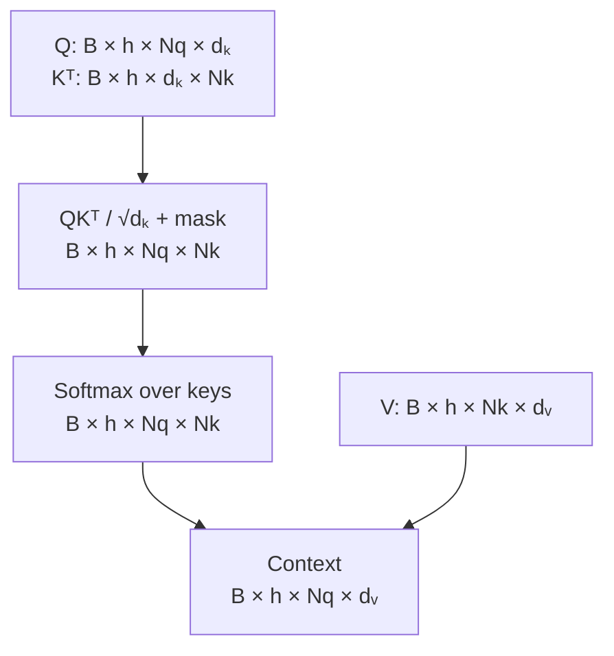

---
{
  "id": "scaled-dot-product-attention",
  "title": "Scaled Dot-Product Attention",
  "slug": "scaled-dot-product-attention",
  "category": "Transformer Architecture",
  "difficulty": "Hard",
  "coverImage": "social_banner.png",
  "companies": [
    "Google",
    "Meta",
    "OpenAI",
    "Anthropic",
    "Microsoft",
    "NVIDIA"
  ],
  "shortDescription": "Each token mixes content from positions it may read. The score scale, the mask, and the memory traffic decide whether that mix stays usable.",
  "prerequisites": [
    "embeddings-cosine-dot-product-quantization"
  ],
  "keyConceptsTested": [
    "Scaled dot-product attention formula derivation",
    "Q/K/V projections and their roles (routing vs content)",
    "Variance proof for √d_k scaling factor",
    "Three attention types: bidirectional, causal, cross",
    "Multi-head attention: parallel subspaces, same asymptotic attention FLOPs",
    "Multi-head routing capacity without assumed head interpretations",
    "Single-head vs full multi-head attention complexity",
    "Training vs inference bottlenecks: score matrix vs KV cache bandwidth",
    "MQA/GQA: shrinking KV-cache traffic and measuring decode trade-offs",
    "FlashAttention: IO-aware tiling with O(n) auxiliary attention state",
    "Softmax numerical stability (max-shift technique)",
    "Gradients through attention scores and values"
  ],
  "section": "Transformer & Multimodal Architectures",
  "order": 1
}
---

Read the sentence *"Birds in the garden sing softly at dawn."* When the model reaches the verb *"sing,"* it needs to know *who* is singing and *how* the sentence is structured. A fixed lookup table cannot answer that question, because the right source word changes with every sentence.

<span data-glossary="self-attention">Self-attention</span> solves this routing problem with a soft, differentiable database lookup.[^vaswani2017] Every <span data-glossary="token">token</span> projects its hidden state into three vectors: a **query** asking what context it needs, a **key** advertising what it holds, and a **value** carrying the payload to share. Dot products score every query against every key, <span data-glossary="softmax">softmax</span> turns each row of scores into probability weights, and multiplying by the values blends the chosen information into a fresh representation.

Zoom into the two-token slice *"Birds sing."* Under a <span data-glossary="causal-mask">causal mask</span>, *"Birds"* can only read itself, while *"sing"* blends both *"Birds"* and itself into a single context vector `[1.42, 1.58]`. We will compute every number in that pass by hand, prove why dividing by $\sqrt{d_k}$ keeps gradients alive, trace how masks and multi-head splits work in <span data-glossary="pytorch">PyTorch</span>, and see why long sequences hit two completely different hardware walls during training and decoding.

<figure>
  
  <figcaption>One causal attention pass on "Birds sing." The mask restricts Birds to its own value, while sing blends 42% of Birds with 58% of itself to produce [1.42, 1.58].</figcaption>
</figure>

---

## Three views of one token

Why project each token into three separate vectors instead of just taking raw <span data-glossary="dot-product">dot products</span> $X X^T$? Because asking for context and advertising context are asymmetric jobs. A verb looking for its subject needs a different feature direction than a noun advertising itself as a subject, and the information transferred once they match may live in a third subspace altogether.

Three learned linear projections split routing from content cleanly:

| Vector | Question it answers | Role in attention |
|--------|---------------------|-------------------|
| Query ($Q$) | What context does this position need? | Scores every candidate source position |
| Key ($K$) | When should another position read me? | Matched against incoming queries |
| Value ($V$) | What content do I contribute if selected? | Payload blended by the resulting weights |

Given input token states $X \in \mathbb{R}^{n \times d_{\text{model}}}$, each layer applies three learned weight matrices $W_Q, W_K \in \mathbb{R}^{d_{\text{model}} \times d_k}$ and $W_V \in \mathbb{R}^{d_{\text{model}} \times d_v}$:[^vaswani2017]

$$
Q = XW_Q, \quad K = XW_K, \quad V = XW_V
$$

Even if raw scores $QK^T$ happened to be symmetric, **attention weights are still asymmetric**: each query row normalizes by its own softmax denominator, and causal masking removes future edges.

<figure>
  
  <figcaption>One hidden state splits into three views. Query [1.0, 0.5] and key [0.8, 0.2] meet to compute the routing score 0.90, while value [2.0, 1.0] waits to be mixed by the normalized weights.</figcaption>
</figure>

> **Key insight:** Queries and keys decide *where* information flows; values decide *what* information flows. Decoupling $W_Q$, $W_K$, and $W_V$ lets a head match tokens on syntactic features while copying semantic features.

```checkpoint
In one sentence, which tensors choose where attention goes, and which tensor carries content?
---
Q and K choose where attention goes. Their dot products produce routing scores that softmax converts into weights. V carries the content that gets mixed by those weights.
```

---

## The core formula

Scaled dot-product attention combines scoring, scaling, masking, normalization, and value mixing in one compact <span data-glossary="matrix">matrix</span> expression:[^vaswani2017]

$$
\text{Attention}(Q, K, V; M) = \text{softmax}\left(\frac{QK^T}{\sqrt{d_k}} + M\right)V
$$

Here $M$ is an optional additive mask with $M_{ij} = 0$ for allowed keys and $M_{ij} = -\infty$ for blocked keys. Adding $-\infty$ before softmax drives the blocked exponential $e^{-\infty}$ straight to zero so blocked positions contribute nothing and the remaining weights still sum to 1.

| Step | Operation | Shape | What it does |
|------|-----------|-------|--------------|
| Score | $S = QK^T$ | $(B, h, N_q, N_k)$ | Pairwise compatibility between every query and key |
| Scale | $L = S / \sqrt{d_k}$ | $(B, h, N_q, N_k)$ | Keeps logit variance steady as head width grows |
| Mask | $Z = L + M$ | $(B, h, N_q, N_k)$ | Blocks disallowed keys with $-\infty$ |
| Normalize | $\alpha = \text{softmax}(Z, \text{dim}=-1)$ | $(B, h, N_q, N_k)$ | Turns each query row into weights summing to 1 |
| Mix | $O = \alpha V$ | $(B, h, N_q, d_v)$ | Weighted average of visible value vectors |

Notice that $d_k$ (query/key width) disappears during $QK^T$, while $d_v$ (value width) flows straight into the output. They are usually equal, though the math never requires it.



<figure>
  
  <figcaption>Tracing "Birds sing" through every stage: raw dot products $QK^T$, scaling by $\sqrt{2}$, row-wise softmax, and multiplying by $V$ to produce the blended context vectors.</figcaption>
</figure>

### A trace with real numbers

Take two tokens with 2-dimensional projections ($d_k = d_v = 2$):

| Token | Query $q$ | Key $k$ | Value $v$ |
|---|---|---|---|
| Birds | `[1.0, 0.5]` | `[0.8, 0.2]` | `[2.0, 1.0]` |
| sing | `[0.5, 1.0]` | `[0.3, 0.9]` | `[1.0, 2.0]` |

Without a mask, multiply $Q$ by $K^T$, divide by $\sqrt{2} \approx 1.414$, and apply row-wise softmax:

$$
\begin{aligned}
S = QK^T &= \begin{bmatrix} 0.90 & 0.75 \\ 0.60 & 1.05 \end{bmatrix}, \qquad
L = \frac{S}{\sqrt{2}} \approx \begin{bmatrix} 0.64 & 0.53 \\ 0.42 & 0.74 \end{bmatrix}, \qquad
\alpha = \text{softmax}(L) \approx \begin{bmatrix} 0.53 & 0.47 \\ 0.42 & 0.58 \end{bmatrix}
\end{aligned}
$$

Now multiply $\alpha$ by $V$:

- **Birds:** $0.53 \cdot [2.0, 1.0] + 0.47 \cdot [1.0, 2.0] = [1.53, 1.47]$
- **sing:** $0.42 \cdot [2.0, 1.0] + 0.58 \cdot [1.0, 2.0] = [1.42, 1.58]$

Every valid row of $\alpha$ is a probability distribution, so each output vector lies inside the convex hull of the visible value vectors. Now add a lower-triangular causal mask so *"Birds"* cannot peek ahead at *"sing"*:

<!-- leetllm: test, deps=numpy, output=show -->
```python title="scaled-dot-product-attention.py"
import numpy as np

Q = np.array([[1.0, 0.5], [0.5, 1.0]])
K = np.array([[0.8, 0.2], [0.3, 0.9]])
V = np.array([[2.0, 1.0], [1.0, 2.0]])

def attention(Q, K, V, mask=None):
    scores = (Q @ K.T) / np.sqrt(Q.shape[-1])
    if mask is not None:
        scores = np.where(mask, scores, -np.inf)
    shifted = scores - scores.max(axis=-1, keepdims=True)
    weights = np.exp(shifted)
    weights /= weights.sum(axis=-1, keepdims=True)
    return weights @ V, weights

out_bi, w_bi = attention(Q, K, V)
causal = np.tril(np.ones((2, 2), dtype=bool))
out_causal, w_causal = attention(Q, K, V, mask=causal)

print("Unmasked weights:\n", np.round(w_bi, 3))
print("Unmasked output:\n", np.round(out_bi, 3))
print("Causal weights:\n", np.round(w_causal, 3))
print("Causal output:\n", np.round(out_causal, 3))
```

<!-- leetllm: output:start -->
```text title="Output" output compact
Unmasked weights:
 [[0.526 0.474]
 [0.421 0.579]]
Unmasked output:
 [[1.526 1.474]
 [1.421 1.579]]
Causal weights:
 [[1.    0.   ]
 [0.421 0.579]]
Causal output:
 [[2.    1.   ]
 [1.421 1.579]]
```
<!-- leetllm: output:end -->

Look at the two outputs side by side. With the causal mask, *"Birds"* puts weight `1.0` on itself and returns its own value `[2.0, 1.0]`, while *"sing"* still sees both tokens and keeps `[1.421, 1.579]`.

<figure>
  
  <figcaption>Read attention row by row from scaled scores to normalized weights to mixed values. Every query row sums to 1, while columns do not need to because many queries can read the same key.</figcaption>
</figure>

> **Common mistake:** Two silent shape bugs break hand-written attention. First, forgetting `K.transpose(-2, -1)` runs without error whenever $N_k = d_k$ by coincidence, contracting the wrong axis; always test with $N_k \neq d_k$. Second, running softmax over the query axis instead of the key axis (`dim=-1`) normalizes columns instead of rows so queries no longer form valid distributions.

---

## Why scale by $\sqrt{d_k}$? The variance proof

With $d_k = 2$, dividing by $\sqrt{2}$ barely changes the numbers. At $d_k = 64$ or $128$, omitting that factor silently stalls learning.

Why? Because a dot product sums $d_k$ products: $q \cdot k = \sum_{i=1}^{d_k} q_i k_i$. Model the entries of $q$ and $k$ at initialization as independent random variables with mean $0$ and variance $1$.[^vaswani2017] Each coordinate product has mean $\mathbb{E}[q_i k_i] = 0$ and variance:

$$
\text{Var}(q_i k_i) = \mathbb{E}[q_i^2]\mathbb{E}[k_i^2] - 0 = 1
$$

Summing $d_k$ independent terms adds their variances, so $\text{Var}(q \cdot k) = d_k$ and the standard deviation grows as $\sqrt{d_k}$. Dividing by $\sqrt{d_k}$ divides the variance by $d_k$ and restores unit scale:

$$
\text{Var}\!\left(\frac{q \cdot k}{\sqrt{d_k}}\right) = \frac{1}{d_k} \text{Var}(q \cdot k) = 1
$$

| Head width $d_k$ | Raw $\text{Std}(q \cdot k)$ | Scaled $\text{Std}(q \cdot k / \sqrt{d_k})$ |
|:---:|:---:|:---:|
| 16 | 4.0 | 1.0 |
| 64 | 8.0 | 1.0 |
| 128 | 11.3 | 1.0 |
| 512 | 22.6 | 1.0 |

### Why wide logits kill gradients

Softmax exponentiates logit **gaps**. When one score beats its neighbors by 20, $e^{20} \approx 4.85 \times 10^8$, so the winning weight snaps to $a_{\max} \approx 1$ and every other weight collapses to $0$. Look at the softmax Jacobian:

$$
\frac{\partial a_i}{\partial z_j} = a_i (\delta_{ij} - a_j)
$$

When $a_{\max} \to 1$, the factor $a_{\max}(1 - a_{\max}) \to 0$ and every off-diagonal term $a_i a_j \to 0$. The routing gradient into $Q$ and $K$ vanishes! Notice that adding a uniform constant like `+1000` to every logit changes nothing (softmax is shift-invariant); it is the *spread* between logits that saturates softmax.

<figure>
  
  <figcaption>Raw dot-product standard deviation climbs as $\sqrt{d_k}$ across head widths, while dividing by $\sqrt{d_k}$ holds the score spread steady at 1.</figcaption>
</figure>

Run a quick NumPy simulation across head widths and compare a uniform row against a 20-point gap:

<!-- leetllm: test, deps=numpy, output=show -->
```python title="variance-scaling-simulation.py"
import numpy as np

rng = np.random.default_rng(7)
for d_k in (16, 64, 512):
    q = rng.standard_normal((5000, d_k))
    k = rng.standard_normal((5000, d_k))
    raw = np.sum(q * k, axis=1)
    scaled = raw / np.sqrt(d_k)
    print(f"d_k={d_k:3d}: raw std={raw.std():5.2f}, scaled std={scaled.std():4.2f}")

def softmax(z):
    e = np.exp(z - np.max(z))
    return e / e.sum()

for name, logits in [("uniform", [0., 0., 0.]), ("shifted", [1000., 1000., 1000.]), ("gapped", [20., 0., 0.])]:
    a = softmax(np.array(logits))
    print(f"{name:8s}: p0={a[0]:.4f}, self-grad p0(1-p0)={a[0]*(1-a[0]):.2e}")
```

<!-- leetllm: output:start -->
```text title="Output" output compact
d_k= 16: raw std= 3.99, scaled std=1.00
d_k= 64: raw std= 8.08, scaled std=1.01
d_k=512: raw std=22.74, scaled std=1.00
uniform : p0=0.3333, self-grad p0(1-p0)=2.22e-01
shifted : p0=0.3333, self-grad p0(1-p0)=2.22e-01
gapped  : p0=1.0000, self-grad p0(1-p0)=4.12e-09
```
<!-- leetllm: output:end -->

A 20-point gap drops the self-derivative from `0.222` to `4.12e-09`, more than fifty million times smaller. Once training progresses, learned queries and keys become correlated (for instance, if $k = q$ with $\pm 1$ entries, $q \cdot k = d_k$ deterministically), so $\sqrt{d_k}$ acts as a clean initialization-time stabilizer rather than a permanent guarantee.

```checkpoint
Why divide by $\sqrt{d_k}$ instead of by $d_k$?
---
The raw dot product has variance $d_k$, so its standard deviation is $\sqrt{d_k}$. Softmax sees the scale of logits through their standard deviation, so dividing by $\sqrt{d_k}$ brings the variance back to 1. Dividing by $d_k$ would over-shrink the logits as dimensions grow.
```

---

## Three types of attention

The attention equation never changes across transformer families; only **who may read whom** changes, controlled by the mask $M$ and where $Q$, $K$, and $V$ come from.

| Attention Type | $Q$ Source | $K, V$ Source | Mask | Typical Models |
|---|---|---|---|---|
| **Bidirectional Self** | Same sequence | Same sequence | Padding only | BERT, ViT |
| **Causal Self** | Same sequence | Same sequence | Lower-triangular (+ padding) | GPT, Llama |
| **Cross-Attention** | Target sequence | Source sequence | Source padding | T5, original Transformer |

- **Bidirectional self-attention** lets every real token read every other token in the sequence, ideal for encoders where the full text or image grid is available at once.
- **Causal self-attention** masks future keys ($k > q$) with $-\infty$ so autoregressive decoders can train over all sequence positions in parallel without leaking upcoming tokens.
- **<span data-glossary="cross-attention">Cross-attention</span>** takes queries from one stream (like a decoder) and keys/values from another (like an encoder memory), forming a rectangular $N_q \times N_k$ routing grid with no causal restriction across streams.[^vaswani2017]

<figure>
  
  <figcaption>The same operator powers all three patterns: dense bidirectional rows, lower-triangular causal rows, and rectangular $N_q \times N_k$ cross-attention between two sequences.</figcaption>
</figure>

```checkpoint
Why must token 0 be unable to attend to token 1 in causal self-attention?
---
During next-token training, token 0 is only allowed to use itself and earlier context. If it can attend to token 1, the model can leak the future answer during training. Loss can look good, but generation fails because that future token isn't available at inference time.
```

### Cached queries and PyTorch mask conventions

During autoregressive decoding with a <span data-glossary="kv-cache">KV cache</span>, a single new token at absolute position 4 attends to all five cached keys `[0, 1, 2, 3, 4]`. Its local query index is `0`, NOT its absolute position! If you naively apply a `1 x 5` lower-triangular mask (`is_causal=True` in PyTorch's `F.scaled_dot_product_attention`, which aligns upper-left for rectangular matrices), the new token can only read key `0` and goes blind to keys `1..4`.[^pytorchSdpaDocs2026]

Instead, build masks from **absolute positions** (`key_pos <= query_pos`) intersected with valid non-padding keys. Also watch out for PyTorch's inverted boolean conventions: in `F.scaled_dot_product_attention`, `True` means **allowed**, whereas in `nn.MultiheadAttention`'s `key_padding_mask`, `True` means **ignored**.[^pytorchSdpaDocs2026][^pytorchMhaMasks2026]

<!-- leetllm: test, deps=torch, output=show -->
```python title="cached-causal-and-padding.py"
import torch
import torch.nn.functional as F

# Query at absolute position 2 reading 3 cached keys, where position 1 is padding.
q = torch.tensor([[[[1.0, 0.0]]]])
k = torch.tensor([[[[1.0, 0.0], [0.0, 1.0], [1.0, 1.0]]]])
v = torch.tensor([[[[1.0, 0.0], [0.0, 1.0], [2.0, 2.0]]]])
allowed = torch.tensor([[True, False, True]])  # True = participating key in SDPA

cached = F.scaled_dot_product_attention(q, k, v, attn_mask=allowed)
wrong_upper_left = F.scaled_dot_product_attention(q, k, v, is_causal=True)

print("explicit cached mask (reads keys 0 & 2):", cached.flatten().tolist())
print("wrong is_causal=True (reads key 0 only):", wrong_upper_left.flatten().tolist())
```

<!-- leetllm: output:start -->
```text title="Output" output compact
explicit cached mask (reads keys 0 & 2): [1.5, 1.0]
wrong is_causal=True (reads key 0 only): [1.0, 0.0]
```
<!-- leetllm: output:end -->

<details>
<summary>Deep dive: left-padded batches and all-masked query rows</summary>

When batching sequences of unequal length with left padding (`[PAD, birds, sing]`), a causal query at the padded slot `0` has **no allowed key**. Feeding `[-inf, -inf, -inf]` into softmax produces `NaN` (`-inf - (-inf)`), and filling blocked slots with a finite constant like `-1e4` makes every masked key tie and produces a bogus uniform row `[1/3, 1/3, 1/3]`!

Fix this explicitly before softmax: combine `causal & key_valid & query_valid` with broadcastable shapes `(B, 1, Nq, Nk)`, substitute zero logits on inactive query rows, run softmax, and zero out inactive rows afterward so both forward outputs and backward gradients for padded tokens stay exact zeros:

<!-- leetllm: test, deps=torch, output=show -->
```python title="batched-causal-padding-reference.py"
import math
import torch

q = torch.tensor([[[[1., 0.], [1., 0.], [1., 0.]]]], requires_grad=True)
k = torch.tensor([[[[9., 9.], [1., 0.], [1., 1.]]]], requires_grad=True)
v = torch.tensor([[[[999., 999.], [2., 1.], [1., 2.]]]], requires_grad=True)
valid = torch.tensor([[False, True, True]])  # [PAD, birds, sing]

pos = torch.arange(3)
causal = pos[None, :] <= pos[:, None]
active = valid[:, None, :, None]
allowed = causal[None, None] & valid[:, None, None, :] & active

logits = (q @ k.transpose(-2, -1)) / math.sqrt(q.shape[-1])
safe_logits = torch.where(active, logits.masked_fill(~allowed, -torch.inf), 0.0)
weights = torch.softmax(safe_logits, dim=-1).masked_fill(~active, 0.0)
context = weights @ v
context[..., 0].sum().backward()

print("row sums:", weights.sum(dim=-1).flatten().tolist())
print("context:", context.detach()[0, 0].tolist())
print("pad token grad norm:", q.grad[0, 0, 0].norm().item())
```

<!-- leetllm: output:start -->
```text title="Output" output compact
row sums: [0.0, 1.0, 1.0]
context: [[0.0, 0.0], [2.0, 1.0], [1.5, 1.5]]
pad token grad norm: 0.0
```
<!-- leetllm: output:end -->

</details>

---

## Multi-head attention

A single head produces one probability distribution per query token, forcing it to average together every relationship it wants to track. **Multi-Head Attention (MHA)** runs $h$ parallel heads in smaller subspaces of width $d_k = d_v = d_{\text{model}} / h$, concatenates their outputs back to $d_{\text{model}}$, and mixes them with an output projection $W^O$:[^vaswani2017]

$$
\text{head}_i = \text{Attention}(XW_i^Q, XW_i^K, XW_i^V), \qquad
\text{MultiHead}(X) = \text{Concat}(\text{head}_1, \ldots, \text{head}_h) W^O
$$

Each head gets its own independent routing pattern: one can focus on adjacent tokens while another tracks a distant subject or implements a copy-like induction circuit.[^voita2019][^olsson2022] Heads are learned jointly rather than hand-assigned, and ablation studies show some trained heads can be pruned with little quality drop while others carry specialized patterns.[^michel2019]

<figure>
  
  <figcaption>A width-8 residual stream projects into Q, K, and V, splits into four width-2 heads that attend in parallel, concatenates back to width 8, and mixes through $W^O$.</figcaption>
</figure>

> **Key insight:** Splitting $d_{\text{model}}$ into $h$ heads of width $d_{\text{model}} / h$ leaves the leading attention-core FLOPs **completely unchanged**: $h \cdot 2n^2(d_{\text{model}}/h) = 2n^2 d_{\text{model}}$. What grows with $h$ is the number of softmax rows (and score matrices if materialized).

### Gradient flow through attention

How does backpropagation teach queries and keys where to look? Write one query's output as $o = \sum_j a_j v_j$, where $a = \text{softmax}(z)$. Plugging the softmax Jacobian into the weighted sum gives a strikingly clean identity:[^dao2022]

$$
\frac{\partial o}{\partial z_j} = a_j (v_j - o)
$$

Increasing key $j$'s logit pulls the output toward $v_j$ and away from the current average $o$. Notice two immediate consequences: if all allowed keys carry identical values ($v_j = o$), the routing gradient is **zero**; and if only one key is allowed ($a_j = 1, v_j = o$), the routing gradient is also **zero**, while the value path still receives the upstream gradient $g = \partial \ell / \partial o$.

For an upstream gradient $t_j = \partial \ell / \partial a_j = g^T v_j$, you never need to materialize an $N_k \times N_k$ softmax Jacobian in code. The backward pass collapses to a single row-wise dot product:[^dao2022]

$$
\frac{\partial \ell}{\partial z_j} = a_j \left(t_j - \sum_i a_i t_i\right), \qquad
\frac{\partial \ell}{\partial q} = \frac{1}{\sqrt{d_k}}\sum_j \frac{\partial \ell}{\partial z_j} k_j, \qquad
\frac{\partial \ell}{\partial V} = A^T G
$$

Let's verify both the multi-head reshape layout and this exact Jacobian-free backward formula against PyTorch autograd:

<!-- leetllm: test, deps=torch, output=show -->
```python title="mha-reshape-and-backward.py"
import torch

# 1. Verify (B, N, D) -> (B, h, N, d_k) -> (B, N, D) round-trip
B, N, D, h = 2, 3, 8, 4
x = torch.arange(B * N * D, dtype=torch.float64).reshape(B, N, D)
heads = x.view(B, N, h, D // h).transpose(1, 2)
restored = heads.transpose(1, 2).contiguous().view(B, N, D)
assert torch.equal(x, restored)
print("head tensor shape:", tuple(heads.shape))

# 2. Verify Jacobian-free softmax backward with a masked third key
z = torch.tensor([[0.0, 0.0, 5.0]], dtype=torch.float64, requires_grad=True)
allowed = torch.tensor([[True, True, False]])
a = torch.softmax(z.masked_fill(~allowed, -torch.inf), dim=-1)
upstream = torch.tensor([[2.0, 1.0, 99.0]], dtype=torch.float64)

manual_dz = a * (upstream - (a * upstream).sum(dim=-1, keepdim=True))
(a * upstream).sum().backward()
assert torch.allclose(manual_dz, z.grad)
print("weights:", a.detach().flatten().tolist())
print("logit gradients (masked key gets 0):", z.grad.flatten().tolist())
```

<!-- leetllm: output:start -->
```text title="Output" output compact
head tensor shape: (2, 4, 3, 2)
weights: [0.5, 0.5, 0.0]
logit gradients (masked key gets 0): [0.25, -0.25, 0.0]
```
<!-- leetllm: output:end -->

Every row of logit gradients sums to zero (`0.25 + (-0.25) + 0.0 = 0`), reflecting softmax's shift invariance, and the masked third key receives an exact `0.0` gradient even when given an upstream gradient of `99.0`.

---

## Complexity analysis

Attention has two distinct cost regimes, and confusing them leads to the wrong optimization every time.

| Cost | Complexity | What drives it |
|------|------------|----------------|
| **Attention core (multi-head)** | $O(n^2 d_{\text{model}})$ | $QK^T$ and $\alpha V$ across all token pairs |
| **Q/K/V and output projections** | $O(n d_{\text{model}}^2)$ | Four dense linear layers per block |
| **Naive score memory** | $O(h n^2)$ | Materializing the $n \times n$ matrix per head |
| **KV-cache memory (decode)** | $O(L \cdot h_{\text{KV}} \cdot d_k \cdot n)$ | Storing past keys and values across $L$ layers |

Plug in concrete numbers for naive score storage: a batch of 8, 32 heads, $n = 8{,}192$, in <span data-glossary="fp16">FP16</span> (2 bytes) needs

$$
8 \times 32 \times 8{,}192^2 \times 2\text{ bytes} = 34.4\text{ GB} \text{ (}32\text{ GiB)}
$$

for a *single* layer's score matrix before weights, activations, or <span data-glossary="optimizer-state">optimizer state</span>. Doubling sequence length quadruples that tensor.

<figure>
  
  <figcaption>Naive attention writes an $N \times N$ FP16 score matrix per head to HBM (2 MB at $N=1{,}024$ up to 512 MB at $N=16{,}384$). Tiled FlashAttention keeps only one active block in on-chip SRAM so temporary HBM memory stays $O(N)$.</figcaption>
</figure>

### Training vs. decoding: two different hardware walls

- **Training and prompt prefill** process all $n$ tokens together, hitting the $O(n^2)$ temporary score-matrix memory wall in GPU high-bandwidth memory (HBM).
- **Autoregressive decoding** generates one token at a time ($N_q = 1$). The score vector is tiny ($1 \times N_k$), so the bottleneck flips completely to **persistent KV-cache bandwidth**: loading every past key and value from HBM on every generated token.[^shazeer2019]

For $L$ layers, batch size $B$, sequence length $N$, $h_{\text{KV}}$ key/value heads of width $d_k = d_v$, and $P_{\text{bytes}}$ bytes per element, the KV-cache payload is:

$$
\text{Memory}_{\text{KV}} = 2 \cdot L \cdot h_{\text{KV}} \cdot d_k \cdot N \cdot B \cdot P_{\text{bytes}}
$$

To shrink that decode memory read without sacrificing query expressivity, modern models share key/value heads across query groups:
- **Multi-Head Attention (MHA):** $h_{\text{KV}} = h_Q$ (1:1).
- **Multi-Query Attention (MQA):** all query heads share one key/value head ($h_{\text{KV}} = 1$).[^shazeer2019]
- **Grouped-Query Attention (GQA):** groups of $h_Q / G$ query heads share one KV head ($h_{\text{KV}} = G$), preserving near-MHA quality with much smaller caches (for example, Llama 3.1 70B uses $L=80, h_Q=64, h_{\text{KV}}=8, d_k=128$).[^ainslie2023][^dubey2024]

Sharing KV heads also boosts decode **arithmetic intensity** (FLOPs per byte read from HBM) by the sharing ratio $h_Q / h_{\text{KV}}$, because each loaded KV head serves multiple query heads:

$$
\text{Grouped core intensity} \approx \frac{4 N h_Q d}{2 N h_{\text{KV}} d P_{\text{bytes}}} = \frac{2 h_Q}{h_{\text{KV}} P_{\text{bytes}}}
$$

<!-- leetllm: test, output=show -->
```python title="kv-head-bandwidth.py"
layers, tokens, d_head, bytes_fp16, q_heads = 32, 8192, 128, 2, 32

for label, kv_heads in [("MHA", 32), ("GQA-8", 8), ("MQA", 1)]:
    cache_gib = (2 * layers * kv_heads * d_head * tokens * bytes_fp16) / 1024**3
    core_flops = 4 * tokens * q_heads * d_head
    kv_bytes = 2 * tokens * kv_heads * d_head * bytes_fp16
    print(f"{label:5s}: cache={cache_gib:.3f} GiB, decode intensity={core_flops / kv_bytes:2.0f} FLOPs/byte")
```

<!-- leetllm: output:start -->
```text title="Output" output compact
MHA  : cache=4.000 GiB, decode intensity= 1 FLOPs/byte
GQA-8: cache=1.000 GiB, decode intensity= 4 FLOPs/byte
MQA  : cache=0.125 GiB, decode intensity=32 FLOPs/byte
```
<!-- leetllm: output:end -->

For Llama 3.1 70B dimensions ($L=80, h_Q=64, d_k=128$, $B=16$, $N=8{,}192$, FP16), switching from 64 KV heads (320 GiB) to GQA-8 drops the raw KV payload 8x to 40 GiB. Remember that **FlashAttention** and **MQA/GQA** solve opposite halves of the problem: FlashAttention eliminates temporary $O(n^2)$ score traffic during prefill/training, while MQA/GQA shrink persistent KV-cache reads during decoding.

```checkpoint
Which optimization reduces temporary attention-matrix I/O, and which reduces persistent KV-cache bandwidth during decoding?
---
FlashAttention reduces temporary attention-matrix I/O by tiling attention and avoiding materializing the full $n \times n$ matrix. MQA and GQA reduce persistent KV-cache bandwidth by sharing or grouping key/value heads during autoregressive decoding.
```

---

## Softmax numerical stability

Computing $e^x$ directly overflows float32 around $x > 88$ and float16 around $x > 11$, turning logits into `Inf / Inf = NaN`. Subtracting the row maximum $m = \max_j x_j$ before exponentiating cancels algebraically while capping the largest exponent at $e^0 = 1$:[^milakov2018]

$$
\text{softmax}(x_i) = \frac{e^{x_i - m}}{\sum_j e^{x_j - m}}
$$

On `[1000, 1001, 999]`, subtracting `1001` passes `[-1, 0, -2]` to `exp`, producing clean probabilities `[0.2447, 0.6652, 0.0900]`.

<details>
<summary>Deep dive: FP16 score overflow before softmax</summary>

Max-shifting only works if the scores are still finite when they reach softmax. If $Q$ and $K$ are finite in FP16 (`300.0` each), their dot product `90,000` exceeds FP16 max (`65,504`) and overflows to `inf` *during* `Q @ K.T`. Casting to FP32 *after* the matmul cannot repair an `inf` that already happened; cast inputs or accumulate in FP32 before softmax:

<!-- leetllm: test, deps=torch, output=show -->
```python title="score-overflow-precedes-softmax.py"
import torch

q = torch.tensor([[300.]], dtype=torch.float16)
k = torch.tensor([[300.], [0.]], dtype=torch.float16)

late_cast = torch.softmax((q @ k.T).float(), dim=-1)
wide_first = torch.softmax(q.float() @ k.float().T, dim=-1)

print("late FP32 cast:", late_cast.flatten().tolist())
print("FP32 matmul first:", wide_first.flatten().tolist())
```

<!-- leetllm: output:start -->
```text title="Output" output compact
late FP32 cast: [nan, nan]
FP32 matmul first: [1.0, 0.0]
```
<!-- leetllm: output:end -->

Note also that during training, **attention-weight dropout** (`dropout_p > 0`) drops random entries of $\alpha$ and rescales survivors, which temporarily moves outputs outside the convex hull of $V$; always pass `dropout_p=0.0` at evaluation.

</details>

---

## FlashAttention: tiled exact attention

A naive GPU attention pass makes three slow round trips to HBM: write $S = QK^T / \sqrt{d_k}$ to HBM, read $S$ and write $P = \text{softmax}(S)$ to HBM, then read $P$ to compute $O = PV$. At long context lengths, moving that $n \times n$ matrix back and forth dominates wall-clock time even though GPU tensor cores could finish the math much faster.

[FlashAttention](/learn/flashattention-memory-efficient-attention) eliminates every HBM write of the $n \times n$ matrix while computing **exact** dense attention.[^dao2022] It combines two ideas:

1. **SRAM tiling:** Load small blocks $Q_i \in \mathbb{R}^{B_r \times d}$ and stream key/value blocks $K_j, V_j \in \mathbb{R}^{B_c \times d}$ into fast on-chip SRAM.
2. **<span data-glossary="online-softmax">Online softmax</span> rescaling:** Instead of needing the entire row's maximum up front, maintain three per-row running accumulators in registers: the current maximum $m$, the exponential sum $\ell$, and the unnormalized output $u$.[^milakov2018] When a new tile arrives with local scores $\tilde{S}_{ij} = Q_i K_j^T / \sqrt{d_k}$ and local max $\tilde{m} = \max(\tilde{S}_{ij})$, rescale the old accumulators in four lines:

$$
\begin{aligned}
m_{\text{new}} &= \max(m_{\text{old}}, \tilde{m}) \\
\alpha &= \exp(m_{\text{old}} - m_{\text{new}}) \\
\ell_{\text{new}} &= \alpha \cdot \ell_{\text{old}} + \sum_k \exp(\tilde{S}_{ij, k} - m_{\text{new}}) \\
u_{\text{new}} &= \alpha \cdot u_{\text{old}} + \sum_k \exp(\tilde{S}_{ij, k} - m_{\text{new}}) V_{j, k}
\end{aligned}
$$

After all key-value tiles stream past, one division $O_i = u_{\text{final}} / \ell_{\text{final}}$ produces the exact attention output. During the backward pass, FlashAttention stores only $O(n)$ row log-sum-exp statistics instead of the $O(n^2)$ matrix $P$, recomputing score tiles inside fast SRAM on the fly.[^dao2022]

| Property | Standard attention | FlashAttention |
|----------|:-----------------:|:--------------:|
| **Saved attention state in HBM** | $O(n^2)$ per head | $O(n)$ row statistics per head |
| **Score-matrix HBM traffic** | Multiple $O(n^2)$ reads/writes | Zero (tiles stay in SRAM) |
| **Result** | Exact | Exact (up to FP rounding) |
| **Backward pass** | Reads saved $P$ from HBM | Recomputes tiles on chip |

<figure>
  
  <figcaption>FlashAttention streams $Q$, $K$, and $V$ blocks through fast on-chip SRAM, rescaling running statistics by $\exp(m_{\text{old}} - m_{\text{new}})$ whenever a tile introduces a larger maximum.</figcaption>
</figure>

You can verify that online tiled attention matches full-row attention to 12 decimal places in 15 lines of Python, even when tile 1 has score `1000`, tile 2 jumps to `1001`, or a leading tile is completely masked:

<!-- leetllm: test, output=show -->
```python title="online-tiled-attention.py"
import math

def online_attention(tiles):
    m, denom, num = -math.inf, 0.0, 0.0
    for logits, values in tiles:
        if not logits or max(logits) == -math.inf:
            continue  # Skip empty or fully masked tiles cleanly
        m_new = max(m, max(logits))
        scale = math.exp(m - m_new)
        w = [math.exp(x - m_new) for x in logits]
        denom = scale * denom + sum(w)
        num = scale * num + sum(wi * vi for wi, vi in zip(w, values))
        m = m_new
    return num / denom

scores, values = [1000.0, 1001.0, 999.0], [2.0, 1.0, 4.0]
exps = [math.exp(s - max(scores)) for s in scores]
full = sum(w * v for w, v in zip(exps, values)) / sum(exps)

tiled = online_attention([(scores[:1], values[:1]), (scores[1:], values[1:])])
with_masked = online_attention([([-math.inf], [20.0]), (scores, values)])
assert abs(tiled - full) < 1e-12 and abs(with_masked - full) < 1e-12
print(f"full-row: {full:.6f}, two-tile: {tiled:.6f}, with masked tile: {with_masked:.6f}")
```

<!-- leetllm: output:start -->
```text title="Output" output compact
full-row: 1.514820, two-tile: 1.514820, with masked tile: 1.514820
```
<!-- leetllm: output:end -->

In PyTorch, you get fused FlashAttention kernels directly through `F.scaled_dot_product_attention` without writing custom <span data-glossary="cuda">CUDA</span> code.[^pytorchSdpaDocs2026]

---

## Mistakes that break attention

| Mistake | Symptom | Fix |
|---------|---------|-----|
| Forgetting `K.transpose(-2, -1)` | Shape error, or silently wrong scores when $N_k = d_k$ | Transpose the last two axes; test with $N_k \neq d_k$. |
| Skipping `/ sqrt(d_k)` | Softmax saturates at large $d_k$ and routing gradients vanish | Scale logits by $1/\sqrt{d_k}$ before masking and softmax. |
| Softmax on the wrong axis | Rows do not sum to 1 | Apply softmax over keys (`dim=-1`), never over queries. |
| Using `is_causal=True` with an offset KV cache | New decode token reads only key 0 | Build an explicit mask from absolute positions `k_pos <= q_pos`. |
| Allowing an all-masked query row | `NaN` from `-inf - (-inf)`, or bogus uniform weights with `-1e4` | Suppress padded query rows explicitly before and after softmax. |
| Confusing FlashAttention with GQA | Optimizing the wrong bottleneck | FlashAttention cuts temporary $O(n^2)$ score I/O; GQA shrinks persistent KV-cache reads. |

<details>
<summary>Going deeper: additive attention vs. dot-product, and attending to nothing</summary>

- **Why dot-product instead of additive attention?** Bahdanau et al. (2015)[^bahdanau2015] scored compatibility via $u^T \tanh(W_q q + W_k k)$. Both learn rich alignments, but dot products map directly to high-throughput GPU matrix multiplication, with $1/\sqrt{d_k}$ stabilizing variance at large $d_k$.[^vaswani2017]
- **Can a head attend to nothing?** Not via softmax weights alone: every valid row sums to 1. However, values can cancel to a zero vector, or a layer can dedicate a neutral "sink" token whose value contributes near zero.

</details>

## Practice drill

Try this 2-minute experiment on the two-token NumPy script above: set both rows of `V` to `[3.0, -1.0]` while keeping `Q` and `K` distinct. Regardless of how you change the scores or mask, every convex blend returns `[3.0, -1.0]`, so $\partial \ell / \partial Q = 0$ even while $\partial \ell / \partial V$ remains nonzero. Then restore distinct values and mask out key 1 so only key 0 is visible: once again $\partial \ell / \partial Q = 0$, proving that routing gradients only flow when a query has both multiple visible keys *and* distinct values to choose between.

```mastery-quiz
[
  {
    "question": "An image encoder produces seven patch vectors. Four summary tokens each read all seven patches through one cross-attention head. Which inputs supply Q, K, and V, and what shape does the weight matrix have?",
    "options": [
      "Q from the summary tokens, K and V from the patches, weights 7 × 4.",
      "Q from the summary tokens, K and V from the patches, weights 4 × 7.",
      "Q from the patches, K and V from the summary tokens, weights 7 × 4.",
      "Q from the patches, K and V from the summary tokens, weights 4 × 7."
    ],
    "answer": "Q from the summary tokens, K and V from the patches, weights 4 × 7.",
    "explanation": "Each summary token supplies a query. It compares that query with a key from each patch and uses the resulting weights to mix the patch values. Four readers therefore produce four rows of seven weights. A 7 × 4 matrix swaps the reader and source axes. Taking Q from the patches would make the patches read the summary tokens, reversing the direction of the update."
  },
  {
    "question": "In scaled dot-product attention, Q has shape (B, h, 5, 64), K has shape (B, h, 20, 64), and V has shape (B, h, 20, 128). What are the shapes of the attention weights and the output?",
    "options": [
      "Weights (B, h, 5, 20) and output (B, h, 5, 128).",
      "Weights (B, h, 20, 5) and output (B, h, 20, 64).",
      "Weights (B, h, 5, 20) and output (B, h, 5, 64).",
      "Weights (B, h, 20, 5) and output (B, h, 20, 128)."
    ],
    "answer": "Weights (B, h, 5, 20) and output (B, h, 5, 128).",
    "explanation": "K must be transposed, so Q @ K^T multiplies (5 x 64) by (64 x 20). That gives one score for each query-key pair, which is 5 x 20. Softmax over the keys keeps that shape. Multiplying by V, (5 x 20) times (20 x 128), gives 5 x 128. The output has one row per query and the width of V. A width of 64 is wrong because d_k is used only for scoring. A 20 x 5 weight matrix has rows for keys, and it cannot multiply a V that has 20 rows."
  },
  {
    "question": "A query attends to two keys. Each vector has 81 coordinates, and all coordinates are mutually independent with mean 0 and variance 1. What is the population standard deviation of a raw dot product? For two unequal scores, how does skipping the usual scaling affect the larger softmax weight and its sensitivity to its own logit?",
    "options": [
      "The standard deviation is 9. The larger weight moves toward 1 and becomes less sensitive.",
      "The standard deviation is 81. The larger weight moves toward 1 and becomes less sensitive.",
      "The standard deviation is 9. The larger weight moves toward 1/2 and becomes more sensitive.",
      "The standard deviation is 81. The larger weight moves toward 1/2 and becomes more sensitive."
    ],
    "answer": "The standard deviation is 9. The larger weight moves toward 1 and becomes less sensitive.",
    "explanation": "Each coordinate product has mean 0 and variance 1. Adding 81 independent products gives variance 81 and standard deviation 9. Skipping division by 9 makes the gap between the two logits nine times as large. The larger weight $p$ moves closer to 1. Its sensitivity to its own logit is $p(1-p)$, which decreases as $p$ rises above 1/2. A dominant weight near 1 can therefore leave little gradient for learning through the scores. Moving toward 1/2 would require a smaller gap."
  },
  {
    "question": "Two attention rows each start with logits [2, 1, 5] over three keys. The code fills blocked logits with -1e4 and then applies softmax over the keys. In the active row, only key 3 is blocked. In the padded query row, all three keys are blocked. What weights does each row get?",
    "options": [
      "Active row [0.73, 0.27, 0] and padded row [1/3, 1/3, 1/3].",
      "Active row [0.05, 0.02, 0] and padded row [0, 0, 0].",
      "Active row [0.05, 0.02, 0] and padded row [1/3, 1/3, 1/3].",
      "Active row [0.73, 0.27, 0] and padded row [0, 0, 0]."
    ],
    "answer": "Active row [0.73, 0.27, 0] and padded row [1/3, 1/3, 1/3].",
    "explanation": "The mask is applied before softmax, so the active row normalizes over the allowed logits. Softmax of [2, 1] is about [0.73, 0.27], and the blocked key gets about 0. The row [0.05, 0.02, 0] comes from running softmax first and zeroing afterward, and it no longer sums to 1. In the padded row, every logit becomes -1e4. They tie, so softmax returns a uniform row that reads blocked keys. Zeros appear only through explicit handling, so the code must reject the row, skip it, or set its weights to zero on purpose."
  },
  {
    "question": "During cached decoding, a two-token chunk at absolute positions 3 and 4 reads keys at positions 0 to 4. Position 1 is padding. Using T for allowed and F for blocked, which masks are correct for the two queries?",
    "options": [
      "Query 3: T F F F F. Query 4: T F F F F.",
      "Query 3: T F T T F. Query 4: T F T T T.",
      "Query 3: T T T T F. Query 4: T T T T T.",
      "Query 3: T F T F F. Query 4: T F T T F."
    ],
    "answer": "Query 3: T F T T F. Query 4: T F T T T.",
    "explanation": "A key is allowed when its absolute position is at or before the query's position and it is not padding. Query 3 reads keys 0, 2, and 3. Query 4 reads keys 0, 2, 3, and 4. Allowing position 1 leaves the padding key open. Blocking each query's own position is wrong, because causal attention includes the current position. Allowing only position 0 uses local row numbers 0 and 1 in place of absolute positions, so each new token sees only the start of its history."
  },
  {
    "question": "A dense self-attention layer changes from two heads of width 192 to six heads of width 64. Within each head, Q, K, and V have the same width. The batch, sequence length, and score precision stay fixed. Relative to the old layout, how many multiply-adds does the attention core need for scoring and mixing values? How much memory does it need to store all scores?",
    "options": [
      "Three times the work and three times the score memory.",
      "The same work and six times the score memory.",
      "Three times the work and six times the score memory.",
      "The same work and three times the score memory."
    ],
    "answer": "The same work and three times the score memory.",
    "explanation": "For each token pair, scoring takes 2 × 192 = 384 coordinate products across the old heads and 6 × 64 = 384 across the new heads. Mixing the values has the same count in each layout. Tripling the work would count the extra heads while ignoring their smaller width. Each head still stores one score per token pair, so memory grows by a factor of 6/2 = 3. A factor of six would use one head as the starting point."
  },
  {
    "question": "A naive attention implementation stores one FP16 score for every query-key pair in every head. With batch size 4, 16 heads, and sequence length 4096, how large is that score tensor?",
    "options": [
      "About 128 MiB",
      "About 1 GiB",
      "About 512 MiB",
      "About 2 GiB"
    ],
    "answer": "About 2 GiB",
    "explanation": "The size is batch x heads x n x n x bytes: 4 x 16 x 4096 x 4096 x 2 = 2,147,483,648 bytes, or 2 GiB. Because n appears twice, doubling the sequence length makes this tensor four times larger. The value 1 GiB forgets that each FP16 score takes 2 bytes. The value 128 MiB forgets the 16 heads, and 512 MiB forgets the batch size of 4."
  },
  {
    "question": "Keys A, B, and C have scalar values 6, −2, and 6. A mask blocks B before softmax. With attention-weight dropout off, A gets one quarter of the weight and C gets the rest. The loss equals this row's output. Which scores before masking and which individual values have nonzero gradients from this loss?",
    "options": [
      "Scores at A and C. Values at A and C.",
      "None of the scores. Values at A, B, and C.",
      "None of the scores. Values at A and C.",
      "Scores at A and C. Values at A, B, and C."
    ],
    "answer": "None of the scores. Values at A and C.",
    "explanation": "The output is ¼ × 6 + ¾ × 6 = 6. Raising the score for A or C shifts weight between two equal values, so the output stays at 6. Changing the score for B has no effect because the mask blocks it. Each value gradient equals its weight here because the loss is the output itself. A gets a gradient of ¼ and C gets ¾. Giving B a value gradient would count a value with zero weight."
  },
  {
    "question": "A team has two problems. Training on long sequences runs out of memory because it stores every attention score. Serving is limited by the bandwidth needed to read the growing KV cache for each new token. Which pair of changes targets these problems?",
    "options": [
      "Training: FlashAttention. Serving: FlashAttention.",
      "Training: MQA or GQA. Serving: FlashAttention.",
      "Training: FlashAttention. Serving: MQA or GQA.",
      "Training: MQA or GQA. Serving: MQA or GQA."
    ],
    "answer": "Training: FlashAttention. Serving: MQA or GQA.",
    "explanation": "FlashAttention computes exact attention in tiles, so the full $n \\times n$ score matrix is never written to high-bandwidth memory. It does not shrink the cached K and V. MQA and GQA share K/V heads, so each new token reads fewer cached bytes. They do not shrink the score matrix, because every query head still scores every query-key pair. Each change therefore helps only one of these problems. MQA and GQA also need a model trained or uptrained for that layout."
  },
  {
    "question": "Online softmax processes one row in tiles. After the first tile, which has the single score 1000, the running maximum is 1000 and the running sum of exponentials is $e^{1000-1000} = 1$. The next tile has scores 1002 and 999. What is the running sum after this tile?",
    "options": [
      "About 1.05",
      "About 2.05",
      "About 1.19",
      "About 8.44"
    ],
    "answer": "About 1.19",
    "explanation": "The new maximum is 1002, so earlier work must be rescaled by exp(1000 - 1002) = 0.135. The new tile adds exp(0) + exp(-3) = 1.050. The sum is 0.135 + 1.050 = 1.19, which equals the denominator of a full-row max-shifted softmax on [1000, 1002, 999]. The value 2.05 forgets to rescale, so it mixes terms measured against two different maxima. The value 1.05 drops the first tile and loses that key's share. The value 8.44 rescales in the wrong direction. Working relative to the running maximum keeps every exponent at 0 or below, so nothing overflows."
  }
]
```

> **Next:** Continue to [Positional Encoding: RoPE & ALiBi](/learn/positional-encoding-rope-alibi).
