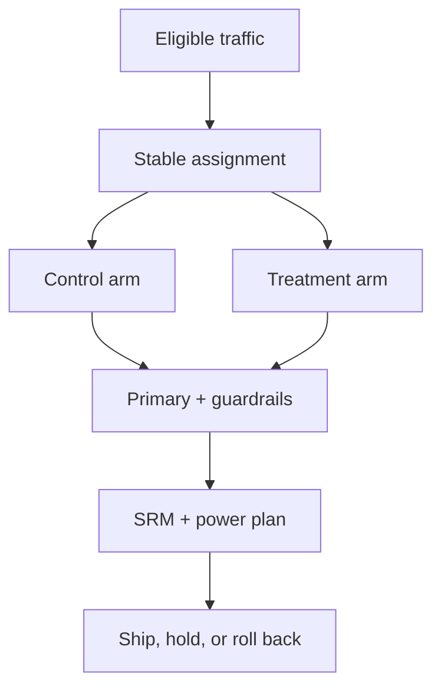

A/B testing (also called an online controlled experiment or split test) is a randomized comparison of two product or model variants under a predeclared assignment policy and primary metric. Eligible users, tenants, conversations, or requests are assigned to **control** (current system) or **treatment** (candidate change). You estimate whether treatment moves the metric more than sampling noise would allow, while guardrail metrics keep latency, cost, safety, and reliability from quietly regressing.

Randomization supports a causal comparison by avoiding self-selection into arms. That interpretation also requires intact assignment and outcome logging, analysis appropriate to the assignment unit, and no unaccounted interference between units. Users sharing one workspace, for example, can affect each other's outcomes. In AI products the hard parts include sticky assignment so multi-turn memory doesn't leak across arms, a primary metric matching the product decision, and latency, cost, safety, and abstention guardrails.

## Diagram

## How it works

1. **Hypothesis and unit.** State one intentional change (new prompt, reranker, model route) and the assignment unit: user, tenant, conversation, or request. For chat agents, sticky per conversation or user usually beats per-request flips.
2. **Metrics.** Predeclare one primary metric (for example, human acceptance of a drafted reply) and guardrails that can veto a win (p95 latency, cost per request, citation-present rate, safety failures).
3. **Assignment.** Hash a stable key with an experiment salt into a bucket; route a fixed share of eligible traffic to treatment. Log arm, eligibility, and version on every event.
4. **Integrity.** Before reading the primary metric, check sample ratio mismatch (observed arm counts vs planned split), fallback/as-served rates, and that eligibility filters did not differ by arm.
5. **Analysis.** Compare arms with a planned test or interval at a fixed horizon (or a predeclared sequential rule). Report both intent-to-treat (by assigned arm) and as-served (actual model) when fallbacks are common.

Offline evals and shadow traffic are upstream gates. An A/B test answers the live question offline fixtures cannot: does the change help real users under real load?

## Formula

For a binary primary metric with control rate $p_C$ and treatment rate $p_T$, a common large-sample estimate of the absolute lift and its standard error is

$$
\hat{\delta} = \hat{p}_T - \hat{p}_C, \qquad
\mathrm{SE}(\hat{\delta}) \approx \sqrt{\frac{\hat{p}_T(1-\hat{p}_T)}{n_T} + \frac{\hat{p}_C(1-\hat{p}_C)}{n_C}}.
$$

An approximate 95% confidence interval is $\hat{\delta} \pm 1.96\,\mathrm{SE}(\hat{\delta})$. Planning sample size for a minimum detectable absolute lift $\delta$, significance $\alpha$, and power $1-\beta$ is approximately

$$
n \approx \frac{(z_{1-\alpha/2} + z_{1-\beta})^2 \bigl(p_C(1-p_C) + p_T(1-p_T)\bigr)}{\delta^2}
$$

per arm under equal allocation (normal approximation to two proportions). For a 10% treatment canary, plan with $n_T=0.1N$ and $n_C=0.9N$ in the variance above. With equal arm variances, that split needs about $0.25/(0.1\cdot0.9)=2.78$ times the total sample of a 50/50 split for the same approximate precision. These formulas assume independent observations; repeated requests from one randomized user need aggregation or analysis accounting for clustering. Continuous metrics use outcome variances in place of Bernoulli variances. CUPED can reduce variance using predictive pre-assignment covariates.

## Example

You ship a new cross-encoder reranker. For two weeks, 10% of eligible support chats get sticky assignment to treatment (hash of conversation id + experiment salt). Primary metric: human acceptance of the drafted reply within 5 minutes. Guardrails: p95 latency under 2.5s, citation-present rate, and unauthorized-access answers at 0.

After $n = 12{,}400$ eligible chats ($n_T \approx 1{,}240$, $n_C \approx 11{,}160$), acceptance is $0.41$ control vs $0.46$ treatment, so $\hat{\delta} = 0.05$. The Bernoulli SE above is about $0.015$, so a 95% interval is roughly $0.05 \pm 0.029$ (about $+2$ to $+8$ percentage points). That interval excludes zero, but a predeclared MDE of $+3$ pp at 80% power would have needed far more treatment traffic at a 10% split (equal-allocation planning is on the order of a few thousand per arm; a 10% canary multiplies total volume). Expand only if the analysis set matches the power plan, every guardrail is green, and SRM is clean.

Before celebrating, check sample ratio mismatch against the planned 90/10 split, and check that treatment didn't change who became "eligible" (for example by failing earlier and dropping out of logging). If treatment fell back to the old reranker on 18% of turns, report intent-to-treat (assigned arm) and descriptive as-served (actual model) results. Intent-to-treat estimates the effect of assignment. As-served outcomes can be biased by which requests fell back and aren't automatically causal estimates of model quality.

## Experiment contract

Declare before peeking:

| Field | Examples |
|---|---|
| Assignment unit | User, tenant, conversation, request |
| Eligibility | Surface, locale, consent, bot filter |
| Primary metric | Acceptance, resolution, preference win rate |
| Guardrails | p95 latency, cost, safety, abstention |
| Split and stickiness | 10% treatment, sticky for 14 days |
| MDE, power, $\alpha$ | +3 pp, 80% power, $\alpha=0.05$ |
| Stopping rule | Fixed horizon or predeclared sequential looks |
| Exclusions | Internal dogfood, bot traffic, incomplete logs |

Changing the primary metric after seeing results invalidates the statistical story the power plan assumed. For multi-turn agents, sticky per conversation usually beats per-request flips so memory, style, and tool state stay on one arm.

## Why it matters here

Offline accuracy, answer style, latency, cost, and live behavior often disagree. A notebook win can raise latency enough to erase user benefit, or improve judge scores while safety failures climb. A/B tests show whether a model, prompt, or retrieval change helps under real traffic, alongside evidence from frozen evaluations. They sit next to offline evaluation, shadow evaluation, canaries, and traffic splits as the causal step in the release path.

## Related terms

- [Statistical power](glossary://statistical-power)
- [Minimum detectable effect](glossary://minimum-detectable-effect)
- [Sample ratio mismatch](glossary://sample-ratio-mismatch)
- [CUPED](glossary://cuped)
- [Stable assignment](glossary://stable-assignment)
