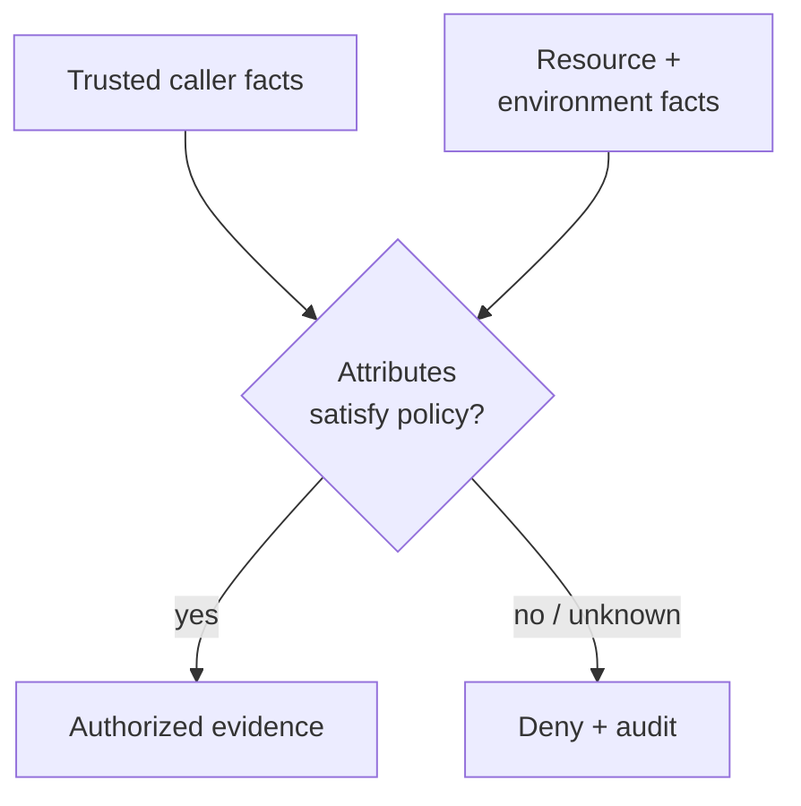

**Attribute-based access control (ABAC)** decides whether an action is allowed by evaluating attributes of the caller, resource, requested operation, and environment. [NIST SP 800-162](https://csrc.nist.gov/pubs/sp/800/162/upd2/final) defines these subject, object, operation, and environmental inputs. Instead of granting every security engineer identical access, an ABAC policy can require the same tenant, the correct department, an active employment record, an approved document classification, and a request made during an authorized incident.

Attributes must come from trusted identity and policy systems. A model's text about caller identity grants no authority. Missing, expired, or unavailable attributes must deny access rather than silently expanding authority.

## How policy follows the request

Unlike [RBAC](glossary://rbac), which groups permissions into roles, ABAC can express conditions crossing several dimensions without creating a separate role for every combination. That flexibility increases policy complexity, evaluation cost, and the importance of keeping source attributes current.

## Example

A retrieval request for `runbook-17` is permitted only when `caller.tenant == document.tenant`, `caller.department == "security"`, `document.classification != "restricted"`, and the caller's incident assignment hasn't expired. A contractor with the same job title but a different tenant fails before any protected chunk reaches ranking, tracing, or generation.

## Why it matters here

Enterprise RAG lessons compare roles, attributes, and relationship graphs because similarity search doesn't enforce any of them automatically. Push ABAC decisions into the trusted retrieval boundary, include revocation freshness in the decision, and apply the same policy to summaries, cached answers, citations, and agent tools.

## Related terms

- [RBAC](glossary://rbac)
- [Access control list](glossary://acl)
- [Tenant isolation](glossary://tenant-isolation)
- [Fail closed](glossary://fail-closed)
