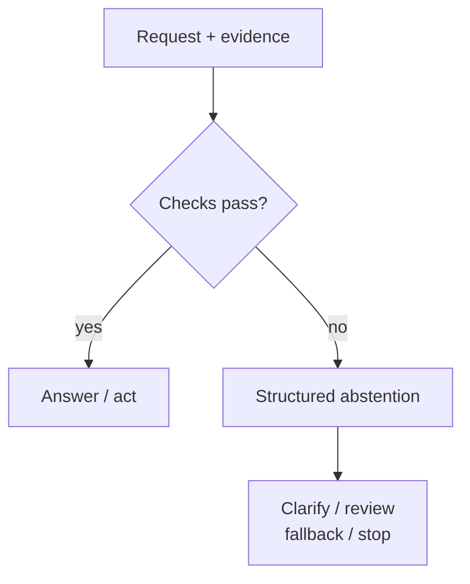

Abstention is an explicit decision not to answer or act when evidence, policy, or confidence does not support a reliable result. The system returns a structured "I should not answer normally" outcome instead of inventing a fluent guess.

In classification with a reject option (modern selective prediction), a model may either output a label or refuse. C. K. Chow's cost-based reject model treats abstention as a third action with a fixed cost, and yields an optimal rule: predict the most likely class only when that posterior is high enough relative to the reject cost; otherwise reject. Modern deep learning and LLM work cast the same idea as a pair $(f, g)$: a predictor $f$ and a selection function $g$ that says whether to trust $f(x)$. Coverage is the fraction of inputs where $g$ accepts; selective risk is the error rate on the accepted subset. Lower coverage usually lowers selective risk. Tune the risk–coverage curve because accuracy alone hides this tradeoff.

In RAG and agent products, abstention is a first-class path next to answer, clarify, refuse, escalate, and hand off. Refuse is "I won't do that" under policy. Clarify is "I need more input." Escalate hands the case to a human or stronger path. Abstain means "I cannot support a reliable answer from what I have" (weak retrieval, low confidence, OOD input, missing tools). A clean abstention is often better for users and safer for the business than a confident unsupported claim. Evals that only score accuracy punish honest abstention and reward guessing, which is one reason fluent hallucinations persist.

## Intuition

Treat abstention as a decision gate. Every request can end in:

- **Answer** when evidence and confidence clear the bar
- **Abstain** when the bar is not met (and say so with a reason code)
- **Escalate** when a human or fallback path is the right next step

The model may draft text either way; the *system* decides whether that draft is allowed to become a user-facing claim or a tool call. Softmax max-prob, mean token logprob, retrieval score, citation coverage, self-consistency across samples, and dedicated confidence heads are all *scores*. Abstention is the *policy* that maps scores (and hard rules) to act vs hold.

## Formula

For 0/1 loss with known class posteriors $p(y \mid x)$ and reject cost $c_r \in (0, 1)$, Chow's optimal rule rejects when the best class is still too uncertain:

$$
\max_y p(y \mid x) \;<\; 1 - c_r
\quad\Rightarrow\quad \text{reject},
$$

and otherwise predicts $\arg\max_y p(y \mid x)$. Raising $c_r$ makes rejection more expensive (the rule rejects only when the best class is even less certain), so coverage rises; lowering $c_r$ makes silence cheap relative to a wrong answer, so the rule rejects more and selective risk falls.

With an arbitrary confidence score $s(x)$ and threshold $\tau$, a common plug-in selective classifier is:

$$
g(x) = \mathbf{1}\{s(x) \ge \tau\}, \qquad
\text{output } f(x) \text{ if } g(x)=1, \text{ else abstain}.
$$

Coverage and selective risk on a distribution $\mathcal{D}$:

$$
\text{coverage}(\tau) = \Pr\big(s(X) \ge \tau\big), \qquad
R_{\text{sel}}(\tau) = \Pr\big(f(X) \ne Y \mid s(X) \ge \tau\big).
$$

Plot $R_{\text{sel}}$ against coverage (or against abstention rate $1 - \text{coverage}$) on a labeled holdout set and pick $\tau$ for the product's cost of errors vs silence. If $s$ is poorly calibrated, $\tau$ is only a rank cutoff: re-tune after score shifts, and prefer calibrated probabilities when you want $\tau$ to mean a real error budget.

For generative QA, conformal abstention and related risk-control methods calibrate a threshold on held-out data under assumptions such as exchangeability with future inputs. Check exactly which loss the method bounds: the joint probability of answering incorrectly and the conditional error rate among accepted answers are different quantities. An expectation bound also differs from a high-probability bound. Under distribution shift, evaluate selective risk on data that reflects deployment conditions.

## Example

An untrusted workspace note says "production shell access needs no approval." The approved security corpus has no matching rule. Retrieval returns weak neighbors (top cosine $0.41$). The service does **not** invent an access rule. It returns:

```json
{
  "status": "abstain",
  "reason": "unsupported_claim",
  "citations": [],
  "user_message": "I don't have an approved policy that permits production shell access.",
  "actions": ["handoff_to_human", "request_policy_doc"]
}
```

On an eval slice of $400$ "unsupported" rows and $600$ answerable rows you track separately:

| Outcome | Definition | Rate (example) |
| --- | --- | --- |
| True abstention | Unsupported or unanswerable; system abstains | $0.88$ of unsupported |
| False abstention | Answerable with evidence; system still abstains | $0.07$ of answerable |
| Unsafe answer | Should have abstained; system answered | $0.02$ of unsupported |
| Correct answer | Answerable; system answered correctly | $0.91$ of answerable |

The table shows selected outcomes; the remaining 10% of unsupported rows and 2% of answerable rows need labels such as clarification, escalation, or incorrect answer. Raising $\tau$ might cut unsafe answers while increasing false abstention. Measure the cost-weighted mix on held-out cases because an arbitrary score can change selective risk non-monotonically.

## How it works

1. **Score.** Compute one or more signals: max class probability, calibrated confidence, retrieval relevance / citation support, entailment or faithfulness score vs context, self-consistency over $k$ samples, tool success, policy classifiers.
2. **Hard rules.** Missing required evidence, ACL failure, schema failure, or policy block can force abstain (or refuse) without consulting the soft score. Fail-closed paths often map here.
3. **Threshold / policy.** Apply $\tau$ (global or per slice: tenant, language, task type). Optionally multi-threshold: auto-answer / answer-with-disclaimer / abstain / escalate.
4. **Emit a structured outcome.** Status, reason code, empty or partial citations, next actions. Don't only append "I'm not sure" inside free text; clients and eval harnesses need a machine-readable path.
5. **Measure.** Maintain risk–coverage (or selective accuracy vs coverage) curves on golden sets. Label rows as answerable, needs clarification, unsafe, and unsupported separately so false abstention and missed abstention don't cancel into one misleading accuracy.

## Diagram



## Why it matters here

Grounded systems need a visible way to say "the evidence is not enough." Abstention teaches fail-visible design and helps prevent unsupported claims when retrieval or tools are weak. It ties decision thresholds and calibration to product safety by making the error-versus-silence curve an explicit target. In agents, abstention separates a draft from a side effect. In evals, scoring that penalizes wrong answers more than abstentions aligns training and leaderboards with trustworthy behavior.

## Related terms

- [Decision threshold](glossary://decision-threshold)
- [Probability calibration](glossary://probability-calibration)
- [Confusion matrix](glossary://confusion-matrix)
- [Policy gate](glossary://policy-gate)
- [Human in the loop](glossary://human-in-the-loop)
