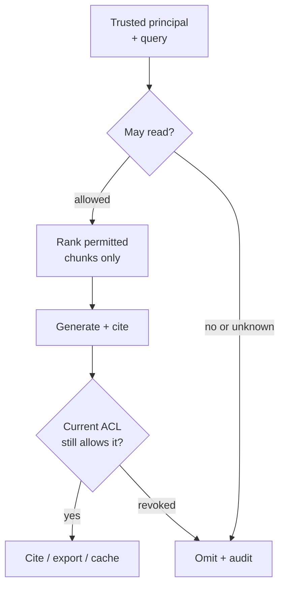

An **access control list (ACL)** is a resource-attached list of *who* may do *what* on that resource. Classically it is the object-oriented view of the access control matrix: each object holds a list of `(principal, rights)` entries rather than each principal holding a list of capabilities. In systems terms the question is always:

> May principal $P$ perform action $A$ on resource $R$?

That decision must run in trusted code, before private text enters a prompt, a tool causes a side effect, or a cache returns another user's answer. The model is not the security boundary.

An ACL entry (sometimes called an ACE) names a principal (user, group, service account, or public/anonymous) and a set of rights (for example `read`, `write`, `admin`, or export). Empty or unknown grants must fail closed: deny. ACL-style control is object-centric. [RBAC](glossary://rbac) is role-centric (permissions ride on roles assigned to people). Production AI products often combine them: roles and groups appear as principals inside per-document ACLs, while service accounts stay least-privileged for tools.

In multi-tenant RAG, enforce authorization as a runtime filter before chunks reach the context window. Index-time grants can go stale by answer time, so compare each candidate with current tenant and user permissions. Later refusal language cannot remove exposure to a chunk that already entered the context.

## How it works

Think of each protected resource (document, chunk, thread, tool, export job) as carrying or referencing a list:

$$
\mathrm{ACL}(R) = \{(P_i, A_i)\}
$$

where $P_i$ is a principal and $A_i$ is a set of allowed actions. Authorization is membership plus action:

$$
\mathrm{allow}(P, A, R) \iff \exists (P', A') \in \mathrm{ACL}(R):\ P' \in \mathrm{expand}(P) \land A \in A'
$$

Here $\mathrm{expand}(P)$ is the authenticated caller's resolved principal set (user id, groups, roles) from a source of truth, not from model text. Evaluation order that stays safe in practice:

1. Authenticate the caller and bind tenant / workspace identity in trusted middleware.
2. Resolve principals (user id, groups, roles) from a source of truth, not from model text.
3. At retrieval, **filter candidates by ACL before ranking** (or use a permission-aware index / metadata filter so denied docs never score).
4. Re-check ACL when packing context, citing sources, streaming partials, writing caches, and exporting.
5. On policy-service timeout or missing metadata, omit the resource ([fail closed](glossary://fail-closed)).
6. Emit an [audit](glossary://audit-trail) event with principal, resource id, action, allow/deny, policy version, and trace id (prefer IDs over raw private text).

Network ACLs (IP allow/deny lists) and object ACLs (document grants) share the name but answer different questions. In this curriculum, **ACL** almost always means document- or resource-level grants in retrieval and agent systems, not firewall rules.

## Example

Document `doc_4821` (tenant `acme`) has this ACL at query time:

| Principal | Rights |
|-----------|--------|
| `role:workspace_admin` | `read`, `write`, `export` |
| `role:support_agent` | `read` |
| `group:legal` | `read` |
| `user:u_contractor` | *(none)* |

User `u_contractor` in tenant `acme`, with none of the granting roles or groups, asks: "Summarize our Q3 security policy." An empty user grant doesn't override a group grant in this allow-only example. ACL systems supporting explicit deny entries need their own precedence rules. The pipeline:

1. **Candidate generation** only considers docs where some expanded principal has `read`. `doc_4821` is excluded before dense/sparse scoring.
2. **Reranker and generator** never receive denied chunk IDs or text. A high similarity score does not override missing rights.
3. **Semantic cache** keys include `tenant_id` and a principal/permission fingerprint, not query text alone. Otherwise user B can hit user A's private answer for the same wording.
4. **Citation / export** re-check ACL. If `legal` was removed from the grant after index time, the export path must deny even if the vector still carries an old `allowed_principals` tag until refresh.

Concrete leak if step 1 is skipped: the top-3 retriever returns chunks with scores $0.91$, $0.88$, $0.72$; two of them are contractor-forbidden. The model answers fluently from private policy language. Redacting the final string is too late; the prompt, logs, and judge inputs may already hold the text.

Minimal allow-only sketch after trusted authentication, tenant matching, and role/group expansion. A full evaluator also needs explicit denies, inheritance, and revocation:

```python
def may_read(principal: dict, doc: dict) -> bool:
    # Fail closed on missing ACL metadata
    acl = doc.get("acl")
    if not acl:
        return False
    principals = set(principal.get("expanded_principals", []))
    for entry in acl:
        if entry["principal"] in principals and "read" in entry["actions"]:
            return True
    return False

def filter_for_read(docs: list[dict], principal: dict) -> list[dict]:
    return [d for d in docs if may_read(principal, d)]
```

Rank only after `filter_for_read` (or push the same predicate into the vector store metadata filter).

## Diagram



## Why it matters here

LeetLLM retrieval and enterprise RAG lessons treat ACL tags as first-class chunk metadata alongside region and version. The production rule is fixed: apply region, ACL, and freshness **inside the retrieval boundary** so hybrid search only ranks permitted current chunks, then pass only those chunks to packing, the model, and caller-visible logs. Practice problems such as document permission filtering encode the same idea: public / tenant / group / private visibility, deny unknown modes, rank after filter.

ACL bugs in LLM products show up as private chunks in prompts, cross-user [semantic cache](glossary://semantic-cache) hits, traces that store denied text, and exports that honor stale index-time grants. Fixing the prompt does not fix any of those paths. Naming principal, resource, action, policy source, allow/deny, denial behavior, and audit event, then testing denials with the same care as allows, is the operational checklist.

## Related terms

- [RBAC](glossary://rbac)
- [Tenant isolation](glossary://tenant-isolation)
- [Action allowlist](glossary://action-allowlist)
- [Fail closed](glossary://fail-closed)
- [Audit trail](glossary://audit-trail)
