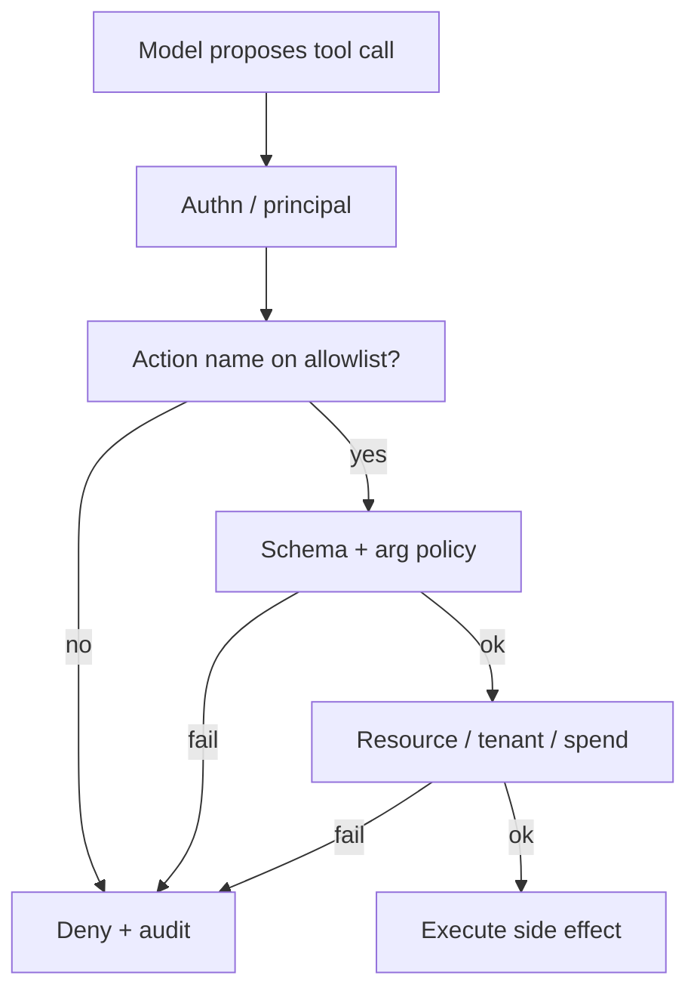

An action allowlist is the exact set of operations an agent runtime is willing to execute. The model may propose tool calls, including names and arguments that look confident and well formed. Trusted application code still decides: if the name is not on the allowlist for this principal, role, session, or risk tier, the call is denied before side effects run.

An allowlist is a default-deny registry enforced by runtime code. A system prompt can show the model a tool schema; the runtime separately authorizes whether to execute that tool. Production systems usually do both: expose a small tool schema to the model, then re-check the same (or a stricter) registry after authentication and before any API, shell, or external side-effect call.

An allowlist also needs an argument policy for repository, path, environment, compute budget, recipient domain, content class, and approval state. Most harmful tool calls use a familiar name with dangerous arguments (`path=../../.env`, `environment=production`, `to=external@…`). Open-ended tools such as "run any shell command" or "fetch any URL" require tight argument scope to enforce the intended boundary.

## Diagram



## Example

A coding agent for an authenticated developer may call only:

| Action | Purpose |
|--------|---------|
| `read_file` | Read files inside the checked-out repository |
| `write_file` | Write files inside the checked-out repository |
| `search_repo` | Search repository text and paths |
| `run_tests` | Run an approved test command in the sandbox |
| `request_approval` | Open a human review ticket |

It cannot call `deploy_production`. When the model emits:

```json
{"name": "deploy_production", "args": {"service": "api", "revision": "r1842"}}
```

The runtime denies before any deployment API runs, logs `denied_action` with caller id, action, sanitized args, rule id, and trace id, and returns a structured error the scaffold can turn into "I need a human approval path."

Name allowlisting alone is still incomplete. Suppose `write_file` is allowlisted, but only for paths inside `/workspace/repo` with a $1$ MB payload cap. Then:

```json
{"name": "write_file", "args": {"path": "/etc/ssh/sshd_config", "content": "…"}}
```

fails argument policy even though the verb is permitted. The same pattern applies to SQL statement kinds for data tools and environment scopes for deployment tools.

```python
ALLOWED = {
    "developer": {"read_file", "write_file", "search_repo", "run_tests", "request_approval"},
    "release_manager": {"read_file", "write_file", "search_repo", "run_tests",
                        "request_approval", "deploy_production"},
}

def authorize_tool(principal, name: str, args: dict) -> None:
    allowed = ALLOWED.get(principal.role, set())
    if name not in allowed:
        audit("denied_action", principal, name, args, rule="name_allowlist")
        raise PermissionError(f"action not allowlisted: {name}")
    validated = TOOL_SCHEMAS[name].parse(args)  # types, required fields
    check_arg_policy(principal, name, validated)  # path, environment, recipient, …
    # only then: execute(name, validated)
```

## How it works

Enforcement sits in the agent scaffold (or a shared policy service the scaffold calls), not in free-form model text:

1. **Authenticate** the user or service principal.
2. **Resolve** the role- or product-specific allowlist (and any session overrides that only *narrow* it).
3. **Match** the proposed action name; unknown names fail closed.
4. **Validate** arguments against a schema (JSON Schema / Pydantic), then against semantic policy (resource ownership, environment, budget, domain, path).
5. **Require approval** for high-impact names even when they are on the list (production deploys, external sends, deletes).
6. **Execute** only after all gates pass; return structured errors the model can recover from without inventing success.
7. **Log** allows and denials with enough fields for forensics: caller, action, sanitized args or arg hash, rule id, policy version, trace id.

Keep the allowlist small and product-shaped. Prefer `read_file` and `deploy_production` over a single `call_backend(method, path, body)` mega-tool. Broad tools push the real policy into argument inspection that is easy to get wrong under prompt injection. Version the registry with the scaffold; when you add a write tool, add tests that assert non-privileged roles still cannot call it.

Model-side controls such as OpenAI's `tool_choice` (including the `allowed_tools` mode that subsets the tools list for a request, often for caching) constrain what that API call accepts from the model. Runtime code must also enforce its own allowlist. A compromised prompt, a jailbreak, a different client, or a misconfigured tool registry can still surface a forbidden name, so trusted code after authentication must refuse to run it.

## Why it matters here

Agent product risk is mostly agency: the model can request tools that change production state, delete data, or leave the network. An action allowlist is the first runtime boundary that keeps tool use product-shaped instead of open-ended system access. OWASP-style agent guidance stresses least privilege on tools, avoiding open-ended shell/URL extensions, and treating planner output as untrusted. Without a name-and-argument allowlist enforced fail-closed, every other control (sandbox, audit log, human review) is either too late or too easy to walk around.

## Related terms

- [Tool calling](glossary://tool-calling)
- [Policy gate](glossary://policy-gate)
- [Least privilege](glossary://least-privilege)
- [Fail closed](glossary://fail-closed)
- [Human in the loop](glossary://human-in-the-loop)
