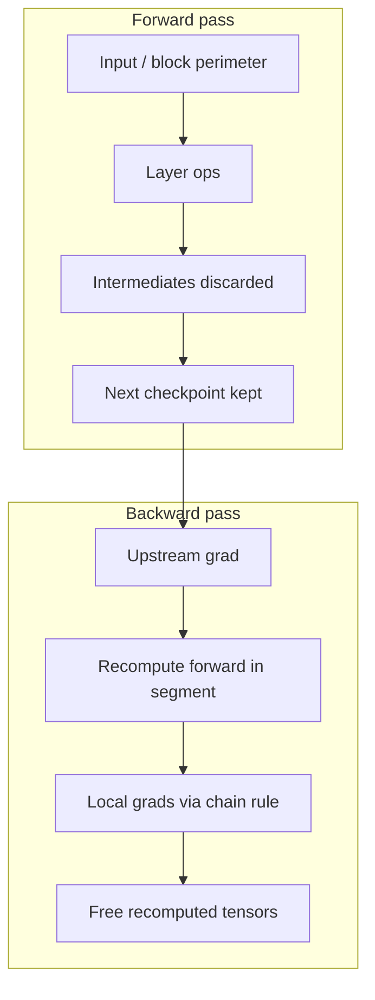

Activation checkpointing (also called **gradient checkpointing** or **activation recomputation**) cuts training memory by discarding selected forward-pass activations and recomputing them during [backpropagation](glossary://backpropagation). Autograd normally saves tensors required by backward operations, not necessarily every intermediate or an explicit Jacobian. Checkpointing saves chosen partitions and rebuilds omitted tensors when their gradients are needed.

The trade is deliberate: extra FLOPs and usually higher step time, in exchange for lower peak activation memory. That free memory can go to larger microbatches, longer sequences, or models that otherwise OOM. The technique targets **activation** memory. It does not shrink parameters, [optimizer state](glossary://optimizer-state), or gradient buffers by itself. Those need sharding tools such as [FSDP](glossary://fsdp) or [ZeRO](glossary://zero).

Do not confuse this with **model checkpointing** (periodically saving weights to disk). Same word, different job.

## How it works

1. **Forward.** Run the network as usual, but only store activations at chosen checkpoint split points (for example, each transformer block input). Free intermediates inside a checkpointed segment as soon as that segment finishes.
2. **Backward.** When gradients reach a checkpointed segment, re-run its forward from the saved perimeter tensors, rebuild the missing intermediates, compute gradients for that segment, then free the recomputed tensors again.
3. **Result.** Peak live activations track roughly "one segment's worth" plus the stored checkpoints, not the full depth of the net at once.

Equal-spacing analysis from Chen et al. (2016) shows a clean asymptotic: for an $n$-layer chain, store a checkpoint every $\sqrt{n}$ layers. You hold about $\sqrt{n}$ checkpoints, and each recompute segment is length $\sqrt{n}$, so peak activation memory scales as $O(\sqrt{n})$ with only about one extra full forward per step. In the extreme, recursive checkpointing can reach $O(\log n)$ memory at $O(n \log n)$ extra forward cost. Their experiments reported a 1,000-layer ResNet dropping from about 48 GB to 7 GB of memory with roughly 30% extra runtime on ImageNet-scale training.

## Diagram



## Formula

Without checkpointing, activation memory for a depth-$L$ stack often scales like

$$
M_{\text{act}} \propto B \cdot S \cdot H \cdot L
$$

for batch $B$, sequence length $S$, and hidden size $H$ (plus attention intermediates that can grow with $S^2$ per layer if materialized).

With evenly spaced checkpoints every $\sqrt{L}$ layers (Chen-style), stored checkpoints scale like $\sqrt{L}$ and live recompute working set like one segment, so

$$
M_{\text{act}}^{\text{ckpt}} \sim O\!\left(B \cdot S \cdot H \cdot \sqrt{L}\right)
$$

plus whatever you still choose to keep (for example attention scores if not recomputed). Compute becomes roughly

$$
\text{FLOPs}_{\text{step}} \approx \text{FLOPs}_{\text{fwd}} + \text{FLOPs}_{\text{bwd}} + \text{FLOPs}_{\text{recompute}}
$$

where full-layer recomputation can add roughly another forward pass. Its wall-time impact depends on kernels, memory pressure, communication, and implementation. Selective schemes can keep expensive matmul outputs and recompute cheaper operations, reducing recompute work.

## Example

A 32-block transformer trains at sequence length $4096$ and microbatch $1$, then OOMs when every intermediate is retained for backward. You wrap each transformer block with checkpointing:

```python
from torch.utils.checkpoint import checkpoint

def forward(self, x):
    for block in self.blocks:
        # Prefer use_reentrant=False (PyTorch recommendation)
        x = checkpoint(block, x, use_reentrant=False)
    return x
```

Or, with Hugging Face Transformers:

```python
model.gradient_checkpointing_enable(
    gradient_checkpointing_kwargs={"use_reentrant": False}
)
```

Forward now saves block partitions and other required state. Backward recomputes omitted operations before calculating gradients; the non-reentrant implementation can stop once necessary tensors are rebuilt. Whether this frees enough memory for microbatch $2$ or length $4096$ must be measured. Don't assume a fixed memory or step-time factor.

Sanity check on a tiny run with and without checkpointing: peak allocated memory should fall, step time should rise, and loss curves plus gradient norms should match within numerical noise. If memory barely moves, activations were not the bottleneck (look at optimizer/parameter sharding, fragmentation, or host-side pressure instead).

## Selective recomputation

Full-layer checkpointing is simple but can recompute expensive work you would rather keep. Large transformer stacks often use **selective activation recomputation** (Korthikanti et al., 2022; Megatron / DeepSpeed-style training): keep tensors that are costly to recompute and relatively small, and recompute ops that are memory-heavy but cheap (notably attention intermediates that scale poorly with sequence length). In that regime, memory still falls a lot while recompute overhead can shrink by an order of magnitude versus full recompute. PyTorch also exposes selective policies via `create_selective_checkpoint_contexts` and `CheckpointPolicy` for op-level save vs recompute control.

## Placement and production details

- **Checkpoint large repeated blocks** (transformer layers, residual stages), not tiny glue ops. partitions should align with natural module cuts so recompute work is coherent.
- **RNG and dropout.** Recompute re-runs stochastic ops. PyTorch stashes and restores RNG by default (`preserve_rng_state=True`) so dropout masks match the original forward; that bookkeeping has a cost, and multi-device RNG edge cases can still bite.
- **`use_reentrant`.** Prefer `use_reentrant=False`. The reentrant path has stricter requirements (for example inputs needing `requires_grad`) and more interaction bugs with DDP and nested structures. Pass the flag explicitly.
- **Mixed precision.** Autocast regions and dtype partitions must behave the same on recompute as on the first forward, or you can get silent numeric skew.
- **Distributed training.** Checkpointing pairs with [FSDP](glossary://fsdp), [ZeRO](glossary://zero), and pipeline parallelism because sharding solves model-state memory while activations still grow with $B$, $S$, and depth. Pipeline stages with many in-flight microbatches amplify activation pressure; checkpointing is often mandatory there.
- **Debug path.** If checkpointing prevents OOM, saved activations were enough to cross the memory limit, but does not need to be the largest memory component. Tune segment size: smaller segments reduce the recompute working set while storing more partitions, so memory does not need to decrease monotonically. Also inspect sequence length, microbatch, state sharding, RNG, custom autograd, and mutable state used during recomputation.

## Why it matters here

When learners train or fine-tune large models, the first OOM is often activation memory under long context, not the weight tensors. Activation checkpointing is the standard "compute for memory" knob next to [mixed precision](glossary://mixed-precision), FSDP/ZeRO, and microbatching. Understanding what it saves (and what it does not) keeps memory debugging honest: shard state when parameters and Adam moments dominate; checkpoint when the live graph of activations dominates.

## Related terms

- [Backpropagation](glossary://backpropagation)
- [FSDP](glossary://fsdp)
- [ZeRO](glossary://zero)
- [Optimizer state](glossary://optimizer-state)
- [Mixed precision](glossary://mixed-precision)
