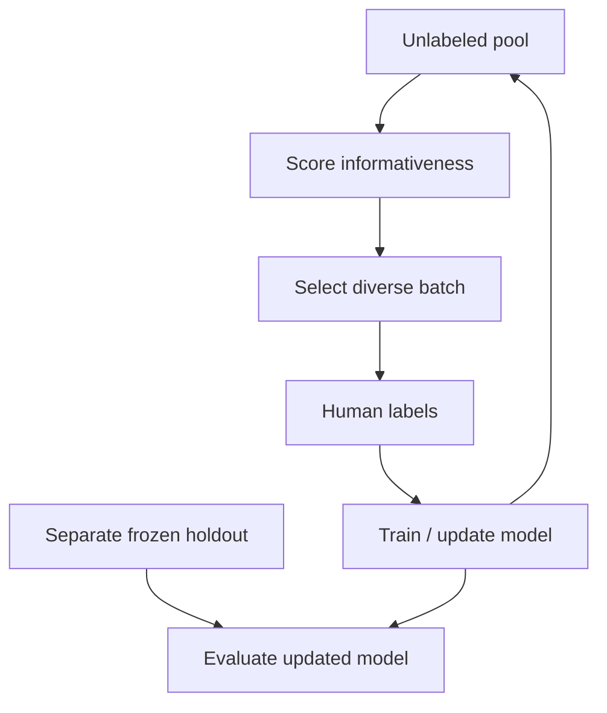

Active learning is a label-selection strategy: given a large pool (or stream) of unlabeled examples and a limited labeling budget, the system chooses which items a human (or other oracle) should label next. The goal is to improve a model or expand evaluation coverage per unit of review time.

Clear rubrics, rater training, and quality control still determine label quality. A clever selector that routes ambiguous cases to confused reviewers still produces [label noise](glossary://label-noise). Active learning sets queue priorities within a human-feedback pipeline.

## Diagram

## How it works

Classic active learning assumes a small labeled set $L$ and a large unlabeled set $U$. Each cycle:

1. Fit (or update) a model on $L$.
2. Score candidates in $U$ with a query strategy.
3. Ask the oracle for labels on a batch of top-scoring items.
4. Move those items into $L$ (or into a frozen eval set, if that is their job).
5. Repeat until the budget runs out or a stopping rule fires.

Settles' survey distinguishes three query *scenarios*: pool-based sampling (rank a stored pool, the usual production case), stream-based selective sampling (accept or discard each arrival once), and membership-query synthesis (invent synthetic inputs). Product ML usually selects from real traffic through pool-based or stream-based methods. Synthetic queries help only when reviewers can interpret them.

## Query strategies

**Uncertainty sampling** asks for labels where the current model is least sure. For a probabilistic classifier with parameters $\theta$:

- **Least confident:** pick the example with the lowest top-class probability
  $$
  x_{\mathrm{LC}} = \arg\max_x \bigl(1 - P_\theta(\hat{y}\mid x)\bigr),
  \quad \hat{y} = \arg\max_y P_\theta(y\mid x).
  $$
- **Margin:** pick the smallest gap between the top two classes
  $$
  x_{\mathrm{M}} = \arg\min_x \bigl(P_\theta(\hat{y}_1\mid x) - P_\theta(\hat{y}_2\mid x)\bigr).
  $$
- **Entropy:** pick the most mixed full posterior
  $$
  x_{\mathrm{H}} = \arg\max_x \Bigl(-\sum_i P_\theta(y_i\mid x)\log P_\theta(y_i\mid x)\Bigr).
  $$

For binary classification these three tend to agree (all peaking near $P=0.5$). With many classes they diverge: entropy cares about the whole distribution; least-confident only looks at the winner.

**Query-by-committee (QBC)** trains several models on the same $L$ and scores disagreement (vote entropy, KL divergence across members). The premise is version-space shrinkage: labels that split competing hypotheses shrink the set of still-plausible models faster than labels everyone already agrees on.

**Diversity / density / core-set** methods stop pure uncertainty from flooding the queue with near-duplicates or outliers. Density-weighted strategies favor uncertain points that also sit in dense regions of $U$. Core-set selection chooses examples that expand coverage of the unlabeled pool in embedding space and improve geometric representativeness. Combine that coverage score with uncertainty or disagreement when the goal also includes challenging examples.

Production selectors usually **mix** signals: uncertainty or model disagreement, coverage of rare slices, drifted traffic, business-critical policies, and a random baseline so you can measure whether selection actually helped.

## Example

A moderation classifier has $500$ reviewer hours this month (about $4{,}000$ labels at $7.5$ minutes each). The unlabeled pool is millions of tickets. A hybrid queue might allocate:

| Share | Selector | Intent |
|------:|----------|--------|
| $40\%$ | scores in $[0.45, 0.55]$ near the ship threshold | fix decision-boundary errors |
| $20\%$ | model A vs model B disagreement | expose competing hypotheses and model-specific blind spots |
| $20\%$ | underrepresented policy slices (self-harm-adjacent, sarcasm) | cover rare slices alongside uncertain cases |
| $10\%$ | embedding neighborhoods that drifted from training | catch new traffic modes |
| $10\%$ | uniform random from production | baseline and sanity check |

In a hypothetical cycle, disjoint labels feed retraining and an evaluation expansion. Measure improvement on a separately frozen test set. Actively selected evaluation cases overrepresent difficult inputs, so estimating traffic-wide accuracy requires a suitable sampling analysis. If threshold-region error falls from $0.18$ to $0.11$, compare that gain with an equal-budget random-selection training baseline under the same training recipe and fixed evaluation. Compare both selectors before choosing the one for production.

For LLM preference data, $P(A \succ B)\approx0.5$ makes a pair uncertain under that model. The label can help when the uncertainty is learnable or reviewers can resolve an ambiguous preference. A confident $P=0.97$ pair can still expose a confident error. Mix uncertainty with diversity and a random baseline.

## What fails in production

Pure uncertainty sampling can overrepresent outliers and near-duplicates. Selection quality depends on how confidence scores order useful cases; calibration measures probability accuracy, while information value needs its own evaluation. Freeze evaluation IDs, adjudicate ambiguous labels, and record why each example was selected, its rater and rubric version, and its disjoint training or evaluation destination. Tuning on evaluation labels turns those cases into development data.

## Why it matters here

Active learning is the budget dial on human feedback: it connects scarce review time to dataset quality, [evaluation slice](glossary://evaluation-slice) coverage, drift response, and model iteration. In the labeling and HITL curriculum it is the selection step after redaction and routing. Measure its value against a random baseline on a frozen holdout as part of a well-designed review process.

## Related terms

- [Human in the loop](glossary://human-in-the-loop)
- [Label noise](glossary://label-noise)
- [Evaluation slice](glossary://evaluation-slice)
- [Golden dataset](glossary://golden-dataset)
- [Data drift](glossary://data-drift)
