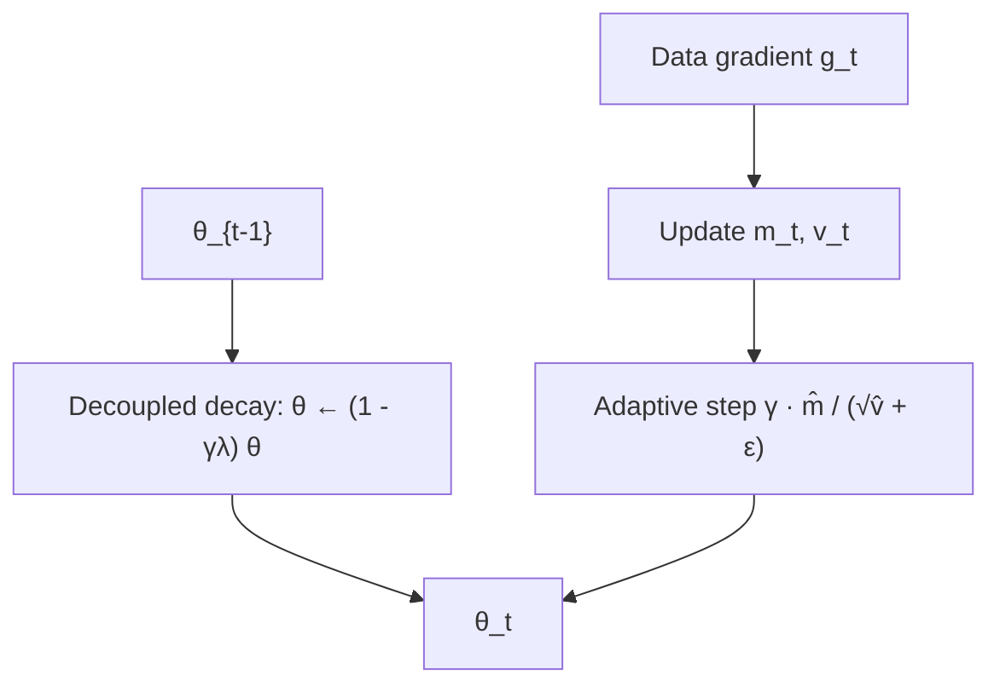

AdamW is Adam with **decoupled weight decay**: the optimizer tracks first and second gradient moments while a separate multiplicative decay shrinks parameters. The decay term stays out of those moments. Loshchilov and Hutter (2017) showed how "Adam + L2" regularizes adaptive coordinates through their gradient history. Adding $\lambda\theta$ to the gradient and scaling by $1/\sqrt{\hat{v}}$ makes regularization depend on that history. AdamW applies shrinkage at a rate set by $\lambda$ and the learning rate, independently of adaptive rescaling.

AdamW is a common optimizer for transformer training and fine-tuning. Check the actual recipe rather than assuming every stack uses it: identify the adaptive step, decay coefficient, and tensors in the no-decay group.

## How it works

Adam maintains two exponential moving averages per parameter:

- $m_t$: smoothed gradient (momentum / first moment)
- $v_t$: smoothed squared gradient (second moment, uncentered)

Bias-corrected estimates $\hat{m}_t$ and $\hat{v}_t$ give a coordinate-wise adaptive step. Weight decay is applied **outside** that adaptive ratio: parameters are multiplied by $(1 - \gamma\lambda)$ (PyTorch) rather than folding $\lambda\theta$ into $g_t$.

Coupled L2 inside Adam does this roughly:

$$
g_t \leftarrow \nabla f_t(\theta_{t-1}) + \lambda\,\theta_{t-1},
\quad
\theta_t \leftarrow \theta_{t-1} - \gamma\,\frac{\hat{m}_t}{\sqrt{\hat{v}_t}+\epsilon}
$$

so the penalty rides through the same adaptive denominator as the data gradient. Weights with historically large gradients get regularized less than weights with small gradients. AdamW avoids that coupling.

## Formula

PyTorch's AdamW (the implementation most training stacks call) applies decoupled decay first, then the adaptive step:

$$
\begin{aligned}
\theta_t &\leftarrow \theta_{t-1} - \gamma\lambda\,\theta_{t-1} \\
m_t &\leftarrow \beta_1 m_{t-1} + (1-\beta_1)\,g_t \\
v_t &\leftarrow \beta_2 v_{t-1} + (1-\beta_2)\,g_t^2 \\
\hat{m}_t &\leftarrow \frac{m_t}{1-\beta_1^t},\quad
\hat{v}_t \leftarrow \frac{v_t}{1-\beta_2^t} \\
\theta_t &\leftarrow \theta_t - \gamma\,\frac{\hat{m}_t}{\sqrt{\hat{v}_t}+\epsilon}
\end{aligned}
$$

Equivalently, in one line:

$$
\theta_t \leftarrow (1 - \gamma\lambda)\,\theta_{t-1} - \gamma\,\frac{\hat{m}_t}{\sqrt{\hat{v}_t}+\epsilon}
$$

Here $\gamma$ is the learning rate, $\lambda$ the weight-decay coefficient, and $g_t=\nabla f_t(\theta_{t-1})$ is the **data** gradient only. Common defaults match PyTorch: $\beta_1=0.9$, $\beta_2=0.999$, $\epsilon=10^{-8}$, and often $\lambda=0.01$ when decay is enabled in the library default. LLM pretrain and SFT recipes commonly set $\lambda$ in about $0.01$–$0.1$ on matrix weights; read the training recipe rather than cargo-culting the optimizer default.

The original paper writes the combined step with an explicit schedule multiplier $\eta_t$ as

$$
\theta_t \leftarrow \theta_{t-1} - \eta_t\left(\alpha\,\frac{\hat{m}_t}{\sqrt{\hat{v}_t}+\epsilon} + \lambda\,\theta_{t-1}\right)
$$

which has the same separation of decay from $m$ and $v$, but a different coefficient convention. To match the two equations with $\gamma=\eta_t\alpha$, the PyTorch decay coefficient must be the paper's $\lambda/\alpha$. Don't copy the same numeric $\lambda$ between conventions and assume identical shrinkage.

## Diagram



## Worked numbers

Take a scalar weight $\theta=10$, data gradient $g=0$ (no signal this step), $\gamma=0.1$, $\lambda=0.01$, and fresh Adam moments so the adaptive path is idle.

**AdamW:** only decay fires:

$$
\theta \leftarrow 10 - 0.1\cdot 0.01\cdot 10 = 9.99
$$

**Coupled L2 into Adam** on the first step treats $g=\lambda\theta=0.1$. With empty moments and bias correction the adaptive denominator can produce a step near the full learning rate in magnitude, landing near $9.9$ rather than $9.99$. Same labels in a config (`weight_decay=0.01`), different update rules, different trajectories once moments warm up.

That gap is the whole reason AdamW exists: when adaptive scaling touches the regularizer, "L2" stops behaving like classical weight decay.

## Example

A small supervised fine-tune recipe:

```python
import torch
from torch import nn

model = nn.Linear(768, 10)
decay, no_decay = [], []
for name, p in model.named_parameters():
    if not p.requires_grad:
        continue
    if p.ndim == 1 or name.endswith(".bias"):
        no_decay.append(p)   # biases, norms, 1-D scales
    else:
        decay.append(p)

optimizer = torch.optim.AdamW(
    [
        {"params": decay, "weight_decay": 0.01},
        {"params": no_decay, "weight_decay": 0.0},
    ],
    lr=2e-5,
    betas=(0.9, 0.999),
)
```

Pair that with a short linear warmup (a few percent of total steps), cosine decay of $\gamma$, and global grad clip at $1.0$. Two runs that only swap `torch.optim.Adam(..., weight_decay=0.01)` for true AdamW can land at different validation loss and different peak-LR stability even when every other hyperparameter matches.

## Parameter groups and production gotchas

| Choice | Why it matters |
| --- | --- |
| Decay on matrix weights only | Norms, biases, and 1-D scales are usually left at $\lambda=0$ in LLM recipes |
| `Adam` vs `AdamW` in the library | Check whether Adam's `decoupled_weight_decay` option is enabled; the coupled default and AdamW have different decay paths |
| Checkpoint restore | Moments $m,v$ are large. Resume from optimizer state alongside model weights. |
| LoRA / adapters | Blind high decay on tiny adapter tensors can wipe the adaptation signal |
| Schedule interaction | Effective decay per step scales with $\gamma$; warmup and cosine change the shrink rate over the run |

With two fp32 moment buffers, AdamW's moments use 8 bytes per parameter, before master weights and other state. Moment dtype and storage depend on the implementation; low-precision or quantized optimizer variants differ. This accounting motivates optimizer-state sharding.

## Why it matters here

Optimizer, fine-tuning, and training-memory lessons require reading decay, scheduling, clipping, and parameter-group settings. Diagnose those choices from the actual update rule and restored moment state, rather than treating every setting named `weight_decay` as the same algorithm.

## Related terms

- [Optimizer](glossary://optimizer)
- [Weight decay](glossary://weight-decay)
- [Learning rate](glossary://learning-rate)
- [Learning rate schedule](glossary://learning-rate-schedule)
- [Optimizer state](glossary://optimizer-state)
