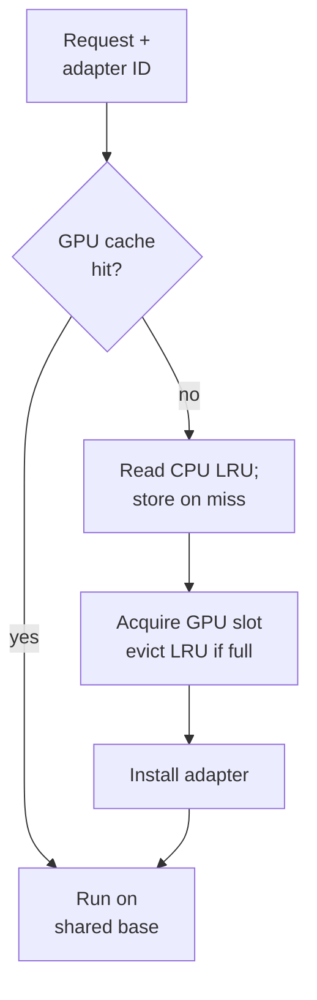

An adapter cache keeps recently used LoRA (or similar PEFT) adapter weights resident near a shared base model so requests can switch specialized behavior without reloading from disk or object storage on every call. The base checkpoint stays loaded; only the small low-rank updates move in and out under memory pressure.

That makes multi-tenant or multi-task serving a routing and capacity problem as well as a storage optimization. Hot adapters sit on GPU for zero-load switches. Warm adapters sit in CPU RAM and promote into GPU slots. Cold adapters pay download and materialization cost, and may force eviction of a cooler resident. Adapter memory competes with base weights, KV cache, runtime buffers, and batch size, so even a small adapter affects concurrency and continuous batching.

In production engines such as vLLM, this is usually a two-tier design: `max_loras` bounds how many adapters can be active on GPU in a batch, and `max_cpu_loras` bounds an LRU-managed CPU store of loaded adapters. Engines pre-allocate buffers up to `max_lora_rank`, so setting rank capacity far above your real adapters wastes VRAM even when few adapters are hot.

## Diagram



## How it works

1. **Route** the request to an authorized adapter id (tenant, task, product, version).
2. **Lookup** that id in the GPU-resident set (capacity ≈ `max_loras`).
3. On miss, **promote** from a larger CPU LRU (capacity ≈ `max_cpu_loras`) or **load** from local disk / object storage / hub.
4. If GPU capacity is full, **evict** the least-recently-used GPU adapter (or a non-pinned one), then install the new weights into pre-allocated LoRA buffers.
5. **Generate** with the shared base weights plus the active low-rank updates. KV state can depend on the adapter even if it doesn't directly target $k$/$v$: earlier adapted layers change later hidden states. Don't reuse a prefix cache across adapter identities unless equivalence is established. Adapter identity belongs in the serving context.

Pinning changes the policy: high-SLA tenants can stay permanently resident while best-effort adapters compete for the remaining slots. Warmup (a dummy short request per critical adapter) reduces first-hit latency after deploy or scale-out.

## Example

A support product shares one 70B base on a GPU fleet and trains $48$ tenant LoRA adapters at rank $r=16$. Disk size is still tiny next to a full checkpoint, but it depends on which modules you adapt. For a 70B-class model with GQA ($d{=}8192$, $\sim 80$ layers, fp16/bf16 weights only):

| Target modules | Rough adapter size |
|----------------|--------------------|
| $q{,}v$ only | $\sim 65$ MB |
| Attention projections ($q{,}k{,}v{,}o$) | $\sim 130$ MB |
| Attention + MLP linears | $\sim 400$ MB |

A second 70B checkpoint uses roughly 140 GB for 16-bit weight values alone, or 35 GB for packed 4-bit values before metadata. These arithmetic estimates show the order of magnitude. Measure actual engine allocations for capacity planning.

Capacity plan for one replica:

| Tier | Knob (vLLM-style) | Count | Role |
|------|-------------------|-------|------|
| GPU hot set | `max_loras = 12` | $12$ | Concurrent active adapters in batches |
| CPU warm set | `max_cpu_loras = 32` | $32$ | LRU buffer before disk reload |
| Store | object storage | $48$ | Source of truth for all tenants |

During business hours the $12$ hottest tenants stay GPU-resident. A cold tenant pays a load stall (often hundreds of milliseconds from local disk; more from remote store) and may evict a cooler GPU adapter. If tenants A and B alternate on every request with `max_loras = 1`, the cache thrashes: every request reloads weights and TTFT spikes even though each adapter is "small."

Correctness is separate from hit rate. Keys must include tenant (or product), adapter version, base-model revision, and any quantization or safety-policy identity that changes which weights apply. If the key omits `tenant_id` or `adapter_version`, tenant A can be served with tenant B's specialized weights: a silent behavior mix even when document ACLs are correct.

```python
from collections import OrderedDict

class AdapterCache:
    """Minimal GPU hot-set sketch (LRU by recency)."""

    def __init__(self, max_loras: int) -> None:
        if max_loras < 1:
            raise ValueError("max_loras must be positive")
        self.max_loras = max_loras
        self.gpu: OrderedDict[str, object] = OrderedDict()

    def get(self, adapter_id: str, load_fn) -> object:
        if adapter_id in self.gpu:
            self.gpu.move_to_end(adapter_id)
            return self.gpu[adapter_id]
        if len(self.gpu) >= self.max_loras:
            evicted, _ = self.gpu.popitem(last=False)
            # engine would free GPU buffers for evicted here
        weights = load_fn(adapter_id)
        self.gpu[adapter_id] = weights
        return weights
```

## Sizing and pressure

Adapter footprint scales with rank, number of target modules, and layers, not with full base size. For a frozen weight $W_0 \in \mathbb{R}^{d \times k}$ and LoRA factors $B \in \mathbb{R}^{d \times r}$, $A \in \mathbb{R}^{r \times k}$, the trainable parameter count for that layer is

$$
|\Theta_{\text{layer}}| = r(d + k)
$$

(not $dk$). Sum over adapted modules and store at $2$ bytes per parameter for fp16/bf16. Raising `max_lora_rank` above the true max rank reserves larger GPU buffers at startup without helping smaller adapters. Raising `max_loras` increases simultaneous specialized behaviors per batch but shrinks headroom for KV cache and continuous batching.

Measure hit rate (GPU and CPU tiers separately), load latency, eviction reason, concurrent distinct adapters per window, and whether loads force batch splits or preemptions. A high hit rate on a wrong key is worse than a miss: you are fast and incorrect.

## Why it matters here

Adapter caching is how PEFT becomes a multi-tenant product: one base model, many specialized behaviors, shared hardware. It ties LoRA training artifacts to inference scheduling, tenant isolation, cache-key design, and memory pressure. Curriculum system-design work (routing, SLAs, thrash under alternating tenants) sits on this same mechanism that production engines implement with `max_loras` / `max_cpu_loras` style knobs.

## Related terms

- [LoRA](glossary://lora)
- [Tenant isolation](glossary://tenant-isolation)
- [LRU cache](glossary://lru-cache)
- [Continuous batching](glossary://continuous-batching)
- [Cache hit rate](glossary://cache-hit-rate)
