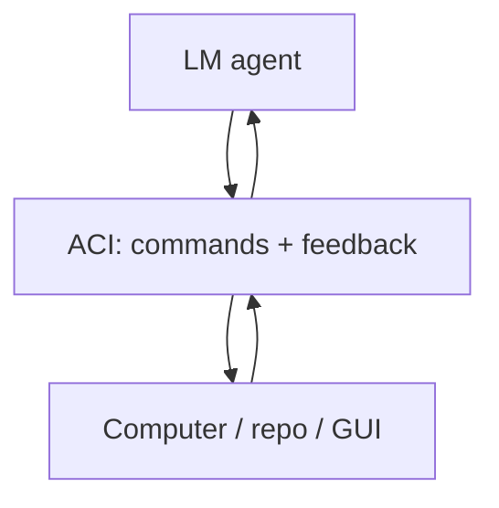

An Agent-Computer Interface (ACI) is the abstraction layer between a language-model agent and a computer environment: the commands the agent may issue, the shape of environment feedback, and the guardrails that accept or reject actions. It is the model's workstation, not the human UI. Think line-numbered file views, search with bounded result lists, patch tools with lint checks, test runners with structured output, shells under policy, and permission boundaries.

Humans and LMs are different end users. Humans can ignore clutter and recover from messy diffs; LMs pay a fixed cost for every token and often fail hard on unreadable feedback. HCI designs for people. ACI design shapes actions, documentation, and observations for what models can parse and recover from. Yang et al. (NeurIPS 2024) introduced this ACI framing in SWE-agent: for a fixed model, redesigning the interface can move task success without changing weights.

The ACI is the tool surface. The [agent scaffold](glossary://agent-scaffold) is the surrounding loop that packs context, runs tools, retries, and stops. Benchmark scores almost always measure model plus interface plus scaffold together. A cleaner viewer, a reliable edit tool, and structured test output can raise repair rates while the checkpoint stays fixed.

## Diagram

## How it works

An ACI usually specifies four things:

1. **Action space.** Provide named operations with small argument grammars (`open`, `scroll_down`, `edit`, `search_dir`, `run_tests`) and constrain any shell access.
2. **Observation format.** What returns after each step: windowed file text with line numbers, search hit lists, linter errors, test summaries, empty-output notices.
3. **State the runtime owns.** Cursor, open file, first visible line, last search query. The model should not rebuild "where am I" from raw history every turn.
4. **Guardrails.** Syntax checks before an edit sticks, caps on search result size, deny lists for dangerous commands, sandboxes, and approval gates for side effects.

SWE-agent's design study distilled four practical principles: keep actions simple; pack important work into compact steps (one multi-line edit, not twenty fragile shell ops); make feedback informative but short; add guardrails so bad edits fail fast and recover.

The same idea extends beyond repos. GUI agents (for example Agent S on OSWorld) use a language-centric ACI: screenshot plus accessibility tree for grounding, and a bounded set of primitives such as `click(element_id)` instead of free mouse deltas or arbitrary code blobs. Dual perception plus discrete, feedback-per-step actions is still ACI design, just for desktops instead of git trees.

## Example

On SWE-bench Lite (300 instances), Yang et al. kept GPT-4 Turbo fixed and varied only the interface:

| Interface | % Resolved (Lite) |
| --- | ---: |
| Shell-only agent | $11.0$ |
| SWE-agent (custom ACI) | $18.0$ |
| RAG baseline (no interactive ACI) | $2.67$ |

On the full $2{,}294$-task SWE-bench test set, SWE-agent with GPT-4 Turbo reached $12.47\%$ resolved versus $1.31\%$ for the same model in a non-interactive RAG setup. On Lite, the custom ACI's move from the $11.0\%$ shell-only baseline to $18.0\%$ is a $64\%$ relative lift and a $+7.0$ percentage-point absolute lift. The paper's separate $+10.7$-point comparison uses the $7.33\%$ shell-only ablation **without a demonstration** as its baseline.

Concrete ACI choices that moved those numbers:

- **File viewer:** at most $100$ lines per turn with path, totals, and line numbers; too little ($30$ lines) or the whole file both hurt Lite score ($14.3\%$ and $12.7\%$ vs $18.0\%$).
- **Search:** summarized hits (retry if too many) beat iterative next/prev browsing that exhausts the budget ($18.0\%$ vs $12.0\%$).
- **Edit + lint:** an integrated edit that shows the updated window and rejects syntax-broken patches beat shell-style rewrite/`sed` ($18.0\%$ with linting vs $15.0\%$ without, $10.3\%$ with no dedicated edit).

A production coding agent often mirrors this stack as tools: `read_file(path, start, end)`, `grep`, `apply_patch`, `run_tests`, plus a container that can only see the checkout. MCP can transport those tools; the ACI is still the design of what the tools do and how results look.

## Trade-offs

Richer ACIs cost engineering and can over-constrain capable models if every step is a tiny primitive. Raw shell is flexible but burns turns on broken `sed`, huge greps, and silent failures. Window sizes and result caps trade context against noise. GUI ACIs that ground by element id need a solid accessibility tree; pure pixel click agents need strong vision grounding and still fail on tiny targets. Always report model, ACI, step budget, and sandbox when comparing agent systems.

## Why it matters here

Coding agents, computer-use agents, MCP tool servers, and SWE-bench-style evals all sit on this boundary. When a leaderboard jumps, ask whether weights, scaffold, or ACI changed. When a production agent loops or corrupts files, debug observation shape, edit tools, and guardrails before swapping models. Curriculum work on tool calling and scaffolds is incomplete without interface design.

## Related terms

- [Agent scaffold](glossary://agent-scaffold)
- [Tool calling](glossary://tool-calling)
- [MCP](glossary://mcp)
- [SWE-bench](glossary://swe-bench)
- [Action allowlist](glossary://action-allowlist)
