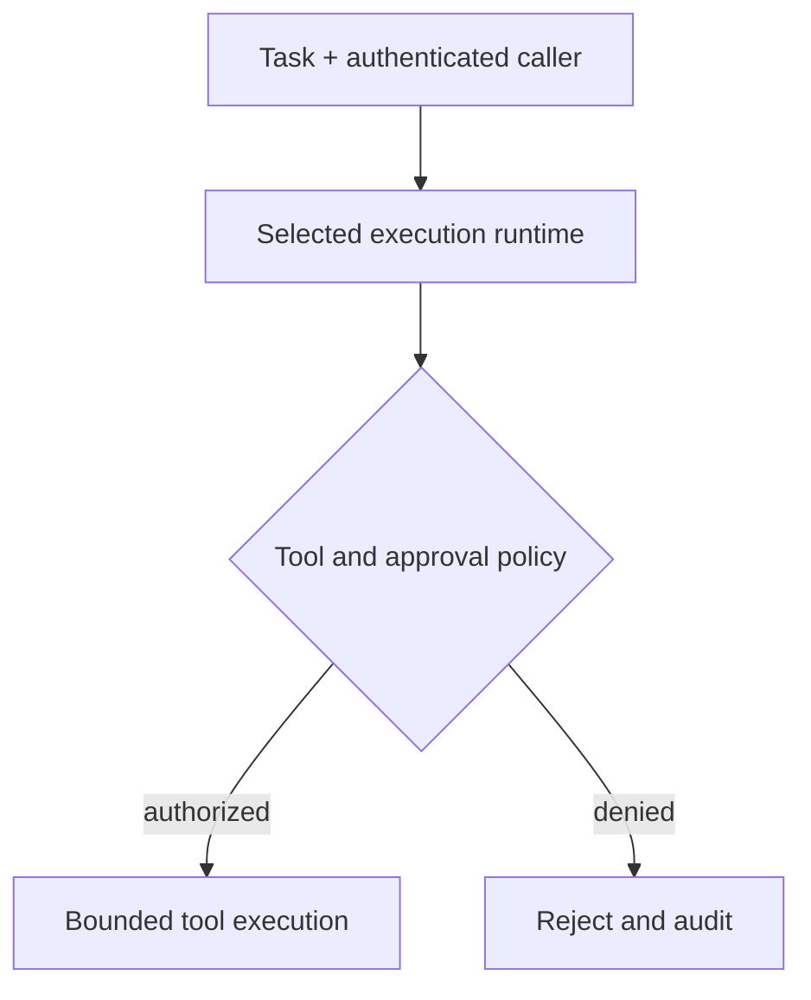

An **agent runtime** is the execution layer that turns model responses into a bounded, stateful workflow. It owns the interaction loop, tool invocation, execution environment, approvals, checkpointing, retries, and lifecycle events. The selected runtime isn't necessarily the same thing as the model provider, model identifier, credential, or user-facing control plane.

Separating those layers prevents subtle billing and security mistakes. One model route can run through different harnesses, and one runtime can be selected under either subscription credentials or metered API credentials. Changing the harness doesn't automatically change who pays or which permissions the caller possesses.

## Keep routing layers distinct

## Example

An OpenClaw configuration selects `openai/gpt-5.6-sol`. Its [official OpenAI provider documentation](https://docs.openclaw.ai/providers/openai) explains that a compatible HTTPS route may choose the bundled Codex runtime automatically, while an explicit `agentRuntime.id: "openclaw"` keeps execution in OpenClaw's embedded harness. Either choice can still use the credential type configured for that route. A model name alone proves neither the chosen runtime nor whether usage is subscription-backed or billed to an API key.

Inspect runtime selection, credential profile, network permissions, mounted files, tool allowlists, approval requirements, and emitted audit events before granting autonomous write access.

## Why it matters here

Coding, browser, multi-agent, and provider-routing lessons depend on knowing which trusted component actually executes a proposed action. The runtime owns authorization, failure handling, bounded budgets, and durable evidence of what happened. Prompts can describe actions, while runtime checks enforce these partitions.

## Related terms

- [Agent scaffold](glossary://agent-scaffold)
- [Control plane](glossary://control-plane)
- [Provider route](glossary://provider-route)
- [permission scope](glossary://permission-boundary)
