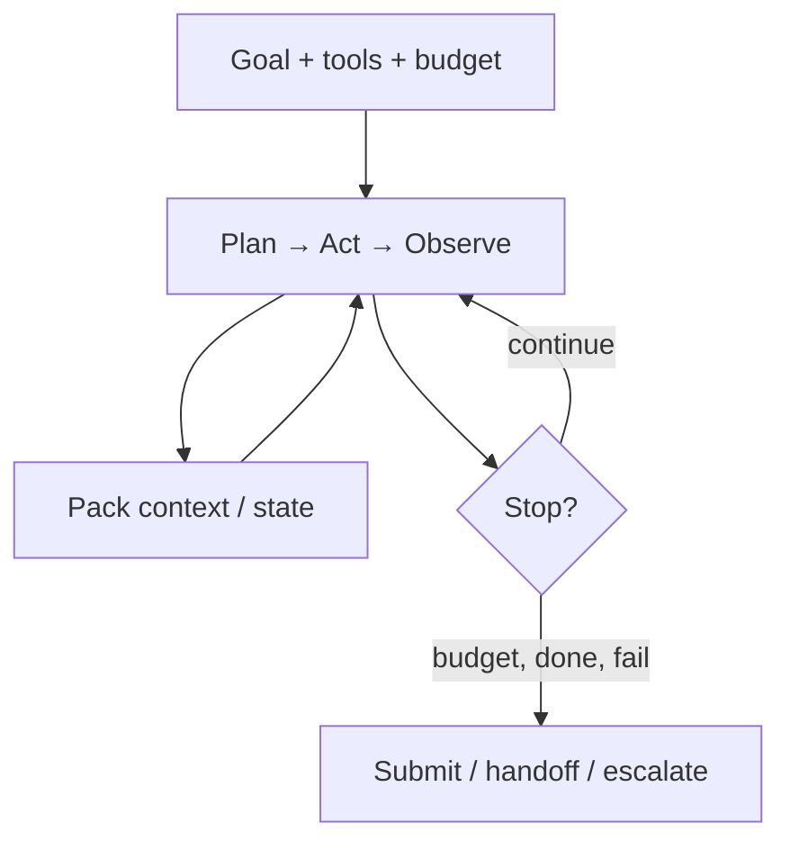

An agent scaffold is the code and control loop around a model that owns planning, tool calls, retries, validation, budgets, context packing, and submission. The scaffold decides what the model sees each turn, how tools run, when to stop, and which failures become user-visible. The base model proposes the next thought or action; the scaffold is the runtime that makes those proposals safe, observable, and finite.

Leaderboard and product results almost always bundle model, scaffold, prompts, tools, step budget, and execution environment. Holding the model fixed and swapping the scaffold can move resolve rate as much as swapping the model. Comparing "models" without fixing the scaffold is misleading.

The scaffold is not the same as the [Agent-Computer Interface](glossary://agent-computer-interface) (ACI). The ACI is the tool surface (file views, search, patch apply, shell, tests). The scaffold is the orchestration around that surface: the plan-act-observe loop, recovery policy, stop conditions, and how observations re-enter the prompt.

## Diagram



## How it works

A typical scaffold is a bounded ReAct-style loop (reason, act, observe), plus product policy:

1. **State.** Goal, plan, transcript, tool results, open tasks, and a step counter live outside the model.
2. **Context packing.** The scaffold builds the next model input: system policy, tool schemas, recent turns, and maybe a summary of older turns.
3. **Model step.** The model emits a thought, a structured tool call, a final answer, or a submit action.
4. **Tool execution.** Trusted code validates arguments, enforces allowlists and permissions, runs the tool in a bounded environment, and returns a structured observation (or error).
5. **Recovery and stop.** On invalid JSON, empty results, failing tests, or timeouts, the scaffold retries, rewrites context, escalates, or stops. Hard caps on steps, wall time, and tokens keep runs finite.

Production scaffolds also log trajectories, enforce human approval for risky writes, and checkpoint long runs so a crash does not replay side effects.

## Example

A SWE-bench-style coding scaffold gives file search, line-level reads, constrained patch apply, local tests, and a max of $50$ tool steps. Same checkpoint, two scaffold policies:

| Policy | Post-patch behavior | Resolved rate (illustrative private subset) |
|---|---|---|
| A | Auto-run focused tests after every patch; feed failures back | $24\%$ |
| B | No intermediate tests; only a final submit | $15\%$ |

Those invented rates illustrate a hypothesis about recovery and verification. A documented historical comparison appears in [the SWE-agent paper](https://arxiv.org/abs/2405.15793): GPT-4 Turbo scored $12.47\%$ on full SWE-bench with SWE-agent versus $1.31\%$ in the non-interactive RAG baseline. This comparison changes the overall interaction setup, including the recovery policy. The $3.79\%$ RAG result used Claude 3 Opus. Report the full setup when interpreting such differences.

When a task fails, classify the failure before you blame the model: missing context, bad plan, wrong tool, invalid patch, test blind spot, permission block, timeout, or pure model error. Scaffold fixes (test feedback, better edit tools, tighter stop rules) are a different lever from swapping checkpoints.

Minimal loop shape:

```python
def run_agent(goal, tools, budget=50):
    state = AgentState(goal=goal, steps=0, history=[])
    while state.steps < budget:
        msg = pack_context(state, tools)
        action = model.generate(msg)  # plan, tool call, or submit
        if action.type == "submit":
            return action.payload
        if action.type == "tool":
            obs = execute_tool(action.name, action.args)  # validate + sandbox
            state.history.append((action, obs))
        state.steps += 1
    return state.fail("budget_exhausted")
```

## Reliability levers

These knobs move outcomes even when weights stay fixed:

- **Task state and checkpoints** so retries are intentional, not blind replay
- **Context packing and summarization** so long trajectories stay usable
- **Tool schemas and ACI design** so the model wastes fewer turns on broken edits
- **Guardrails and allowlists** so tool calls stay inside product policy
- **Step, time, and token budgets** so bad loops cannot run forever
- **Visible checks** (tests, validators, schema checks) before final submit
- **Recovery policy** (retry, replan, escalate, fail closed)

Hidden retries, parallel attempts, and undisclosed best-of-$k$ can inflate benchmark scores if not reported next to the resolve rate.

## Why it matters here

For production agents, reliability, permissions, observability, and product fit are often won or lost in the scaffold, not in the checkpoint name. Curriculum work on tool calling, MCP, coding agents, and SWE-bench-style evals all sits inside this loop: you need to know which part of the system you are measuring and which part you are fixing.

## Related terms

- [Agent-Computer Interface](glossary://agent-computer-interface)
- [Tool calling](glossary://tool-calling)
- [MCP](glossary://mcp)
- [SWE-bench](glossary://swe-bench)
- [Trajectory evaluation](glossary://trajectory-evaluation)
