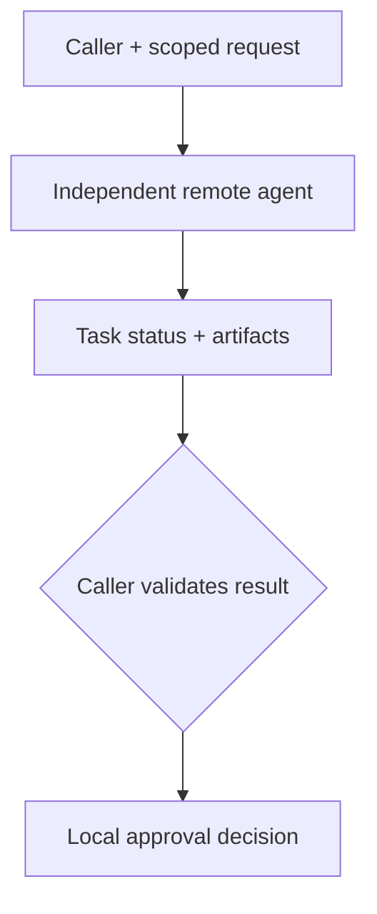

The **Agent-to-Agent Protocol (A2A)** defines how independent agent systems exchange requests, track tasks, report progress, and return artifacts. Its [official protocol specification](https://a2a-protocol.org/latest/specification/) models a remote agent as a separate service rather than treating it as an ordinary function owned by the caller.

The distinction is ownership, not duration. A long-running tool can still belong to the host's tool protocol, while a separately operated agent may need its own task identity, status transitions, message history, output artifacts, authentication, and error handling. A2A doesn't automatically give either side permission to change production state.

## Keep remote work and final source of truth separate

## Example

A release orchestrator asks an independently operated reliability agent to investigate a canary regression. The remote system creates a task, reports that investigation is running, and returns an artifact containing trace references and a health verdict. The orchestrator validates the task identity, tenant scope, artifact lineage, and result shape before adding that verdict to its own release packet.

MCP standardizes access to capabilities such as `get_eval_receipt`, including capabilities hosted by another operator. A2A standardizes collaboration with an independent agent and its task lifecycle. Ownership alone doesn't determine the protocol, and an A2A agent can use MCP tools internally. Neither protocol replaces authentication, authorization, or approval policy.

## Why it matters here

The multi-agent orchestration lesson contrasts local graph nodes, MCP tools, and independently deployed remote agents. Pick the protocol from who owns the execution and artifacts, then enforce the same tenant, approval, and side-effect perimeters after the response returns.

## Related terms

- [MCP](glossary://mcp)
- [Agent runtime](glossary://agent-runtime)
- [Worker fanout](glossary://worker-fanout)
- [permission scope](glossary://permission-boundary)
