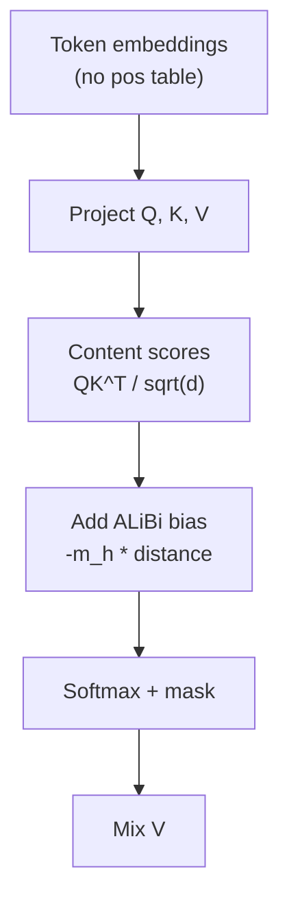

ALiBi (Attention with Linear Biases) encodes position by adding a fixed, distance-based penalty to attention scores instead of adding positional embedding vectors to tokens. Press, Smith, and Lewis (arXiv:2108.12409) leave content embeddings position-free and, for each head, subtract a head-specific slope $m$ times how far the key sits behind the query. Nearby keys keep higher scores; distant keys need a stronger content match to compete.

Because the bias is a closed-form function of relative distance, ALiBi defines a penalty at any distance without a learned position table tied to training length $L$. In the original paper, a 1.3B-parameter model trained at $L=1024$ matched the perplexity of a sinusoidal model trained at $L=2048$ when both were evaluated at 2048 tokens, while training about 11% faster and using about 11% less memory. Useful long-context retrieval still depends on attention dilution, recency bias, and training data. BLOOM and Mosaic MPT popularized ALiBi in open LLMs. Many newer families prefer RoPE, so check the checkpoint's position scheme before assuming ALiBi behavior.

## How it works

The dot-product term is $QK^\top/\sqrt{d_k}$; in other position schemes, $Q$ and $K$ can already contain positional information. ALiBi introduces its position signal at the score stage:

1. Project tokens to $Q$, $K$, $V$ with **no** absolute position vectors mixed into embeddings.
2. Compute scaled (or unscaled, per implementation) query-key scores.
3. Add a static bias $B^{(h)}_{ij} = -m_h \cdot (i-j)$ for key index $j \le$ query index $i$ (causal past). Future keys stay masked with $-\infty$.
4. Softmax and mix values as usual.

The paper notes that the ALiBi bias is **not** multiplied by the $\sqrt{d_k}$ attention scale; addition happens after the content scores. Implementations often fold the bias into the attention mask tensor so **compute** stays nearly free relative to a plain causal mask. Memory is different: a materialized per-head bias is $n_{\text{heads}}\times L\times L$, larger than a shared $L\times L$ causal mask, unless the kernel fuses the distance penalty without storing a full $H\times L\times L$ tensor.

Slopes are fixed before training, not learned. For a power-of-two head count $n$, the paper uses a geometric sequence that starts at $2^{-8/n}$ and uses the same value as its common ratio. For 8 heads that is $\{1/2, 1/4, \ldots, 1/256\}$; for 16 heads it starts at $1/\sqrt{2}$ with the same ratio. Steep slopes make short-range heads; gentle slopes leave longer-range heads. For non-power-of-two $n$, the reference construction keeps the schedule for the largest power of two $p<n$, then appends every other slope from the $2p$-head schedule until it has $n$ slopes. It does not use one geometric sequence with start $2^{-8/n}$.

## Formula

For a causal decoder, query position $i$, key $j \le i$, head slope $m_h > 0$:

$$
\mathrm{score}_h(i,j)=\frac{q_i\cdot k_j}{\sqrt{d}} - m_h\cdot(i-j)
$$

Equivalently, after the full query-key product for the first $i$ keys (Press et al. notation; they omit the scale for presentation):

$$
\mathrm{softmax}\!\left(\mathbf{q}_i\mathbf{K}^\top + m\cdot\bigl[-(i-1),\ldots,-2,-1,0\bigr]\right)
$$

For a power-of-two $n$, index heads from $h=0$:

$$
m_h = \left(2^{-8/n}\right)^{h+1}, \qquad h=0,\ldots,n-1.
$$

For other head counts, let $p=2^{\lfloor\log_2 n\rfloor}$. If $S_n$ denotes the ordered slope list, the reference implementation constructs

$$
S_n = S_p\;\Vert\;\bigl(S_{2p}[0],S_{2p}[2],S_{2p}[4],\ldots\bigr)_{:n-p}.
$$

Example for $n=8$:

$$
m \in \left\{\tfrac{1}{2},\tfrac{1}{4},\tfrac{1}{8},\tfrac{1}{16},\tfrac{1}{32},\tfrac{1}{64},\tfrac{1}{128},\tfrac{1}{256}\right\}
$$

## Diagram



## Example

Head slope $m=0.5$ and relative distances $1$, $4$, and $20$ produce ALiBi penalties $0.5$, $2.0$, and $10.0$. A far key with raw scaled dot product $3.0$ becomes $-7.0$ after bias, while a near key at $1.2$ becomes $0.7$. Softmax then concentrates on nearer positions unless content match is huge.

Same raw score $4.0$ at distance $4$, two heads:

```python
def alibi_score(raw: float, distance: int, slope: float) -> float:
    return raw - slope * distance

print(alibi_score(4.0, 4, 1 / 2))     # 2.0   (steep / local head)
print(alibi_score(4.0, 4, 1 / 256))   # 3.984 (gentle / long-range head)
```

In production, before you assume long-context behavior, read config for `alibi`, `position_embedding_type`, or RoPE fields. Serving a RoPE checkpoint with an ALiBi kernel (or the reverse) silently corrupts attention.

## Worked numbers

The paper's 1.3B-model comparison trains ALiBi at 1024 tokens and evaluates at 2048, matching a sinusoidal model trained at 2048. That's a result for the paper's language-modeling setup. A distance rule being defined beyond training length does not guarantee usable retrieval or multi-hop reasoning at arbitrary lengths; evaluate those tasks separately.

## Trade-offs

| Property | ALiBi behavior |
|----------|----------------|
| Parameters | No position embedding table; slopes fixed |
| Where position enters | Attention logits only (not embeddings, not $V$) |
| Extrapolation | Closed-form for any distance; strong in paper LM evals |
| Inductive bias | Explicit recency: farther always more penalized |
| Serving / conversion | Must match head count and slope schedule |
| Ecosystem | Common in BLOOM/MPT-era models; RoPE dominates many newer stacks |

ALiBi applies a soft recency prior: very negative biases can underflow in float softmax, while mathematical scores for distant tokens remain finite and receive less weight. Causal masking separately assigns $-\infty$ to future tokens.

## Why it matters here

ALiBi is the cleanest teaching case of **relative position as an attention bias**: it sits next to RoPE (geometry on $Q$/$K$), absolute sinusoids/learned tables, and general position-bias ideas in the curriculum lesson on positional encoding. If you train short and hope to serve long, swap models, or debug "works at 2k, dies at 8k," the position method is a first-class suspect. ALiBi helped make length extrapolation an explicit design goal.

## Related terms

- [Positional encoding](glossary://positional-encoding)
- [RoPE](glossary://rope)
- [Self-attention](glossary://self-attention)
- [Attention head](glossary://attention-head)
- [Context window](glossary://context-window)
