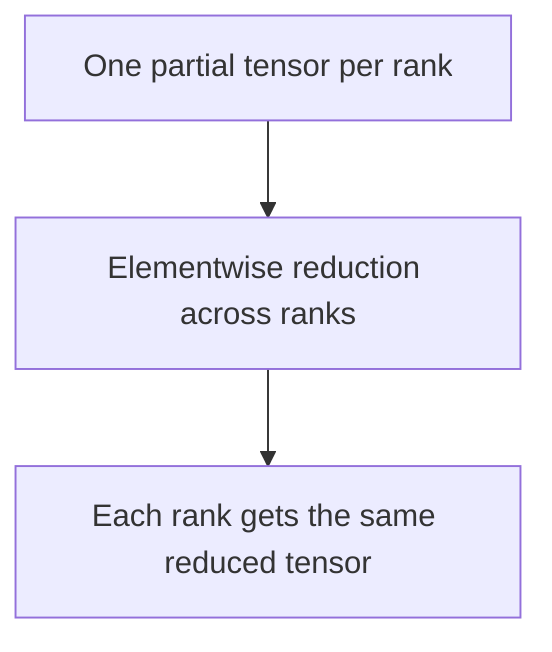

**All-reduce** is a collective operation that combines one tensor from every rank with an operation such as sum, then returns the combined tensor to every rank. If four ranks hold partial vectors $x_0$ through $x_3$, a sum all-reduce leaves every rank with $x_0+x_1+x_2+x_3$.

Large-model training uses all-reduce for data-parallel gradients and for selected tensor-parallel layer outputs. It is synchronization: a fast rank can't finish the collective until the required peers participate.

## Communication meaning

"All" identifies participants and destinations; "reduce" identifies the combine step. Implementations may use ring, tree, NVLink-specialized, or network-specialized algorithms. Application code requests the semantic operation while NCCL chooses a supported execution path.

## Diagram

## Example

Four data-parallel ranks compute gradients [1, 2], [3, 4], [5, 6], and [7, 8]. A sum all-reduce produces [16, 20] on every rank; averaging then divides by four when the training convention requires mean gradients.

## Why it matters here

TP and gradient communication can invoke collectives many times per training step. A topology mismatch turns all-reduce latency into idle GPU time even when local matrix kernels are fast.

## Related terms

- [NCCL](glossary://nccl)
- [Reduce-scatter](glossary://reduce-scatter)
- [All-gather](glossary://all-gather)
- [Data parallelism](glossary://data-parallelism)
- [Tensor parallelism](glossary://tensor-parallelism)
