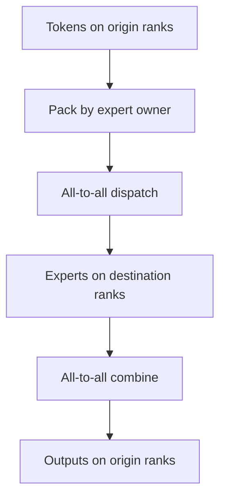

**All-to-all** is a collective where every rank sends a distinct shard to every other rank and receives distinct shards from them. Unlike all-gather, recipients don't all end with the same full tensor. Each receives the pieces addressed to it.

Mixture-of-experts routing is a natural all-to-all workload. Tokens begin on sequence or batch owners, but selected experts may live on other ranks. Dispatch moves token hidden states to expert owners; combine moves expert outputs back.

## Traffic shape

Message sizes depend on router decisions. Balanced routing gives each rank similar work. Hot experts produce uneven sends, variable GEMM sizes, and stragglers. Optimized dispatchers pack tokens by destination and overlap communication with expert compute when dependencies allow it.

## Diagram

## Example

In EP=4, rank 0 may send 40 tokens to rank 1, 12 to rank 2, and 8 to rank 3 while keeping local tokens. Each peer simultaneously performs its own destination-specific sends.

## Why it matters here

GLM-5.3 routes each token to eight of 256 experts in each sparse layer. In the masterclass's candidate EP64 layout, all-to-all latency, routing balance, message packing, and fabric placement need measurement. Uniform expert ownership doesn't imply uniform token traffic or equal work on every rank.

## Related terms

- [Expert parallelism](glossary://expert-parallelism)
- [Mixture of experts](glossary://mixture-of-experts)
- [NCCL](glossary://nccl)
- [NVLink](glossary://nvlink)
- [GEMM](glossary://gemm)
