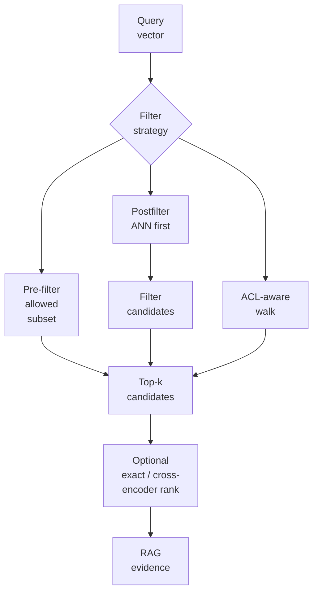

**Approximate nearest neighbor (ANN) search** finds vectors close to a query without scoring every stored vector exactly. Given a query embedding $q \in \mathbb{R}^d$ and a corpus $\{x_i\}$, exact $k$-NN returns the $k$ items that minimize distance (or maximize similarity). ANN builds an index (graph walk, cluster lists, compressed codes, or a mix) so search can skip most of the corpus and still return a neighbor set that is usually close to exact.

Exact scan is $O(N\cdot d)$ per query. Whether it's too slow depends on hardware, batching, filters, and latency targets. ANN trades index construction and approximation for less search work; a reranker can reorder returned candidates but can't recover an item absent from that set.

## Intuition

Exact search computes a distance to every stored vector. ANN replaces most of those comparisons with index traversal: long-range graph links in HNSW, coarse partitions in IVF, and optionally compressed codes from product quantization. Search becomes much faster because it visits only a fraction of the corpus. The trade-off is measurable: a true nearest neighbor can be missed when its partition is not probed or a filter removes graph nodes needed to reach it.

Two different "recall" ideas show up in practice:

1. **ANN vs exact $k$-NN** (index fidelity): of the true geometric top-$k$ under your metric, how many did the approximate index return?
2. **Task recall@k** (retrieval usefulness): of the labeled relevant docs for a user query, how many appear in the candidate set?

A healthy index can still serve bad retrieval if the embedding space is wrong. A perfect embedding can still fail if the index or filters drop the right vector before reranking.

## How it works

Common families used in production RAG and vector DBs:

| Family | Idea | Main knobs | Typical cost profile |
| --- | --- | --- | --- |
| Flat / brute force | Score all vectors | none | Exact; latency grows with $N$ |
| HNSW | Multi-layer navigable graph; walk long edges then refine | $M$, `efConstruction`, `efSearch` | High recall at low latency; more RAM and build time |
| IVF | k-means-like coarse cells; search $nprobe$ lists | $nlist$, $nprobe$ | Cheaper memory; recall depends on probing enough cells |
| PQ / IVFPQ | Compress subvectors to codes; approximate distance | $m$ subquantizers, bits per code | Far less RAM; some geometric error |

Foundational pieces you will see cited in library docs: inverted-file style partitioning (classic non-exhaustive search), product quantization for compact codes (Jégou et al.), and hierarchical navigable small-world graphs (Malkov and Yashunin). Libraries such as FAISS compose these into concrete indexes; managed stores (pgvector, Qdrant, Pinecone, Weaviate, and others) expose similar structures behind their own knobs.

Metric must match the embedding contract. Cosine computes normalization itself; inner product after normalizing both vectors gives the same score, and Euclidean distance between unit vectors gives the same ordering. Raw inner product and raw Euclidean distance generally differ. Handle zero vectors and apply the intended normalization consistently at indexing and search.

## Formula

Exact nearest neighbor under Euclidean distance:

$$
j^\star = \arg\min_i \|q - x_i\|_2
$$

Maximum inner product search (common for dual-encoder retrieval when vectors are normalized so that IP equals cosine):

$$
j^\star = \arg\max_i \langle q, x_i \rangle
$$

ANN index fidelity for one query, comparing approximate top-$k$ set $A_k$ to exact top-$k$ set $E_k$:

$$
\mathrm{ANN\text{-}recall@}k = \frac{|A_k \cap E_k|}{k}
$$

Average that over a held-out query set. Values near $0.95$ to $0.99$ are common targets for well-tuned HNSW on in-domain embeddings; measure recall on your vectors and workload.

## Diagram

Post-filter is common and simple, but high-selectivity ACL can thin the candidate set to near-empty. Prefer pre-filter, tenant-partitioned indexes, or filter-aware walks when filtered recall is the product metric.

## Example

A runbook corpus holds $20$ million passage vectors of dimension $768$ (float32). Raw storage alone is about $20 \times 10^{6} \times 768 \times 4 \approx 61$ GB before index overhead. Exact search performs $O(N \cdot d)$ distance work and reads much of the vector matrix per query, so its latency must be benchmarked on target hardware.

Configure an HNSW index to return $200$ candidates, then use a cross-encoder to rerank to $20$. On a labeled set of $2{,}000$ queries:

- First-stage **task** recall@200 is $0.91$ overall against gold items.
- Under a strict tenant filter that keeps only ~$5\%$ of the corpus, the same knobs drop to recall@200 $= 0.63$.
- Unfiltered ANN-recall@200 against exact geometric neighbors is $0.97$. That does not identify the cause of lower filtered task recall. Compare ANN with exact search over the same allowed subset, keeping queries, labels, and metric fixed. A gap isolates filtered approximation; otherwise inspect embeddings, labels, and the allowed corpus.

If gold passage id `runbook-991` never appears in the candidate set, no amount of prompt engineering recovers it. Fix index parameters, filter strategy (pre-filter vs post-filter vs filter-aware walk), candidate $k$, or hybrid lexical backup first.

## Trade-offs

| Goal | Push toward | Watch for |
| --- | --- | --- |
| Latency / QPS | Lower `efSearch` or $nprobe$; smaller $k$ | Missed golds on long-tail queries |
| Memory | PQ / OPQ codes; fewer HNSW edges | Recall cliffs after quantization |
| Freshness | Incremental insert-friendly indexes | Stale vectors after doc edits; rebuild cost |
| Multi-tenant ACL | Filter-aware search or partitioned indexes | Recall collapse when selectivity is high |
| Build cost | Smaller `efConstruction` / fewer lists | Permanent graph or centroid quality loss |

Track together: recall@k (task and ANN-vs-exact), p50/p95 latency, index RAM, build time, filtered-search correctness, update cost, and long-tail query recall. Defaults that look strong on average can fail on rare runbooks or tight ACL filters.

## Why it matters here

ANN search is where speed, recall, filtering, and index maintenance meet in dense and hybrid RAG. When answers miss evidence, check whether the gold item ever entered the candidate set before blaming the generator. Curriculum lessons on embeddings, FAISS-style indexes, HNSW, IVF, and hybrid retrieval all bottom out on this trade: approximate neighbors are what make interactive retrieval possible at scale.

## Related terms

- [HNSW](glossary://hnsw)
- [IVF](glossary://ivf)
- [Dense retrieval](glossary://dense-retrieval)
- [Recall@k](glossary://recall-at-k)
- [Product quantization](glossary://product-quantization)
