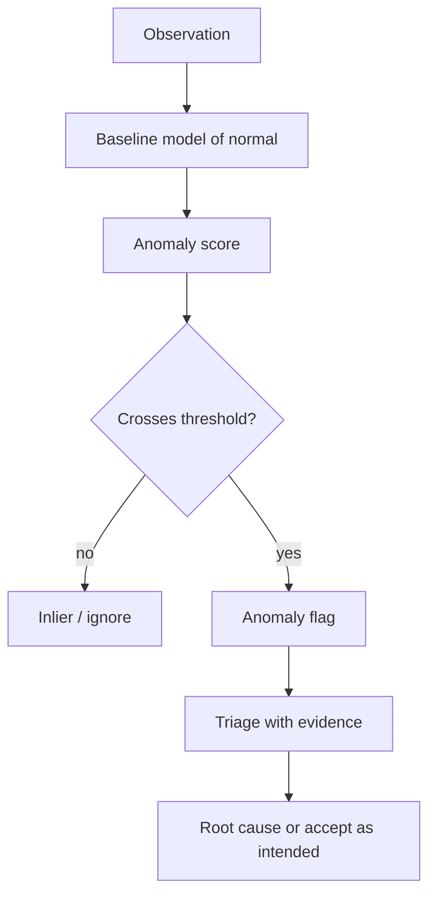

An **anomaly** is an observation that disagrees with a chosen model of "normal" enough to cross a threshold and deserve inspection. The flag says "weird relative to this baseline," not "here is the root cause." Classically, Hawkins described an outlier as a point that deviates so much from other observations as to arouse suspicion it was generated by a different mechanism. In production you operationalize that idea with a score, a threshold, and a triage path.

Baselines may be forecasts, seasonal patterns, historical quantiles, control groups, model scores, embedding neighborhoods, or hard rules. Change the baseline and the same raw value can flip from normal to anomalous. Bad baselines create alert spam or silent misses.

## Outlier vs novelty

In standard ML usage (for example scikit-learn's anomaly tooling), two related jobs share the umbrella term *anomaly detection*:

| Setting | Training data | Question |
| --- | --- | --- |
| **Outlier detection** | May already contain rare bad points | Which points in this set are deviant? |
| **Novelty detection** | Assumed mostly clean "normal" | Is this *new* point outside the learned support of normal? |

Outlier detection is often unsupervised cleaning or offline forensics. Novelty detection is closer to online monitoring: you fit on healthy history, then score fresh traffic, latency, cost, or quality signals as they arrive. Either way, the detector ranks weirdness; humans or runbooks still assign causes.

## Example

Friday job completions usually land near a forecast of $132$ with a $95\%$ prediction interval $[120, 143]$. A reading of $160$ is anomalous under that interval. Forecast error is $e = 160 - 132 = +28$, well outside residual noise the interval was built to cover. The same $160$ may be normal during a planned holiday sale or after a known backfill. Triage checks deploys, data freshness, duplicate telemetry, experiment arms, and whether the threshold was calibrated for this slice before paging humans.

If model-judge fail rate jumps from $0.04$ to $0.11$ on one tenant only, investigate that slice first. Check label drift and traffic mix before attributing the change to a global model regression.

## How scoring works

Most detectors follow the same skeleton:

1. **Define normal.** Pick the baseline: last week's same weekday hour, a seasonal forecast, a robust mean/covariance, a one-class model, or an isolation ensemble.
2. **Score.** Map each observation $x$ to a real-valued score $s(x)$ where larger (or smaller, by convention) means more abnormal. Simple ops metrics often use residual magnitude $|y - \hat{y}|$ or standardized residual $|y - \hat{y}| / \hat{\sigma}$. Multivariate tabular detectors may use Isolation Forest (short random-partition path length for points that are "few and different," Liu et al. 2008) or Local Outlier Factor (local density much lower than neighbors, Breunig et al. 2000).
3. **Threshold.** Declare anomaly if $s(x)$ crosses a cut chosen from history, a target false-alarm rate, prediction-interval coverage, or a contamination prior.
4. **Triage.** Attach evidence (logs, diffs, deploys, slice ids) before claiming root cause.

Under a rough Gaussian residual model after point forecast $\hat{y}$:

$$
s(y) = \frac{|y - \hat{y}|}{\hat{\sigma}}, \quad \text{flag if } s(y) > z_{1-\alpha/2}
$$

where $z_p$ is the standard-normal $p$-quantile. This gives the band $\hat{y}\pm z_{1-\alpha/2}\hat{\sigma}$ only with an appropriate predictive residual scale. Repeated monitoring creates many opportunities for false alarms; pointwise 95% coverage isn't a 5% probability of any alert across a dashboard. Empirical quantiles, conformal intervals, and slice-specific thresholds need their own assumptions checked.

```python
# Residual anomaly flag against a precomputed forecast and residual scale
y, y_hat, sigma = 160.0, 132.0, 5.5
z = abs(y - y_hat) / sigma  # ~5.1
is_anomaly = z > 1.96       # outside ~95% two-sided band under Gaussian noise
```

## Baseline choice

A global average can flag normal regional seasonality. A static rule can ignore trend. A detector trained on polluted history learns bad points as normal. Re-calibrate when the process changes: new product launch, index rebuild, model route swap, or billing unit change. After detection, investigate logs, diffs, known incidents, and whether the shift reflects an intended product change or a silent failure.

## Diagram



## Why it matters here

AI products emit many scores and operational signals: traffic, latency, cost, abstention rate, retrieval hit mix, judge fail rate, and online quality. Anomaly detection decides what deserves attention. It must not invent causes, and it must be sliced carefully so one bad tenant, language, or route does not drown in a global average. Pair anomaly flags with seasonality-aware baselines, honest prediction intervals, drift checks, and incident command when user impact is real.

## Related terms

- [Seasonality](glossary://seasonality)
- [Forecast error](glossary://forecast-error)
- [Prediction interval](glossary://prediction-interval)
- [Data drift](glossary://data-drift)
- [Incident command](glossary://incident-command)
