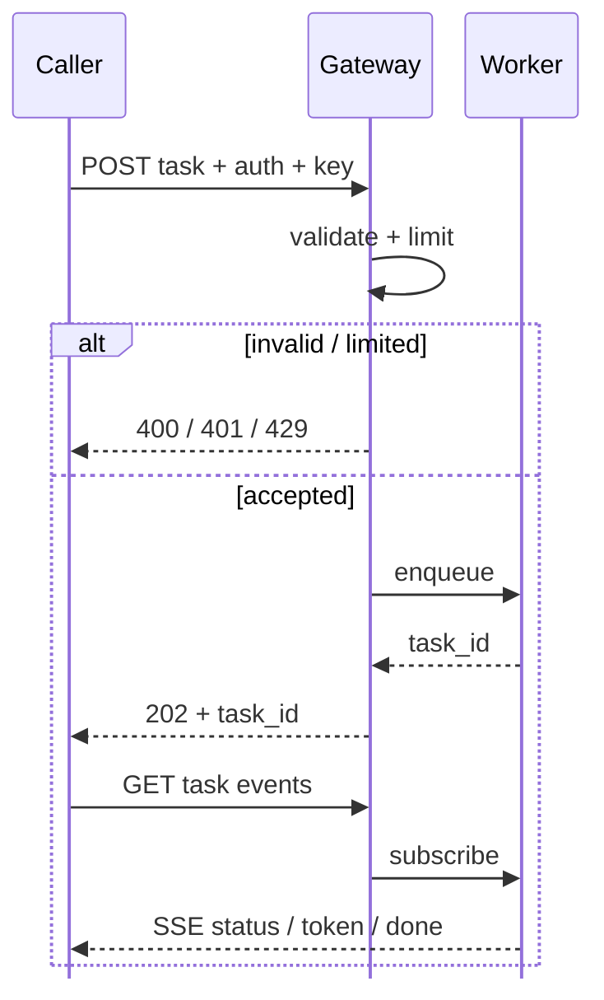

An API schemas is the explicit promise a service makes about how clients may call it and what they can rely on in return. It covers endpoints, methods, request and response shapes, auth, status codes, error bodies, timeouts, rate limits, streaming format, and compatibility rules across versions.

The API schemas defines *wire* behavior. Clients integrate against schemas, headers, and status codes, while free-form text fields can vary word-for-word as long as the envelope stays stable. That split is especially important for LLM endpoints, where generation is stochastic but parsers, agents, and billing systems need deterministic structure.

In practice The schema is written as machine-readable specs (commonly [OpenAPI](https://spec.openapis.org/oas/v3.1.0) plus [JSON Schema](glossary://json-schema)), enforced in code (validators, gateways), and tested so implementation and docs cannot drift.

## Intuition

Think of The schema as the perimeter between two teams or two processes that do not share memory. Everything that crosses that perimeter must be named, typed, versioned, and fail in documented ways. Anything that can vary (model wording, retrieval snippets, latency under load) belongs *inside* a field The schema already declared as free-form or optional.

If a client has to open your source code, guess error shapes, or reparse natural language to decide what to do next, you do not have a usable schema yet.

## Example

A task API for an AI product might promise:

| Surface | schema |
|---|---|
| `POST /v1/tasks` | JSON body with required `input` (string, max 32k chars) and optional `idempotency_key` |
| Success | `202 Accepted` with `{ "task_id": "tsk_…", "status": "queued" }` |
| Events | `GET /v1/tasks/{id}/events` streams SSE: `status`, `token`, `tool_call`, `done`, `error` |
| Errors | Stable codes: `400` validation, `401` auth, `403` blocked tool, `409` idempotency conflict, `429` rate limit, `503` overloaded |
| Rate limits | Headers `x-ratelimit-limit`, `x-ratelimit-remaining`, `retry-after` on `429` |
| Idempotency | Within a documented retention window and caller/tenant scope, same key + same body returns the original `task_id`; different body returns `409` |

The `202` response body is valid JSON:

```json
{
  "task_id": "tsk_01HZX9",
  "status": "queued"
}
```

```text
// GET /v1/tasks/tsk_01HZX9/events  (text/event-stream)
event: status
data: {"task_id":"tsk_01HZX9","status":"running"}

event: token
data: {"text":"Hello"}

event: done
data: {"task_id":"tsk_01HZX9","status":"succeeded","usage":{"input_tokens":120,"output_tokens":48}}
```

Clients build against that schema. The generated summary string inside a later `result` field may differ on every run; the field names, event types, and error codes must not.

Minimal schema validation tests: smallest valid request, smallest invalid request (expect `400` with the documented error body), and a retry after timeout with the same idempotency key (expect one side effect, same `task_id`).

## What belongs in The schema

Document these at every public perimeter:

1. **Transport and identity**: base URL, TLS, auth scheme, tenant or workspace headers, request IDs.
2. **Request/response schemas**: required vs optional fields, types, enums, size limits, unknown-field policy (`reject` vs `ignore`).
3. **Status and errors**: which HTTP codes mean client fix, retry, or fail closed; stable machine-readable `error.code` values; human `message` for logs only.
4. **Async and streaming**: poll vs push, SSE/WebSocket event names, partial failure mid-stream, how `done` and `error` terminate the stream.
5. **Side effects**: [idempotency](glossary://idempotency) keys, tool calls that write state, cancel and timeout behavior.
6. **Capacity**: [rate limits](glossary://rate-limit), quotas, concurrency caps, and how clients should back off.
7. **Compatibility**: additive vs breaking changes, deprecation window, versioning strategy (`/v1` path, header, or both).

Keep [structured output](glossary://structured-output) validation *behind* the stable envelope. Clients parse `result` as a typed object after the HTTP layer has already succeeded; they should not scrape assistant prose for control flow.

## Diagram



## Compatibility rules

Treat The schema as versioned software. Common practice (aligned with [Semantic Versioning](https://semver.org/) ideas for public APIs):

| Change | Usually |
|---|---|
| Add optional field or new event type clients can ignore | Compatible (minor) |
| Add new endpoint | Compatible |
| Rename/remove field, change type, make optional field required | Breaking (major) |
| Change error code meaning or success status family | Breaking |
| Change auth requirement or default behavior clients rely on | Breaking |

Ship breaking changes under a new major path or version header, keep the old schema until clients migrate, and never silently reinterpret an existing field. Unplanned [schema drift](glossary://schema-drift) at a public perimeter can break clients and should be handled as a production incident.

## Why it matters here

LLM systems are variable by design. API schemas turn that variability into something other systems can integrate, debug, version, meter, and roll back. Without a hard envelope, every model upgrade, prompt edit, or provider swap becomes a client-breaking change. With one, you can swap the model behind a stable `task_id` / stream / error surface while eval gates watch quality.

## Related terms

- [Idempotency](glossary://idempotency)
- [JSON Schema](glossary://json-schema)
- [Structured output](glossary://structured-output)
- [Rate limit](glossary://rate-limit)
- [Schema drift](glossary://schema-drift)
