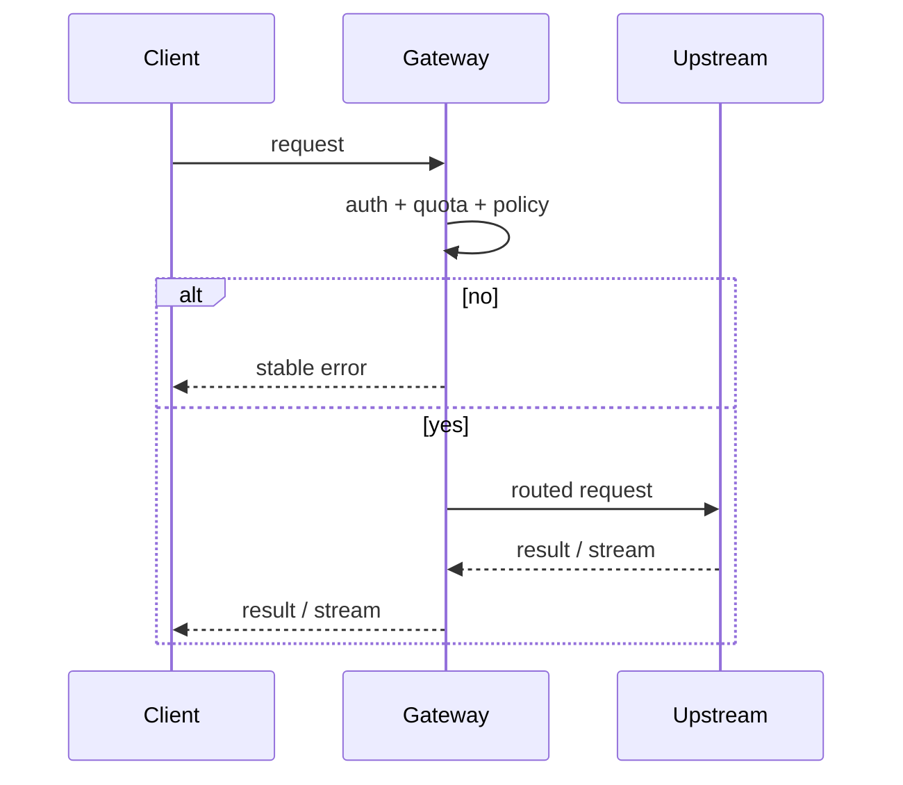

An API gateway is the single front-door service that accepts client HTTP (or WebSocket) calls, applies shared cross-cutting controls, and routes each request to the right internal handler or upstream provider. It is an application-aware reverse proxy that forwards traffic while managing API identity, routes, quotas, and specifications. Centralizing these duties saves every backend from re-implementing authentication, rate limits, and error shaping.

Typical duties include TLS termination, authentication and authorization, per-key or per-tenant rate limits, request size and schema checks, request-ID injection, logging and metrics, route selection, and mapping upstream failures into a stable client interfaces. For model traffic the same layer often normalizes OpenAI-shaped chat endpoints, streams tokens without full buffering, attaches tenant identity, enforces token or dollar budgets, blocks unsupported tools or models, chooses a [provider route](glossary://provider-route), and translates vendor status codes (for example a provider `529`) into your documented `503` with `Retry-After`.

The gateway should stay coarse. It enforces capacity, identity, and schema before expensive prefill or decode work starts. It should not own deep answer-quality logic that needs retrieval context, full document policy, or multi-step agent state.

## Intuition

The gateway is the policy perimeter before specialized backends. Every client request crosses the same authentication, quota, schema, routing, and error-normalization path before retrieval, tools, or inference run. Centralizing these controls keeps clients from implementing incompatible versions and lets backend services focus on their own workloads.

A plain reverse proxy mainly forwards and can load-balance. An API gateway adds API governance on top of that path: keys, quotas, per-route policies, analytics, and versioned specifications. Load balancers still matter deeper in the stack (across GPU replicas); the gateway sits at the product edge.

## How it works

A production request typically hits the gateway in this order:

1. **Terminate and identify**: TLS, parse the route (`/v1/chat/completions`), extract API key or JWT, resolve tenant and plan.
2. **allow or reject cheaply**: body size caps, schema checks, rate limits and quotas (requests, concurrent streams, tokens, spend), feature gates for beta models.
3. **Stamp and observe**: attach `request_id` / trace context, record auth outcome, chosen route, limit counters.
4. **Route**: apply [routing policy](glossary://routing-policy): model alias → provider, region, or self-hosted lane; optional fallbacks and circuit breakers.
5. **Proxy**: forward with rewritten headers and timeouts; for LLMs, pass SSE or chunked tokens through immediately instead of buffering the full completion.
6. **Normalize the exit**: map upstream errors, strip secrets, emit usage metrics, return the stable [API schemas](glossary://api-contract).

Measure gateway overhead separately from retrieval, prefill, and decode. Remote authorization, quota storage, TLS, and buffering can make it significant. Set an overhead budget from measurements of the gateway path because configurations vary.

## Diagram



Rejects at the left edge (bad key, over quota, body too large) never touch GPUs. Streamed tokens flow Client ← GW ← provider without waiting for the full answer.

## Example

A mobile client calls `https://api.example.com/v1/chat`. The gateway:

- Validates the API key and resolves workspace `ws_acme`.
- Attaches `request_id=r_91f…` and OpenTelemetry trace context.
- Enforces $60$ requests/minute and $2$ concurrent streams per key, plus a workspace spend cap of \$50/day.
- Rejects bodies over $256$ KB and `max_tokens` above the plan ceiling before any model call.
- Routes `model=support-fast` to provider A and `model=support-reason` to provider B; if A's error rate crosses a circuit threshold, eligible traffic fails over to B with reason `provider_health`.
- Translates a provider `529` into your documented `503` with `Retry-After: 2`.
- Streams SSE chunks as they arrive so first token is not delayed by response buffering.

Here, $5$ ms p50 is an example overhead target. Measure actual latency on the gateway's request path. Log identity, limit bucket, counter value, and route for rejected requests. Quota request gating needs atomic reservations and usage reconciliation; checking a counter alone allows concurrent requests to overspend. Enforce actual bytes read as well as declared content length.

Minimal edge checks (illustrative):

```python title="gateway-allow-sketch.py"
def allow(req, key_meta, counters):
    if not key_meta.active:
        return deny(401, "invalid_api_key")
    if req.content_length > key_meta.max_body_bytes:
        return deny(413, "payload_too_large")
    if counters.rpm[key_meta.id] >= key_meta.rpm_limit:
        return deny(429, "rate_limited", retry_after_s=counters.reset_s)
    if counters.daily_usd[key_meta.workspace] >= key_meta.daily_budget_usd:
        return deny(429, "budget_exhausted")
    return allow(route=resolve_model(req.model, key_meta))
```

## What belongs at the edge vs deeper

| At the gateway | Near the model / RAG / agent |
|---|---|
| AuthN/AuthZ, API keys, tenant stamp | Citation checks against retrieved docs |
| Request/token/spend limits, concurrency | Fine-grained safety that needs full context |
| Body size, basic schema, tool allowlists by plan | RAG fusion, multi-hop tool loops |
| Model alias → provider route, fallbacks | Prompt assembly and retrieval policy |
| Stable errors, request IDs, usage metrics | Answer quality scoring and eval judges |

Keep citation checks, RAG fusion, and context-heavy safety classifiers next to the services that hold documents and policy state. The gateway enforces coarse policy and capacity so bad or abusive traffic dies before it burns GPU seconds.

## Production failure modes

- **Buffered streaming**: classic HTTP gateways that wait for a full upstream body destroy chat UX; first token appears only after the entire completion. Use chunk passthrough for SSE/`text/event-stream`.
- **Thundering-herd fallback**: failing over $100\%$ of traffic to a secondary provider without its own rate limits can exhaust that provider's quota and cascade the outage.
- **Wrong identity key**: rate limits keyed only by IP punish NAT users; limits keyed by shared service account punish every product surface. Prefer workspace + API key + optional end-user dimension.
- **schema drift**: two providers return different error shapes or ignore `strict` tool flags; the gateway (or adapter behind it) must normalize capability claims and verify behavior compatibility.
- **Mid-stream provider drop**: you cannot silently restart generation on another model mid-stream without client-visible restart semantics; document that perimeter.

Trace auth failures, size limits, quota hits, route choices, upstream status, and saturation so every throttle or failover is explainable from logs.

## Why it matters here

An API gateway is where product promises meet finite model capacity: keys, workspaces, rate limits, request IDs, and model routing show up in every production diagram and system-design interview. Putting shared controls at the edge stops unsafe or unbounded traffic before expensive inference, and it gives learners a named hop on the [request path](glossary://request-path) instead of "the app just called the model."

## Related terms

- [Request path](glossary://request-path)
- [Rate limit](glossary://rate-limit)
- [Routing policy](glossary://routing-policy)
- [API schemas](glossary://api-contract)
- [Provider route](glossary://provider-route)
