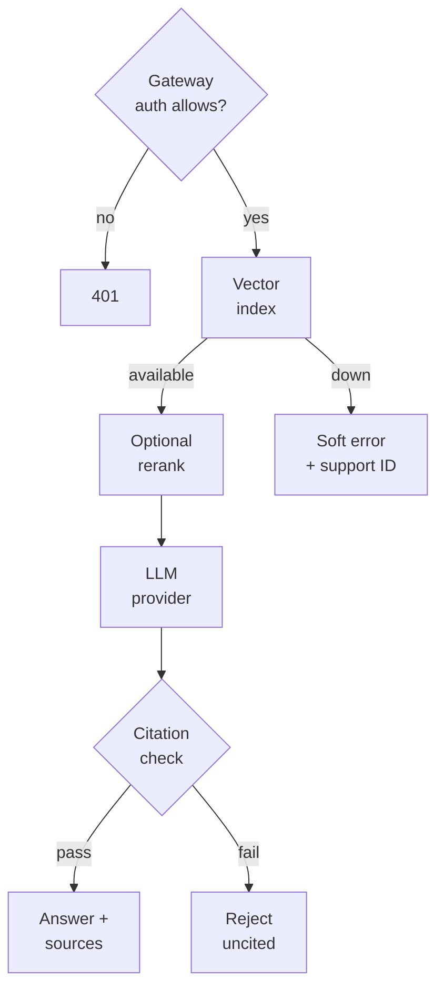

An architecture diagram is a visual map of a software system's major partitions and the relationships that cross them: who talks to whom, what data or control signal moves, and where ownership, trust, or failure modes change. Use it to design and debug the system. For each edge, identify who owns the step, what crosses it, whether it is sync or async, trusted or untrusted, and what happens when it fails.

Boxes alone name parts. Labeled arrows, trust perimeters, sync vs async edges, and failure notes are what make the drawing teach. A useful diagram answers "where does a request go, who is responsible, and what breaks?" It shows behavior and ownership across the system.

## Intuition

Think of the diagram as a map at a chosen zoom level. A city map that labels every doorway is unreadable; a map that only shows "downtown" without roads is useless. You pick a level of abstraction that matches the story: product context for stakeholders, deployable containers for ops and interviews, components for deep dives, sequence or data-flow views for one critical path.

Simon Brown's [C4 model](https://c4model.com/) formalizes that zoom as four static levels: **system context** (people and external systems), **containers** (deployable units such as apps, APIs, databases), **components** (major modules inside a container), and **code** (classes or files, rarely worth a permanent diagram). Most teams live at context + containers. Supporting views (dynamic/sequence, deployment) fill in "what happens at runtime" and "where it runs."

The same discipline shows up in security work. Microsoft's SDL-style threat modeling uses a data-flow diagram (DFD) with **trust perimeters**: lines where authentication, authorization, or privilege must change (public internet vs private network, user input vs model output, tenant A vs tenant B). If an edge crosses a trust perimeter and the diagram does not mark it, the design is incomplete.

## What to label on every edge

For each relationship, prefer labels that a stranger can audit without a verbal walkthrough:

| Label on the edge | Why it matters |
|---|---|
| Direction and intent | "Reads candidates," not vague "uses" |
| Sync vs async | HTTP request vs queue write vs webhook |
| Protocol or schema | gRPC, REST, SSE stream, SQL, vector search API |
| Trust / auth | Untrusted user text, service identity, ACL filter |
| Failure behavior | Timeout, fallback, fail closed, soft degrade |

If the vector index is down, does the product fall back to BM25, return a soft error, or hang? That single failure note often reveals more design maturity than ten extra boxes.

## What to show and omit

**Show:** client or product surface, API/gateway perimeter, auth, storage, retrieval and indexes, model or provider calls, queues and workers, tools or connectors, observability sinks, fallbacks, and third-party dependencies. Mark cached vs live and first-party vs vendor trust.

**Omit:** every library, class, or helper with no system-behavior consequence. Choose the number of boxes from the question and readable scope; there's no universal seven-box limit. Put deeper implementation detail in a separate view when it matters.

A **container** diagram answers structure (who can call whom). A **sequence** or [request path](glossary://request-path) view answers order and latency for one scenario. Do not force both jobs into one unlabeled box soup.

## Example

A retrieval QA product for internal docs, drawn at container level with enough edge labels for a design review:

```text
Browser  --HTTPS-->  API gateway (auth, rate limit)
                       |--sync SQL-->  metadata DB (Postgres, ACLs)
                       |--sync ANN-->  vector index (embeddings)
                       |--sync HTTP--> optional reranker (skip if SLO broken)
                       |--sync HTTP--> LLM provider (generate, stream)
                       |--sync-->     citation / grounding check
                       '--async-->    traces + metrics + audit log
```

These design budgets are illustrative assumptions. Measure latency on the intended workload. A source ID provides traceability; inspect the cited content to assess whether it supports a claim:

| Hop | Budget / behavior |
|---|---|
| Auth + ACL filter | Must run before retrieval; fail closed on missing tenant |
| Vector search top-$k$ | $k=40$ candidates, ~30-80 ms p95 |
| Rerank top-8 | ~100-200 ms; skip path if reranker SLO broken |
| LLM generation | stream tokens; TTFT budget 1.5 s; abort on provider 5xx after 2 retries |
| Citation check | Check source identity, authorization, and claim support; buffer claims until checks pass |

Untrusted user text touches the gateway, query rewrite, and the prompt. Apply ACL filters to the metadata DB and index query, and keep UI checks as additional protection. If the index is unavailable, return a soft error with a support request id so the product never invents uncited answers.

## Diagram

A critical request path through the same system is shown below. The gateway reads Postgres metadata for authorization and emits traces, metrics, and audit events asynchronously, as listed in the table above. The drawing isolates synchronous retrieval, generation, citation checks, and their failure exits; budgets stay in the table.



## Levels and complementary views

Use the view that matches the question:

1. **Context:** users, your product, external systems (IdP, LLM vendor, billing). Good for "what is in scope?"
2. **Container / request path:** deployables and the [request path](glossary://request-path) through them. Good for interviews, on-call, and capacity talks.
3. **Component:** major modules inside one service when a deep dive needs ownership inside a box.
4. **Dynamic / sequence:** ordered interactions for one scenario (tool call loop, canary rollout). Complements the static map.
5. **Deployment:** regions, clusters, GPUs, secrets. Complements the logical map when latency or isolation is the topic.

C4 is intentionally notation-independent: boxes and lines, UML, or text tools such as [Mermaid](glossary://mermaid-diagram) all work if every diagram has a clear title/scope, labeled unidirectional relationships, and a short key when shapes or colors carry meaning.

## Why it matters here

Technical presentations, design rounds, and curriculum deep-dives use architecture diagrams to test ownership partitions, not library trivia. In AI/ML systems the diagram is often the only place that makes retrieval, model providers, tool execution, eval gates, and observability visible as first-class peers of "the model." Drawing the path before optimizing a single hop is how latency budgets, security reviews, and incident response attach to real components. A weak diagram forces the audience to invent structure; a strong one becomes shared state for the rest of the conversation.

## Related terms

- [Request path](glossary://request-path)
- [Technical deep dive](glossary://technical-deep-dive)
- [Mermaid diagram](glossary://mermaid-diagram)
- [API schemas](glossary://api-contract)
- [Observability](glossary://observability)
