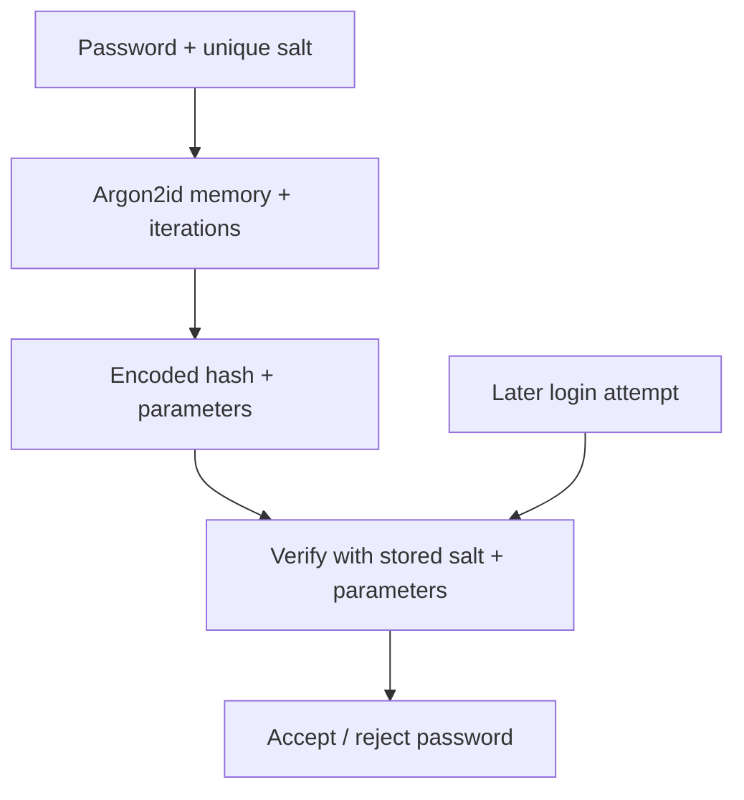

**Argon2id** is a memory-hard password-hashing and key-derivation algorithm. [RFC 9106](https://www.rfc-editor.org/rfc/rfc9106.html) specifies its inputs, including a unique salt, memory size, iteration count, parallelism, and output length. The memory requirement makes large-scale offline password guessing more expensive than fast general-purpose hashes such as MD5 or SHA-256.

The `id` variant combines data-independent and data-dependent memory access. Its security depends on correctly chosen parameters and a maintained implementation, not the algorithm name alone. Parameters should fit the deployment's authentication latency and memory budget while still imposing meaningful cost on an attacker.

## Turn a password into a salted verification record

## Example

During signup, an application generates a fresh random salt and hashes the password using its configured Argon2id memory, time, and parallelism settings. It stores the encoded result and parameters, not the original password. On login, a maintained password library recomputes and verifies the candidate. If policy later increases the work factor, the application can rehash after a successful login.

An AI-generated patch that swaps Argon2id for a fast hash or changes its work factor can leave functional tests green while weakening password security. Password checks should also be rate-limited and must avoid exposing hashes or plaintext credentials in logs.

## Why it matters here

The coding-assistant comparison uses Argon2id as a concrete policy constraint that ordinary correctness tests don't prove. Review the exact algorithm, library, parameters, upgrade behavior, and security policy before accepting an authentication change.

## Related terms

- [Secrets management](glossary://secrets-management)
- [Rate limit](glossary://rate-limit)
- [Permission boundary](glossary://permission-boundary)
- [Validation gate](glossary://validation-gate)
