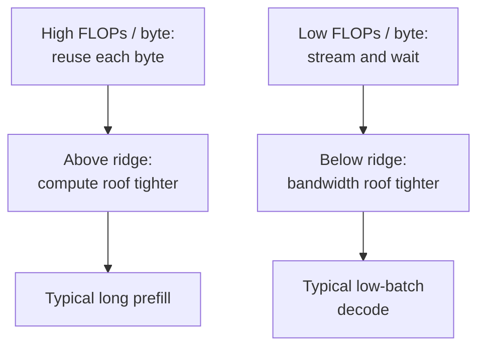

Arithmetic intensity is how much useful math a kernel does per byte of memory traffic, usually written as FLOPs per byte. It answers a practical question on GPUs and other accelerators: for this op, do you run out of compute first, or out of memory bandwidth first?

High intensity means each fetched byte is reused in many arithmetic operations, so tensor cores can stay busy. Low intensity means the chip spends most of its time waiting on HBM or cache traffic even when the paper FLOP count looks large. The [roofline model](glossary://roofline-model) plots attainable performance against intensity so you can see which roof you are under.

Williams, Waterman, and Patterson (2009) popularized the same idea under the name **operational intensity**: FLOPs (or other ops) per byte of traffic between last-level cache and DRAM, after the cache hierarchy has filtered reuse. In LLM engineering people still say "arithmetic intensity" for the FLOPs/byte ratio of matmuls, attention, and decode steps. The unit is what matters; the name is secondary.

## Formula

$$
I = \frac{W}{Q}
$$

where $W$ is work (typically FLOPs) and $Q$ is memory traffic in bytes. Units are FLOPs/byte.

Compare $I$ to the machine **ridge point**, peak compute over peak bandwidth:

$$
I_{\mathrm{ridge}} = \frac{\pi}{\beta}
$$

with $\pi$ peak FLOP/s and $\beta$ peak bytes/s. The classic bound is

$$
P \le \min(\pi,\; \beta \cdot I)
$$

Below the ridge, the bandwidth roof is the tighter bound; above it, the compute roof is tighter. A roofline plot shows idealized resource ceilings. Launch overhead, dependencies, occupancy, communication, or poor tiling can keep an actual kernel below both roofs. Specify which memory level and precision the roofs describe.

**What counts as $Q$?** Algorithmic estimates often use compulsory traffic (read inputs once, write outputs once). Measured intensity uses profiler counters for the specified memory level. On-chip reuse can shrink HBM traffic. FlashAttention avoids materializing the full attention matrix in HBM, but recomputation can change its FLOP count, especially in backward.

## Example

### Dense GEMM vs matrix-vector

For $C = A B$ with $A \in \mathbb{R}^{M \times K}$, $B \in \mathbb{R}^{K \times N}$ (one multiply-add counted as 2 FLOPs):

$$
W = 2 M N K
$$

A lower bound on bytes for FP16/BF16 (2 bytes per element), reading $A$ and $B$ and writing $C$ once with no extra traffic:

$$
Q \ge 2(MK + KN + MN)
$$

so

$$
I \le \frac{MNK}{MK + KN + MN}
$$

When $M$, $N$, and $K$ are all large (big matrix-matrix multiplies in prefill or training), $I$ is high and the kernel is often compute-bound. When the effective "batch" collapses to one token, a linear layer becomes a matrix-vector product. For weight matrix $W \in \mathbb{R}^{n \times n}$ in BF16 and batch $B=1$:

$$
W_{\mathrm{flops}} \approx 2 n^{2},\qquad Q_{\mathrm{weights}} \approx 2 n^{2},\qquad I \approx 1\ \text{FLOP/byte}
$$

(weight traffic only). Raising the token batch to $B$ reuses the same weights across $B$ rows, so weight-only intensity scales roughly as $I \approx B$ FLOPs/byte. Activations, KV-cache traffic, and writes still pull measured intensity down.

### Ridge point on H100 SXM

NVIDIA lists H100 SXM peak HBM bandwidth at $3.35$ TB/s and dense BF16/FP16 Tensor Core peak near $989$ TFLOPS (the higher datasheet numbers often include structured sparsity). The dense **paper** ridge is about

$$
I_{\mathrm{ridge}} \approx \frac{989 \times 10^{12}}{3.35 \times 10^{12}} \approx 295\ \text{FLOPs/byte}
$$

That figure uses datasheet peak $\pi$ and $\beta$. Sustained HBM bandwidth and real kernels sit below the paper roof. Use $I_{\mathrm{ridge}}\approx 295$ FLOPs/byte as a planning estimate; profile your workload to locate its practical knee.

Low-batch decode at ~1 FLOP/byte sits far below that ridge, where peak HBM bandwidth times intensity bounds useful work. Peak TFLOPS sets the compute roof above the ridge. That is why a large model can show very low Tensor Core utilization during single-stream generation even though the chip is "busy" streaming weights.

### Prefill vs decode

| Regime | Geometry | Intensity | Likely ceiling |
|---|---|---|---|
| Prefill (long prompt, large $M$) | matrix-matrix | high | compute / tensor cores |
| Decode ($B$ small) | near matrix-vector + KV reads | low | HBM bandwidth |
| Large continuous batch | many tokens share weights | higher | can approach compute roof |

Same weights, different intensity: prefill amortizes each weight load over many prompt positions; single-request decode may stream most of the model for one new token.

## Diagram

## How to raise or lower it in practice

Levers that change $I$ (or the effective roof you care about):

| Lever | Effect on intensity / bound |
|---|---|
| Larger batch / continuous batching | More FLOPs per weight byte |
| FlashAttention-style tiling | Less HBM traffic; recomputation can add FLOPs |
| Weight quantization (INT8/FP8/…) | Fewer bytes per weight load |
| Kernel fusion | Avoid writing/reading intermediates |
| Longer sequences in attention | Can raise algorithmic intensity, but naive $N^{2}$ materialization explodes $Q$ |

If measured SM or Tensor Core utilization is low while HBM bandwidth is pegged, you are memory-bound: more peak FLOPs will not help until you cut traffic or raise reuse. If bandwidth headroom is large and utilization is high, you are closer to compute-bound.

## Why it matters here

Arithmetic intensity connects transformer math to serving behavior: prefill versus decode, why batching raises tokens per second, and how FlashAttention and quantization address different bottlenecks. HBM pressure can leave compute units underused even when a datasheet lists ample peak FLOPs. Curriculum lessons on TTFT, TPS, speculative decoding, and the roofline model all rest on this ratio.

## Related terms

- [Roofline model](glossary://roofline-model)
- [HBM](glossary://hbm)
- [FlashAttention](glossary://flashattention)
- [Decode phase](glossary://decode-phase)
- [Prefill](glossary://prefill)
