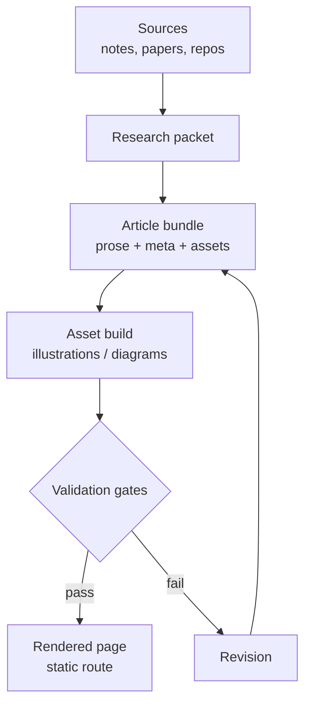

An article bundle is the complete, version-controlled source package for one lesson or post: prose, structured metadata, references, illustration sources, diagram inputs, generated assets, quizzes, and the validation hooks that must pass before publish. Readers see the combined output of those sources, metadata, and generated assets.

The idea matches the broader docs-as-code pattern used by static site generators (for example [Hugo page bundles](https://gohugo.io/content-management/page-bundles/)): one directory logically associates content with its resources so loaders, reviewers, and CI treat them as one unit. When a numeric claim, API name, or diagram label changes, update the **bundle** so text, visuals, glossary spans, and exports stay aligned.

## Intuition

A published page is many artifacts that must agree:

| Piece | Job |
|:---|:---|
| Prose (`content.md`) | Teach the idea with examples and citations |
| Metadata / frontmatter | Route, index, SEO, difficulty, cover image, ordering |
| Illustration sources (`.tsx`) | Custom visuals compiled to light/dark PNGs |
| Diagram sources (Mermaid, etc.) | Flow and structure that re-render in the pipeline |
| Generated assets | Build outputs; not hand-edited as truth |
| Research notes | Claim inventory and evidence (often `_research.md`) |
| Validators | Fail the bundle if paths, schema, or references break |

If only Markdown ships, cards, diagrams, mobile export, and search snippets can stay stale while the body looks fine. Bundling makes those dependencies machine-visible.

## Example

A production RAG lesson directory might look like:

```text
retrieval/design-production-rag-pipeline/
├── content.md                 # JSON frontmatter + article body
├── _research.md               # claims, sources, misconceptions
├── illustrations/
│   ├── rag_pipeline.tsx       # source of truth for a figure
│   └── _generated/            # dark/light PNGs from the build
│       ├── rag_pipeline_dark.png
│       └── rag_pipeline_light.png
├── diagrams/_generated/       # Mermaid or other rendered diagrams
└── social_banner.png          # optional share art
```

Lesson frontmatter can carry `id`, `slug`, `section`, `difficulty`, `coverImage`, and `shortDescription`; blog metadata uses its own schema. Shared citation records and global validators aren't necessarily stored inside the directory, but belong to its review dependencies. The loader combines local metadata and body and resolves generated media.

Concrete consistency check: if the prose says p95 answer latency is "$2.5\,\mathrm{s}$" after a retrieval change, update the latency-budget figure, quiz answer, glossary span, and any table that still says "$4\,\mathrm{s}$". Review the full **bundle** alongside its rendered HTML.

```ts
// Conceptual shape of loadContentBundle(articleDir)
// content.md required; metadata from JSON frontmatter or metadata.json
type ContentBundle = {
  metadata: Record<string, unknown>
  body: string
  contentPath: string
  metadataPath?: string
}
```

## Bundle contract

Make sources of truth obvious:

1. **Canonical (edit these):** `content.md` prose and frontmatter, illustration `.tsx` sources, Mermaid (or other) diagram inputs, research notes, shared reference IDs.
2. **Generated-only (rebuild, do not hand-edit as truth):** `illustrations/_generated/*.png`, diagram PNG outputs, compiled search/export artifacts, auto-resolved footnote blocks.
3. **Must pass before publish:** metadata schema, slug/id match to directory, image paths that exist, every illustration source referenced from prose, citation keys present in the global reference store, glossary spans valid, route and smoke checks for the rendered page.

Hand-editing a generated PNG "fixes" one deploy and leaves the next illustration build free to overwrite your fix. Prefer regenerating from source and fixing the source if the visual is wrong.

## Diagram



## What fails in production

- **Split brain:** prose updated, caption and quiz still old; learners get two answers.
- **Orphan assets:** illustration `.tsx` never referenced (or referenced path missing after rename).
- **Schema drift:** frontmatter field renamed or enum value added without loader/schema update; page disappears from indexes or cards.
- **Generated-as-canonical:** someone commits a one-off PNG edit; next build restores the old figure.
- **Partial review:** only the Markdown PR is read; broken cover image, bad difficulty, or wrong section order ship with "perfect" writing.

## Why it matters here

LeetLLM publishes through a content pipeline and static generation. Lessons, blog posts, and related learning pages are directories under `web/src/content/`, not CMS rows. The bundle shape is how editorial quality (claims, examples, citations) and technical assets (TSX illustrations, Mermaid diagrams, metadata schema) move together through review, CI, and deploy. Treat each lesson like a small software package: one reviewable unit, one set of gates, one coherent page.

## Related terms

- [Frontmatter](glossary://frontmatter)
- [Content pipeline](glossary://content-pipeline)
- [Mermaid diagram](glossary://mermaid-diagram)
- [Static generation](glossary://static-generation)
- [Validation gate](glossary://validation-gate)
