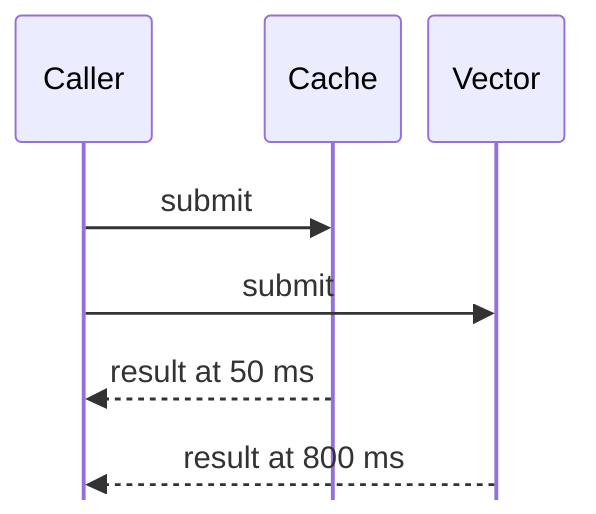

`as_completed` yields concurrent work **in completion order**, not submission order. In `concurrent.futures`, it iterates over `Future` objects as each one finishes or is cancelled. In `asyncio`, the same idea applies to awaitables: you process results (or exceptions) as soon as the next task is done.

That matters when tasks are independent and finish times vary. A 200ms embedding call should not wait behind a 4s tool call just because you submitted the tool first. You get partial progress, per-task error handling, and the option to stop early once you have enough successes. The trade-off is identity: the iterator does not tell you *which* input finished unless you map each future back to its key.

Two library APIs share the name:

| API | Yields | Typical use |
| --- | --- | --- |
| `concurrent.futures.as_completed(fs, timeout=None)` | `Future`s as they complete | Thread/process pools over blocking I/O |
| `asyncio.as_completed(aws, *, timeout=None)` | Plain iteration yields result-wrapper coroutines; on 3.13+ async iteration yields original Tasks/Futures, or created Tasks for other awaitables | Coroutines on one event loop |

Neither cancels remaining work just because you stop iterating. Timeouts raise `TimeoutError` on the waiter; running tasks keep going unless you cancel them yourself.

## Intuition

Submission order and completion order are separate. After you submit $N$ independent jobs, `as_completed` yields each finished future immediately. Fast paths unblock without waiting for slow paths, while the caller keeps responsibility for mapping results back to inputs.

`Executor.map` yields in input order, so an early slow job holds up later completed jobs. `asyncio.gather` returns the ordered result collection after all succeed (with different error behavior by configuration). Prefer `as_completed` when you can consume completion order or re-key results yourself.

## How it works

1. Submit every task (or create every asyncio task) up front so they run concurrently within the pool/loop budget.
2. Pass the futures/awaitables into `as_completed`.
3. For each completed item, call `future.result()` (threads) or `await` the yielded coroutine/task (asyncio) inside `try/except` so one failure does not abort the whole loop.
4. Keep a `dict` from future to input key if you need provenance for logs, retries, or reordering.

Per the stdlib (`concurrent.futures`): duplicate futures in the iterable are yielded once; futures already done when `as_completed` starts are yielded first. Asyncio's `as_completed` is analogous for awaitables on one loop. The optional `timeout` is measured from the original `as_completed` call; if the next completion is not ready in time, `__next__` / the async loop raises `TimeoutError`.

## Example

Fan out three retrieval sources for one query. Cache hits return in ~50ms; a cold vector search takes ~800ms; a flaky web tool times out. You want each answer as soon as it lands, and you want the bad tool isolated:

```python title="as-completed-retrieval.py"
from concurrent.futures import ThreadPoolExecutor, as_completed
import time

def retrieve(source: str) -> tuple[str, list[str]]:
    delays = {"cache": 0.05, "vector": 0.8, "web": 2.0}
    if source == "web":
        time.sleep(delays[source])
        raise TimeoutError("web tool timed out")
    time.sleep(delays[source])
    return source, [f"hit from {source}"]

sources = ["cache", "vector", "web"]

with ThreadPoolExecutor(max_workers=3) as pool:
    futures = {pool.submit(retrieve, s): s for s in sources}
    hits: list[str] = []
    for future in as_completed(futures, timeout=3.0):
        source = futures[future]
        try:
            name, docs = future.result()
            hits.extend(docs)
            print(f"{name} ok, total hits={len(hits)}")
        except Exception as exc:
            print(f"{source} failed: {exc}")
```

Typical print order is `cache` then `vector` then `web failed`, not the submission list order. If you only need the first successful source, break after the first success and cancel the rest with `future.cancel()` (already-running thread work usually cannot be interrupted; process/asyncio cancel semantics differ).

If you need results aligned to the original list, store indices:

```python
with ThreadPoolExecutor(max_workers=3) as pool:
    futures = {pool.submit(retrieve, s): i for i, s in enumerate(sources)}
    ordered: list[object | None] = [None] * len(sources)
    for future in as_completed(futures):
        try:
            ordered[futures[future]] = future.result()
        except Exception as exc:
            ordered[futures[future]] = exc
```

## Diagram



## Timeouts and cancellation

The optional `timeout` is a single deadline measured from the original `as_completed` call, not a fresh budget on every iteration. If the next unfinished item is not ready by that deadline, `__next__` (or the asyncio wait) raises `TimeoutError` on the waiter. It does not stop threads already inside blocking I/O, and remaining work is not cancelled just because the wait timed out. Decide a policy:

- **Keep running** unfinished futures (common when results still matter for a later join).
- **Cancel pending** work with `Future.cancel()` / task cancel, knowing running thread callables usually finish anyway.
- **Ignore after enough results** (first-$k$ successes) but still drain or cancel so the pool can shut down cleanly.

On asyncio, prefer structured tools (`TaskGroup`, `asyncio.timeout`) when you need cancel-and-wait guarantees; use `as_completed` when completion-order streaming is the main goal.

## Why it matters here

AI pipelines constantly fan out independent I/O: multi-source retrieval, batch embeddings, eval harness rows, agent tool probes, and document crawls. `as_completed` is the standard stdlib pattern for partial progress and per-task failure isolation without writing callbacks. Interview and production code both get graded on whether every submitted item produces exactly one observed result or recorded error, and whether timeouts leave orphan work behind.

## Related terms

- [ThreadPoolExecutor](glossary://thread-pool-executor)
- [Worker fanout](glossary://worker-fanout)
- [asyncio.Queue](glossary://asyncio-queue)
- [Backpressure](glossary://backpressure)
- [Rate limit](glossary://rate-limit)
