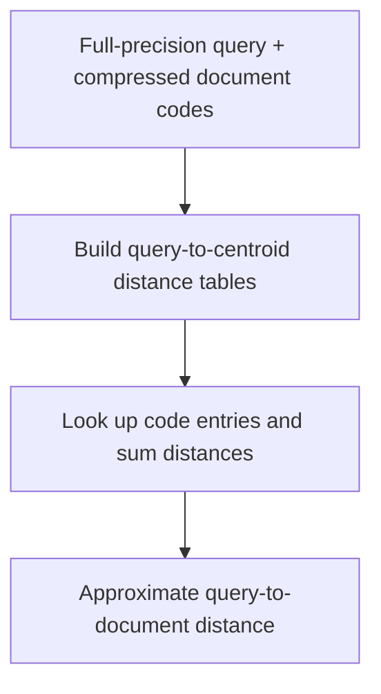

**Asymmetric distance computation (ADC)** compares an uncompressed query vector against compressed database vectors. With product quantization, the query remains in full precision while each stored vector is represented by short centroid identifiers. The asymmetry avoids adding a second quantization error to every query.

## Score with lookup tables, not reconstructed vectors

Suppose a product quantizer splits every vector into $M$ subspaces and learns a separate centroid codebook for each subspace. Before scanning the index, the search engine computes the query's distance to every centroid in every codebook.

Each stored document contributes one centroid identifier per subspace. Its approximate squared distance is the sum of the precomputed entries selected by those identifiers:

$$
\widetilde{d}(q, x)^2 = \sum_{j=1}^{M} T[j, c_j(x)]
$$

Here $T[j, i]$ is the squared Euclidean query-to-centroid distance in subspace $j$, and $c_j(x)$ is the stored code. Sum squared distances, not Euclidean distances; an optional square root recovers the approximate Euclidean distance without changing rank.

## Example

A four-coordinate document is split into two subspaces. Its stored code is `[1, 0]`. For the incoming query, the first subspace has centroid distances `[0.8, 0.2]`, and the second has `[0.1, 0.7]`. ADC selects `0.2 + 0.1 = 0.3` as the approximate squared distance.

The original document's true distance may differ. If the approximation changes which candidates survive, retrieve a larger shortlist and rerank with an exact representation before measuring final retrieval quality.

## Why it matters here

Embedding-compression lessons use ADC to explain how product-quantized indexes can search millions of short codes without treating approximate distances as exact relevance judgments. It connects memory savings, candidate recall, and reranking into one measurable serving tradeoff.

## Related terms

- [Product quantization](glossary://product-quantization)
- [Quantization](glossary://quantization)
- [Reranker](glossary://reranker)
- [Recall at K](glossary://recall-at-k)
