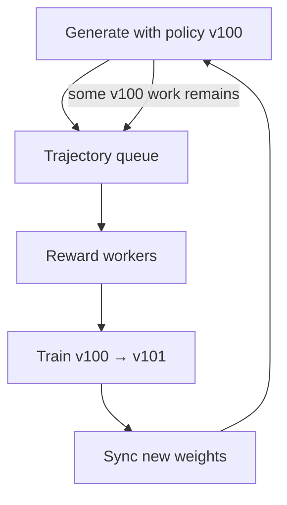

**Asynchronous reinforcement learning** lets rollout generation, reward computation, and policy updates progress without one global barrier after every batch. Workers can continue producing trajectories while the learner updates weights.

The throughput gain comes from overlap: slow environments or long generations no longer idle every trainer rank. The cost is off-policy data. Some trajectories were sampled by an older policy than the one computing their loss.

## Pipeline overlap

An asynchronous system needs queues, policy-version tags, weight synchronization, admission control, and a staleness policy. Bounded queues prevent generation from running arbitrarily far ahead. Correction methods can clip, mask, or importance-weight stale samples.

## Diagram

## Example

With maximum staleness two, the learner may accept a trajectory generated up to two policy updates behind current weights. Older work should be blocked, replaced, or corrected according to the algorithm.

## Why it matters here

SkyRL-style rollout/learner pipelines expose overlap and staleness as configuration choices. Worker count controls capacity; the term describes pipeline behavior. Measure throughput, policy ratios, clipping, and held-out behavior together. These diagnostics reveal instability; assess correction bias and convergence with dedicated analysis.

## Related terms

- [Rollout staleness](glossary://rollout-staleness)
- [Importance sampling](glossary://importance-sampling)
- [Policy ratio](glossary://policy-ratio)
- [Rollout](glossary://rollout)
- [SkyRL](glossary://skyrl)
