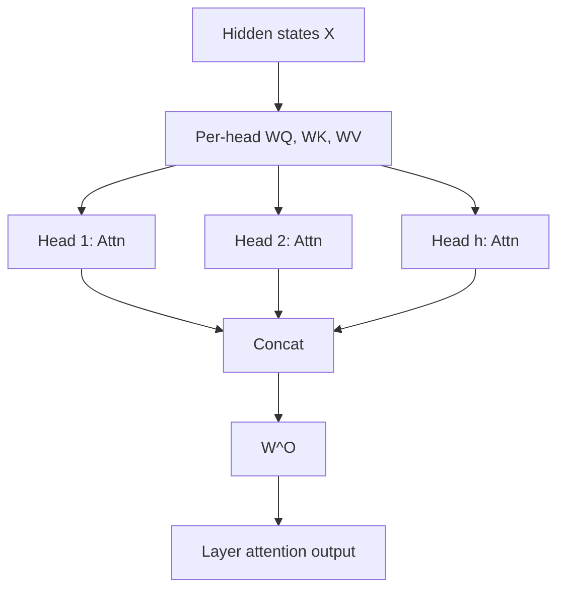

An attention head is one independent scaled dot-product attention path inside multi-head attention. The layer projects the same residual stream into several lower-dimensional query, key, and value subspaces, runs attention in each subspace in parallel, concatenates the head outputs, and mixes them with an output projection $W^O$.

Heads exist so the model can read different patterns at once (local syntax, a distant referent, broad topic context) without forcing a single attention distribution to average everything together. Head "roles" emerge from training; nothing assigns syntax or copying to head 3 by hand. Looking at one head's weights rarely explains the full residual update.

## Diagram

## Intuition

Think of one head as a specialized reader over the sequence. Its queries ask "what do I need?", its keys say "what do I offer?", and its values carry the payload. Multi-head attention stacks many such readers with different projections so one layer can track several relationships at the same position. Vaswani et al. (2017) put it directly: multi-head attention lets the model jointly attend to information from different representation subspaces; a single head tends to average those signals together.

## Formula

Scaled dot-product attention for one head (Vaswani et al., 2017):

$$
\mathrm{Attention}(Q,K,V)=\mathrm{softmax}\!\left(\frac{QK^{\top}}{\sqrt{d_k}}\right)V
$$

In decoder self-attention, add a causal mask before softmax so position $t$ can't attend to future positions greater than $t$.

Multi-head attention with $h$ heads:

$$
\mathrm{MultiHead}(Q,K,V)=\mathrm{Concat}(\mathrm{head}_1,\ldots,\mathrm{head}_h)\,W^O
$$

$$
\mathrm{head}_i=\mathrm{Attention}(QW_i^Q,\,KW_i^K,\,VW_i^V)
$$

with $W_i^Q,W_i^K\in\mathbb{R}^{d_{\mathrm{model}}\times d_k}$, $W_i^V\in\mathbb{R}^{d_{\mathrm{model}}\times d_v}$, and $W^O\in\mathbb{R}^{h d_v\times d_{\mathrm{model}}}$.

The original base Transformer used $d_{\mathrm{model}}=512$, $h=8$, and $d_k=d_v=d_{\mathrm{model}}/h=64$. Shrinking each head keeps total FLOPs close to one full-width attention while preserving subspace diversity. The $\sqrt{d_k}$ scale keeps dot products from growing with head dimension so softmax stays in a useful gradient regime.

## Example

Suppose $d_{\mathrm{model}}=1024$ and $h=16$ query heads with $d_k=d_v=64$. For a sequence of length $n$:

| Tensor (one head) | Typical shape |
| --- | --- |
| $Q$, $K$ | $(n,\,64)$ |
| scores $QK^{\top}$ | $(n,\,n)$ |
| head output | $(n,\,64)$ |
| concat of 16 heads | $(n,\,1024)$ |
| after $W^O$ | $(n,\,1024)$ |

In a decoder under a [causal mask](glossary://causal-mask), position $t$ may only attend to keys $1..t$. During decode, each new token still runs every head, but reuses cached $K$ and $V$ for earlier positions.

## KV heads vs query heads

Full multi-head attention uses the same head count for $Q$, $K$, and $V$. Multi-query attention (MQA) and grouped-query attention (GQA) keep many query heads but fewer key/value heads so several queries share one KV subspace. That does not remove heads; it changes which tensors you store in the [KV cache](glossary://kv-cache).

Per-token KV storage (keys and values, all layers) scales as:

$$
\text{bytes/token} \approx 2 \times L \times n_{\mathrm{kv}} \times d_k \times b
$$

where $L$ is layers, $n_{\mathrm{kv}}$ is KV heads (not query heads under GQA/MQA), and $b$ is bytes per element (2 for FP16/BF16). The leading $2$ assumes $d_v = d_k$ (the usual case). If head value dim differs from key dim, use $L\, n_{\mathrm{kv}}\, (d_k + d_v)\, b$ instead.

Worked case: $L=32$, $n_{\mathrm{kv}}=8$, $d_k=d_v=128$, FP16 $\Rightarrow$ $2 \times 32 \times 8 \times 128 \times 2 = 131{,}072$ bytes $=128$ KiB per token before fragmentation or paging overhead. Dropping $n_{\mathrm{kv}}$ via GQA cuts that bill even if query head count stays at 32.

## Shape check

Per head, the path is project $\to$ score $\to$ mask $\to$ softmax $\to$ weight $V$. Bugs often show up as wrong $d_k$ (not dividing $d_{\mathrm{model}}$ by $h$), missing causal mask, head-axis transpose mistakes, or mismatched query vs KV head counts when wiring GQA. If quality collapses after a reshape refactor, print shapes for $Q$, $K$, $V$, scores, and the concat before $W^O$.

## Why it matters here

Attention heads are the unit behind multi-head attention, MQA/GQA trade-offs, interpretability heatmaps, FlashAttention tiling over the head and sequence axes, and decode-time memory math. When you size serving capacity, compare models by query heads, KV heads, head dimension, and layers, not by parameter count alone.

## Related terms

- [Self-attention](glossary://self-attention)
- [Causal mask](glossary://causal-mask)
- [Grouped-query attention](glossary://grouped-query-attention)
- [Multi-query attention](glossary://multi-query-attention)
- [KV cache](glossary://kv-cache)
