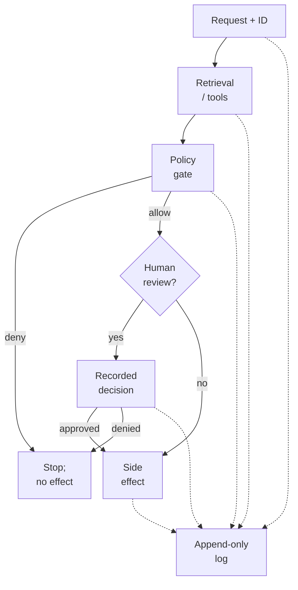

An audit trail is a durable, reviewable, chronological record of the facts needed to explain a decision, access, or side effect later. Classical security guidance (for example NIST SP 800-12) frames it as a technical control that supports individual accountability, reconstruction of events, intrusion detection, and problem analysis. For AI systems that retrieve private context, propose actions, call tools, and route approvals, the trail answers who asked, under which identity and tenant, what evidence was used, which policy and model versions applied, what the gate decided, who reviewed it, and what finally happened.

Operational traces and metrics help you fix latency and quality *now*. An audit trail preserves evidence that can be trusted months later under access control, retention, and integrity rules. Good trails prefer stable IDs and content hashes over raw private payloads when full text is not required for investigation. Audit storage can itself become a sensitive corpus, so redaction, encryption, and who may query it need an explicit policy.

## Intuition

Think of a flight data recorder for product decisions. Each security-relevant hop should leave a fact that a human investigator can join without replaying the model or guessing. If actor, policy version, evidence IDs, gate decision, or effect ID is missing, the trail is decorative. It shows that *something* happened but leaves *why it was allowed* unresolved.

In agentic workflows the path is non-deterministic. The same user prompt can produce different tool sequences on different runs. That makes "replay the request" a weak forensic strategy. You need structured events that bind user, agent or service identity, tool invocation, policy decision, and outcome under one correlation ID.

## Example

An LLM promotion assistant handles request `r_77c2` for tenant `acme`:

| Fact | Value |
| --- | --- |
| Actor | `user_19` (support lead), session `sess_441` |
| Policy | version `pol_3.2`, risk tier `write-prod` |
| Model / prompt | `support-v4` @ checkpoint `sha256:9c1a…`, template `pt_12` |
| Retrieved evidence | source IDs `[doc_9, doc_44]` with content checksums (not full text) |
| Gate | proposed action `update_banner`, decision `needs_review` |
| Human review | review `rev_3` by `user_88`, outcome `approved` at `2026-07-01T14:02:11Z` |
| Effect | change id `chg_881` applied; prior state hash recorded |

Months later, security reconstructs why the banner change shipped without dumping full prompts. Missing actor, policy version, or effect id would leave only a vague "the bot did something" story. A denial path is equally important: if the gate had returned `deny` with reason `missing_eval_coverage`, that event should still exist so you can prove the control fired.

```python
audit_event = {
    "event_version": "1.0",
    "ts": "2026-07-01T14:02:11Z",
    "request_id": "r_77c2",
    "tenant_id": "acme",
    "actor_id": "user_19",
    "agent_id": "promo-assistant",
    "policy_version": "pol_3.2",
    "model_id": "support-v4",
    "prompt_template_id": "pt_12",
    "evidence_ids": ["doc_9", "doc_44"],
    "evidence_checksums": ["sha256:ab…", "sha256:cd…"],
    "action": "update_banner",
    "gate_decision": "needs_review",
    "review_id": "rev_3",
    "reviewer_id": "user_88",
    "review_outcome": "approved",
    "effect_id": "chg_881",
}
```

## What to capture

Record the facts needed to reconstruct *authorization and effect*. Store model tokens when a documented investigation need requires them.

**Identity and scope.** Actor (human or service), agent or workflow ID, tenant, delegation or session token ID, and permission scope in force.

**Versions.** Policy version, model ID or checkpoint hash, prompt or graph template ID, tool schema version, and retrieval index or corpus version when those affect the decision.

**Evidence without over-collection.** Document or chunk IDs, content checksums, ACL filter that applied, and a redacted query summary or query hash. Prefer references over copying private bodies into long-lived storage.

**Decisions and side effects.** Allow / deny / escalate, denial reason, tool name, hashed or redacted tool params, result status, reviewer ID, and final effect or transaction ID.

**Correlation.** Request ID, trace ID, and parent event ID so you can join audit rows to short-lived operational traces when both exist.

Separate short-lived operational traces (days to weeks, rich payloads for debugging) from compliance-grade audit storage (months to years, append-oriented, stricter access) when retention and sensitivity differ.

## Diagram



Each solid arrow is runtime work. Each dotted arrow is an audit event that must land even when the path denies or times out. Log denials and timeouts alongside successful allows so the trail reveals attacks and policy pressure.

## Audit trail vs tracing

| Concern | Operational tracing | Audit trail |
| --- | --- | --- |
| Primary job | Debug latency, quality, failures | Prove who did what, under which policy |
| Typical retention | Short, high volume | Long, controlled access |
| Payload style | Spans, timings, optional rich I/O | Stable IDs, hashes, decisions, effect IDs |
| Integrity goal | Best-effort observability | Tamper-evident or append-only where feasible |
| Success criteria | Engineer can find the slow span | Investigator can reconstruct authorization |

Share a `request_id` / `trace_id` so the two systems join. Do not treat a mutable debug log bucket as your compliance store.

## Production failure modes

- **Decorative logging:** events lack actor, policy version, or effect ID, so investigations stall.
- **Audit as a second leak path:** raw prompts, retrieved chunks, or tool bodies land in SIEM with broad read access.
- **Missing denials:** denials, timeouts, and fail-closed decisions are never written, so abuse looks like silence.
- **Mutable "audit" tables:** operators can edit history; prefer append-only writes, restricted delete, integrity checks.
- **Identity dilution:** everything runs as one service account, so you cannot tell user-driven action from agent autonomy or override.

## Why it matters here

Enterprise RAG, agents with tools, and promotion pipelines all create security-relevant decisions that compliance and incident response will ask about after the fact. An audit trail turns policy gates, human review, and side effects into accountable history without forcing every investigator to re-run a non-deterministic model. The curriculum uses this idea to connect retrieval, RBAC, agents, and release controls with the evidence behind a dashboard status.

## Related terms

- [Policy gate](glossary://policy-gate)
- [Action allowlist](glossary://action-allowlist)
- [Fail closed](glossary://fail-closed)
- [Tracing](glossary://tracing)
- [Provenance](glossary://provenance)
