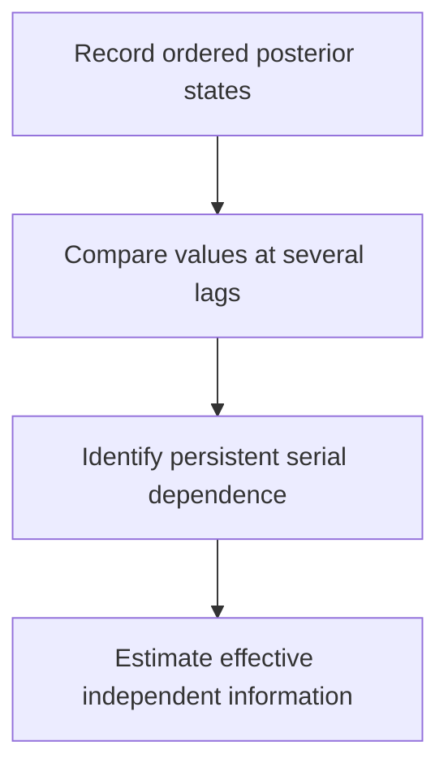

Autocorrelation measures how strongly values in a sequence relate to earlier values from that same sequence at a specified lag. A lag-one autocorrelation compares each state with the immediately preceding state. In Markov chain Monte Carlo, dependence is expected because every proposal starts from the current chain state, but strong persistent dependence reduces the precision gained from additional stored draws.

## Inspect dependence across successive chain states

Autocorrelation depends on the quantity being inspected. A parameter mean, posterior tail indicator, or latent component label can display different mixing behavior in the same chain. Slowly decaying correlation suggests that proposals are moving too cautiously or that the chain is trapped in one region. Merely setting a reproducible random seed does not remove serial dependence.

## Example

A chain that stays near one posterior region for hundreds of iterations before moving to another can have persistent positive autocorrelation and low effective sample size. Five close values alone don't diagnose that: small marginal variance isn't serial dependence, and alternating values can be negatively correlated. Inspect lag correlations over a sufficiently long, stationary run and compare chains. Rejected Metropolis proposals repeat the previous state, but a wider proposal isn't automatically better because rejection can rise.

## Why it matters here

Simulation lessons first teach independent Monte Carlo draws. Posterior samplers require an additional diagnostic because their transitions intentionally create a chain. Autocorrelation explains why a long replayable run can still have low effective sample size and unreliable uncertainty estimates.

## Related terms

- [Effective sample size](glossary://effective-sample-size)
- [Markov chain Monte Carlo](glossary://markov-chain-monte-carlo)
- [Metropolis-Hastings](glossary://metropolis-hastings)
- [Correlation](glossary://correlation)
