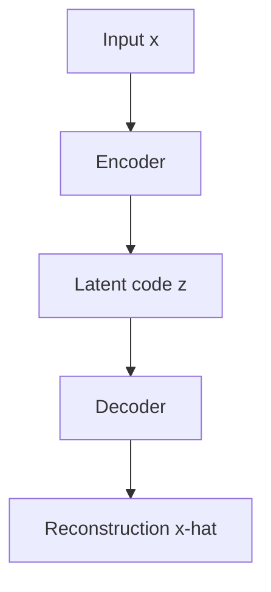

An autoencoder learns to reconstruct an input after passing it through an intermediate representation. Its encoder maps an observation $x$ to a latent code $z$, and its decoder maps that code back to a reconstruction $\hat x$. Training minimizes a reconstruction objective that measures how closely $\hat x$ matches $x$.

## Compression alone doesn't create a generator

A narrow latent bottleneck encourages the model to keep information useful for reconstruction, but reconstruction accuracy doesn't ensure that arbitrary latent points decode into realistic examples. A deterministic autoencoder can map observed inputs to isolated regions of latent space while producing nonsense between or outside them.

The exact learning behavior also depends on capacity and constraints. An overpowered encoder-decoder can learn an almost direct copy, especially without a meaningful bottleneck, noise, sparsity, or another restriction. Assess generalization on held-out data because low training reconstruction error can coexist with a representation that fails on new examples.

## Diagram

## Example

A five-by-five grayscale patch has 25 pixel values. Compress it into a three-value latent vector, then decode those three values back into 25 reconstructed pixels. The reconstruction error measures lost image detail. Sampling a random three-value vector is a separate experiment: without distributional regularization, its decoded patch may not resemble any valid training example.

## Why it matters here

The generative-modeling lesson first teaches deterministic compression, then introduces a variational autoencoder to explain why matching latent codes to a chosen prior changes the meaning of random samples.

## Related terms

- [Variational autoencoder](glossary://variational-autoencoder)
- [Embedding](glossary://embedding)
- [Loss function](glossary://loss-function)
- [Overfitting](glossary://overfitting)
