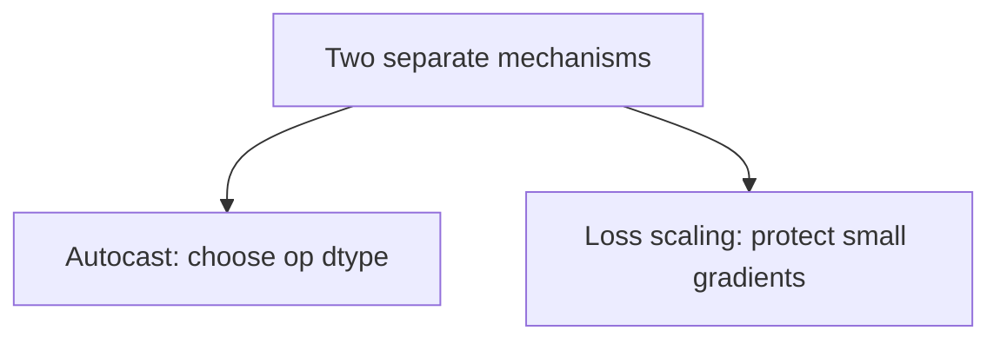

Automatic mixed precision (AMP) applies an operation-specific precision policy during model execution. Eligible operations can run in a lower-precision format while sensitive operations retain wider precision. It automates dtype selection; it doesn't mean that every tensor, parameter, gradient, or optimizer state uses the same small format.

## Autocast and gradient scaling solve different problems

In [PyTorch AMP](https://docs.pytorch.org/docs/2.14/amp.html), autocast chooses execution dtypes for eligible operations. Gradient scaling multiplies the loss before backpropagation and later unscales gradients, reducing underflow risk in FP16 training. These mechanisms are related but separate. BF16 often doesn't need gradient scaling because its exponent range is much wider than FP16's.

Autocast isn't equivalent to permanently converting a model's parameters to half precision. Inspect parameter storage, selected kernels, reduction precision, and optimizer state separately. Backend and operation support determine the effective behavior.

## Example

A classifier performs a large matrix multiplication under BF16 autocast while retaining FP32 parameter storage. Its speed and activation-memory use may improve without halving every memory component. In an FP16 run with gradient scaling, unscale gradients before clipping them; otherwise the clipping threshold is applied to artificially enlarged values.

## Why it matters here

AMP appears in PyTorch loops, distributed training, and GPU debugging. It can save compute and activation memory, but finite loss alone does not guarantee equivalent learning. Compare a fixed batch against a wider-precision baseline, check gradients and task quality, and verify which operations actually used lower precision. A checkpoint's FP8 storage is a separate serving or training decision.

## Related terms

- [Mixed precision](glossary://mixed-precision)
- [BF16](glossary://bf16)
- [FP16](glossary://fp16)
- [Loss scaling](glossary://loss-scaling)
- [Gradient clipping](glossary://gradient-clipping)
