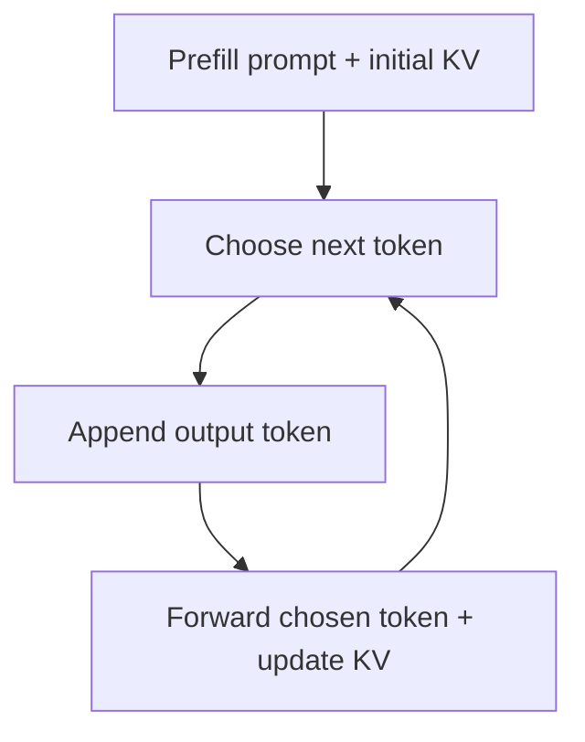

Autoregressive decoding generates one token at a time, conditioning each new token on the prompt and every token already produced. Generation is a feedback loop: run the model, turn logits into a token choice, append that token, update state (usually a KV cache), and repeat until a stop condition.

A decoder-only language model factorizes a sequence as a product of next-token conditionals:

$$
P(x_1,\ldots,x_T)=\prod_{t=1}^{T} P(x_t \mid x_{<t})
$$

At step $t$ the model cannot know $x_t$ until $x_1,\ldots,x_{t-1}$ are fixed. That is why output length drives latency and cost even when the prompt is fixed, and why an early bad sample can steer the rest of the answer.

## Diagram

## How it works

Serving splits the work into two phases with very different hardware shapes:

1. **Prefill.** The full prompt is known, so the model can process prompt positions largely in parallel and write initial keys and values into the KV cache. This phase is usually compute-heavy and sets up time to first token (TTFT).
2. **Decode.** Each new output token needs another forward step that depends on the previous choice. With a KV cache, the step only computes the new token's keys/values and attends over cached history instead of replaying the whole prefix. Decode is often memory-bandwidth bound: weights and growing KV traffic dominate more than arithmetic.

A naive loop without a cache recomputes keys, values, and full attention over the prefix every step, so attention cost in **sequence length** is about $O(t^2)$ at step $t$ and about $O(T^3)$ over the whole generation (hiding $d$, layers, and batch). With a KV cache, each step builds only the new token's keys/values and attends over cached history: about $O(t)$ attention work in sequence length per step and $O(T^2)$ total, trading GPU memory for that reuse. Projection and MLP costs still run every step either way.

Stop when the model emits an end token, hits `max_tokens`, matches a stop string, or an external policy aborts the stream. Streaming APIs ship tokens as they complete because the algorithm is already sequential.

## Example

Prompt: `How do I reset my password?` After prefill, the model is about to emit the first answer token.

| Step | Context so far (abbrev.) | Next-token options (sketch) | Choice |
|------|--------------------------|-----------------------------|--------|
| 1 | prompt | `To`, `Reset`, `You`, ... | `To` |
| 2 | ... `To` | `reset`, `change`, `open`, ... | `reset` |
| 3 | ... `To reset` | `your`, `the`, `a`, ... | `your` |
| 4 | ... `To reset your` | `password`, `account`, ... | `password` |

After emitting `reset`, the model feeds that token back before choosing among `your`, `the`, or punctuation. With temperature $1.2$, a wrong early token can cascade into a full wrong procedure. For $T=400$ generated tokens you need about $400$ decode steps after prefill, even if each step is cheap. Prefill can process prompt positions in parallel; decode cannot invent future tokens that do not exist yet.

At an assumed $25\,\mathrm{ms}$ per ordinary decode step, a 400-token answer takes about 10 seconds beyond prefill and queueing. The first token is normally predicted from prefill, so the exact step count is typically 399 subsequent decode steps. Raising `max_tokens` from 200 to 800 raises the output cap fourfold; actual duration depends on how many tokens are produced and how step time changes with context and load.

Grammar or schema constraints can exclude invalid token continuations within the supported grammar. Stop sequences only terminate generation; they don't enforce structure. Even grammar-constrained output can be incomplete after a limit or abort, and syntactic validity does not guarantee factual or semantic correctness.

## Sampling at each step

The model emits logits over the vocabulary; decoding policy turns them into one token:

- **Greedy:** $\arg\max_i z_i$ (deterministic, can be dull or brittle).
- **Temperature:** scale logits as $z_i / \tau$ before softmax; $\tau < 1$ sharpens, $\tau > 1$ flattens.
- **Top-$k$ / top-$p$:** keep only the $k$ largest logits or the smallest set whose cumulative probability exceeds $p$, then sample.

Those knobs do not remove the autoregressive dependency. They only change which token closes each step of the loop. Beam search keeps several prefixes instead of one, but each beam is still extended left to right.

## Train versus serve

Training usually uses teacher forcing: every position is scored against the true previous tokens in one parallel pass with a causal mask. Autoregressive decode at inference must condition on its own samples. That train/serve gap (exposure bias) is why fluent teacher-forced loss can coexist with free-running drift, and why decoding policy, stop rules, and evaluation on real generations matter in production.

## Latency and serving shape

Batching, continuous batching, prefix caches, GQA/MQA, and PagedAttention hide some cost, but each new token still needs another model step for that sequence. Metrics that describe the loop:

- **TTFT:** time until the first output token (model-side prefill-dominated; end-to-end TTFT can still be queue- or network-dominated).
- **TPOT / ITL:** time per output token during decode.
- **Tokens/sec:** throughput across one or many concurrent sequences.

Speculative decoding tries to keep the same target distribution while verifying several draft tokens in parallel so some serial target steps can be skipped. It speeds the loop; it does not remove left-to-right dependence of the accepted output.

## Why it matters here

Autoregressive decoding is the core generation algorithm behind almost every LLM chat, completion, and tool-calling path. It explains max tokens, streaming UX, KV memory growth, decode versus prefill bottlenecks, sampling and constrained decoding, and why longer answers cost more even when the prompt is fixed.

## Related terms

- [Token](glossary://token)
- [KV cache](glossary://kv-cache)
- [Decode phase](glossary://decode-phase)
- [Teacher forcing](glossary://teacher-forcing)
- [Speculative decoding](glossary://speculative-decoding)
