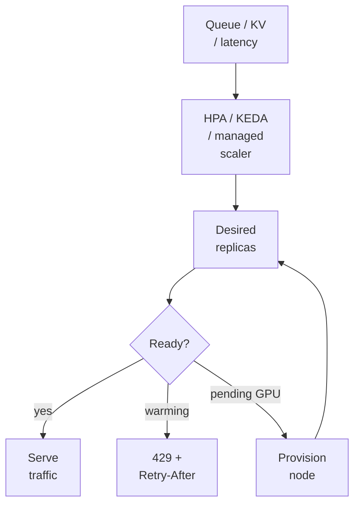

Autoscaling is a control loop that changes how much capacity is running (workers, pods, nodes, or managed instances) in response to measured demand. Demand signals can be resource utilization, request concurrency, queue depth, custom app metrics, a schedule, or a mix. Capacity arrives after scheduling, image pulls, model loading, GPU-node provisioning, and warmup, so the response takes time.

Horizontal autoscaling adds or removes replicas of the same unit. Vertical autoscaling grows or shrinks CPU and memory on existing units. LLM fleets usually care most about horizontal replica count and a second layer that provisions scarce GPU nodes when pods cannot schedule.

Before you scale, name the scarce resource: decode slots, KV-cache blocks, GPU memory, provider quota, queue workers, database connections, or cache capacity. Scaling on the wrong signal spends money without fixing user latency.

## How it works

A typical production loop has several stages:

1. **Observe** a demand metric (queue wait, waiting requests, KV-cache use, concurrency, or CPU when that is the real bottleneck).
2. **Decide** a desired replica count against min/max bounds, cooldowns, and stabilization windows.
3. **Create** pods or instances (image pull, process start, weight load, readiness).
4. **Schedule** onto nodes that already have the right accelerators, or **provision** new nodes when pods stay Pending.
5. **Admit** only ready capacity to the load balancer; reject or queue excess work with backpressure while lag lasts.

Pod autoscalers (Kubernetes HPA, KEDA-driven scale, Cloud Run concurrency scaling) own replica count. Node autoscalers (Karpenter, Cluster Autoscaler, managed node pools) own hardware supply. Those two loops must not be confused: raising `replicas` does nothing useful if every new pod is unschedulable.

## Diagram

## Formula

Kubernetes Horizontal Pod Autoscaler (HPA) targets a metric value with a ratio of current to desired load. The core update is:

$$
desiredReplicas = \left\lceil currentReplicas \times \frac{currentMetricValue}{desiredMetricValue} \right\rceil
$$

If current average is $200$ and the target is $100$, the ratio is $2$ and the controller aims to double replicas (subject to max, missing metrics, not-yet-ready pods, and scale-down stabilization). Default HPA sync is on the order of $15$ seconds; default downscale stabilization is often $5$ minutes so brief dips do not thrash replica count. With multiple metrics, HPA takes the **largest** recommended replica count.

That ratio is only as good as the metric. For LLM engines, average CPU rarely tracks KV-cache pressure or waiting-request backlog.

## Example

An interactive chat fleet runs $4$ warm vLLM pods on GPU nodes. Target policy:

- Scale out when average `vllm:num_requests_waiting` stays above $5$ for $2$ minutes, or `vllm:kv_cache_usage_perc` stays above $0.85$.
- Cap at $12$ replicas.
- Node pool only grows when GPU pods are Pending for accelerators that do not exist yet.

In a hypothetical spike at $t=0$, waiting requests rise from 0 to 40 while active requests stay near capacity. After the declared two-minute trigger window, the scaler requests eight replicas. If scheduling, weight loading, and warmup then take 90 seconds, the first new replica is ready near $t=210$ seconds, not 90 seconds after the spike. These are assumed timings. Admission control covers the lag; measure detection time, provisioning time, readiness, and p95 TTFT separately.

For batch embeddings, scale on backlog age (oldest job older than $5$ minutes) rather than GPU duty cycle. Empty GPUs with a deep queue point to the wrong pool or a stuck consumer. Full GPUs with empty queues indicate healthy packing and favor holding node count.

## Signals for LLM serving

| Signal | Use as scale trigger? | Why |
|---|---|---|
| Waiting queue depth / queue age | Primary | Users are already delayed before generation |
| KV-cache utilization | Primary / guard | Near saturation, admission and preemption get tight |
| TTFT / TPOT vs SLO | Primary / gate | User-visible outcomes lead, with hardware activity as a diagnostic |
| GPU utilization (DCGM) | Supporting | High can mean healthy full batches; low can mean memory-bound stalls |
| CPU percent alone | Rarely for decode pods | Prefill/decode capacity is usually HBM and scheduler limited |

vLLM exposes gauges and histograms such as `vllm:num_requests_waiting`, `vllm:num_requests_running`, `vllm:kv_cache_usage_perc`, `vllm:time_to_first_token_seconds`, and inter-token latency for this purpose. Wire those (or gateway queue metrics) into HPA custom metrics or a KEDA Prometheus trigger rather than inventing a CPU target for the GPU process.

## Debug path

Trace **demand signal → scaler decision → pod create → schedule → node provision → readiness → warmup → load balancer → errors**. The break is often outside the replica integer: stale metrics, auth to the metric API, image pull rate limits, GPU quota, wrong node selectors, readiness that flips Ready before weights load, or scale-to-zero that reintroduces multi-second cold starts on every spike.

## Why it matters here

Autoscaling is how AI serving turns cost, latency, and reliability into one control problem. The GPU Serving & Autoscaling lesson treats it as a two-loop design: KEDA/HPA for replicas, Karpenter-style node supply for accelerators, with backpressure covering the unavoidable warmup gap. Get the signal and lag model right, or you either burn idle GPUs or miss TTFT under every morning spike.

## Related terms

- [KEDA](glossary://keda)
- [Karpenter](glossary://karpenter)
- [Backpressure](glossary://backpressure)
- [Cold start](glossary://cold-start)
- [KV cache](glossary://kv-cache)
