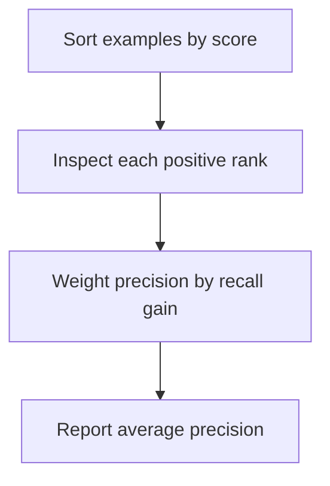

Average precision (AP) summarizes a binary classifier's precision-recall tradeoff across score thresholds. It weights precision by the increase in recall when additional actual positives enter the ranked list. AP emphasizes how effectively a system places positive examples near the top, making it particularly useful when the positive class is rare and reviewer capacity is limited.

## Stepwise area, not arbitrary trapezoids

For recall levels $R_n$ and corresponding precision values $P_n$, $\operatorname{AP}=\sum_n(R_n-R_{n-1})P_n$. With unweighted examples and distinct scores, this is the average of the precision values at the ranks where positive examples appear. AP uses a stepwise sum over recall increments; trapezoidal area is a distinct calculation, so reports should name the exact statistic and implementation.

## Example

Four ranked access requests have labels `[1, 0, 1, 0]`. The first positive appears at rank one, where precision is $1/1=1$. The second appears at rank three, where precision is $2/3$. Their average is $(1+2/3)/2=5/6\approx0.833$. Moving the second positive below another negative would reduce AP even if the total positive count remained unchanged.

## Why it matters here

Classifier lessons distinguish ranking quality, thresholded interventions, and calibrated probabilities. AP reveals how many false alarms accompany high-recall operation on rare positives, while deployment still requires a concrete threshold, class prevalence, review capacity, and explicit error costs.

## Related terms

- [Precision](glossary://precision)
- [Recall](glossary://recall)
- [ROC-AUC](glossary://roc-auc)
